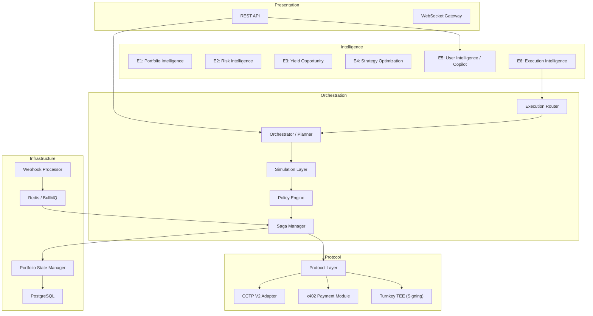
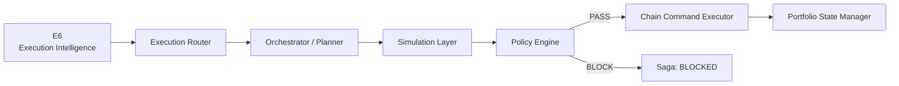

# CrestFlow

CrestFlow is a non-custodial, AI-augmented DeFi portfolio management platform. Users define investment goals and risk preferences; the system autonomously analyses their portfolio, generates strategy plans, and executes multi-step DeFi operations across EVM and Solana networks — with compliance enforced at every step.

The platform integrates AI-driven intelligence engines, deterministic transaction orchestration, cross-chain bridging, and a micropayment-gated knowledge layer into a cohesive system designed for trust, auditability, and extensibility.

---

## Table of Contents

1. [Architecture Overview](#1-architecture-overview)
2. [Intelligence Engines](#2-intelligence-engines)
3. [Execution Pipeline](#3-execution-pipeline)
4. [Policy Engine](#4-policy-engine)
5. [User Paths](#5-user-paths)
6. [Key Protocols](#6-key-protocols)
7. [Supported Networks and Venues](#7-supported-networks-and-venues)
8. [Technology Stack](#8-technology-stack)
9. [Database Schema](#9-database-schema)
10. [KYC and Identity](#10-kyc-and-identity)
11. [Release Gates](#11-release-gates)
12. [Repository Structure](#12-repository-structure)
13. [Documentation Index](#13-documentation-index)
14. [Implementation Validations and Known Limitations](#14-implementation-validations-and-known-limitations)

---

## 1. Architecture Overview

The system is organized into five logical layers. Each layer has a strict directional dependency on the layer below it; no layer calls upward.

| Layer | Components | Responsibility |
|---|---|---|
| **Presentation** | REST API, WebSocket gateway | Ingress, authentication, request routing |
| **Intelligence** | Engines 1–6, Copilot | Portfolio analysis, risk scoring, yield ranking, strategy generation, execution intent |
| **Orchestration** | Orchestrator/Planner, Execution Router, Policy Engine, Saga Manager | Plan-to-transaction translation, compliance enforcement, state management |
| **Protocol** | Protocol Layer, bridge adapters, payment module | Chain-specific transaction construction and signing |
| **Infrastructure** | PostgreSQL, Redis, BullMQ, webhook processors, provider health monitor | Persistence, job queuing, event ingestion, liveness |



---

## 2. Intelligence Engines

Six independent engines read from the Portfolio State Manager and produce scored, ranked, or structured output. They do not call each other directly.

| Engine | Name | Responsibility |
|---|---|---|
| E1 | Portfolio Intelligence | Snapshot composition, concentration scoring (HHI), weighted average cost basis |
| E2 | Risk Intelligence | Composite risk scoring (0–100), alert generation, persona-adjusted multipliers |
| E3 | Yield Opportunity | Multi-criteria yield ranking across supported lending and liquidity venues |
| E4 | Strategy Optimization | Drift detection, rebalancing plan generation, economic viability gating |
| E5 | User Intelligence / Copilot | Natural-language goal profiling, persona modelling, AI-generated guidance |
| E6 | Execution Intelligence | Authority resolution, urgency prioritisation, execution intent construction |

---

## 3. Execution Pipeline

Every execution request traverses a fixed, non-bypassable sequence. No component may reorder or skip steps.



Each execution is tracked as a saga — a durable state machine that progresses through stages covering routing, building, simulation, policy evaluation, signing, broadcasting, and confirmation. Cross-chain transfers include additional attestation and minting stages. All failure states trigger compensating actions where applicable.

---

## 4. Policy Engine

All nine checks execute on every request without short-circuiting. Each check produces an auditable result record; the engine aggregates into a single policy decision.

| # | Check |
|---|---|
| 1 | KYC Gate — user must hold an approved KYC status |
| 2 | KYC Tier Daily Limit — enforces per-tier daily transaction volume caps |
| 3 | Execution Authority — wallet path must grant the requested execution mode |
| 4 | Risk Gate — risk score snapshot must be within the freshness window |
| 5 | Chain Allowlist — destination chain must be in the approved set |
| 6 | Protocol Allowlist — target venue must be in the approved registry |
| 7 | Per-Transaction Value Limit — enforces per-transaction USD cap by tier |
| 8 | Slippage Tolerance — simulated slippage must not exceed configured threshold |
| 9 | Action Type Restrictions — action type must be permitted for the user's tier and mode |

---

## 5. User Paths

| Attribute | Path A — Embedded Wallet | Path B — External Wallet |
|---|---|---|
| Wallet custody | Turnkey TEE; private keys never in application memory | User-controlled; external signer |
| Signing | Programmatic via Turnkey | User-initiated manual signing |
| Supported modes | AUTOPILOT, MANUAL | READ_ONLY, MANUAL |
| Autonomous execution | Yes — AI-driven without per-transaction prompts | No |

---

## 6. Key Protocols

### Circle CCTP V2

Native USDC cross-chain transfers with two finality modes. Standard mode is permissionless and free; Fast mode uses a fee-quoted relay for significantly reduced latency. Both modes go through the same attestation-and-mint flow on the destination chain.

| Mode | Finality | Typical Latency |
|---|---|---|
| Standard | Full finality | ~60 minutes |
| Fast | Partial finality (relayed) | ~5 minutes |

### x402 Payment Protocol

An HTTP 402-based micropayment standard that gates access to AI-generated financial intelligence queries. Payments settle on Base in USDC via EIP-3009 authorization. A free daily quota is included; x402 is only triggered once that quota is exhausted.

### Turnkey TEE

All cryptographic signing is delegated to Turnkey's Trusted Execution Environment. The application never holds or accesses raw private keys. This applies to both EVM and Solana transaction signing for Path A users.

### Webhook Infrastructure

On-chain event confirmation is handled via authenticated webhooks from Alchemy (EVM networks) and Helius (Solana). All incoming webhook payloads are signature-verified before being queued for processing.

---

## 7. Supported Networks and Venues

| Environment | Networks |
|---|---|
| Mainnet | Ethereum, Base, Arbitrum, Solana |
| Testnet | Sepolia, Base Sepolia, Arbitrum Sepolia, Solana Devnet |

| Category | Venues |
|---|---|
| DEX (EVM) | Uniswap V3, Aerodrome |
| DEX (Solana) | Jupiter, Raydium |
| Lending (EVM) | Aave V3, Moonwell |
| Lending (Solana) | Kamino, MarginFi |
| Bridge | Circle CCTP V2 (USDC) |

---

## 8. Technology Stack

| Category | Technology |
|---|---|
| Language / Runtime | TypeScript, Node.js |
| Framework | NestJS |
| Database | PostgreSQL 16 |
| Cache and Queue | Redis, BullMQ |
| API | REST (OpenAPI 3.1), WebSocket |
| AI / LLM | Google Gemini Flash (primary), Gemini Flash Lite (fallback) |
| Signing | Turnkey TEE |
| KYC | HyperVerge |
| EVM Data | Alchemy |
| Solana Data | Helius |
| Bridge | Circle CCTP V2 |
| Micropayments | x402 Protocol |

---

## 9. Database Schema

The schema spans 29 tables across the following domains:

| Domain | Tables |
|---|---|
| Identity | Users, auth sessions, address scopes, KYC records |
| Goal and Portfolio | Goal profiles, portfolio snapshots, positions |
| Risk | Risk snapshots, risk alerts |
| Yield | Yield snapshots, yield opportunities |
| Strategy | Strategy plans, plan actions |
| Execution | Intents, actions, instructions, simulations, simulated actions |
| Policy | Policy decisions, policy check results |
| Saga | Executions, execution steps, CCTP transfers |
| Audit | Audit entries (range-partitioned), deduplication index |
| Payments | Payments, nonces |
| Operations | Webhook events, provider health |

---

## 10. KYC and Identity

KYC verification is tiered. Each tier carries a daily transaction volume limit, and the policy engine enforces these limits on every request. KYC state progresses through a defined lifecycle from initiation through approval, rejection, or expiry.

**Delegation** allows account holders to authorize a third party — an advisor or an automated agent — to trigger execution on their behalf. All delegated actions pass through the same nine-policy checks as direct user actions.

---

## 11. Release Gates

Deployment to mainnet requires all of the following criteria to be validated on testnet first:

- At least one successful swap on a supported EVM testnet
- At least one lending supply and withdrawal round-trip
- At least one CCTP cross-chain transfer in both Standard and Fast modes
- At least one x402-paid knowledge query following free quota exhaustion

---

## 12. Repository Structure

```
crestflow-product/
├── README.md
└── documentation/
    ├── 00_DOCUMENT_INDEX.md
    ├── 01_canonical/
    │   ├── CANONICAL_DECISIONS.md        # Architecture decisions and type standards
    │   └── canonical_schemas.md          # Domain types, enums, unit conventions
    ├── 02_architecture/
    │   ├── system_architecture.md
    │   ├── implementation_spec.md
    │   ├── policy_engine.md
    │   ├── orchestrator_planner.md
    │   ├── execution_router.md
    │   ├── protocol_layer.md
    │   ├── cross_chain_ecosystem.md
    │   ├── identity_kyc.md
    │   ├── user_onboarding.md
    │   ├── audit_layer_x402.md
    │   ├── financial_knowledge_layer.md
    │   ├── portfolio_state_manager.md
    │   ├── portfolio_state_analysis.md
    │   └── technical_reference.md
    ├── 03_engines/
    │   ├── engine1_portfolio_intelligence.md
    │   ├── engine2_risk_intelligence.md
    │   ├── engine3_yield_opportunity.md
    │   ├── engine4_strategy_optimization.md
    │   ├── engine5_user_intelligence.md
    │   └── engine6_execution_intelligence.md
    ├── 05_research_and_audits/
    │   ├── AUDIT_REPORT.md
    │   ├── REMEDIATION_REPORT.md
    │   ├── literature_survey.md
    │   └── integration_audit_report.md
    ├── 06_uml_diagrams/
    │   ├── README.md
    │   ├── *.mmd                         # 19 Mermaid diagram sources
    │   └── png/                          # 19 rendered PNGs
    └── assets/
        └── *.png                         # Architecture diagrams
```

---

## 13. Documentation Index

The master index at [`documentation/00_DOCUMENT_INDEX.md`](documentation/00_DOCUMENT_INDEX.md) lists every file with its class, owner, version, and scope.

The current diagram pack at [`documentation/06_uml_diagrams/README.md`](documentation/06_uml_diagrams/README.md) contains 19 Mermaid sources and their rendered PNGs, with notation, render instructions, and a decision-traceability matrix.

All canonical architecture decisions and type-level standards are consolidated in [`documentation/01_canonical/CANONICAL_DECISIONS.md`](documentation/01_canonical/CANONICAL_DECISIONS.md).

---

## 14. Implementation Validations and Known Limitations

All architecture and policy decisions are resolved in [`documentation/01_canonical/CANONICAL_DECISIONS.md`](documentation/01_canonical/CANONICAL_DECISIONS.md) v1.2. Remaining items are implementation validations, not open design choices; their gates are recorded in the decision record and in [`documentation/05_research_and_audits/REMEDIATION_REPORT.md`](documentation/05_research_and_audits/REMEDIATION_REPORT.md).

Implementation validations:

- **KYC provider:** HyperVerge is selected pending the D9 two-week sandbox/webhook spike; Persona or Sumsub is the fallback.
- **Solana signing:** Turnkey TEE signing on Solana Devnet must validate key-type compatibility before release.
- **x402 facilitator:** Production uses the official facilitator on Base; testnet availability is validated during integration.
- **Fast CCTP fees:** The quoted fee cap is defined in D5; the adapter must source the live quote before enabling Fast.
- **Perpetuals execution:** GMX is read-only in MVP (D2); automated perpetual execution stays Phase 2.
