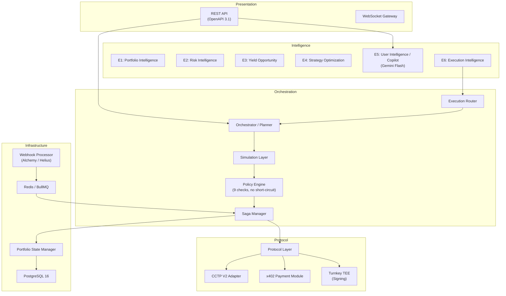
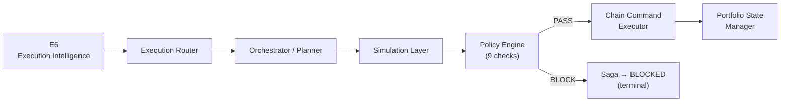

# CrestFlow

CrestFlow is a non-custodial, AI-augmented DeFi portfolio management backend. Users define investment goals through a natural-language copilot interface; six specialized intelligence engines then analyse portfolio composition, score risk, rank yield opportunities, and generate a deterministic execution plan. That plan is routed through a mandatory nine-check policy engine before any on-chain action is taken — ensuring every transaction is compliant, authorized, and within the user's risk parameters.

The system operates across EVM-compatible networks (Ethereum, Base, Arbitrum) and Solana, supporting spot swaps, lending, liquidity provision, and USDC cross-chain transfers via Circle CCTP V2. Cryptographic signing is handled exclusively by Turnkey's Trusted Execution Environment — private keys never enter application memory. A lightweight x402 micropayment layer gates access to AI-generated financial intelligence, settling at \$0.01 per query on Base USDC.

CrestFlow exposes two integration paths: **Path A** provides a fully embedded wallet with autonomous AUTOPILOT execution; **Path B** accommodates externally-managed wallets in a manual or read-only capacity. Both paths share the same execution pipeline, policy enforcement, and audit trail.

---

## Table of Contents

1. [Architecture Overview](#1-architecture-overview)
2. [Intelligence Engines](#2-intelligence-engines)
3. [Execution Pipeline](#3-execution-pipeline)
4. [Policy Engine](#4-policy-engine)
5. [User Paths](#5-user-paths)
6. [Key Protocols](#6-key-protocols)
7. [Supported Networks and Venues](#7-supported-networks-and-venues)
8. [Technology Stack](#8-technology-stack)
9. [Database Schema](#9-database-schema)
10. [KYC and Identity](#10-kyc-and-identity)
11. [Release Gates](#11-release-gates)
12. [Repository Structure](#12-repository-structure)
13. [Documentation Index](#13-documentation-index)
14. [Open Decisions and Known Limitations](#14-open-decisions-and-known-limitations)

---

## 1. Architecture Overview

The system is organized into five logical layers. Each layer has a strict directional dependency on the layer below it; no layer calls upward.

| Layer | Components | Responsibility |
|---|---|---|
| **Presentation** | REST API (OpenAPI 3.1), WebSocket gateway | Ingress, authentication, request routing |
| **Intelligence** | Engines 1–6, Copilot (E5) | Portfolio analysis, risk scoring, yield ranking, strategy generation, execution intent |
| **Orchestration** | Orchestrator/Planner, Execution Router, Policy Engine, Saga Manager | Deterministic plan-to-transaction translation, compliance enforcement, state management |
| **Protocol** | Protocol Layer, CCTP bridge adapters, x402 payment module | Chain-specific transaction construction and signing via Turnkey TEE |
| **Infrastructure** | PostgreSQL 16, Redis, BullMQ, Alchemy/Helius webhooks, provider health monitor | Persistence, job queuing, event ingestion, liveness |



---

## 2. Intelligence Engines

All six engines are independent computation units. They read from the Portfolio State Manager and write scored, ranked, or structured output to their respective snapshot tables. They do not call each other directly.

| Engine | Name | Core Output | Key Algorithm / Metric |
|---|---|---|---|
| E1 | Portfolio Intelligence | `PortfolioSnapshot`, HHI, WAC | Herfindahl-Hirschman Index; WAC = weighted average cost basis |
| E2 | Risk Intelligence | `riskScore` (0–100), `RiskAlert[]` | Composite score with persona multipliers; bands: 0–39 LOW, 40–59 MEDIUM, 60–79 HIGH, 80–100 CRITICAL |
| E3 | Yield Opportunity | Ranked `YieldOpportunity[]` | TOPSIS over 5 criteria: Net APY, Protocol Safety, Yield Consistency (1/CV), Liquidity, IL Risk |
| E4 | Strategy Optimization | `StrategyPlan`, `PlanAction[]` | Drift detection, cooldown enforcement, economic viability gate |
| E5 | User Intelligence / Copilot | `GoalProfile`, natural-language guidance | Gemini Flash (primary), Gemini Flash Lite (fallback); persona profiling |
| E6 | Execution Intelligence | `ExecutionIntent[]` | Authority filter → DriftUrgency waterfall → intent construction |

**HHI concentration bands:** <1500 Low — 1500–2500 Moderate — 2500–5000 High (new positions blocked above 2500) — >5000 Critical.

**Yield metric identifier:** `twapApy7dPercent` (seven-day TWAP; never thirty-day).

---

## 3. Execution Pipeline

Decision D7 defines the canonical, non-negotiable execution order. No component may bypass this sequence.



**Saga state machine — 18 states:**

`CREATED → ROUTING → BUILDING → SIMULATING → POLICY_CHECK`

From `POLICY_CHECK`:
- Block path: `→ BLOCKED` (terminal)
- Path A (Turnkey): `→ SIGNING → BROADCASTING → AWAITING_CONFIRMATION`
- Path B (external): `→ AWAITING_SIGNATURE → SIGNING → BROADCASTING → AWAITING_CONFIRMATION`
- CCTP extension: `→ AWAITING_ATTESTATION → MINTING`

Final: `→ CONFIRMING → COMPLETED`

Failure: `→ FAILED → COMPENSATING → COMPENSATED` or `→ PAUSED`

**Amount encoding:** `amountIn` is always an integer string in base units (e.g., `"1000000"` for 1 USDC). Decimal representations are rejected at the protocol layer.

**Action type identifiers:** `LEND_SUPPLY` and `LEND_WITHDRAW` (never `LEND_DEPOSIT`).

---

## 4. Policy Engine

All nine checks execute on every request. There is no short-circuit evaluation — a failure on check 1 does not skip checks 2–9. Each check emits a `PolicyCheckResult` row; the engine aggregates into a `PolicyDecision`.

| # | Check | Failure behavior |
|---|---|---|
| 1 | KYC Gate | Blocks if `kycStatus ≠ APPROVED` |
| 2 | KYC Tier Daily Limit | TIER_1: \$1k/day — TIER_2: \$10k/day — TIER_3: unlimited |
| 3 | Execution Authority | Verifies wallet path grants the requested mode (AUTOPILOT / MANUAL / READ_ONLY) |
| 4 | Risk Gate | Rejects if `riskScore` snapshot age > 4 hours |
| 5 | Chain Allowlist | Rejects chains outside the approved set |
| 6 | Protocol Allowlist | Rejects venues not in the approved registry |
| 7 | Per-Transaction Value Limit | Enforces per-tx USD cap by tier |
| 8 | Slippage Tolerance | Rejects if simulated slippage exceeds user or system tolerance |
| 9 | Action Type Restrictions | Blocks action types not permitted for the user's current tier/mode |

---

## 5. User Paths

| Attribute | Path A — Turnkey Embedded Wallet | Path B — External Wallet |
|---|---|---|
| Wallet custody | Turnkey TEE; no private key in application memory | User-controlled; external signer |
| Signing | Programmatic via Turnkey API | User signs manually (AWAITING_SIGNATURE state) |
| Supported modes | AUTOPILOT, MANUAL | READ_ONLY, MANUAL |
| AUTOPILOT execution | Yes — E6 initiates autonomously | No |
| Account abstraction | None — ERC-4337 and session keys are out of scope (D1) | None |
| GMX integration | Read-only display only (D2) | Read-only display only (D2) |

---

## 6. Key Protocols

### Circle CCTP V2 (D3, D5)

Cross-chain USDC transfers only. No token other than USDC is supported at the bridge layer.

**Call signature:**
```
depositForBurn(
  amount,                  // base units integer
  destinationDomain,       // ETH=0, ARB=3, SOL=5, BASE=6
  mintRecipient,
  burnToken,               // USDC contract on source chain
  destinationCaller=0x0,   // permissionless relay
  maxFee,
  minFinalityThreshold
)
```

**Modes:**

| Mode | maxFee | minFinalityThreshold | Typical latency |
|---|---|---|---|
| Standard | 0 | 2000 | ~60 minutes |
| Fast | Quoted (cap: min(0.10%, \$5)) | 1000 | ~5 minutes |

### x402 Payment Protocol (D4, T17)

HTTP 402-based micropayment for AI knowledge-layer queries. Facilitator: `https://x402.org/facilitator`. Settlement chain: Base USDC. Payment scheme: `exact`. Authorization standard: EIP-3009.

- Price per query: \$0.01 USDC
- Free quota: 10 queries per day per user
- x402 is only triggered after the free quota is exhausted

### Turnkey TEE (D10)

All cryptographic signing operations are delegated to Turnkey's Trusted Execution Environment. The CrestFlow application never holds or has access to raw private keys. Signing requests are authenticated via Turnkey API credentials and executed within the enclave.

### Webhooks

- **Alchemy** (EVM confirmation events): HMAC SHA-256 signature verified against `X-Alchemy-Signature` header.
- **Helius** (Solana events): Static `authHeader` token combined with a secret URL path.

---

## 7. Supported Networks and Venues

**MVP chains:**

| Environment | Chains |
|---|---|
| Mainnet | Ethereum, Base, Arbitrum, Solana |
| Testnet | Sepolia, Base Sepolia, Arbitrum Sepolia, Solana Devnet |

**Execution venues:**

| Category | Chain | Venue |
|---|---|---|
| DEX | Ethereum / Base / Arbitrum | Uniswap V3 |
| DEX | Base | Aerodrome |
| DEX | Solana | Jupiter (`/order` + `/build` endpoints), Raydium |
| Lending | Ethereum / Base / Arbitrum | Aave V3 |
| Lending | Base | Moonwell |
| Lending | Solana | Kamino, MarginFi |
| Bridge | ETH ↔ ARB ↔ BASE ↔ SOL | Circle CCTP V2 (USDC only) |

---

## 8. Technology Stack

| Category | Technology | Detail |
|---|---|---|
| Runtime | Node.js / TypeScript | Strict mode; shared types via `@crestflow/pool-type` |
| Framework | NestJS | Modular architecture; dependency injection |
| Primary database | PostgreSQL 16 | 29 tables; `audit_entries` range-partitioned |
| Cache / queue | Redis + BullMQ | Job queues for saga workers, engine pipelines |
| API specification | OpenAPI 3.1 | REST; WebSocket for real-time saga state events |
| Primary LLM | Google Gemini Flash | Copilot (E5) natural-language interface |
| Fallback LLM | Google Gemini Flash Lite | Automatic failover when primary is unavailable |
| Signing | Turnkey TEE | Programmatic non-custodial signing (Path A) |
| KYC provider | HyperVerge | Conditional — pending integration validation (D9) |
| EVM data | Alchemy | Webhooks + RPC |
| Solana data | Helius | Webhooks + RPC |
| Bridge | Circle CCTP V2 | Cross-chain USDC only |
| x402 facilitator | x402.org | HTTP 402 micropayment settlement on Base |

**Shared library:** `@crestflow/pool-type` is imported by E1, E2, E3, E4, E6, the Execution Router, the Protocol Layer, and the Policy Engine. All shared domain types, enums, and units are defined here.

---

## 9. Database Schema

The schema contains 29 tables organized by domain:

| Domain | Tables |
|---|---|
| Identity | `users`, `auth_sessions`, `address_scopes`, `kyc_records` |
| Goal and portfolio | `goal_profiles`, `portfolio_snapshots`, `positions` |
| Risk | `risk_snapshots`, `risk_alerts` |
| Yield | `yield_snapshots`, `yield_opportunities` |
| Strategy | `strategy_plans`, `plan_actions` |
| Execution intent | `execution_intents`, `execution_actions`, `execution_instructions` |
| Simulation | `simulations`, `simulated_actions` |
| Policy | `policy_decisions`, `policy_check_results` |
| Saga execution | `executions`, `execution_steps`, `cctp_transfers` |
| Audit | `audit_entries` (range-partitioned), `audit_event_dedupe` |
| Payments | `payments`, `nonces` |
| Operations | `webhook_events`, `provider_health` |

---

## 10. KYC and Identity

**Provider:** HyperVerge (D9 — selected pending integration validation).

**KYC lifecycle states:** `NOT_STARTED → PENDING → UNDER_REVIEW → APPROVED | REJECTED | EXPIRED`

**Tiers and limits:**

| Tier | Daily transaction limit |
|---|---|
| TIER_1 | \$1,000 |
| TIER_2 | \$10,000 |
| TIER_3 | Unlimited |

**Delegation lifecycle states:** `NONE → REQUESTED → ACTIVE → SUSPENDED | REVOKED`

Delegation grants a third party (advisor or automated agent) the ability to trigger execution on behalf of the account holder, subject to the same nine-policy checks.

---

## 11. Release Gates

Deployment to mainnet is blocked until all of the following testnet criteria are met:

| Criterion | Network |
|---|---|
| At least one successful swap | Sepolia or Base Sepolia |
| At least one Aave V3 `LEND_SUPPLY` and `LEND_WITHDRAW` round-trip | Any supported testnet |
| At least one CCTP V2 cross-chain transfer (Standard and Fast modes) | Testnet CCTP domains |
| At least one x402-paid knowledge query (post free-quota exhaustion) | Base Sepolia (x402 facilitator) |

---

## 12. Repository Structure

```
crestflow-product/
├── README.md
└── documentation/
    ├── 00_DOCUMENT_INDEX.md          # Master index with file descriptions and version history
    ├── 01_canonical/
    │   ├── CANONICAL_DECISIONS.md    # D1–D10 architecture decisions, T1–T17 type standards (v1.2)
    │   └── canonical_schemas.md      # All domain types, enums, unit conventions
    ├── 02_architecture/
    │   ├── system_architecture.md    # Five-layer topology (v2.0)
    │   ├── implementation_spec.md    # DB schema, API, saga, gas, security (v1.0)
    │   ├── policy_engine.md          # Nine-check policy specification (v2.0)
    │   ├── orchestrator_planner.md
    │   ├── execution_router.md
    │   ├── protocol_layer.md
    │   ├── cross_chain_ecosystem.md
    │   ├── identity_kyc.md
    │   ├── user_onboarding.md
    │   ├── audit_layer_x402.md
    │   ├── financial_knowledge_layer.md
    │   ├── portfolio_state_manager.md
    │   ├── portfolio_state_analysis.md
    │   ├── technical_reference.md
    │   └── technical_reference_summary.md
    ├── 03_engines/
    │   ├── engine1_portfolio_intelligence.md
    │   ├── engine2_risk_intelligence.md
    │   ├── engine3_yield_opportunity.md
    │   ├── engine4_strategy_optimization.md
    │   ├── engine5_user_intelligence.md
    │   └── engine6_execution_intelligence.md
    ├── 04_uml_pack/
    │   ├── 00_INDEX.md               # UML pack index and construction order
    │   ├── 01_component_diagram.md
    │   ├── 02_class_diagram.md
    │   ├── 03_seq_onboarding_kyc.md
    │   ├── 04_seq_policy_evaluation.md
    │   ├── 05_seq_transaction_execution.md
    │   ├── 06_seq_cctp_bridge.md
    │   ├── 07_seq_x402_payment.md
    │   ├── 08_state_saga_lifecycle.md
    │   ├── 09_state_kyc_lifecycle.md
    │   ├── 10_state_delegation_lifecycle.md
    │   ├── 11_deployment_diagram.md
    │   ├── 12_BE_system_architecture.md
    │   ├── 13_BE_dfd_level0.md
    │   ├── 14_BE_dfd_level1.md
    │   ├── 15_BE_use_case.md
    │   ├── 16_BE_activity_diagram.md
    │   ├── 17_BE_er_diagram.md
    │   ├── 18_project_gantt.md
    │   ├── 19_project_sdlc.md
    │   └── 20_unresolved_decisions.md
    ├── 05_research_and_audits/
    │   ├── AUDIT_REPORT.md
    │   ├── literature_survey.md
    │   ├── CrestFlow Literature Survey Papers List.csv
    │   ├── integration_audit_report.md
    │   └── legacy_DOCUMENT_INDEX_v1.md
    └── assets/
        ├── system-architecture-post-pivot.png
        ├── system-architecture-pre-pivot.png
        └── system-architecture-before-pivot-legacy.png
```

---

## 13. Documentation Index

The master documentation index is at [`documentation/00_DOCUMENT_INDEX.md`](documentation/00_DOCUMENT_INDEX.md). It lists every file with its version, status (finalized / draft / proposed), and a one-line description.

The UML and architecture specification pack index is at [`documentation/04_uml_pack/00_INDEX.md`](documentation/04_uml_pack/00_INDEX.md). It documents the construction order, dependencies between diagrams, and the recommended sequence for recreating diagrams in Lucidchart.

Canonical architecture decisions (D1–D10) and type standards (T1–T17) are consolidated in [`documentation/01_canonical/CANONICAL_DECISIONS.md`](documentation/01_canonical/CANONICAL_DECISIONS.md). All component specifications and diagrams are cross-referenced against this file.

---

## 14. Open Decisions and Known Limitations

Unresolved architectural questions, flagged contradictions, and decisions marked as conditional or pending validation are documented in [`documentation/04_uml_pack/20_unresolved_decisions.md`](documentation/04_uml_pack/20_unresolved_decisions.md).

Key open items include:

- **D9 — HyperVerge KYC:** Selected pending integration validation. Fallback provider not yet decided.
- **GMX integration (D2):** Currently read-only display only. Automated execution is out of scope but not permanently closed.
- **Solana signing via Turnkey:** TEE support for Solana key types requires validation.
- **x402 testnet availability:** The `x402.org/facilitator` endpoint's testnet support is unconfirmed.
- **ERC-4337 and session keys:** Explicitly out of scope (D1). Any future Path A enhancement would require a new decision record.
- **Fast CCTP fee cap implementation:** The `min(0.10%, $5)` cap requires a fee-quoting integration step not yet fully specified.

---

*CrestFlow is a backend-only system. It does not include a frontend application. All interaction occurs through the documented REST API and WebSocket interface.*
