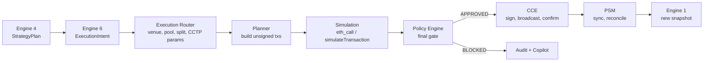

# CrestFlow Canonical Decisions

**Status:** Authoritative  
**Version:** 1.2  
**Decision date:** 18 November 2026  
**Supersedes:** Every conflicting statement in the planning documents listed in §7.  
**Owner:** Architecture / Product  
**Change control:** Any change to a decision in this file requires a new version, a dated entry in §8, and updates to every document that references it.

---

## 1. How to use this document

This file is the single source of truth for architectural decisions. Other documents must **link** to the relevant decision instead of restating it. If a document disagrees with this file, this file wins.

The repository uses three document classes:

| Class | Meaning | Examples |
|---|---|---|
| **Authoritative** | Defines a contract; other documents must conform. | `CANONICAL_DECISIONS.md`, `docs/policy_engine.md`, `docs/canonical_schemas.md` |
| **Component** | Defines a component's internal algorithm and owns its local schema extensions. | `docs/engine1_portfolio_intelligence.md` … `docs/engine6_execution_intelligence.md` |
| **Derived** | Summary, index, historical record, or literature review. Must not define new contracts. | `core_documents/technical_reference.md`, `docs/technical_reference.md`, `core_documents/literature_survey.md`, `docs/integration_audit_report.md` |

### 1.1 Source-of-truth hierarchy

1. `CANONICAL_DECISIONS.md` — decisions D1–D10 and T1–T17.
2. `docs/canonical_schemas.md` — canonical TypeScript types, enums, units, and invariants.
3. `docs/policy_engine.md` — the nine policy checks and their predicates.
4. Component documents — algorithms and component-local behaviour.
5. `docs/technical_reference.md` — cross-cutting index; it links, it does not redefine.
6. `core_documents/system_architecture.md` — topology and component boundaries only.
7. `core_documents/technical_reference.md` — derived summary; never an implementation contract.
8. `docs/integration_audit_report.md` — historical; not evidence of current consistency.

### 1.2 Execution order at a glance



**One pass, simulation before policy.** Engine 6 and Engine 4 perform pre-filters (authority, economics), but the authoritative Policy decision runs on the `SimulationPassedPackage`. There is no second policy stage in MVP.

---

## 2. Product decisions (D1–D10)

### D1 — Path B is read-only plus manual execution

**Decision:** External wallets (MetaMask, Phantom, and any non-Turnkey wallet) are **read-only tracking accounts** with **manual execution**. CrestFlow generates analysis, alerts, and plan previews. The user signs every transaction in their own wallet. Autonomous execution is available only through the embedded Turnkey wallet (Path A).

**Consequences:**

- No ERC-4337 session keys, no EIP-7702 delegation, no SPL `delegate` for Path B in MVP.
- `address_scope.executionMode` is `AUTOPILOT` (embedded only), `MANUAL` (external, user-signed), or `READ_ONLY` (watch-only, no execution).
- Policy Check 3 distinguishes `AUTOPILOT` (Turnkey delegation must be active) from `MANUAL` (ownership verified; user signature required at broadcast).
- CCTP mint recipient for Path B is the user's external wallet, because the user signs the mint.
- Path B cannot rebalance Aave/Uniswap/Kamino/MarginFi positions automatically; this is a documented product limitation, not an implementation gap.
- Path B receives a `MANUAL_EXECUTION_REQUIRED` package with unsigned transactions and a deep link or wallet-connect payload.

**Rejected alternatives:** smart-account migration (ERC-4337/EIP-7702) and token-only custody vault. Both remain Phase 2 options; neither is in MVP.

**Audit findings resolved:** C-03, X-13, X-14 (delegation part), plus the Path B claims in `technical_reference.md`, `protocol_layer.md`, `cross_chain_ecosystem.md`, `portfolio_state_analysis.md`, `user_onboarding.md`.

### D2 — GMX is manual-only

**Decision:** GMX positions are tracked, valued, and displayed. They are **not** part of the automated sourcing waterfall, Router Job 3, or automated Policy branches. If a plan needs liquidity and the only source is a GMX position, Engine 6 emits a `MANUAL_REVIEW_REQUIRED` task instead of an automated plan.

**Consequences:**

- `gmx_gm_pool` remains a `poolType` for classification and reporting only.
- No `LP_ADD` / `LP_REMOVE` actions are generated for GMX.
- Protocol Layer exposes a **read-only** GMX position reader; no GMX deposit/withdraw adapter in MVP.
- Policy has no GMX-specific branch.
- The async `AWAITING_FULFILLMENT` saga state is retained for future GMX automation but is unreachable in MVP.

**Audit findings resolved:** H-04, X-30, plus the GMX dead paths in `engine4`, `engine6`, `execution_router`, `policy_engine`.

### D3 — Non-USDC cross-chain bridging is out of MVP

**Decision:** MVP cross-chain execution is **CCTP V2 USDC only**. Any non-USDC cross-chain action fails closed with `UNSUPPORTED_BRIDGE`. The `BRIDGE_AGGREGATOR` mechanism is removed from the runtime enum. LI.FI/Socket are documented as Phase 2 candidates.

**Consequences:**

- `BridgeMechanism` is `CCTP_V2` only in MVP.
- Engine 4's cross-chain cost model only models CCTP.
- Engine 6 emits `UNSUPPORTED_BRIDGE` plus a manual-review task for non-USDC cross-chain intents.
- Orchestrator/Planner and Protocol Layer contain no bridge-aggregator adapter.
- `system_architecture.md` open item is resolved: "Phase 2 vendor evaluation, not MVP."

**Audit findings resolved:** H-05, X-31.

### D4 — x402 uses the official facilitator and per-query pricing

**Decision:** Paid Copilot access uses **x402 V2** with the official facilitator `https://x402.org/facilitator`, **Base USDC**, CAIP-2 network identifiers, and the `exact` scheme with EIP-3009 `transferWithAuthorization`. Permit2 is not part of the MVP x402 settlement path. Pricing is **$0.01 per paid query**, with **10 free queries per user per day**. No subscription in MVP.

**Consequences:**

- Headers: `PAYMENT-REQUIRED` (server → client), `PAYMENT-SIGNATURE` (client → server), `PAYMENT-RESPONSE` (server → client).
- Networks: `eip155:8453` (Base mainnet), `eip155:84532` (Base Sepolia), and Solana CAIP-2 if Solana payments are enabled later.
- The client signs an EIP-3009 authorization; it does **not** send a transaction hash.
- Replay protection uses the authorization's `validAfter`/`validBefore` and the facilitator's settlement nonce, not a custom 15-minute/24-hour Redis nonce.
- Settlement occurs only for successful responses; 5xx responses are not charged.
- The dead `api.goplusfable.xyz` facilitator is removed.

**Audit findings resolved:** C-05, X-36 (payment part).

### D5 — CCTP V2: Standard by default, Fast opt-in

**Decision:** CCTP V2 is the only bridge. **Standard** is the default (no protocol fee). **Fast** is opt-in only for `HIGH` urgency, with a route-specific `maxFee` quote and a fee cap of **0.10% of the transfer or $5, whichever is lower**. The adapter uses the V2 `depositForBurn` signature with `destinationCaller`, `maxFee`, and `minFinalityThreshold`.

**Parameters:**

| Parameter | Standard | Fast |
|---|---|---|
| `maxFee` | `0` | Quoted from Circle/Iris; capped as above |
| `minFinalityThreshold` | `2000` (finalized) | `1000` (confirmed) |
| Default timeout | 60 minutes | 5 minutes, then poll attestation |
| Fee disclosure | None | Expected received amount shown before signing |

**Recipient and caller policy:**

- `mintRecipient`: Path A = embedded Turnkey wallet; Path B = the user's external wallet (manual signing).
- `destinationCaller`: `0x0` in MVP (permissionless mint to the fixed recipient). A CrestFlow-only minter can be introduced later without changing the recipient model.
- `burnToken`: USDC on the source domain.
- Domain IDs: Ethereum `0`, Arbitrum `3`, Base `6`, Solana `5`.

**Ownership:**

- Router selects speed, source/destination domains, and fee parameters.
- Planner builds the burn transaction and the post-attestation mint template.
- CCE signs/broadcasts for Path A; the user signs for Path B.
- CCE polls Iris, builds the final mint transaction after attestation, and confirms.
- PSM reconciles balances after execution; it does not own the bridge lifecycle.

**Audit findings resolved:** C-04, X-09, X-10, X-11, X-12, M-04.

### D6 — Policy is the `policy_engine.md` nine checks

**Decision:** `docs/policy_engine.md` is the canonical policy catalog. The nine checks are:

1. KYC gate.
2. KYC tier daily limit.
3. Execution authority (Autopilot delegation or manual ownership).
4. Risk gate (`riskScore` vs `adjustedThreshold` + 4-hour freshness).
5. Chain allowlist.
6. Protocol allowlist.
7. Per-transaction value limit.
8. Slippage / price impact (`poolType`-aware).
9. Action-type restrictions (`GoalProfile.allowedActionTypes`).

**Moved out of Policy:**

- **Rebalance cooldown** → Engine 4 plan generation.
- **Gas/bridge payback** → Engine 4 economic gate.
- **Persona volatility bounds** → Engine 2 risk thresholds, surfaced through `RiskSnapshot.adjustedThreshold`.

**Semantics:**

- All nine checks run for every plan. No short-circuit. Failures are collected and returned as a complete set.
- Check order is cheap → expensive for latency, but every check still executes.
- `RiskSnapshot.riskScore` is the only risk-score field; `compositeRiskScore` is removed.
- `GoalProfile.allowedActionTypes` is required.
- Audit spend query uses `category = 'EXECUTION'`.
- GMX branches are removed because GMX is manual-only.
- Path B manual plans skip Check 3's delegation branch but require verified ownership and a user signature at broadcast.

**Audit findings resolved:** C-01, C-02, X-01, X-02, X-03, X-04, X-05, X-06, X-38, X-39.

### D7 — One-pass execution order

**Decision:** The canonical order is:

```
Engine 6 ExecutionIntent
  → Execution Router (venue/pool/split/CCTP parameters)
  → Planner (build unsigned transactions)
  → Simulation (eth_call / simulateTransaction with state overrides)
  → Policy Engine (final gate on SimulationPassedPackage)
  → CCE (sign, broadcast, confirm)
  → PSM (sync, reconcile)
```

**Consequences:**

- The Router runs **before** byte construction. It resolves venues, pools, split routes, aggregator calldata, and CCTP parameters.
- The Planner never builds from a bare `ExecutionIntent`; it builds from `ExecutionInstructions`.
- Policy sees resolved calldata, simulated balances, gas, and per-action slippage.
- Engine 6's authority filter and Engine 4's economic gates remain pre-filters, not policy.
- The Orchestrator owns the saga; it does not own routing or policy.

**Audit findings resolved:** C-01, C-06, H-01, X-06, X-07, X-32.

### D8 — Copilot uses Gemini 3.8 Flash with Flash-Lite fallback

**Decision:** Primary model: `google/gemini-3.8-flash`. Fallback: `google/gemini-flash-lite-latest`. Model IDs live in configuration, never in code. The deprecated `GPT-4.1-mini` and `Gemini 2.5 Flash` pins are removed.

**Consequences:**

- A provider abstraction allows adding OpenAI later without changing the engine.
- An evaluation set covers intent classification, numeric faithfulness, and refusal behaviour.
- Prompt-injection boundaries and tool-call allowlists are specified in the implementation spec.
- Model failure must not change a financial result; the Copilot falls back to deterministic templates.

**Audit findings resolved:** H-11, X-37.

### D9 — HyperVerge is conditional

**Decision:** Proceed with HyperVerge, but gate the build on a **two-week integration spike** covering sandbox access, webhook signature scheme, API version, tier mapping, and pricing. If the spike fails, switch to Persona or Sumsub. The BE report describes HyperVerge as **selected pending integration validation**, not verified.

**Consequences:**

- Do not claim WazirX scale or "30k checks/day" as a technical fact.
- Do not claim a verified HMAC scheme until the vendor document or sandbox confirms it.
- KYC state mapping is vendor-agnostic (`APPROVED`, `REJECTED`, etc.) with a documented adapter.
- A fallback vendor evaluation is prepared in parallel.

**Audit findings resolved:** M-06, E-25.

### D10 — Backend stack is TypeScript/NestJS

**Decision:** The BE report and UML target **TypeScript/NestJS**, PostgreSQL, Redis, and a managed queue (BullMQ). REST with OpenAPI 3.1. Turnkey TEE for signing. Testnets: Ethereum Sepolia, Base Sepolia, Arbitrum Sepolia, Solana Devnet.

**Consequences:**

- Canonical schemas are TypeScript interfaces and enums.
- NestJS modules map to engines, FKL, Policy, Orchestrator, Router, CCE, PSM, Audit, Identity, and Payments.
- BullMQ handles engine jobs, simulation jobs, bridge attestation polling, and webhook processing.
- Postgres is the system of record; Redis is cache/lock/queue, never the audit ledger.

**Audit findings resolved:** Missing stack/API/DB/deployment specifications.

---

## 3. Technical decisions (T1–T17)

### T1 — HHI

`HHI = Σ(share_i²) × 10,000`, computed separately for chain, protocol, and asset exposure. Range 0–10,000.

| Band | Range | Meaning |
|---|---|---|
| Low | `< 1,500` | Diversified |
| Moderate | `1,500–2,500` | Acceptable but monitored |
| High | `2,500–5,000` | Concentrated |
| Critical | `> 5,000` | Dangerous |

**Action rule:** Block new placements that would push any HHI above **2,500**. Emit a HIGH alert at 2,500–5,000 and a CRITICAL alert above 5,000. Do **not** force an unwind solely because HHI is high; forced reduction requires a separate risk trigger.

**Consumers:** Engine 1 health score, Engine 2 concentration alerts, Engine 4 placement constraint, Policy (via plan constraints). All use the same formula and bands.

**Audit findings resolved:** H-06, X-20.

### T2 — TOPSIS and APY

**Criteria (five):** Net APY, Protocol Safety, Yield Consistency (1/CV), Liquidity, IL Risk.

**Weights:** the persona table in `docs/engine3_yield_opportunity.md` is canonical (Capital Preservation 0.05/0.50/0.30/0.10/0.05, etc.).

**APY window:** 7-day time-weighted average with at least 7 daily points. Field name is `twapApy7dPercent`. The old `twapApy30dPercent` is removed.

**Post-TOPSIS gates:** 90-day payback and $25/year minimum remain filters, not TOPSIS criteria. Net switching benefit is handled by Engine 4 drift/cooldown, not by adding a sixth criterion.

**Missing IL:** protocols without a meaningful IL model (GMX, manual-only) are excluded from TOPSIS rather than assigned a synthetic score.

**Audit findings resolved:** H-07, X-21, X-22.

### T3 — Slippage

`effectiveCap = min(goalProfile.maxSlippagePercent, poolTypeCap(action.poolType))`.

| Pool type | Cap |
|---|---:|
| `stable_swap` | 0.25% |
| `correlated` | 0.50% |
| `constant_product` | 1.00% |
| `gmx_gm_pool` | Manual-only; not evaluated by Policy in MVP |

The persona value may lower the cap but never raise it. The hard maximum is 1.00%. Policy Check 8 enforces the effective cap on simulated slippage or price impact.

**Audit findings resolved:** H-07 (slippage part), X-39.

### T4 — Oracles

- **EVM:** Chainlink primary, Pyth fallback.
- **Solana:** Pyth primary.
- **Execution pricing:** on-chain oracle only. CoinGecko is for discovery, display, and ranking; it is never the execution price.
- **Staleness:** a feed older than 60 seconds blocks signing.
- **Cross-check:** Chainlink vs Pyth divergence above **1.5%** blocks signing on EVM. If only one feed exists, a DEX TWAP cross-check above **1%** blocks signing.
- **CoinGecko vs oracle divergence above 5%:** data-quality warning, not an execution halt.
- **L2 sequencer:** check the sequencer-uptime feed; if the sequencer is down, block signing.
- Feed addresses, decimals, and heartbeats live in the asset registry.

**Audit findings resolved:** H-08, X-24.

### T5 — Drift and cooldown

**Tolerance bands:** Capital Preservation / Conservative ±3%, Moderate ±5%, Aggressive / Yield Seeker ±7%.

**Drift tiers (retained from Engine 4):** LOW 2–7%, MEDIUM 7–15%, HIGH >15%.

**Precedence:** if drift is within the tolerance band, no plan is generated. If drift exceeds tolerance, the urgency tier applies. This removes the 2–3% overlap: a 2.5% drift with a 3% tolerance is "no action," not "LOW urgency."

**Cooldown:** Engine 4 suppresses new plans for 7 days after the last execution unless urgency is HIGH or an emergency risk override applies. Policy does not enforce cooldown.

**Ownership:** Engine 4 owns both tolerance and cooldown; `GoalProfile.driftTolerancePercent` and `GoalProfile.rebalancingFrequencyCap` are consumed, not duplicated.

**Audit findings resolved:** M-02, M-03, X-28, X-29.

### T6 — Cache

| Data | TTL |
|---|---:|
| Token prices (display) | 30 s |
| Wallet holdings | 30 s |
| Open positions | 30 s |
| Pool APY / TVL | 300 s |
| Protocol safety scores | 24 h |
| Historical daily prices | 24 h |
| Static asset metadata | 7 d |

Stale-while-revalidate is allowed up to **2× TTL** with `dataQuality = 'STALE'`. Beyond that, execution fails closed. Execution pricing is always re-quoted at build time; cache is for display and ranking only.

**Audit findings resolved:** H-08, X-23.

### T7 — Indexer and webhooks

- Poll cadence: Solana **500 ms**, EVM **1,500 ms**.
- `maxWait`: **10 s**. On timeout, set `dataQuality = 'PARTIAL'`, log `INDEXER_LAG_WARNING`, and let PSM continue with the last known state plus a 30-second re-sync.
- Alchemy Notify: verify `X-Alchemy-Signature` (HMAC SHA-256) with the signing key.
- Helius: verify the static `authHeader` and keep the webhook URL secret; Helius does not sign payloads.
- Deduplicate by provider event ID; order by block height and log index.
- Retries: provider defaults (Alchemy 10 min Free/PAYG, 1 h Enterprise; Helius 24 h).
- Reconciliation sweep: every **10 minutes**.
- `dataQuality` enum: `COMPLETE`, `PARTIAL`, `STALE`. It is carried on `PortfolioSnapshot` and consumed by Engine 1.

**Audit findings resolved:** H-14, X-25, M-16.

### T8 — KYC

**Statuses:** `PENDING`, `APPROVED`, `REJECTED`, `RESUBMISSION_REQUESTED`, `SUSPENDED`, `EXPIRED`.

**Tiers:**

| Tier | Basis | Daily execution limit |
|---|---|---:|
| `TIER_1` | Basic document + liveness | $1,000 |
| `TIER_2` | Enhanced document + source of funds | $10,000 |
| `TIER_3` | Institutional / manual review | Unlimited |

**Semantics:**

- All nine policy checks run; KYC failure does **not** short-circuit the others.
- Travel Rule is **Phase 3**.
- Sanctions rescreening: daily and on list update; a hit sets `SUSPENDED` and opens a manual review.
- `kycStatus` and `kycTier` are snapshotted into every audit entry.
- HyperVerge statuses map to the canonical enum; the adapter owns the mapping.

**Audit findings resolved:** H-09, X-15, X-16, M-13.

### T9 — Identity and auth

- Google `sub` is the stable identity anchor. `email` is mutable and never a foreign key.
- `User` stores `id`, `googleSub`, `email`, `kycStatus`, `kycTier`, `kycUpdatedAt`, `createdAt`.
- OAuth callback upserts by `googleSub`.
- Address scopes are a separate table with `userId`, `address`, `chain`, `executionMode`, `ownershipVerifiedAt`.
- Sessions use short-lived JWT access tokens plus refresh tokens.
- External address ownership is proven by a wallet signature challenge before the address is added for read-only tracking.
- Path A's Turnkey sub-organisation is the only signer for autonomous execution.

**Audit findings resolved:** H-10, X-17, M-15.

### T10 — Audit taxonomy

Audit entries use **two fields**:

**`category`:** `AUTH`, `KYC`, `EXECUTION`, `PREFERENCE`, `PAYMENT`, `SYSTEM`.

**`action`:** the set is **category-scoped**. The approved cross-cutting actions are `POLICY_EVALUATION`, `SIMULATION`, `SIGNING`, `BROADCAST`, `CONFIRMATION`, `FULFILLMENT`, `COMPENSATION`, `CIRCUIT_BREAKER`, `KYC_SUBMITTED`, `KYC_APPROVED`, `KYC_REJECTED`, `KYC_RESUBMISSION_REQUESTED`, `KYC_REVOKED`, `KYC_EXPIRED`, `GOAL_UPDATED`, `PAYMENT_SETTLED`, `PAYMENT_FAILED`. Completing the split requires the category-local actions listed in `docs/canonical_schemas.md` §13 (`LOGIN`, `LOGOUT`, `TOKEN_REFRESH`, `SESSION_REVOKED`, `WALLET_PROVISIONED`, `WALLET_LINKED`, `WALLET_VERIFIED`, `WALLET_REMOVED`, `PREFERENCE_UPDATED`, `AUTOPILOT_ENABLED`, `AUTOPILOT_DISABLED`, `PAYMENT_REQUIRED`, `PAYMENT_REPLAY_BLOCKED`, `CONFIG_CHANGED`, `ADAPTER_REGISTERED`, `ADAPTER_REMOVED`, `AUDIT_RECOVERED`). Every canonical KYC status transition has an action: `PENDING` creation (`KYC_SUBMITTED`), `APPROVED`, `REJECTED`, `RESUBMISSION_REQUESTED`, `SUSPENDED` (`KYC_REVOKED`), and `EXPIRED`. This is an implementation completion of the two-field taxonomy, not a change to the category set.

**Rules:**

- Policy spend queries use `category = 'EXECUTION'`.
- KYC events use `category = 'KYC'`; `PROFILE_CHANGE` is removed and replaced by `PREFERENCE`.
- Every entry carries `schemaVersion`, `eventId`, `userId`, `createdAt`, `executionGroupId?`, `txId?`, and the KYC snapshot.
- Append-only; no updates or deletes. Retention and partitioning are in the persistence spec.

**Audit findings resolved:** H-13, X-05, X-18, X-40.

### T11 — Shared libraries and nonce ownership

- One shared `@crestflow/pool-type` package owns pool classification, stable-swap detection, IL rules, and slippage caps. Engines 1–4, Engine 6, Policy, Router, and Protocol Layer import it. No reimplementation.
- CCE owns per-chain nonce allocation:
  - Postgres/Redis lease keyed by `chain + address`.
  - Gap detection, replacement, and cancellation.
  - One in-flight transaction per nonce.
  - The Orchestrator requests a nonce; it never allocates or signs.

**Audit findings resolved:** M-10, X-33, M-14 (nonce part).

### T12 — Venue roster

**MVP automated venues:**

- EVM: Aave V3, Uniswap V3, Aerodrome, Moonwell.
- Solana: Jupiter Swap API (`/order` + `/build`), Raydium, Kamino, MarginFi.
- GMX: read-only.

**Phase 2:** 1inch, UniswapX, Curve, Camelot.

**Rules:**

- Policy allowlist, Router venue list, and Protocol Layer adapter roster must match exactly.
- Any venue not in the MVP list is rejected with `UNSUPPORTED_VENUE`.
- Jupiter uses the current Swap API with a Developer Platform API key, not the legacy "V6 Aggregator" naming.
- UniswapX's intent-auction lifecycle is out of MVP; it is not treated as an aggregator.

**Audit findings resolved:** H-02, X-08, M-12.

### T13 — Risk score

- `RiskSnapshot.riskScore` is the only composite risk field. `compositeRiskScore` is removed.
- Scale: 0–100, higher = riskier.
- Bands: `0–39` LOW, `40–59` MEDIUM, `60–79` HIGH, `80–100` CRITICAL. These are the existing Engine 2 bands.
- Persona multipliers (Engine 2): Capital Preservation 0.5×, Conservative 0.7×, Moderate 1.0×, Aggressive 1.3×, Yield Seeker 1.15×.
- `adjustedThreshold = baselineThreshold × multiplier`; Policy Check 4 compares `riskScore` to `adjustedThreshold`.
- Snapshot freshness: 4 hours; stale snapshots block.
- If a component metric is unavailable, its weight is redistributed proportionally across available metrics (Engine 2 rule).

**Clarification:** The approved T13 summary used 25/50/75 band boundaries; remediation retains Engine 2's existing 0–39/40–59/60–79/80–100 boundaries to avoid changing alert behaviour. The approved intent (0–100, higher = riskier, persona-scaled threshold) is unchanged.

**Audit findings resolved:** C-02, M-06, X-03.

### T14 — Documentation governance

- `docs/policy_engine.md` is authoritative for policy.
- `docs/canonical_schemas.md` is authoritative for shared types and enums.
- Component documents own their algorithms and component-local extensions.
- `docs/technical_reference.md` is a derived index; it must link, not restate.
- `core_documents/system_architecture.md` owns topology only.
- `core_documents/technical_reference.md` is derived and must not define contracts.
- `docs/integration_audit_report.md` is historical.
- Every document gets a status block: `Status`, `Version`, `Last reviewed`, `Canonical references`, `Supersedes`.
- `docs/DOCUMENT_INDEX.md` lists every document, class, owner, and version.

**Audit findings resolved:** M-08, M-09, M-15, X-35, X-36.

### T15 — API, persistence, and deployment

- REST with OpenAPI 3.1.
- PostgreSQL 16 as the system of record.
- Redis for cache, locks, and queue coordination.
- BullMQ for background jobs.
- NestJS modules: `identity`, `portfolio`, `risk`, `yield`, `strategy`, `execution`, `policy`, `router`, `planner`, `orchestrator`, `cce`, `psm`, `audit`, `payments`, `fkl`.
- Turnkey TEE for signing; no private keys in application memory.
- Testnets: Ethereum Sepolia (`11155111`), Base Sepolia (`84532`), Arbitrum Sepolia (`421614`), Solana Devnet.
- Mainnet activation is a separate release gate.

**Audit findings resolved:** M-14, missing API/DB/deployment specs.

### T16 — Fiat on-ramp

Out of MVP. The onboarding flow links to a partner on-ramp only as an optional external step, with no CrestFlow custody, no embedded widget contract, and no shared KYC. Phase 2.

**Audit findings resolved:** M-14 (on-ramp part).

### T17 — x402 pricing

- $0.01 per paid Copilot query.
- 10 free queries per user per day.
- No subscription in MVP.
- The free-tier counter is per authenticated user, stored in Postgres, and reconciled with payment records.
- Failed (5xx) requests are not charged.
- Pricing lives in configuration, not code.

**Audit findings resolved:** D4 pricing, C-05.

---

## 4. Cascading implementation decisions

### 4.1 CCTP V2 contract parameters

```typescript
interface CctpV2BurnParams {
  amount: bigint;                 // USDC base units (6 decimals)
  destinationDomain: 0 | 3 | 5 | 6;
  mintRecipient: `0x${string}`;   // 32-byte padded address
  burnToken: `0x${string}`;
  destinationCaller: `0x${string}`; // 0x0 in MVP
  maxFee: bigint;                 // 0 for Standard; quoted for Fast
  minFinalityThreshold: 1000 | 2000;
}
```

- Standard: `maxFee = 0`, `minFinalityThreshold = 2000`.
- Fast: quoted `maxFee`, `minFinalityThreshold = 1000`, fee cap 0.10%/$5.
- The destination mint is a separate transaction after attestation; it is not embedded in the burn.
- Policy approves the bridge intent once; the mint is deterministic and re-simulated before signing.

### 4.2 Policy input and decision

```typescript
interface PolicyInput {
  user: User;
  goalProfile: GoalProfile;
  riskSnapshot: RiskSnapshot;
  addressScopes: AddressScope[];
  plan: StrategyPlan;
  simulation: SimulationPassedPackage;
  auditSpend24hUsd: number;
  autopilotConfig?: AutopilotConfig;
  policyVersion: string;
}

interface PolicyDecision {
  decision: 'APPROVED' | 'BLOCKED';
  checksRun: PolicyCheckResult[];
  failures: PolicyFailure[];
  policyVersion: string;
  decidedAt: string;
}
```

### 4.3 Amount and unit rules

- All monetary amounts are integer base units (`bigint` in TypeScript, `NUMERIC(78,0)` in Postgres) plus an explicit `decimals` and `symbol`.
- USD values are `NUMERIC(20,8)` and are estimates, never used for on-chain amounts.
- No decimal strings in execution objects.
- Rounding is always down for user-protective amounts (minimum received, maximum spend).

### 4.4 Execution modes

| Mode | Who signs | Automation | Policy Check 3 |
|---|---|---|---|
| `AUTOPILOT` | Turnkey TEE (embedded wallet) | Full | Turnkey delegation/session active |
| `MANUAL` | User's external wallet | None; user signs each tx | Ownership verified; signature checked at broadcast |
| `READ_ONLY` | Nobody | None | No execution allowed |

### 4.5 Status transition ownership

| Transition | Owner |
|---|---|
| Intent → route | Execution Router |
| Route → unsigned bytes | Planner |
| Bytes → simulation result | Planner |
| Simulation → policy decision | Policy Engine |
| Decision → signed tx | CCE (Autopilot) / user (Manual) |
| Signed tx → confirmation | CCE |
| Confirmation → portfolio sync | PSM |
| Any failure → audit | Audit Layer |

---

## 5. Canonical schemas

The canonical types are in `docs/canonical_schemas.md`. That file is authoritative for field names, types, enums, and invariants. Component documents may extend types but must not rename or duplicate canonical fields.

Key invariants:

1. `RiskSnapshot.riskScore` and `RiskSnapshot.adjustedThreshold` are the only risk fields Policy reads.
2. `GoalProfile.allowedActionTypes` is required and non-empty.
3. `ExecutionIntent` carries every field needed to route/build; no inference.
4. `SimulationPassedPackage` carries resolved instructions, simulation results, gas, and approvals.
5. `AuditEntry` uses `category` + `action`, `eventId`, and `schemaVersion`.
6. `PortfolioSnapshot.dataQuality` is one of `COMPLETE`, `PARTIAL`, `STALE`.
7. `BridgeMechanism` is `CCTP_V2` only in MVP.
8. `ExecutionMode` is `AUTOPILOT`, `MANUAL`, or `READ_ONLY`.

---

## 6. What changed from the audit findings

| Audit finding | Resolution |
|---|---|
| C-01 execution order | D7 one-pass order; all docs updated |
| C-02 policy catalog | D6 nine checks; `riskScore`; `allowedActionTypes`; `EXECUTION` category |
| C-03 delegated Path B | D1 read-only + manual; delegation claims removed |
| C-04 CCTP V2 | D5 V2 parameters, recipient, fee, ownership |
| C-05 x402 V2 | D4 official facilitator, V2 headers, EIP-3009, CAIP-2 |
| C-06 ExecutionIntent | §5 canonical schema; all fields and base units |
| H-01 Router | D7 Router before Planner; "does not route" removed |
| H-02 allowlist/venues | T12 direct venues; Policy/Router/Adapters aligned |
| H-03 Permit2 | Approval spec: one-time Permit2 approval; Aave uses EIP-2612 |
| H-04 GMX | D2 manual-only; dead branches removed |
| H-05 non-USDC | D3 out of MVP; fail closed |
| H-06 HHI | T1 four bands; block >2,500; critical >5,000 |
| H-07 TOPSIS/APY/slippage | T2 five criteria; 7-day TWAP; T3 caps |
| H-08 oracle/cache | T4 gates; T6 TTL table |
| H-09 KYC enums | T8 canonical statuses/tiers |
| H-10 identity | T9 `googleSub` anchor |
| H-11 LLM | D8 Gemini 3.8 Flash + Flash-Lite |
| H-12 E3→E4 | Engine 4 consumes `YieldOpportunitySnapshot`; event updated |
| H-13 audit taxonomy | T10 category/action split; KYC category |
| H-14 indexer | T7 500/1500 ms, 10 s, PARTIAL |
| M-01 E2/E3 parallel | Architecture and pipeline updated to parallel fan-out |
| M-02 cooldown | T5 Engine 4 only |
| M-03 drift overlap | T5 tolerance gate precedence |
| M-04 CCTP fees | D5 Standard/Fast, quoted fee, expected received |
| M-05 gas | Implementation spec: Base getL1Fee + operator fee; Arbitrum params |
| M-06 HyperVerge | D9 conditional spike |
| M-07 citations | Literature survey corrected; CSV deduped |
| M-08 integration report | Marked historical; claim corrected |
| M-09 assets | Renamed/moved; links updated |
| M-10 poolType | T11 single package |
| M-11 providers | Implementation spec: plans, limits, failover |
| M-12 aggregators | T12 Phase 2; Jupiter current API |
| M-13 FATF | T8 Travel Rule Phase 3 |
| M-14 missing specs | `docs/implementation_spec.md` |
| M-15 governance | T14 document index/status headers |

---

## 7. Documents affected

| Document | Action |
|---|---|
| `docs/policy_engine.md` | Canonical policy; rewritten checks 2/3/4/8/9; `PolicyInput`; no short-circuit; GMX removed |
| `docs/orchestrator_planner.md` | D7 order; Router before build; `SimulationPassedPackage` expanded; CCTP ownership; nonce via CCE |
| `docs/execution_router.md` | Router before Planner; venue roster; GMX/aggregators removed; CCTP params |
| `docs/protocol_layer.md` | CCTP V2; recipient policy; Permit2 correction; Path A only; adapter roster |
| `docs/cross_chain_ecosystem.md` | Path A signing; Base gas; Arbitrum params; CCTP ownership; nonce |
| `docs/portfolio_state_manager.md` | T7 indexer/webhooks; CCTP fee; bridge ownership; dataQuality |
| `docs/portfolio_state_analysis.md` | Read-only Path B; snapshot authority; address proof |
| `docs/financial_knowledge_layer.md` | T4/T6; provider contracts; direct RPC through FKL; Jupiter API |
| `docs/identity_kyc.md` | T8 statuses/tiers; no short-circuit; KYC audit category; Travel Rule Phase 3 |
| `docs/user_onboarding.md` | T9 identity; KYC step; Path B read-only; Turnkey policy scope; fiat out |
| `docs/audit_layer_x402.md` | T10 taxonomy; D4 x402; schemaVersion/eventId; retention |
| `docs/engine1_portfolio_intelligence.md` | T1 HHI; `dataQuality`; shared poolType |
| `docs/engine2_risk_intelligence.md` | T13 `riskScore`; T1 HHI; risk scale; FKL data path |
| `docs/engine3_yield_opportunity.md` | T2 five criteria; 7-day TWAP; E4 event; cross-chain gate |
| `docs/engine4_strategy_optimization.md` | `riskScore`; E3 dependency; T5; D2/D3; CCTP fees |
| `docs/engine5_user_intelligence.md` | `allowedActionTypes`; D8 models; trigger section; idempotency |
| `docs/engine6_execution_intelligence.md` | C-06 schema; base units; D2/D3; approvals; handoff |
| `docs/technical_reference.md` | Derived; links to canonical; conflicting sections replaced |
| `core_documents/technical_reference.md` | Derived; links; no contracts |
| `core_documents/system_architecture.md` | D7 graph; E2/E3 parallel; assets; scope; data access |
| `core_documents/literature_survey.md` | Citation fixes; 54 unique papers after dedupe + Barber split |
| `core_documents/CrestFlow Literature Survey Papers List.csv` | Dedupe; DOI + verification columns; 54 rows |
| `docs/integration_audit_report.md` | Historical; corrected claim |
| `docs/assets/*` | Rename/move; update links |
| `docs/canonical_schemas.md` | New canonical schema contract |
| `docs/implementation_spec.md` | New API/DB/security/observability/provider/nonce/gas/approval/saga spec |
| `docs/DOCUMENT_INDEX.md` | New document status index |
| `REMEDIATION_REPORT.md` | New after re-audit |

---

## 8. Change log

| Version | Date | Change |
|---|---|---|
| 1.0 | 2026-11-18 | Initial decision lock after audit; approved by product/architecture. |
| 1.1 | 2026-11-18 | T10 action set documented as category-scoped and completed with the category-local actions required by auth, wallet, preference, payment, and system events. The category set and the category/action split are unchanged. |
| 1.2 | 2026-11-18 | Header version aligned with the change log. T10 KYC actions completed so every canonical KYC status transition is auditable (`KYC_SUBMITTED`, `KYC_RESUBMISSION_REQUESTED`, `KYC_EXPIRED` added). D4 removes the stray Permit2 alternative from x402 settlement; the MVP path is EIP-3009 only. |
