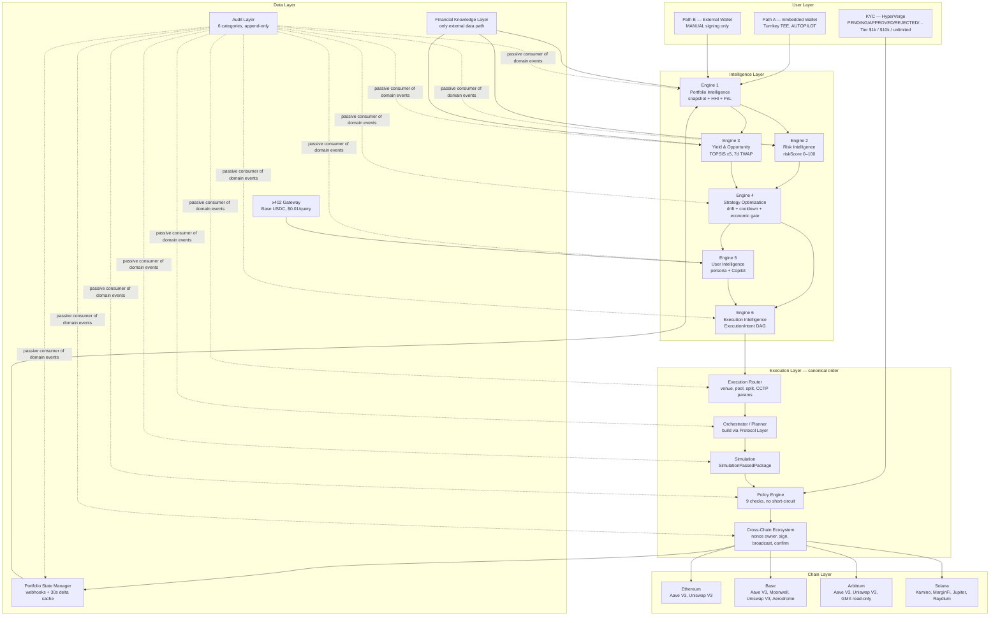

# CrestFlow System Architecture

**Status:** Core — topology and component relationships only
**Version:** 2.0
**Last reviewed:** 18 November 2026
**Canonical decisions:** `CANONICAL_DECISIONS.md` D1–D10, T6, T7, T10, T11, T12, T15
**Document precedence:** see `docs/DOCUMENT_INDEX.md`. This document owns topology only; policy semantics live in `docs/policy_engine.md`, shared types in `docs/canonical_schemas.md`, and runtime contracts in `docs/implementation_spec.md`.

**MVP chain scope:** Ethereum · Base · Arbitrum · Solana (testnets: Sepolia, Base Sepolia, Arbitrum Sepolia, Solana Devnet).

---

## Architecture Overview

- **Post-pivot architecture diagram:** [system-architecture-post-pivot.png](../assets/system-architecture-post-pivot.png)
- **Pre-pivot reference (superseded):** [system-architecture-pre-pivot.png](../assets/system-architecture-pre-pivot.png)
- **Legacy reference (superseded):** [system-architecture-before-pivot-legacy.png](../assets/system-architecture-before-pivot-legacy.png)

The Excalidraw source referenced by earlier revisions does not exist in the repository and the link has been removed.



**Non-negotiable ordering (D7):** `Engine 6 → Execution Router → Orchestrator/Planner (build) → Simulation → Policy → CCE → PSM`. Policy evaluates a `SimulationPassedPackage`, never a bare intent, and no execution path bypasses it — including autopilot.

---

## Chain Topology

| Chain | VM | Shared EVM Address | Key | CCTP Domain |
|---|---|---|---|---|
| Ethereum | EVM | ✅ same address as Base + Arbitrum | secp256k1 | 0 |
| Base | EVM (OP Stack) | ✅ same address as Ethereum + Arbitrum | secp256k1 | 6 |
| Arbitrum | EVM (Nitro) | ✅ same address as Ethereum + Base | secp256k1 | 3 |
| Solana | SVM | ❌ separate address | Ed25519 | 5 |

**Identical EVM address ≠ shared state.** Nonces, balances, positions, and gas are per-chain. The CCE owns nonce allocation per `(chain, address)` and is the only component that assigns them (T11).

---

## Protocol Roster by Chain (MVP)

| Chain | Lending | DEX / LP | Bridge | Notes |
|---|---|---|---|---|
| Ethereum | Aave V3 | Uniswap V3 (`constant_product`) | CCTP V2 (USDC only) | 1inch/UniswapX are Phase 2 |
| Base | Aave V3, Moonwell | Uniswap V3, Aerodrome (`stable_swap`) | CCTP V2 (USDC only) | x402 settlement chain |
| Arbitrum | Aave V3 | Uniswap V3 | CCTP V2 (USDC only) | GMX GM pools read-only (D2) |
| Solana | Kamino, MarginFi | Jupiter (`/order` + `/build`), Raydium | CCTP V2 (USDC only) | — |

Curve, Camelot, 1inch, UniswapX, and all bridge aggregators are Phase 2 (T12, D3). Non-USDC cross-chain transfers fail closed with `UNSUPPORTED_BRIDGE`; there is no runtime aggregator branch.

---

## `poolType` — Shared Classification Package

`poolType` (`constant_product` | `stable_swap` | `correlated` | `gmx_gm_pool` | `lending_market` | `none`) is owned by the single shared package `@crestflow/pool-type` (T11). No component re-implements classification or IL branching.

| Component | How `poolType` Is Used |
|---|---|
| Engine 1 | Position decomposition, IL, out-of-range yield quality |
| Engine 2 | Liquidity-impact formula selection; GMX excluded from HF and IL |
| Engine 3 | IL-adjusted true yield; GMX excluded from TOPSIS |
| Engine 4 | Drift valuation; GMX becomes `MANUAL_REVIEW` |
| Engine 6 | LP action eligibility; GMX never becomes `LP_ADD` / `LP_REMOVE` |
| Execution Router | Venue and pool selection constraints |
| Protocol Layer | Adapter selection and transaction building |
| Policy Engine | Slippage cap lookup by pool class |

---

## Key Data Flows

### Onboarding

```
Google OAuth (sub = identity anchor)
  → KYC start (HyperVerge) → PENDING → APPROVED / REJECTED / RESUBMISSION_REQUESTED
  → tier assignment: $1,000 / $10,000 / unlimited
  → Path A: Turnkey embedded wallet (AUTOPILOT)
     Path B: user connects external wallet (MANUAL, READ_ONLY supported)
  → addresses registered → PSM starts monitoring
```

Fiat on-ramp is out of MVP (T16).

### Portfolio intelligence cycle

```
PSM triggers scan
  → Engine 1 PortfolioSnapshotCreated
  → Engine 2 and Engine 3 run in parallel
  → Engine 4 starts only after RiskAnalysisCompleted AND YieldOpportunitiesUpdated
  → StrategyPlanCreated → Engine 5 narrates / Engine 6 executes on approval
```

### Execution flow

```
User approves plan / autopilot trigger
  → Engine 6 (ExecutionIntent)
  → Execution Router (ExecutionInstructions)
  → Orchestrator/Planner builds via Protocol Layer
  → Simulation (SimulationPassedPackage)
  → Policy Engine (9 checks, all run, fail-closed)
  → CCE (nonce → sign Path A / collect Path B signature → broadcast → confirm)
  → PSM (post-execution sync scoped to event.chains)
  → Engine 1 rescan
```

Path B returns unsigned transactions or a signing request to the user's wallet. There is no ERC-4337 session key and no SPL delegate execution path (D1, E-11/E-12 contradicted).

### Cross-chain USDC bridge (CCTP V2)

```
Source: approve USDC → depositForBurn(amount, destinationDomain, mintRecipient,
        burnToken, destinationCaller=0x0, maxFee, minFinalityThreshold)
  Standard: maxFee=0,    minFinalityThreshold=2000
  Fast:     quoted fee, minFinalityThreshold=1000, only when HIGH urgency and within cap
→ Circle Iris attestation
→ Destination: receiveMessage(message, attestation) → USDC minted
→ CCE owns the two-leg lifecycle; PSM reconciles balances and fee deltas
```

Fast is capped at 0.10% of the transfer or $5, whichever is lower. If the quote exceeds the cap, the Router falls back to Standard and records the reason.

---

## Engine Data Contracts

| Producer | Event | Consumers |
|---|---|---|
| Engine 1 | `PortfolioSnapshotCreated` | Engine 2, Engine 3 (parallel), PSM |
| Engine 2 | `RiskAnalysisCompleted`, `RiskAlertCreated` | Engine 4, Engine 5 |
| Engine 3 | `YieldOpportunitiesUpdated` | Engine 4, Engine 5, Engine 6 |
| Engine 4 | `StrategyPlanCreated` / `StrategyPlanRevised` | Engine 5 narration, Engine 6 trigger |
| Engine 5 | `GoalProfileChanged`, `CopilotQuery` | Engines 3 and 4 (weights/persona) |
| Engine 6 | `ExecutionIntent` | Execution Router |
| Router | `ExecutionInstructions` | Orchestrator/Planner |
| Orchestrator | Simulation + execution lifecycle events | Policy, CCE, Audit, PSM |
| CCE | `TransactionConfirmed`, `TransactionFailed` | Orchestrator, PSM, Audit |
| PSM | `PortfolioStateUpdated` | Engine 1 |

`PortfolioSnapshotCreated` is the fan-out point. Engine 2 and Engine 3 have no ordering dependency on each other.

---

## Wallet Authority Model

| Path | Provisioning | Execution mode | Who signs | Policy Check 3 |
|---|---|---|---|---|
| A — Embedded | Turnkey TEE secp256k1 + Ed25519 | `AUTOPILOT` | CCE (Turnkey) | Delegation active |
| B — External | User-connected wallet | `MANUAL` | User wallet | Ownership verified; signature validated before broadcast |
| Read-only | Watched address | `READ_ONLY` | Nobody | Never a source of execution |

Both paths share the CCE sign → broadcast → confirm pipeline, but Path B is always user-signed. "Delegate it" is not an available option in MVP; the Copilot tells the user to sign manually.

---

## Financial Knowledge Layer — Single Data Path

Engines 1–3 and the Protocol Layer never call protocol RPC or third-party data APIs directly. The FKL is the only external data path. Engine 2 does not poll Aave/Kamino/MarginFi; it consumes FKL-supplied protocol-safety scores.

| Data type | TTL (T6) |
|---|---|
| Token prices | 30 s |
| Wallet holdings / open positions | 30 s |
| Pool APY / TVL | 300 s |
| Protocol safety scores | 24 h |
| Historical prices / returns | 24 h |
| Protocol / token metadata | 7 days |

Stale-while-revalidate is used throughout. Execution pricing never reads the cache: the FKL re-quotes at build time.

**Oracle policy (T4):** Chainlink primary + Pyth fallback on EVM; Pyth primary on Solana; 60 s staleness blocks signing; 1.5% cross-check between the two on-chain sources blocks signing; CoinGecko is display-only and a 5% divergence raises a warning, never a signing gate.

---

## Audit Layer

```
All domain events → durable bus (at-least-once)
  → Audit consumer → AES-256-GCM encryption of PII → INSERT into audit_entries
```

Taxonomy (T10): six categories — `AUTH`, `KYC`, `EXECUTION`, `PREFERENCE`, `PAYMENT`, `SYSTEM` — each with a category-scoped `action`, plus `eventId` idempotency and a DB-set `createdAt`. `audit_entries` is append-only, monthly-partitioned, 7-year retention.

The Policy Engine's rolling 24-hour spend query sums `category = 'EXECUTION'` and `action` in the spend-bearing set. There is no separate mutable counter.

---

## x402 Monetisation

- Official facilitator: `https://x402.org/facilitator`.
- Network: Base mainnet, CAIP-2 `eip155:8453`, USDC.
- Scheme: `exact` with EIP-3009 `transferWithAuthorization`.
- Price: **$0.01 per query** after **10 free queries per user per day** (T17). No subscription tier.
- Headers: `PAYMENT-REQUIRED`, `PAYMENT-SIGNATURE`, `PAYMENT-RESPONSE` (V2). No `X-Payment` header and no transaction-hash verification.

---

## Resolved Architectural Items

| Former open item | Resolution |
|---|---|
| Shared `poolType` library | `@crestflow/pool-type` is mandatory shared infrastructure (T11) |
| Non-USDC cross-chain | Out of MVP; fail closed `UNSUPPORTED_BRIDGE` (D3) |
| GM pool saga compensation | Not applicable; GMX is read-only/manual (D2) |
| Solana re-sign handoff | CCE owns blockhash refresh and re-sign for Path A; Path B re-prompts the user |
| Per-chain nonce ownership | CCE owns allocation, gap detection, replacement, cancellation (T11) |
| Curve / aggregator routing | Phase 2; MVP uses allowlisted venues only (T12) |
| Bridge aggregator vendor | Not selected; Phase 2 (D3) |
| Policy/execution ordering | Fixed at D7: build → simulate → policy → sign |
| KYC model | Canonical six statuses, three tiers (T8) |
| Audit taxonomy | Category + action split (T10) |
| Engineering stack | TypeScript/NestJS, Postgres, Redis, BullMQ, REST/OpenAPI 3.1 (T15) |
