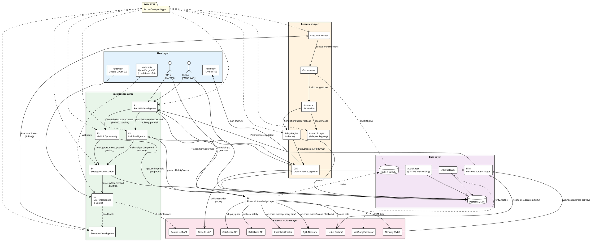

# Diagram 01 — Component Diagram

**Purpose:** Show all engines, modules, services, interfaces, dependencies, and communication boundaries of the CrestFlow MVP backend system.  
**Scope:** MVP only. Excludes Phase 2 items (Black-Litterman, RWA, non-USDC bridge, Permit2, 1inch, GMX automation, Travel Rule).  
**Primary deliverable:** Lucidchart-ready specification below. PlantUML is supplementary.  
**Source:** `core_documents/system_architecture.md`, `CANONICAL_DECISIONS.md` D7/D10/T11/T12/T15, all component documents.

---

## Purpose & Scope

The Component Diagram shows the **static structural decomposition** of CrestFlow's backend into components (NestJS modules), their provided/required interfaces, and dependency relationships. It answers: "What are the parts, what do they expose, and what do they depend on?"

---

## Element Inventory

### A. User Layer (external actors — not NestJS modules)

| Element | Type | Stereotype | Responsibility |
|---|---|---|---|
| `Path A User` | Actor / External | `«user»` | Authenticated user with Turnkey embedded wallet; AUTOPILOT execution |
| `Path B User` | Actor / External | `«user»` | Authenticated user with external wallet; MANUAL signing |
| `Google OAuth 2.0` | External System | `«external»` | Identity provider; returns `googleSub`, `email`, `email_verified` |
| `HyperVerge KYC` | External System | `«external»` | KYC vendor (conditional — D9); delivers decisions via webhook |
| `Turnkey TEE` | External System | `«external»` | Key management and signing enclave; Path A only |

### B. Intelligence Layer — NestJS Modules

| Element | Module Name | Responsibility |
|---|---|---|
| `Engine 1 — Portfolio Intelligence` | `portfolio` | Snapshot, LP decomposition, HHI, PnL, health score |
| `Engine 2 — Risk Intelligence` | `risk` | riskScore 0–100, 5 analysers, RiskAlert, adjustedThreshold |
| `Engine 3 — Yield & Opportunity` | `yield` | TOPSIS 5-criteria ranking, 7-day TWAP APY, switching signals |
| `Engine 4 — Strategy Optimization` | `strategy` | Drift gate, cooldown, economic gate, StrategyPlan |
| `Engine 5 — User Intelligence & Copilot` | `identity` (persona) + Copilot sub-module | GoalProfile, persona, Gemini 3.8 Flash Copilot |
| `Engine 6 — Execution Intelligence` | `execution` | ExecutionIntent DAG, authority filter, sourcing waterfall |

### C. Execution Layer — NestJS Modules

| Element | Module Name | Responsibility |
|---|---|---|
| `Execution Router` | `router` | Venue/pool/split selection, CCTP parameters → ExecutionInstructions |
| `Orchestrator` | `orchestrator` | Saga state machine, retry logic, compensation coordination |
| `Planner` | `planner` | Build unsigned transactions via Protocol Layer adapters |
| `Simulation` | (sub of `planner`) | eth_call / simulateTransaction → SimulationPassedPackage |
| `Protocol Layer` | (sub of `planner`) | Adapter registry: DEX, Lending, LP, Bridge adapters |
| `Policy Engine` | `policy` | 9 checks, fail-closed, no short-circuit → PolicyDecision |
| `CCE — Cross-Chain Ecosystem` | `cce` | Nonce owner, Turnkey signing, broadcast, confirmation, CCTP lifecycle |

### D. Data Layer — NestJS Modules

| Element | Module Name | Responsibility |
|---|---|---|
| `FKL — Financial Knowledge Layer` | `fkl` | 4 sub-layers: Adapters → Cache → Normaliser → Price Service |
| `PSM — Portfolio State Manager` | `psm` | Post-exec sync, delta tracking, watchdog, downstream propagation |
| `Audit Layer` | `audit` | Passive event consumer, INSERT-only, 6 categories, AES-256-GCM PII |
| `x402 Gateway` | `payments` | x402 V2 middleware, EIP-3009 settlement, free-tier counter |

### E. Infrastructure / Persistence

| Element | Type | Responsibility |
|---|---|---|
| `PostgreSQL 16` | Database | System of record: all canonical tables, audit_entries (monthly partitioned) |
| `Redis` | Cache/Queue | TTL cache (T6), nonce lease, session tokens, BullMQ backing store |
| `BullMQ` | Queue | Engine jobs, simulation jobs, bridge attestation polling, webhook processing |

### F. Shared Library

| Element | Type | Responsibility |
|---|---|---|
| `@crestflow/pool-type` | Shared NPM Package | PoolType classification, IL branching, slippage caps — T11 |

### G. External Protocols / Providers (Chain Layer)

| Element | Type | Chains |
|---|---|---|
| `Alchemy` | RPC / Webhook Provider | Ethereum, Base, Arbitrum |
| `Helius` | RPC / Webhook Provider | Solana |
| `Circle Iris API` | Attestation Service | CCTP V2 — all chains |
| `x402.org Facilitator` | Payment Facilitator | Base mainnet (`eip155:8453`) |
| `Chainlink Oracles` | On-chain Oracle | EVM chains (primary execution price) |
| `Pyth Network` | On-chain Oracle | Solana (primary); EVM (fallback) |
| `CoinGecko API` | Off-chain REST | Display/ranking only (never execution price) |
| `DeFiLlama API` | Off-chain REST | Protocol safety scores (24h cache) |
| `Gemini LLM API` | AI Model API | Copilot: `google/gemini-3.8-flash` primary, `google/gemini-flash-lite-latest` fallback |

### H. Protocol Adapters (inside Protocol Layer)

| Adapter | Chain | Category | Protocols |
|---|---|---|---|
| `UniswapV3Adapter` | ETH, BASE, ARB | DEX | Uniswap V3 |
| `AerodromeAdapter` | BASE | DEX / LP | Aerodrome |
| `JupiterSwapAdapter` | SOL | DEX | Jupiter Swap API `/order` + `/build` |
| `RaydiumAdapter` | SOL | DEX / LP | Raydium |
| `AaveV3Adapter` | ETH, BASE, ARB | Lending | Aave V3 |
| `MoonwellAdapter` | BASE | Lending | Moonwell |
| `MarginFiAdapter` | SOL | Lending | MarginFi |
| `KaminoAdapter` | SOL | Lending | Kamino |
| `UniswapV3LPAdapter` | ETH, BASE, ARB | LP | Uniswap V3 LP (NFT) |
| `AerodromeLPAdapter` | BASE | LP | Aerodrome LP |
| `RaydiumLPAdapter` | SOL | LP | Raydium LP |
| `CircleCCTPAdapter` | ALL | Bridge | CCTP V2 — USDC only |
| `GmxPositionReader` | ARB | Read-only | GMX (display/risk only; no execution) |

---

## Interface Inventory

| Interface Name | Provided By | Required By | Communication |
|---|---|---|---|
| `IPortfolioPort` | FKL | E1 | In-process method call |
| `IRiskDataPort` | FKL | E2 | In-process method call |
| `IYieldDataPort` | FKL | E3 | In-process method call |
| `IGoalProfilePort` | E5 (persona module) | E3, E4, E6 | BullMQ event / in-process |
| `IStrategyPlanPort` | E4 | E5, E6 | BullMQ event `StrategyPlanCreated` |
| `IExecutionIntentPort` | E6 | Execution Router | BullMQ event `ExecutionIntent` |
| `IExecutionInstructionsPort` | Execution Router | Orchestrator/Planner | In-process / BullMQ |
| `ISimulationPort` | Planner/Simulation | Policy Engine | In-process |
| `IPolicyDecisionPort` | Policy Engine | Orchestrator | In-process |
| `ISigningPort` | CCE (Turnkey TEE) | Orchestrator | HTTPS to Turnkey API |
| `IBroadcastPort` | CCE | — | Alchemy / Helius RPC |
| `IConfirmationPort` | CCE | Orchestrator | RPC polling |
| `IPostExecSyncPort` | PSM | CCE / Orchestrator | BullMQ event `ExecutionConfirmed` |
| `IAuditEventBusPort` | Audit Layer (consumer) | All modules | BullMQ domain events (at-least-once) |
| `IX402Port` | x402 Gateway | E5 Copilot | HTTP middleware |
| `IFKLAdapterPort` | FKL sub-layers | E1, E2, E3 | In-process |
| `IPoolTypePort` | `@crestflow/pool-type` | E1–E4, E6, ER, PL, PE | NPM import |
| `IWebhookPort` | PSM | Alchemy Notify / Helius | HTTP POST (webhook) |
| `IKYCWebhookPort` | Identity module | HyperVerge | HTTP POST (webhook) |

---

## Dependency / Connection Table

> Read as: **Source** depends on / calls **Target** via **Mechanism**.

| # | Source | Target | Mechanism | Direction | Label |
|---|---|---|---|---|---|
| 1 | E1 | FKL | In-process `IPortfolioPort` | E1 → FKL | `getHoldings, getPrices, getPositions` |
| 2 | E2 | FKL | In-process `IRiskDataPort` | E2 → FKL | `getProtocolSafetyScores` |
| 3 | E3 | FKL | In-process `IYieldDataPort` | E3 → FKL | `getLendingPools, getLpPools` |
| 4 | E2 | E1 | BullMQ `PortfolioSnapshotCreated` | E1 emits → E2 | Parallel fan-out |
| 5 | E3 | E1 | BullMQ `PortfolioSnapshotCreated` | E1 emits → E3 | Parallel fan-out |
| 6 | E4 | E2 | BullMQ `RiskAnalysisCompleted` | E2 emits → E4 | After both E2+E3 done |
| 7 | E4 | E3 | BullMQ `YieldOpportunitiesUpdated` | E3 emits → E4 | After both E2+E3 done |
| 8 | E4 | E5 | BullMQ `StrategyPlanCreated` | E4 emits → E5 | Narration trigger |
| 9 | E6 | E4 | Approval trigger | E6 receives approved plan | User/autopilot approval |
| 10 | E6 | E5 | GoalProfile | E5 provides → E6 | `GoalProfile.allowedActionTypes` |
| 11 | ER | E6 | BullMQ `ExecutionIntent` | E6 emits → ER | Canonical D7 order |
| 12 | ORC | ER | In-process / BullMQ | ER emits → ORC | `ExecutionInstructions` |
| 13 | PL | ORC | In-process adapter calls | ORC/Planner → PL | Build unsigned transactions |
| 14 | SIM | PL | In-process | Planner → Simulation | Simulate built transactions |
| 15 | PE | SIM | In-process | SIM emits → PE | `SimulationPassedPackage` |
| 16 | CCE | PE | In-process / BullMQ | PE emits → CCE | `PolicyDecision APPROVED` |
| 17 | CCE | Turnkey TEE | HTTPS TEE API | CCE → Turnkey | Sign (Path A only) |
| 18 | CCE | Alchemy RPC | HTTPS JSON-RPC | CCE → Alchemy | Broadcast + confirm (EVM) |
| 19 | CCE | Helius RPC | HTTPS JSON-RPC | CCE → Helius | Broadcast + confirm (Solana) |
| 20 | CCE | Circle Iris API | HTTPS REST | CCE → Circle | Poll CCTP attestation |
| 21 | PSM | CCE | BullMQ `TransactionConfirmed` | CCE emits → PSM | Post-exec sync trigger |
| 22 | PSM | Alchemy Notify | HTTP webhook | Alchemy → PSM | Address activity events |
| 23 | PSM | Helius | HTTP webhook | Helius → PSM | Address activity events |
| 24 | E1 | PSM | BullMQ `PortfolioStateUpdated` | PSM emits → E1 | Rescan after sync |
| 25 | AL | All modules | BullMQ domain events | Passive consumer | At-least-once delivery |
| 26 | X402 | E5 Copilot | HTTP middleware | Inline on `/v1/copilot/query` | 402 gate |
| 27 | X402 | x402.org/facilitator | HTTPS REST | X402 → Facilitator | `/verify` and `/settle` |
| 28 | E5 | Gemini LLM API | HTTPS | E5 → Google AI | Copilot inference |
| 29 | FKL | Alchemy | HTTPS RPC | FKL → Alchemy | EVM data fetch |
| 30 | FKL | Helius | HTTPS RPC | FKL → Helius | Solana data fetch |
| 31 | FKL | Chainlink | On-chain `eth_call` | FKL → Chain | Execution price (EVM primary) |
| 32 | FKL | Pyth | On-chain / API | FKL → Chain | Execution price (Solana primary, EVM fallback) |
| 33 | FKL | CoinGecko API | HTTPS REST | FKL → CoinGecko | Display price only |
| 34 | FKL | DeFiLlama API | HTTPS REST | FKL → DeFiLlama | Protocol safety scores |
| 35 | All modules | PostgreSQL 16 | TCP (pg driver) | Read/Write | System of record |
| 36 | All modules | Redis | TCP | Read/Write | Cache, locks, BullMQ store |
| 37 | PE | `@crestflow/pool-type` | NPM import | Compile-time dep | Slippage caps by poolType |
| 38 | E1–E4, E6, ER, PL | `@crestflow/pool-type` | NPM import | Compile-time dep | poolType classification |
| 39 | Identity module | HyperVerge | HTTPS + webhook | Bidirectional | KYC session + webhook |
| 40 | Identity module | Google OAuth | HTTPS | Identity module → Google | Token exchange |

---

## Grouping / Boundary Recommendations

**Create 5 boundary boxes (swimlane-style sub-diagrams or background rectangles):**

1. **User Layer** (top-left) — Path A User, Path B User, Google OAuth, HyperVerge, Turnkey TEE
2. **Intelligence Layer** (left-centre) — E1–E6, GoalProfile flows
3. **Execution Layer** (centre) — ER, ORC, Planner, SIM, PL, PE, CCE
4. **Data Layer** (right) — FKL, PSM, AL, X402, PostgreSQL, Redis, BullMQ
5. **External / Chain Layer** (bottom) — Alchemy, Helius, Circle Iris, x402.org, Chainlink, Pyth, CoinGecko, DeFiLlama, Gemini LLM API, blockchain networks (ETH, BASE, ARB, SOL)

**Trust boundaries (dashed red borders):**
- Around `Turnkey TEE` — private key boundary; CrestFlow never crosses it
- Around `HyperVerge` — vendor boundary; claims conditional (D9)
- Around `x402.org/facilitator` — settlement boundary

**Lucidchart construction order:**
1. Draw 5 background rectangles with correct colours (see palette in `00_INDEX.md`)
2. Place all components inside their layer
3. Add `@crestflow/pool-type` as a note/package shared between layers
4. Draw dependency arrows (use BullMQ colour for async, solid for sync)
5. Add interface lollipops on key ports
6. Add trust boundary dashed rectangles last

---

## Supplementary PlantUML

---

## Flags & Notes

> [!NOTE]
> `HyperVerge` is **conditional** (D9). The diagram must label it "selected pending integration validation." Fallback vendors are Persona or Sumsub.

> [!NOTE]
> `GMX` is **read-only** in MVP (D2). The `GmxPositionReader` adapter is inside FKL/Protocol Layer, but it feeds only display and risk — no automated execution paths.

> [!IMPORTANT]
> The `@crestflow/pool-type` shared package (T11) is **mandatory shared infrastructure**. All 8 consumers must import it; no component reimplements pool classification.

> [!IMPORTANT]
> `BullMQ` arrows are **asynchronous** (dashed or coloured differently from synchronous calls). E1→E2 and E1→E3 are parallel fan-outs; E4 waits for BOTH E2 and E3 before triggering.
