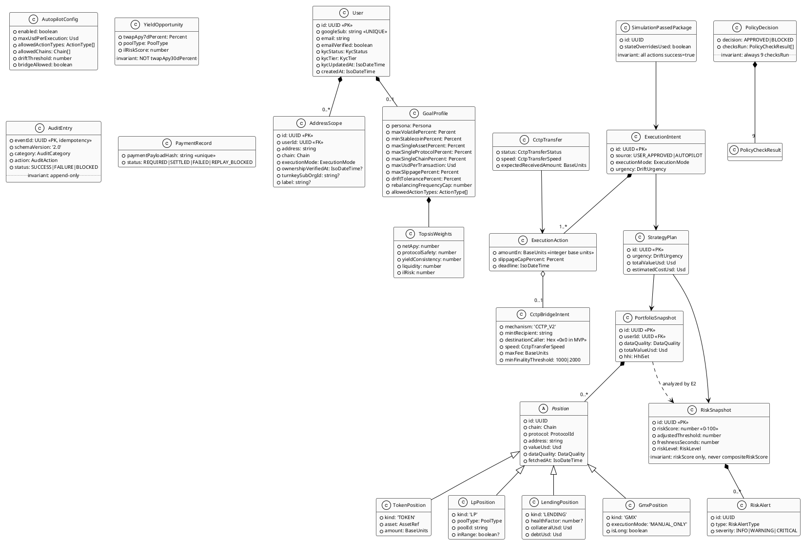

# Diagram 02 — Class Diagram

**Purpose:** Show all canonical classes, their attributes (with types), methods (selected key operations), relationships (inheritance, association, composition, aggregation), and multiplicities.  
**Scope:** All canonical types from `docs/canonical_schemas.md` v2.0 plus key component-local extensions.  
**Primary deliverable:** Lucidchart specification. PlantUML is supplementary.  
**Source:** `docs/canonical_schemas.md` §1–§17; `docs/implementation_spec.md` §3; `CANONICAL_DECISIONS.md` §4.

---

## Purpose & Scope

The Class Diagram represents the **data model and type system** of CrestFlow as declared in `docs/canonical_schemas.md`. Every class here is an implementation contract — no invented fields.

---

## Class Inventory (by domain)

### Domain 1 — Identity & Access

---
**Class: `User`**
- Attributes:
  - `id: UUID` {PK}
  - `googleSub: string` {UNIQUE, stable identity anchor — never email}
  - `email: string` {mutable; NOT a foreign key}
  - `emailVerified: boolean`
  - `kycStatus: KycStatus` {enum}
  - `kycTier: KycTier` {enum}
  - `kycUpdatedAt: IsoDateTime`
  - `createdAt: IsoDateTime`
- Operations: `—` (data entity)
- Invariants: `googleSub` unique; changing email never creates a second user

---
**Class: `AddressScope`**
- Attributes:
  - `id: UUID` {PK}
  - `userId: UUID` {FK → User}
  - `address: string` {EVM lowercase hex or Solana base58}
  - `chain: Chain` {enum}
  - `executionMode: ExecutionMode` {AUTOPILOT | MANUAL | READ_ONLY}
  - `ownershipVerifiedAt: IsoDateTime | null`
  - `turnkeySubOrgId?: string` {present only for AUTOPILOT}
  - `label?: string`
  - `createdAt: IsoDateTime`
- Invariants: AUTOPILOT requires turnkeySubOrgId; MANUAL requires ownershipVerifiedAt; READ_ONLY never executes; unique (userId, chain, address)

---
**Class: `AuthSession`**
- Attributes:
  - `userId: UUID` {FK → User}
  - `accessToken: string` {short-lived JWT}
  - `refreshToken: string` {hashed in DB}
  - `accessExpiresAt: IsoDateTime`
  - `refreshExpiresAt: IsoDateTime`

---

### Domain 2 — Goals & Autopilot

---
**Class: `GoalProfile`**
- Attributes:
  - `persona: Persona` {enum — 5 values}
  - `maxVolatilePercent: Percent` {0..100}
  - `minStablecoinPercent: Percent`
  - `maxSingleAssetPercent: Percent`
  - `maxSingleProtocolPercent: Percent`
  - `maxSingleChainPercent: Percent`
  - `maxUsdPerTransaction: Usd` {string}
  - `maxSlippagePercent: Percent`
  - `driftTolerancePercent: Percent`
  - `rebalancingFrequencyCap: number` {days; default 7}
  - `allowedActionTypes: ActionType[]` {REQUIRED, non-empty}
  - `topsisWeights: TopsisWeights` {composed}
- Invariants: `allowedActionTypes` required and non-empty for executable users; no `maxRiskScore` on GoalProfile

---
**Class: `TopsisWeights`** (composition inside GoalProfile)
- Attributes:
  - `netApy: number`
  - `protocolSafety: number`
  - `yieldConsistency: number`
  - `liquidity: number`
  - `ilRisk: number`
- Invariant: sum = 1.0 per persona

---
**Class: `AutopilotConfig`**
- Attributes:
  - `enabled: boolean`
  - `maxUsdPerExecution: Usd`
  - `allowedActionTypes: ActionType[]`
  - `allowedChains: Chain[]`
  - `driftThreshold: number`
  - `bridgeAllowed: boolean`
- Invariant: may further restrict GoalProfile, never expand it

---

### Domain 3 — Portfolio

---
**Class: `PortfolioSnapshot`**
- Attributes:
  - `id: UUID` {PK}
  - `userId: UUID` {FK → User}
  - `createdAt: IsoDateTime`
  - `dataQuality: DataQuality` {COMPLETE | PARTIAL | STALE}
  - `totalValueUsd: Usd`
  - `positions: Position[]` {composition}
  - `chainExposureUsd: Record<Chain, Usd>`
  - `assetExposureUsd: Record<string, Usd>`
  - `protocolExposureUsd: Record<string, Usd>`
  - `hhi: HhiSet` {composed}

---
**Class: `HhiSet`** (composition inside PortfolioSnapshot)
- Attributes:
  - `asset: number` {0–10,000}
  - `protocol: number`
  - `chain: number`
- Formula: `HHI = Σ(shareᵢ²) × 10,000` (T1)

---
**Abstract Class: `Position`** (base)
- Attributes:
  - `id: UUID`
  - `chain: Chain`
  - `protocol: ProtocolId | 'wallet'`
  - `address: string`
  - `valueUsd: Usd`
  - `dataQuality: DataQuality`
  - `fetchedAt: IsoDateTime`

---
**Class: `TokenPosition`** extends `Position`
- Attributes:
  - `kind: 'TOKEN'`
  - `asset: AssetRef` {composed}
  - `amount: BaseUnits` {integer string}

---
**Class: `LpPosition`** extends `Position`
- Attributes:
  - `kind: 'LP'`
  - `asset: AssetRef` {LP share token}
  - `amount: BaseUnits`
  - `poolId: string`
  - `poolAddress: string`
  - `poolType: PoolType`
  - `token0: AssetRef`
  - `token1: AssetRef`
  - `tokenId?: string` {Uniswap V3 NFT}
  - `underlyingAmounts: { asset: AssetRef; amount: BaseUnits }[]`
  - `inRange?: boolean`

---
**Class: `LendingPosition`** extends `Position`
- Attributes:
  - `kind: 'LENDING'`
  - `marketId: string`
  - `supplied: { asset: AssetRef; amount: BaseUnits; valueUsd: Usd }[]`
  - `borrowed: { asset: AssetRef; amount: BaseUnits; valueUsd: Usd }[]`
  - `healthFactor: number | null`
  - `collateralUsd: Usd`
  - `debtUsd: Usd`

---
**Class: `GmxPosition`** extends `Position`
- Attributes:
  - `kind: 'GMX'`
  - `market: string`
  - `collateralAsset: AssetRef`
  - `collateralAmount: BaseUnits`
  - `sizeUsd: Usd`
  - `isLong: boolean`
  - `entryPriceUsd: Usd`
  - `liquidationPriceUsd: Usd | null`
  - `executionMode: 'MANUAL_ONLY'` {never automated}

---
**Class: `AssetRef`** (value object — embedded in many)
- Attributes:
  - `symbol: string`
  - `address: string | null` {null for native assets}
  - `chain: Chain`
  - `decimals: number`
  - `coingeckoId?: string`

---

### Domain 4 — Risk

---
**Class: `RiskSnapshot`**
- Attributes:
  - `id: UUID` {PK}
  - `userId: UUID` {FK → User}
  - `portfolioSnapshotId: UUID` {FK → PortfolioSnapshot}
  - `analyzedAt: IsoDateTime`
  - `freshnessSeconds: number` {must be ≤ 14,400 for Policy}
  - `cvar95Percent: number | null`
  - `sortinoRatio: number | null`
  - `maxDrawdownPercent: number | null`
  - `calmarRatio: number | null`
  - `realizedVol7d: number | null`
  - `realizedVol30d: number | null`
  - `insufficientHistory: boolean`
  - `liquidationPositions: LiquidationPosition[]`
  - `minHealthFactor: number | null`
  - `crossChainCollateral: CrossChainCollateral` {composed}
  - `liquidationRiskScore: number`
  - `assetHhi: number`
  - `protocolHhi: number`
  - `chainHhi: number`
  - `concentrationScore: number`
  - `protocolScores: Record<string, number>`
  - `weightedProtocolScore: number`
  - `protocolRiskScore: number`
  - `exitRiskPositions: ExitRiskPosition[]`
  - `maxExitImpactPercent: number`
  - `liquidityRiskScore: number`
  - `riskScore: number` {0–100; ONLY composite risk field — never compositeRiskScore}
  - `riskLevel: RiskLevel`
  - `adjustedThreshold: number` {baselineThreshold × persona multiplier}
  - `appliedProfileMultiplier: number`
  - `scoreComponents: Record<string, number>`

---
**Class: `RiskAlert`**
- Attributes:
  - `id: UUID` {PK}
  - `userId: UUID`
  - `riskSnapshotId: UUID`
  - `type: RiskAlertType` {enum — 10 values}
  - `severity: 'INFO' | 'WARNING' | 'CRITICAL'`
  - `message: string`
  - `createdAt: IsoDateTime`
  - `resolvedAt?: IsoDateTime`

---

### Domain 5 — Yield

---
**Class: `YieldOpportunitySnapshot`**
- Attributes:
  - `id: UUID`
  - `createdAt: IsoDateTime`
  - `dataQuality: DataQuality`
  - `opportunities: YieldOpportunity[]`
  - `topsisCriteria: TopsisCriterion[]` {exactly 5}
  - `weightsByPersona: Record<Persona, TopsisWeights>`

---
**Class: `YieldOpportunity`**
- Attributes:
  - `id: string`
  - `chain: Chain`
  - `protocol: ProtocolId`
  - `poolId: string`
  - `poolAddress: string`
  - `poolType: PoolType`
  - `assetSymbols: string[]`
  - `tvlUsd: Usd`
  - `spotApyPercent: Percent`
  - `twapApy7dPercent: Percent` {7-day TWAP; min 7 daily points — NOT twapApy30dPercent}
  - `yieldConsistencyCv: number`
  - `ilRiskScore: number` {0–100}
  - `liquidityScore: number` {0–100}
  - `protocolSafetyScore: number` {0–100}
  - `netApyPercent: Percent`
  - `fetchedAt: IsoDateTime`
  - `dataQuality: DataQuality`

---

### Domain 6 — Strategy

---
**Class: `StrategyPlan`**
- Attributes:
  - `id: UUID` {PK}
  - `userId: UUID`
  - `createdAt: IsoDateTime`
  - `goalProfileVersion: string`
  - `portfolioSnapshotId: UUID`
  - `riskSnapshotId: UUID`
  - `yieldSnapshotId: UUID`
  - `urgency: DriftUrgency` {NONE | LOW | MEDIUM | HIGH | EMERGENCY}
  - `actions: PlanAction[]`
  - `totalValueUsd: Usd`
  - `estimatedCostUsd: Usd`
  - `rationale: string`
  - `manualReviewItems: ManualReviewItem[]`

---
**Class: `PlanAction`**
- Attributes:
  - `id: string`
  - `type: ActionType`
  - `chain: Chain`
  - `protocol: ProtocolId`
  - `poolId?: string`
  - `poolAddress?: string`
  - `tokenId?: string`
  - `assetIn: AssetRef`
  - `assetOut?: AssetRef`
  - `amountUsd: Usd`
  - `targetWeightPercent?: Percent`
  - `dependsOn: string[]`

---

### Domain 7 — Execution

---
**Class: `ExecutionIntent`**
- Attributes:
  - `id: UUID` {PK}
  - `userId: UUID`
  - `strategyPlanId: UUID`
  - `createdAt: IsoDateTime`
  - `source: 'USER_APPROVED' | 'AUTOPILOT'`
  - `executionMode: ExecutionMode`
  - `urgency: DriftUrgency`
  - `actions: ExecutionAction[]`
  - `manualReviewItems: ManualReviewItem[]`
  - `estimatedTotalCostUsd: Usd`
  - `estimatedGasCostUsd: Usd`

---
**Class: `ExecutionAction`**
- Attributes:
  - `id: string`
  - `type: ActionType`
  - `chain: Chain`
  - `protocol: ProtocolId`
  - `poolId?: string`
  - `poolAddress?: string`
  - `tokenId?: string`
  - `assetIn: AssetRef`
  - `assetOut?: AssetRef`
  - `amountIn: BaseUnits` {integer base units — NEVER decimal string}
  - `amountUsd: Usd`
  - `sourceAddress: string`
  - `recipientAddress: string`
  - `poolType: PoolType`
  - `slippageCapPercent: Percent` {min(goal, poolTypeCap)}
  - `deadline: IsoDateTime`
  - `approval?: ApprovalIntent`
  - `bridge?: CctpBridgeIntent` {BRIDGE actions only; CCTP_V2 only}
  - `dependsOn: string[]`
  - `estimatedCostUsd: Usd`
  - `overrideReason?: string`

---
**Class: `ApprovalIntent`** (embedded in ExecutionAction)
- Attributes:
  - `token: AssetRef`
  - `spender: string`
  - `amount: BaseUnits`
  - `mechanism: 'ERC20_APPROVE' | 'EIP2612_PERMIT' | 'PERMIT2_APPROVE' | 'PERMIT2_PERMIT'`
  - `deadline?: IsoDateTime`

---
**Class: `CctpBridgeIntent`** (embedded in ExecutionAction for BRIDGE type)
- Attributes:
  - `mechanism: 'CCTP_V2'`
  - `sourceDomain: CctpDomain` {0 | 3 | 5 | 6}
  - `destinationDomain: CctpDomain`
  - `destinationChain: Chain`
  - `mintRecipient: string` {Path A = Turnkey wallet; Path B = user's external wallet}
  - `destinationCaller: Hex` {0x0 in MVP}
  - `burnToken: string` {USDC on source chain}
  - `amount: BaseUnits`
  - `maxFee: BaseUnits` {0 for Standard; quoted for Fast}
  - `minFinalityThreshold: 1000 | 2000`
  - `speed: CctpTransferSpeed`

---

### Domain 8 — Router & Planner Outputs

---
**Class: `ExecutionInstructions`**
- Attributes:
  - `id: UUID`
  - `intentId: UUID`
  - `createdAt: IsoDateTime`
  - `actions: ResolvedAction[]`
  - `totalGasEstimateUsd: Usd`
  - `warnings: string[]`

---
**Class: `ResolvedAction`**
- Attributes:
  - `actionId: string`
  - `type: ActionType`
  - `chain: Chain`
  - `protocol: ProtocolId`
  - `poolAddress?: string`
  - `tokenId?: string`
  - `routerAddress: string`
  - `calldata: Hex`
  - `value: BaseUnits`
  - `gasLimit: string`
  - `maxFeePerGas?: BaseUnits`
  - `maxPriorityFeePerGas?: BaseUnits`
  - `deadline: IsoDateTime`
  - `approval?: ApprovalInstruction`
  - `bridge?: CctpBridgeInstruction`
  - `routeLegs?: RouteLeg[]`

---

### Domain 9 — Simulation

---
**Class: `SimulationPassedPackage`**
- Attributes:
  - `id: UUID`
  - `intentId: UUID`
  - `instructionsId: UUID`
  - `userId: UUID`
  - `simulatedAt: IsoDateTime`
  - `actions: SimulatedAction[]`
  - `totalGasUsd: Usd`
  - `chains: Chain[]`
  - `blockNumbers: Partial<Record<Chain, string>>`
  - `stateOverridesUsed: boolean`
  - `warnings: string[]`
- Invariant: a package with any `success = false` action is never passed to Policy

---
**Class: `SimulatedAction`**
- Attributes:
  - `actionId: string`
  - `success: boolean`
  - `gasUsed: string`
  - `gasCostUsd: Usd`
  - `simulatedSlippagePercent?: Percent`
  - `simulatedPriceImpactPercent?: Percent`
  - `minAmountOut?: BaseUnits`
  - `balanceDeltas: BalanceDelta[]`
  - `revertReason?: string`

---

### Domain 10 — Policy

---
**Class: `PolicyInput`**
- Attributes:
  - `userId: UUID`
  - `policyVersion: string`
  - `user: User`
  - `goalProfile: GoalProfile`
  - `riskSnapshot: RiskSnapshot`
  - `addressScopes: AddressScope[]`
  - `plan: StrategyPlan`
  - `simulation: SimulationPassedPackage`
  - `auditSpend24hUsd: Usd`
  - `autopilotConfig?: AutopilotConfig`
  - `now: IsoDateTime`

---
**Class: `PolicyDecision`**
- Attributes:
  - `id: UUID`
  - `userId: UUID`
  - `planId: UUID`
  - `decision: 'APPROVED' | 'BLOCKED'`
  - `checksRun: PolicyCheckResult[]` {always exactly 9 entries}
  - `failures: PolicyFailure[]`
  - `policyVersion: string`
  - `decidedAt: IsoDateTime`
  - `simulationPackageId: UUID`

---
**Class: `PolicyCheckResult`**
- Attributes:
  - `check: 1 | 2 | 3 | 4 | 5 | 6 | 7 | 8 | 9`
  - `name: string`
  - `passed: boolean`
  - `code?: PolicyFailureCode`
  - `message?: string`
  - `details?: Record<string, unknown>`

---

### Domain 11 — Audit

---
**Class: `AuditEntry`**
- Attributes:
  - `eventId: UUID` {PK — idempotency key; unique}
  - `schemaVersion: '2.0'`
  - `userId: UUID | null`
  - `category: AuditCategory` {AUTH | KYC | EXECUTION | PREFERENCE | PAYMENT | SYSTEM}
  - `action: AuditAction` {category-scoped}
  - `status: 'SUCCESS' | 'FAILURE' | 'BLOCKED'`
  - `executionGroupId?: UUID`
  - `strategyPlanId?: UUID`
  - `intentId?: UUID`
  - `txId?: string`
  - `chain?: Chain`
  - `kycStatus: KycStatus | null` {snapshotted at INSERT time}
  - `kycTier: KycTier | null`
  - `walletAddresses: Record<string, unknown> | null` {AES-256-GCM encrypted}
  - `payload: Record<string, unknown>` {PII encrypted where applicable}
  - `ipAddress: string | null` {AUTH/PAYMENT only; encrypted}
  - `userAgent: string | null` {AUTH/PAYMENT only; encrypted}
  - `createdAt: IsoDateTime` {DB server default — not application clock}
- Invariants: append-only; no UPDATE or DELETE; `eventId` unique

---

### Domain 12 — CCTP Transfer

---
**Class: `CctpTransfer`**
- Attributes:
  - `id: UUID` {PK}
  - `userId: UUID`
  - `intentId: UUID`
  - `actionId: string`
  - `sourceChain: Chain`
  - `destinationChain: Chain`
  - `sourceDomain: CctpDomain`
  - `destinationDomain: CctpDomain`
  - `amount: BaseUnits`
  - `mintRecipient: string`
  - `destinationCaller: Hex`
  - `burnToken: string`
  - `maxFee: BaseUnits`
  - `minFinalityThreshold: 1000 | 2000`
  - `speed: CctpTransferSpeed`
  - `burnTxId?: string`
  - `attestation?: string`
  - `mintTxId?: string`
  - `status: CctpTransferStatus` {PENDING | BURNED | ATTESTED | MINTED | FAILED}
  - `expectedReceivedAmount: BaseUnits` {amount - maxFee for Fast; amount for Standard}
  - `actualReceivedAmount?: BaseUnits`
  - `createdAt: IsoDateTime`
  - `updatedAt: IsoDateTime`

---

### Domain 13 — x402 Payments

---
**Class: `PaymentRequirements`**
- Attributes:
  - `scheme: 'exact'`
  - `network: 'eip155:8453' | 'eip155:84532'`
  - `maxAmountRequired: BaseUnits` {10000 = $0.01}
  - `resource: string`
  - `description: string`
  - `mimeType: string`
  - `payTo: string`
  - `maxTimeoutSeconds: number`
  - `asset: string` {USDC contract address on Base}
  - `extra?: { name?: string; version?: string }`

---
**Class: `PaymentPayload`**
- Attributes:
  - `x402Version: 2`
  - `scheme: 'exact'`
  - `network: PaymentNetwork`
  - `payload.signature: Hex`
  - `payload.authorization.from: string`
  - `payload.authorization.to: string`
  - `payload.authorization.value: BaseUnits`
  - `payload.authorization.validAfter: string` {unix seconds}
  - `payload.authorization.validBefore: string`
  - `payload.authorization.nonce: Hex`

---
**Class: `PaymentRecord`**
- Attributes:
  - `id: UUID` {PK}
  - `userId: UUID | null`
  - `network: PaymentNetwork`
  - `scheme: 'exact'`
  - `amount: BaseUnits`
  - `asset: string`
  - `status: 'REQUIRED' | 'SETTLED' | 'FAILED' | 'REPLAY_BLOCKED'`
  - `payer?: string`
  - `facilitatorTx?: string`
  - `paymentPayloadHash: string` {unique — replay protection}
  - `createdAt: IsoDateTime`
  - `settledAt?: IsoDateTime`

---

## Enumerations (draw as «enumeration» class boxes)

| Enum | Values |
|---|---|
| `Chain` | `ethereum`, `base`, `arbitrum`, `solana` |
| `KycStatus` | `PENDING`, `APPROVED`, `REJECTED`, `RESUBMISSION_REQUESTED`, `SUSPENDED`, `EXPIRED` |
| `KycTier` | `TIER_1` ($1k/day), `TIER_2` ($10k/day), `TIER_3` (unlimited) |
| `ExecutionMode` | `AUTOPILOT`, `MANUAL`, `READ_ONLY` |
| `Persona` | `CAPITAL_PRESERVATION`, `CONSERVATIVE`, `MODERATE`, `AGGRESSIVE`, `YIELD_SEEKER` |
| `PoolType` | `constant_product`, `stable_swap`, `correlated`, `gmx_gm_pool`, `lending_market`, `perps`, `none` |
| `ActionType` | `SWAP`, `LP_ADD`, `LP_REMOVE`, `LEND_SUPPLY`, `LEND_WITHDRAW`, `BORROW`, `REPAY`, `BRIDGE`, `APPROVE`, `ATA_CREATE`, `MANUAL_REVIEW` |
| `BridgeMechanism` | `CCTP_V2`, `NONE` {CCTP_V2 only in MVP} |
| `CctpTransferSpeed` | `STANDARD`, `FAST` |
| `CctpTransferStatus` | `PENDING`, `BURNED`, `ATTESTED`, `MINTED`, `FAILED` |
| `DriftUrgency` | `NONE`, `LOW`, `MEDIUM`, `HIGH`, `EMERGENCY` |
| `DataQuality` | `COMPLETE`, `PARTIAL`, `STALE` |
| `RiskLevel` | `LOW` (0–39), `MEDIUM` (40–59), `HIGH` (60–79), `CRITICAL` (80–100) |
| `AuditCategory` | `AUTH`, `KYC`, `EXECUTION`, `PREFERENCE`, `PAYMENT`, `SYSTEM` |

---

## Relationship Table

| Relationship | From | To | Type | Multiplicity | Label |
|---|---|---|---|---|---|
| R01 | `User` | `AddressScope` | Composition | 1 → 0..* | `owns` |
| R02 | `User` | `AuthSession` | Association | 1 → 0..* | `has sessions` |
| R03 | `User` | `GoalProfile` | Association | 1 → 1 | `has profile` |
| R04 | `GoalProfile` | `TopsisWeights` | Composition | 1 → 1 | `contains` |
| R05 | `User` | `AutopilotConfig` | Association | 1 → 0..1 | `may have` |
| R06 | `User` | `PortfolioSnapshot` | Association | 1 → 0..* | `has snapshots` |
| R07 | `PortfolioSnapshot` | `HhiSet` | Composition | 1 → 1 | `contains` |
| R08 | `PortfolioSnapshot` | `Position` | Composition | 1 → 0..* | `contains` |
| R09 | `Position` | `TokenPosition` | Generalization | 1 → 1 | `is-a` |
| R10 | `Position` | `LpPosition` | Generalization | 1 → 1 | `is-a` |
| R11 | `Position` | `LendingPosition` | Generalization | 1 → 1 | `is-a` |
| R12 | `Position` | `GmxPosition` | Generalization | 1 → 1 | `is-a (manual only)` |
| R13 | `PortfolioSnapshot` | `RiskSnapshot` | Association | 1 → 0..1 | `analyzed by E2` |
| R14 | `RiskSnapshot` | `RiskAlert` | Composition | 1 → 0..* | `emits` |
| R15 | `PortfolioSnapshot` | `YieldOpportunitySnapshot` | Association | 1 → 0..1 | `paired with E3` |
| R16 | `YieldOpportunitySnapshot` | `YieldOpportunity` | Composition | 1 → 1..* | `contains` |
| R17 | `StrategyPlan` | `PortfolioSnapshot` | Association | 1 → 1 | `based on` |
| R18 | `StrategyPlan` | `RiskSnapshot` | Association | 1 → 1 | `informed by` |
| R19 | `StrategyPlan` | `YieldOpportunitySnapshot` | Association | 1 → 1 | `informed by` |
| R20 | `StrategyPlan` | `PlanAction` | Composition | 1 → 0..* | `contains` |
| R21 | `ExecutionIntent` | `StrategyPlan` | Association | 1 → 1 | `derived from` |
| R22 | `ExecutionIntent` | `ExecutionAction` | Composition | 1 → 1..* | `contains` |
| R23 | `ExecutionAction` | `ApprovalIntent` | Aggregation | 1 → 0..1 | `may require` |
| R24 | `ExecutionAction` | `CctpBridgeIntent` | Aggregation | 1 → 0..1 | `may have (BRIDGE only)` |
| R25 | `ExecutionInstructions` | `ExecutionIntent` | Association | 1 → 1 | `resolves` |
| R26 | `ExecutionInstructions` | `ResolvedAction` | Composition | 1 → 1..* | `contains` |
| R27 | `SimulationPassedPackage` | `ExecutionInstructions` | Association | 1 → 1 | `simulates` |
| R28 | `SimulationPassedPackage` | `SimulatedAction` | Composition | 1 → 1..* | `contains` |
| R29 | `PolicyInput` | `User` | Association | 1 → 1 | `includes` |
| R30 | `PolicyInput` | `GoalProfile` | Association | 1 → 1 | `includes` |
| R31 | `PolicyInput` | `RiskSnapshot` | Association | 1 → 1 | `includes` |
| R32 | `PolicyInput` | `SimulationPassedPackage` | Association | 1 → 1 | `includes` |
| R33 | `PolicyDecision` | `PolicyCheckResult` | Composition | 1 → 9 | `always 9 results` |
| R34 | `AuditEntry` | `User` | Association | * → 0..1 | `for user` |
| R35 | `CctpTransfer` | `ExecutionAction` | Association | 1 → 1 | `tracks` |
| R36 | `PaymentRecord` | `User` | Association | * → 0..1 | `for user (or null)` |

---

## Layout Recommendations

**Suggested Lucidchart layout (left → right, top → bottom):**

```
Row 1 (top): Enumerations — place all enum boxes in a row along the top or right margin
Row 2: Identity domain — User, AddressScope, AuthSession, GoalProfile, TopsisWeights, AutopilotConfig
Row 3: Portfolio domain — PortfolioSnapshot, HhiSet, AssetRef, Position hierarchy (abstract → 4 concrete)
Row 4: Risk domain — RiskSnapshot, RiskAlert
Row 5: Yield domain — YieldOpportunitySnapshot, YieldOpportunity
Row 6: Strategy domain — StrategyPlan, PlanAction, ManualReviewItem
Row 7: Execution domain — ExecutionIntent, ExecutionAction, ApprovalIntent, CctpBridgeIntent
Row 8: Router/Planner domain — ExecutionInstructions, ResolvedAction
Row 9: Simulation domain — SimulationPassedPackage, SimulatedAction, BalanceDelta
Row 10: Policy domain — PolicyInput, PolicyDecision, PolicyCheckResult
Row 11: Audit domain — AuditEntry
Row 12: CCTP + Payments — CctpTransfer, PaymentRequirements, PaymentPayload, PaymentRecord
```

**Colour-code class boxes by domain** (use the layer colours from `00_INDEX.md`):
- Identity/Goals → User Layer blue
- Portfolio/Risk/Yield/Strategy → Intelligence Layer green
- Execution/Router/Simulation → Execution Layer orange
- Policy/Audit/CCTP/Payments → Data Layer purple

---

## Supplementary PlantUML



---

## Flags & Notes

> [!IMPORTANT]
> `riskScore` is the **only** composite risk field. `compositeRiskScore` does not exist and must never appear in diagrams.

> [!IMPORTANT]
> `twapApy7dPercent` is the **only** APY field. `twapApy30dPercent` does not exist.

> [!IMPORTANT]
> `amountIn` on `ExecutionAction` is **always `BaseUnits`** (integer string). No decimal string `amount` field exists on execution objects.

> [!NOTE]
> `GmxPosition.executionMode = 'MANUAL_ONLY'` is a fixed constant, not a variable. GMX positions never produce automated actions.

> [!NOTE]
> `PolicyDecision.checksRun` has **exactly 9 entries** — always. Even when decision is BLOCKED, all 9 checks ran.
