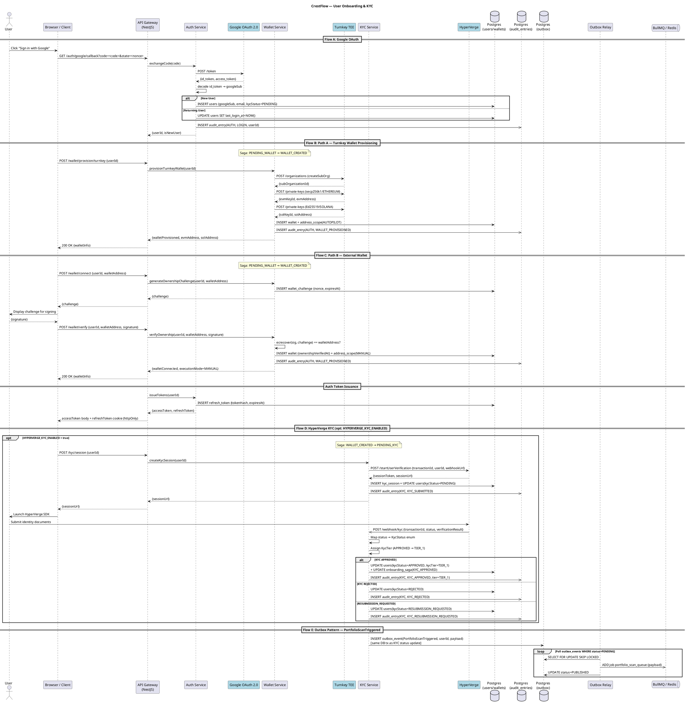

# 03 — Sequence Diagram Specification: User Onboarding & KYC

> Lucidchart-ready specification. Describes participant lifelines, message flows, fragments, audit events, and PlantUML source for the User Onboarding & KYC sequence diagram.

---

## 1. Purpose & Scope

This diagram covers the complete user onboarding journey from initial Google OAuth sign-in through wallet provisioning (Path A or Path B), optional HyperVerge KYC submission, and the outbox-pattern emission of a `PortfolioScanTriggered` event.

**In scope:**
- Google OAuth authorization code exchange and user upsert
- Path A: Turnkey sub-organization creation, secp256k1 EVM key + Ed25519 Solana key derivation, `AddressScope = AUTOPILOT`
- Path B: External wallet challenge-response ownership verification, `AddressScope = MANUAL` or `READ_ONLY`
- KYC session creation → HyperVerge SDK handoff → webhook ingestion → `KycStatus`/`KycTier` mapping
- JWT access token + refresh token issuance; refresh tokens stored hashed
- Outbox pattern for `PortfolioScanTriggered`
- Onboarding saga state machine transitions alongside each step
- Idempotency guard on `googleSub` + request nonce

**Out of scope:** Transaction execution, policy evaluation, fiat on-ramp (T16 — out of MVP).

---

## 2. Participants & Lifelines

| Participant | Type | Stereotype | Lucidchart Shape |
|---|---|---|---|
| User | Actor | «actor» | Stick figure |
| Browser / Client App | System | «client» | Rectangle (lifeline) |
| API Gateway (NestJS) | System | «controller» | Rectangle (lifeline) |
| Auth Service | System | «service» | Rectangle (lifeline) |
| Google OAuth 2.0 | External | «external» | Rectangle (dashed border) |
| Wallet Service | System | «service» | Rectangle (lifeline) |
| Turnkey TEE | External | «external» | Rectangle (dashed border) |
| KYC Service | System | «service» | Rectangle (lifeline) |
| HyperVerge | External | «external» | Rectangle (dashed border) |
| Postgres (users / wallets) | System | «database» | Cylinder |
| Postgres (audit_entries) | System | «database» | Cylinder |
| Postgres (outbox) | System | «database» | Cylinder |
| Outbox Relay | System | «worker» | Rectangle (lifeline) |
| Event Bus (BullMQ/Redis) | System | «queue» | Rectangle (rounded) |

---

## 3. Preconditions

1. The CrestFlow application is deployed and healthy.
2. Google OAuth client credentials are configured (`GOOGLE_CLIENT_ID`, `GOOGLE_CLIENT_SECRET`).
3. Turnkey API credentials are available in environment (no private keys in app memory — Turnkey TEE handles all signing).
4. HyperVerge feature flag `HYPERVERGE_KYC_ENABLED` is set (D9 — conditional, labeled "selected pending integration validation").
5. No prior session exists for the user (new user path), **OR** user record exists with `googleSub` already (returning user path).
6. Postgres schemas for `users`, `wallets`, `address_scopes`, `kyc_sessions`, `audit_entries`, `outbox_events` are migrated.

---

## 4. Main Flow — Step-by-Step

### Flow A — Google OAuth Sign-In

```
Step 1  [User → Browser]: Clicks "Sign in with Google"

Step 2  [Browser → API Gateway]: GET /auth/google/login
        Saga: (no saga yet — pre-auth)

Step 3  [API Gateway → Google OAuth]: Redirect to Google consent screen
        (response_type=code, scope=openid email profile)

Step 4  [Google OAuth → Browser]: Returns authorization code via redirect

Step 5  [Browser → API Gateway]: GET /auth/google/callback?code=<code>&state=<nonce>
        Idempotency: validate nonce to prevent replay

Step 6  [API Gateway → Auth Service]: exchangeCode(code)

Step 7  [Auth Service → Google OAuth]: POST /token (code, client_id, client_secret, redirect_uri)

Step 8  [Google OAuth → Auth Service]: {access_token, id_token, refresh_token}

Step 9  [Auth Service]: Decode id_token → extract {sub: googleSub, email, name}

Step 10 [Auth Service → Postgres (users)]: SELECT * FROM users WHERE google_sub = $1
```

**ALT fragment — New User vs Returning User (see §5)**

```
Step 11a (new user) [Auth Service → Postgres (users)]: INSERT INTO users (google_sub, email, name, kyc_status=PENDING, created_at)
Step 11b (returning) [Auth Service → Postgres (users)]: UPDATE users SET last_login_at=NOW() WHERE google_sub=$1

Step 12 [Auth Service → Postgres (audit_entries)]:
        INSERT audit_entry {category=AUTH, action=LOGIN, userId, metadata={googleSub}}

Step 13 [Auth Service → API Gateway]: {userId, isNewUser}
```

### Flow B — Path A Wallet Provisioning (Turnkey Embedded Wallet)

> Activated only when `isNewUser = true` AND user selects embedded wallet option.
> Saga transitions: `PENDING_WALLET → WALLET_CREATED`

```
Step 14 [Browser → API Gateway]: POST /wallet/provision/turnkey {userId}

Step 15 [API Gateway → Wallet Service]: provisionTurnkeyWallet(userId)

Step 16 [Wallet Service → Turnkey TEE]: POST /organizations (createSubOrganization)
        payload: {organizationName: "crestflow-{userId}", rootUsers: [...]}

Step 17 [Turnkey TEE → Wallet Service]: {subOrganizationId, rootUserId}
        Note: Sub-org created in Turnkey TEE; no private keys in app memory

Step 18 [Wallet Service → Turnkey TEE]: POST /private-keys (deriveKey)
        payload: {curve: secp256k1, addressFormat: ETHEREUM}
        → derives EVM key

Step 19 [Turnkey TEE → Wallet Service]: {privateKeyId: evmKeyId, address: evmAddress}

Step 20 [Wallet Service → Turnkey TEE]: POST /private-keys (deriveKey)
        payload: {curve: Ed25519, addressFormat: SOLANA}
        → derives Solana key

Step 21 [Turnkey TEE → Wallet Service]: {privateKeyId: solKeyId, address: solAddress}

Step 22 [Wallet Service → Postgres (users / wallets)]:
        INSERT wallet {userId, turnkeySubOrgId, evmKeyId, evmAddress, solKeyId, solAddress}
        INSERT address_scope {userId, scope=AUTOPILOT, chains=[ETH,BASE,ARB,SOL]}
        UPDATE onboarding_saga SET state=WALLET_CREATED

Step 23 [Wallet Service → Postgres (audit_entries)]:
        INSERT audit_entry {category=AUTH, action=WALLET_PROVISIONED, userId,
          metadata={type=TURNKEY, evmAddress, solAddress, scope=AUTOPILOT}}

Step 24 [Wallet Service → API Gateway]: {walletProvisioned: true, evmAddress, solAddress, executionMode=AUTOPILOT}

Step 25 [API Gateway → Browser]: 200 OK {walletInfo}
```

### Flow C — Path B Wallet Connection (External Wallet)

> Activated when user selects "Connect External Wallet". Saga: `PENDING_WALLET → WALLET_CREATED`

```
Step 14c [Browser → API Gateway]: POST /wallet/connect {userId, walletAddress, chain}

Step 15c [API Gateway → Wallet Service]: generateOwnershipChallenge(userId, walletAddress)

Step 16c [Wallet Service → Postgres (users / wallets)]:
        INSERT wallet_challenge {userId, walletAddress, nonce, expiresAt=NOW()+5min}

Step 17c [Wallet Service → API Gateway]: {challenge: "Sign this message: CrestFlow-{nonce}"}

Step 18c [API Gateway → Browser]: {challenge}

Step 19c [Browser → User]: Display challenge message for signing in wallet extension

Step 20c [User → Browser]: Signs message → {signature}

Step 21c [Browser → API Gateway]: POST /wallet/verify {userId, walletAddress, signature}

Step 22c [API Gateway → Wallet Service]: verifyOwnership(userId, walletAddress, signature)

Step 23c [Wallet Service]: ecrecover(signature, challenge) → recoveredAddress
        ASSERT recoveredAddress === walletAddress

Step 24c [Wallet Service → Postgres (users / wallets)]:
        INSERT wallet {userId, externalAddress=walletAddress, ownershipVerifiedAt=NOW()}
        INSERT address_scope {userId, scope=MANUAL, chains=[ETH,BASE,ARB,SOL]}
        (READ_ONLY also possible — depends on user preference set here)
        UPDATE onboarding_saga SET state=WALLET_CREATED

Step 25c [Wallet Service → Postgres (audit_entries)]:
        INSERT audit_entry {category=AUTH, action=WALLET_PROVISIONED, userId,
          metadata={type=EXTERNAL, address=walletAddress, scope=MANUAL, ownershipVerifiedAt}}

Step 26c [Wallet Service → API Gateway]: {walletConnected: true, executionMode=MANUAL}

Step 27c [API Gateway → Browser]: 200 OK {walletInfo}
```

### Auth Token Issuance (after both paths)

```
Step 30 [API Gateway → Auth Service]: issueTokens(userId)

Step 31 [Auth Service]: Generate JWT access token (15min TTL), refresh token (30d TTL)
        refresh token hashed (bcrypt) before storage

Step 32 [Auth Service → Postgres (users / wallets)]: INSERT refresh_token {userId, tokenHash, expiresAt}

Step 33 [Auth Service → API Gateway]: {accessToken, refreshToken}

Step 34 [API Gateway → Browser]: Set-Cookie: refreshToken (httpOnly, secure, sameSite=strict)
        Response body: {accessToken}
```

### Flow D — HyperVerge KYC Submission

> Conditional on `HYPERVERGE_KYC_ENABLED` flag (D9). Saga: `WALLET_CREATED → PENDING_KYC`

```
Step 40 [Browser → API Gateway]: POST /kyc/session {userId}

Step 41 [API Gateway → KYC Service]: createKycSession(userId)

Step 42 [KYC Service → HyperVerge]: POST /startUserVerification
        payload: {transactionId: uuid, userId, redirectUrl, webhookUrl}
        Note: Labeled "selected pending integration validation" (D9)

Step 43 [HyperVerge → KYC Service]: {sessionToken, sessionUrl}

Step 44 [KYC Service → Postgres (users / wallets)]:
        INSERT kyc_session {userId, sessionToken, status=PENDING, createdAt}
        UPDATE users SET kyc_status=PENDING

Step 45 [KYC Service → Postgres (audit_entries)]:
        INSERT audit_entry {category=KYC, action=KYC_SUBMITTED, userId}

Step 46 [KYC Service → API Gateway]: {sessionUrl}

Step 47 [API Gateway → Browser]: {sessionUrl}

Step 48 [Browser → User]: Launch HyperVerge SDK (redirect or in-app webview)

Step 49 [User → HyperVerge]: Submits identity documents

Step 50 [HyperVerge → KYC Service]: POST /webhook/kyc (async)
        payload: {transactionId, status: "auto_approved"|"rejected"|...,
                  verificationResult, details}
        Header: (static authHeader + secret URL — no payload signing per Helius pattern)

Step 51 [KYC Service]: Map HyperVerge status → KycStatus enum:
        "auto_approved" → APPROVED
        "rejected" → REJECTED
        "needs_review" → RESUBMISSION_REQUESTED
        "expired" → EXPIRED

Step 52 [KYC Service]: Assign KycTier:
        APPROVED + standard → TIER_1 ($1k/day)
        (TIER_2/$TIER_3 upgrade flow out of scope for onboarding)

Step 53 [KYC Service → Postgres (users / wallets)]:
        UPDATE users SET kyc_status=<mapped>, kyc_tier=TIER_1, kyc_updated_at=NOW()
        UPDATE kyc_session SET status=<mapped>, completedAt=NOW()
        UPDATE onboarding_saga SET state=KYC_APPROVED (if approved)

Step 54 [KYC Service → Postgres (audit_entries)]:
        INSERT audit_entry {category=KYC, action=KYC_APPROVED|KYC_REJECTED|..., userId,
          metadata={tier=TIER_1, hyperVergeTransactionId}}
```

### Flow E — Outbox Pattern: PortfolioScanTriggered

```
Step 60 [KYC Service → Postgres (outbox)]:
        INSERT outbox_event {
          eventType=PortfolioScanTriggered,
          aggregateId=userId,
          payload={userId, walletAddresses:[...], chains:[ETH,BASE,ARB,SOL]},
          status=PENDING,
          createdAt=NOW()
        }
        (Written in same DB transaction as KYC status update — atomicity guaranteed)

Step 61 [Outbox Relay]: Polls outbox_events WHERE status=PENDING (every 1s via setInterval)

Step 62 [Outbox Relay → Postgres (outbox)]: SELECT FOR UPDATE SKIP LOCKED → claim event

Step 63 [Outbox Relay → Event Bus (BullMQ/Redis)]: ADD job portfolio_scan_queue {payload}

Step 64 [Outbox Relay → Postgres (outbox)]: UPDATE outbox_event SET status=PUBLISHED, publishedAt=NOW()

Step 65 [Event Bus (BullMQ/Redis)]: Portfolio scan worker picks up job (out of scope for this diagram)
```

---

## 5. Alternative Fragments

| Fragment | Type | Guard | Steps |
|---|---|---|---|
| ALT: New User | alt | `users WHERE google_sub = $1` returns 0 rows | 11a: INSERT new user record |
| ALT: Returning User | alt | `users WHERE google_sub = $1` returns 1 row | 11b: UPDATE last_login_at |
| ALT: Path A (Turnkey) | alt | User selects embedded wallet | Steps 14–25 (Turnkey provisioning) |
| ALT: Path B (External) | alt | User selects external wallet | Steps 14c–27c (challenge-response) |
| OPT: Path B READ_ONLY | opt | User requests read-only access | AddressScope = READ_ONLY instead of MANUAL |
| OPT: HyperVerge KYC | opt | `HYPERVERGE_KYC_ENABLED = true` | Steps 40–54 (KYC flow) |
| ALT: KYC APPROVED | alt | `verificationResult = auto_approved` | KycStatus=APPROVED, KycTier=TIER_1 |
| ALT: KYC REJECTED | alt | `verificationResult = rejected` | KycStatus=REJECTED, audit KYC_REJECTED |
| ALT: KYC RESUBMISSION | alt | `verificationResult = needs_review` | KycStatus=RESUBMISSION_REQUESTED |
| LOOP: Outbox poll | loop | `outbox_events.status = PENDING` | Steps 61–64 repeat on interval |

---

## 6. Postconditions

- **New user (Path A):** User record exists with `kyc_status=PENDING` (or `APPROVED` if KYC completed), wallet with `evmAddress` + `solAddress`, `address_scope=AUTOPILOT`, valid JWT + refresh token issued.
- **New user (Path B):** User record exists, external wallet with `ownershipVerifiedAt` set, `address_scope=MANUAL` (or `READ_ONLY`), valid JWT + refresh token issued.
- **Returning user:** `last_login_at` updated, fresh JWT + refresh token issued.
- **KYC approved:** `kyc_status=APPROVED`, `kyc_tier=TIER_1`, onboarding saga = `KYC_APPROVED`.
- **Outbox:** `PortfolioScanTriggered` event published to BullMQ; portfolio scan job enqueued.
- All lifecycle events recorded in `audit_entries`.

---

## 7. Exceptions & Recovery

| Exception | Trigger | Recovery |
|---|---|---|
| Google token exchange failure | Google returns error | Return 401 to browser; log SYSTEM/GOOGLE_OAUTH_FAILED |
| Turnkey sub-org creation failure | Turnkey API 5xx | Retry ×3 with exponential backoff; if all fail, return 503; saga stays PENDING_WALLET |
| Turnkey key derivation failure | Turnkey API error on secp256k1 or Ed25519 | Compensation: delete partial sub-org; saga stays PENDING_WALLET |
| Challenge expired (Path B) | `expiresAt < NOW()` | Delete stale challenge; return 410 Gone; user must re-initiate |
| Signature mismatch (Path B) | `ecrecover` returns wrong address | Return 403 Forbidden; audit AUTH/OWNERSHIP_FAILED |
| HyperVerge webhook missing | Timeout >30min | Mark kyc_session as EXPIRED; set kyc_status=EXPIRED; audit KYC/KYC_EXPIRED |
| HyperVerge webhook duplicate | Same transactionId received twice | Idempotency check on transactionId; second webhook is a no-op |
| Outbox relay crash | Process dies mid-publish | On restart, re-select PENDING outbox events; at-least-once delivery to BullMQ |
| Duplicate PortfolioScan job | Outbox relay publishes twice | BullMQ job deduplication by jobId=`portfolio-scan-{userId}` |

---

## 8. Audit Events

| Trigger | AuditCategory | AuditAction | Actor |
|---|---|---|---|
| Successful OAuth login (new or returning) | AUTH | LOGIN | User (googleSub) |
| Path A wallet provisioned | AUTH | WALLET_PROVISIONED | System (Wallet Service) |
| Path B wallet ownership verified | AUTH | WALLET_PROVISIONED | System (Wallet Service) |
| Path B ownership verification failed | AUTH | OWNERSHIP_FAILED | System (Wallet Service) |
| KYC session created | KYC | KYC_SUBMITTED | User |
| KYC webhook: approved | KYC | KYC_APPROVED | System (KYC Service) |
| KYC webhook: rejected | KYC | KYC_REJECTED | System (KYC Service) |
| KYC webhook: needs review | KYC | KYC_RESUBMISSION_REQUESTED | System (KYC Service) |
| KYC session expired | KYC | KYC_EXPIRED | System (KYC Service) |
| KYC status: suspended | KYC | KYC_SUSPENDED | System (KYC Service) |
| Refresh token issued | AUTH | TOKEN_ISSUED | System (Auth Service) |

---

## 9. Connection Table

| From | To | Message | Arrow Type | Notes |
|---|---|---|---|---|
| Browser / Client App | API Gateway | GET /auth/google/callback?code | sync | Carries OAuth code + nonce |
| API Gateway | Auth Service | exchangeCode(code) | sync | Internal NestJS service call |
| Auth Service | Google OAuth 2.0 | POST /token | sync | External HTTPS |
| Google OAuth 2.0 | Auth Service | {id_token, access_token} | return | Decoded for googleSub |
| Auth Service | Postgres (users) | SELECT / INSERT / UPDATE | sync | UPSERT by google_sub |
| Auth Service | Postgres (audit_entries) | INSERT audit_entry | async | Fire-and-forget after upsert |
| API Gateway | Wallet Service | provisionTurnkeyWallet / generateChallenge | sync | Based on user path choice |
| Wallet Service | Turnkey TEE | POST /organizations | sync | External HTTPS to Turnkey API |
| Wallet Service | Turnkey TEE | POST /private-keys (×2) | sync | secp256k1 + Ed25519 derivation |
| Turnkey TEE | Wallet Service | {keyId, address} | return | No private key returned |
| Wallet Service | Postgres (users / wallets) | INSERT wallet + address_scope | sync | Transactional |
| Wallet Service | Postgres (audit_entries) | INSERT audit_entry | async | WALLET_PROVISIONED |
| API Gateway | Browser / Client App | {accessToken} + Set-Cookie | return | refreshToken in httpOnly cookie |
| KYC Service | HyperVerge | POST /startUserVerification | sync | Conditional on feature flag |
| HyperVerge | KYC Service | POST /webhook/kyc | async | Webhook delivery |
| KYC Service | Postgres (users / wallets) | UPDATE kyc_status, INSERT kyc_session | sync | In DB transaction with outbox |
| KYC Service | Postgres (outbox) | INSERT outbox_event | sync | Same transaction as KYC update |
| Outbox Relay | Postgres (outbox) | SELECT FOR UPDATE SKIP LOCKED | sync | Claim pending events |
| Outbox Relay | Event Bus (BullMQ/Redis) | ADD job | async | At-least-once delivery |
| Outbox Relay | Postgres (outbox) | UPDATE status=PUBLISHED | sync | After successful BullMQ enqueue |

---

## 10. Layout Recommendations

- **Left-to-right actor order:** User → Browser → API Gateway → Auth Service → Google OAuth | Wallet Service → Turnkey TEE | KYC Service → HyperVerge → Postgres instances → Outbox Relay → Event Bus
- **Vertical lanes:** Group Postgres cylinders into a "Data Store" swim lane at the right edge.
- **Flow groupings:** Use horizontal dividers or background boxes to visually separate Flow A (OAuth), Flow B (Turnkey), Flow C (Path B), Flow D (KYC), Flow E (Outbox).
- **Saga state labels:** Add a note box on each saga transition step showing `Saga: STATE_A → STATE_B`.
- **Fragment boxes:** Use UML combined fragment rectangles (alt/opt/loop) with operand labels — Lucidchart supports these as "Fragment" shapes.
- **Critical path highlighting:** Bold arrows on the happy path (new user, Path A, KYC approved) to aid readability.
- **External systems:** Render Google OAuth, Turnkey TEE, and HyperVerge with dashed-border lifelines to distinguish from internal services.
- **Color coding:** AUTH flow = blue, KYC flow = orange, WALLET flow = green, OUTBOX flow = purple.

---

## 11. Supplementary PlantUML



---

## 12. Flags & Open Questions

| # | Flag | Status | Notes |
|---|---|---|---|
| F1 | HyperVerge KYC feature flag | Conditional (D9) | Labeled "selected pending integration validation" — may not be active at launch |
| F2 | KycTier upgrade flow | Out of scope | Only TIER_1 assigned at onboarding; TIER_2/TIER_3 upgrade flow TBD |
| F3 | Fiat on-ramp | Out of MVP (T16) | Not included in this diagram |
| F4 | Refresh token rotation policy | Open | Does refresh token rotate on each use? Interval? |
| F5 | Path B READ_ONLY vs MANUAL | Open | Determine which modes are gated by what UI choices; READ_ONLY may forbid trading entirely |
| F6 | HyperVerge webhook auth | Note | Uses static `authHeader` + secret URL (no payload signing); document exact header name |
| F7 | Outbox polling interval | Open | Confirm 1s poll vs trigger-based approach for lower latency |
| F8 | Multi-wallet support | Open | Can a user add multiple external addresses (Path B)? One per chain? |
| F9 | Ed25519 key for Base/ARB | Clarification | Only secp256k1 needed for EVM chains; Ed25519 is Solana-specific — confirm derivation paths |
| F10 | Google OAuth nonce storage | Open | Where is the nonce stored server-side for state validation? Redis? In-memory? |
