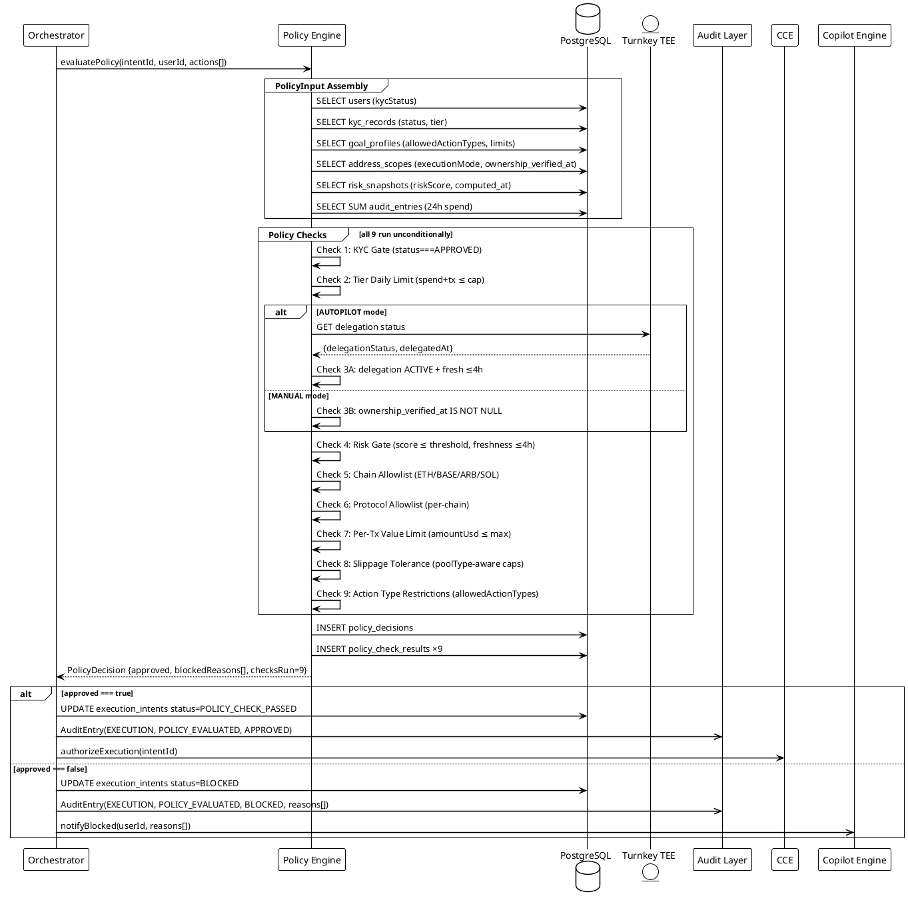

# 04 — Sequence Diagram: Policy Evaluation & Authorization

**Pack:** CrestFlow UML & Architecture Documentation Pack  
**Version:** 1.0 | **Source docs:** `policy_engine.md` v2.0, `implementation_spec.md` v1.0 §6–§7, `CANONICAL_DECISIONS.md` v1.2 (D1, D7, D9)  
**Primary deliverable:** Lucidchart-ready specification. PlantUML is supplementary only.

---

## 1. Purpose & Scope

Specifies the complete Policy Engine evaluation sequence that runs between the Simulation stage and the CCE (Chain Command Executor) stage of every execution pipeline. Covers:

- Assembly of `PolicyInput` from multiple data sources
- All 9 policy checks executed in order (no short-circuit — all 9 always run)
- `PolicyDecision` output: approved or blocked with reasons
- APPROVED path: CCE is authorized to proceed
- BLOCKED path: audit entry written, Copilot notification sent, saga transitions to BLOCKED
- Risk snapshot freshness check (14,400s / 4h window)
- KYC Tier daily limit query (rolling 24h window on `audit_entries`)
- Turnkey delegation freshness check for AUTOPILOT execution mode (4h window)

**Out of scope:** Saga routing/building (covered in `05_seq_transaction_execution.md`), simulation (see same), CCE signing (see same).

---

## 2. Participants & Lifelines

| # | Participant | Type | Stereotype | Lucidchart Shape |
|---|---|---|---|---|
| 1 | Orchestrator/Planner | System | «control» | Rounded rectangle |
| 2 | Policy Engine (NestJS service) | System | «service» | Rounded rectangle |
| 3 | PostgreSQL | System | «database» | Cylinder |
| 4 | Redis | System | «cache» | Cylinder (dashed) |
| 5 | Turnkey TEE | External | «external TEE» | Rectangle (grey fill) |
| 6 | Audit Layer | System | «service» | Rounded rectangle |
| 7 | CCE (Chain Command Executor) | System | «service» | Rounded rectangle |
| 8 | Copilot Engine | System | «service» | Rounded rectangle |

**Lifeline ordering (left → right):** Orchestrator → Policy Engine → PostgreSQL → Redis → Turnkey TEE → Audit Layer → CCE → Copilot Engine

---

## 3. Preconditions

- Simulation has completed successfully; `SimulationResult` is available with `simulatedActions[]` and estimated values.
- `ExecutionIntent` record exists with status `SIMULATING` → about to transition to `POLICY_CHECK`.
- `users`, `address_scopes`, `kyc_records`, `goal_profiles`, `risk_snapshots`, `audit_entries` tables are populated for this user.
- Policy Engine has no internal state — it is a pure function of `PolicyInput`.

---

## 4. Main Flow — Step-by-Step

### Stage 0: PolicyInput Assembly

```
Step 1:  Orchestrator → Policy Engine:  evaluatePolicy(executionIntentId, userId, simulatedActions[])
Step 2:  Policy Engine → PostgreSQL:    SELECT * FROM users WHERE id = $userId
         → { kycStatus, executionMode }
Step 3:  Policy Engine → PostgreSQL:    SELECT * FROM kyc_records WHERE user_id = $userId ORDER BY created_at DESC LIMIT 1
         → { status: KycStatus, tier: KycTier }
Step 4:  Policy Engine → PostgreSQL:    SELECT * FROM goal_profiles WHERE user_id = $userId AND is_active = true
         → { allowedActionTypes[], maxUsdPerTransaction, maxSlippagePercent, allowedChains[] }
Step 5:  Policy Engine → PostgreSQL:    SELECT * FROM address_scopes WHERE user_id = $userId AND address = $signerAddress
         → { executionMode, ownership_verified_at }
Step 6:  Policy Engine → PostgreSQL:    SELECT * FROM risk_snapshots WHERE user_id = $userId ORDER BY created_at DESC LIMIT 1
         → { riskScore, computed_at, adjustedThreshold }
Step 7:  Policy Engine → PostgreSQL:    SELECT SUM(amount_usd) FROM audit_entries
             WHERE user_id = $userId AND category = 'EXECUTION'
             AND created_at > NOW() - INTERVAL '24 hours'
         → { dailySpendUsd }   [for KYC Tier daily limit check]
```

### Stage 1: Check 1 — KYC Gate

```
Step 8:  Policy Engine:  EVALUATE Check 1 — KYC Gate
         Guard: kyc_records.status === 'APPROVED'
         PASS: continue
         FAIL: add { check: 'KYC_GATE', reason: 'KYC_NOT_APPROVED', kycStatus } to blockedReasons[]
```

### Stage 2: Check 2 — KYC Tier Daily Limit

```
Step 9:  Policy Engine:  EVALUATE Check 2 — Tier Daily Limit
         tierLimit: TIER_1=1000, TIER_2=10000, TIER_3=∞
         Guard: dailySpendUsd + estimatedTxUsd ≤ tierLimit
         PASS: continue
         FAIL: add { check: 'KYC_TIER_LIMIT', reason: 'DAILY_LIMIT_EXCEEDED', dailySpendUsd, tierLimit }
```

### Stage 3: Check 3 — Execution Authority

```
Step 10: Policy Engine:  EVALUATE Check 3 — Execution Authority
         [alt AUTOPILOT mode]
Step 11: Policy Engine → Turnkey TEE:  GET /public/v1/query/list_private_keys
             { organizationId: subOrgId }
         → { delegationStatus, delegatedAt }
Step 12: Policy Engine:  Guard — delegationStatus === 'ACTIVE' AND
                               NOW() - delegatedAt ≤ 14400s (4h)
         PASS: continue
         FAIL (not active): add { check: 'EXECUTION_AUTHORITY', reason: 'AUTHORITY_REVOKED' }
         FAIL (stale):       add { check: 'EXECUTION_AUTHORITY', reason: 'AUTHORITY_STALE' }
         [alt MANUAL mode]
Step 13: Policy Engine:  Guard — address_scopes.ownership_verified_at IS NOT NULL
         PASS: continue
         FAIL: add { check: 'EXECUTION_AUTHORITY', reason: 'OWNERSHIP_NOT_VERIFIED' }
         [end alt]
```

### Stage 4: Check 4 — Risk Gate

```
Step 14: Policy Engine:  EVALUATE Check 4 — Risk Gate
         Guard 1: NOW() - risk_snapshots.computed_at ≤ 14400s (4h freshness)
         Guard 2: risk_snapshots.riskScore ≤ adjustedThreshold
         adjustedThreshold = baseThreshold × personaMultiplier
           Persona multipliers: CAPITAL_PRESERVATION 0.5×, CONSERVATIVE 0.7×,
                                MODERATE 1.0×, AGGRESSIVE 1.3×, YIELD_SEEKER 1.15×
         PASS: continue
         FAIL (stale):     add { check: 'RISK_GATE', reason: 'RISK_SNAPSHOT_STALE' }
         FAIL (exceeded):  add { check: 'RISK_GATE', reason: 'RISK_SCORE_EXCEEDED', riskScore, adjustedThreshold }
```

### Stage 5: Check 5 — Chain Allowlist

```
Step 15: Policy Engine:  EVALUATE Check 5 — Chain Allowlist
         Allowed chains: ETH, BASE, ARB, SOL (MVP only)
         Guard: ALL simulatedActions[].chain IN ['ETH','BASE','ARB','SOL']
         PASS: continue
         FAIL: add { check: 'CHAIN_ALLOWLIST', reason: 'CHAIN_NOT_ALLOWED', chain }
```

### Stage 6: Check 6 — Protocol Allowlist

```
Step 16: Policy Engine:  EVALUATE Check 6 — Protocol Allowlist
         Per-chain protocol lists (from GoalProfile.allowedProtocols or system default):
           ETH: Uniswap V3, Aave V3
           BASE: Uniswap V3, Aerodrome, Aave V3, Moonwell
           ARB: Uniswap V3, Aave V3
           SOL: Jupiter, Raydium, Kamino, MarginFi
         Guard: ALL simulatedActions[].protocol IN allowedProtocols[chain]
         PASS: continue
         FAIL: add { check: 'PROTOCOL_ALLOWLIST', reason: 'PROTOCOL_NOT_ALLOWED', protocol }
```

### Stage 7: Check 7 — Per-Transaction Value Limit

```
Step 17: Policy Engine:  EVALUATE Check 7 — Per-Transaction Value Limit
         Guard: ALL simulatedActions[].amountUsd ≤ goalProfile.maxUsdPerTransaction
         PASS: continue
         FAIL: add { check: 'PER_TX_LIMIT', reason: 'AMOUNT_EXCEEDS_LIMIT', amountUsd, limit }
```

### Stage 8: Check 8 — Slippage Tolerance

```
Step 18: Policy Engine:  EVALUATE Check 8 — Slippage Tolerance
         poolType-aware caps:
           stable:          maxSlippage = 0.25%
           correlated:      maxSlippage = 0.50%
           constant_product: maxSlippage = 1.00%
         Guard: simulatedActions[].estimatedSlippage ≤ cap[poolType]
         PASS: continue
         FAIL: add { check: 'SLIPPAGE_TOLERANCE', reason: 'SLIPPAGE_EXCEEDED', slippage, cap }
```

### Stage 9: Check 9 — Action Type Restrictions

```
Step 19: Policy Engine:  EVALUATE Check 9 — Action Type Restrictions
         Guard: ALL simulatedActions[].actionType IN goalProfile.allowedActionTypes
         Exact allowedActionTypes values: SWAP, LEND_SUPPLY, LEND_WITHDRAW, BRIDGE
         (NOT: LEND_DEPOSIT — use LEND_SUPPLY)
         PASS: continue
         FAIL: add { check: 'ACTION_TYPE', reason: 'ACTION_TYPE_NOT_ALLOWED', actionType }
```

### Stage 10: PolicyDecision Output

```
Step 20: Policy Engine:  Build PolicyDecision {
           approved: blockedReasons.length === 0,
           blockedReasons[],
           checksRun: 9,
           timestamp: NOW(),
           executionIntentId
         }
Step 21: Policy Engine → PostgreSQL:  INSERT INTO policy_decisions (execution_intent_id, approved, blocked_reasons, checks_run, evaluated_at)
Step 22: Policy Engine → PostgreSQL:  INSERT INTO policy_check_results (policy_decision_id, check_name, passed, reason) × 9 rows
Step 23: Policy Engine → Orchestrator: return PolicyDecision
```

### Stage 11: APPROVED Path

```
Step 24: Orchestrator:   [guard: PolicyDecision.approved === true]
Step 25: Orchestrator → PostgreSQL:  UPDATE execution_intents SET status = 'POLICY_CHECK' (confirmed pass)
Step 26: Orchestrator → Audit Layer: emit AuditEntry { category=EXECUTION, action=POLICY_EVALUATED, outcome=APPROVED }
Step 27: Orchestrator → CCE:         authorizeExecution(executionIntentId, simulatedActions[])
         [CCE proceeds — see 05_seq_transaction_execution.md]
```

### Stage 12: BLOCKED Path

```
Step 24b: Orchestrator:  [guard: PolicyDecision.approved === false]
Step 25b: Orchestrator → PostgreSQL:  UPDATE execution_intents SET status = 'BLOCKED'
Step 26b: Orchestrator → Audit Layer: emit AuditEntry { category=EXECUTION, action=POLICY_EVALUATED, outcome=BLOCKED, blockedReasons[] }
Step 27b: Orchestrator → Copilot Engine: notifyBlocked(userId, blockedReasons[], executionIntentId)
Step 28b: Copilot Engine → PostgreSQL: store copilot notification for retrieval
Step 29b: Orchestrator → Orchestrator: saga reaches terminal state BLOCKED
```

---

## 5. Alternative Fragments

| Fragment ID | Type | Guard | Steps | Description |
|---|---|---|---|---|
| ALT-AUTH-A | alt | `address_scopes.executionMode === AUTOPILOT` | 11–12 | Autopilot: Turnkey delegation check |
| ALT-AUTH-B | alt | `address_scopes.executionMode === MANUAL` | 13 | Manual: ownership_verified_at check |
| ALT-APPROVED | alt | `blockedReasons.length === 0` | 24–27 | Approved path → CCE |
| ALT-BLOCKED | alt | `blockedReasons.length > 0` | 24b–29b | Blocked path → audit + notification |
| LOOP-CHECKS | loop | check index 1..9 | 8–19 | All 9 checks run unconditionally |

---

## 6. Postconditions

**APPROVED:**
- `policy_decisions` row: `approved = true`, `checks_run = 9`
- `policy_check_results` rows: 9 rows, all `passed = true`
- `audit_entries` row: `category=EXECUTION, action=POLICY_EVALUATED, outcome=APPROVED`
- Saga status: transitions to CCE processing

**BLOCKED:**
- `policy_decisions` row: `approved = false`, `blocked_reasons` populated
- `policy_check_results` rows: 9 rows, ≥ 1 `passed = false`
- `audit_entries` row: `category=EXECUTION, action=POLICY_EVALUATED, outcome=BLOCKED`
- Saga status: `BLOCKED` (terminal)
- Copilot notification: queued for user

---

## 7. Exceptions & Recovery

| Exception | Trigger | Handling |
|---|---|---|
| PostgreSQL timeout on data fetch (Steps 2–7) | DB overload | Policy Engine returns BLOCKED with reason `DATA_UNAVAILABLE`; saga stays POLICY_CHECK for retry |
| Turnkey TEE unavailable (Step 11) | TEE network error | AUTOPILOT check fails with `AUTHORITY_CHECK_FAILED`; saga blocked |
| Risk snapshot absent | No prior E2 run for user | Check 4 fails with `RISK_SNAPSHOT_MISSING` |
| GoalProfile absent | User has no active goal profile | Checks 6–9 cannot run; block with `GOAL_PROFILE_MISSING` |
| `blockedReasons` present but Copilot notification fails | Copilot Engine unreachable | Saga still transitions to BLOCKED; notification failure logged to Audit Layer separately |

---

## 8. Audit Events

| Trigger | AuditCategory | AuditAction | Actor |
|---|---|---|---|
| Policy evaluation completes — approved | EXECUTION | POLICY_EVALUATED | System |
| Policy evaluation completes — blocked | EXECUTION | POLICY_EVALUATED | System |

**Note:** Individual check-level audit granularity is stored in `policy_check_results` table, not as separate `audit_entries`. The `audit_entries` table captures the final outcome only.

---

## 9. Connection Table

| # | From | To | Message / Label | Arrow Type | Notes |
|---|---|---|---|---|---|
| 1 | Orchestrator | Policy Engine | evaluatePolicy(intentId, userId, actions[]) | Synchronous | Blocking call; Orchestrator awaits result |
| 2 | Policy Engine | PostgreSQL | SELECT users | Synchronous | 5 sequential DB queries for input assembly |
| 3 | Policy Engine | PostgreSQL | SELECT kyc_records | Synchronous | |
| 4 | Policy Engine | PostgreSQL | SELECT goal_profiles | Synchronous | |
| 5 | Policy Engine | PostgreSQL | SELECT address_scopes | Synchronous | |
| 6 | Policy Engine | PostgreSQL | SELECT risk_snapshots | Synchronous | |
| 7 | Policy Engine | PostgreSQL | SELECT SUM audit_entries (24h spend) | Synchronous | Rolling window query |
| 8 | Policy Engine | Turnkey TEE | GET delegation status | Synchronous | AUTOPILOT only; HTTPS |
| 9 | Turnkey TEE | Policy Engine | delegationStatus, delegatedAt | Return | |
| 10 | Policy Engine | PostgreSQL | INSERT policy_decisions | Synchronous | |
| 11 | Policy Engine | PostgreSQL | INSERT policy_check_results ×9 | Synchronous | |
| 12 | Policy Engine | Orchestrator | return PolicyDecision | Return | |
| 13 | Orchestrator | PostgreSQL | UPDATE execution_intents status | Synchronous | |
| 14 | Orchestrator | Audit Layer | emit AuditEntry POLICY_EVALUATED | Asynchronous | Fire-and-forget |
| 15 | Orchestrator | CCE | authorizeExecution (APPROVED path) | Synchronous | |
| 16 | Orchestrator | Copilot Engine | notifyBlocked (BLOCKED path) | Asynchronous | |

---

## 10. Layout Recommendations

**Horizontal axis (lifelines, left to right):**
Orchestrator | Policy Engine | PostgreSQL | Redis | Turnkey TEE | Audit Layer | CCE | Copilot Engine

**Vertical grouping (use Lucidchart colored swim-bands):**
- Band 1 (blue): PolicyInput Assembly (Steps 1–7)
- Band 2 (orange): Checks 1–9 (Steps 8–19) — use sub-bands or numbering
- Band 3 (green): PolicyDecision Build + Write (Steps 20–23)
- Band 4 (green, lighter): APPROVED path (Steps 24–27)
- Band 4b (red, lighter): BLOCKED path (Steps 24b–29b)

**Tips:**
- Use an `alt` combined fragment spanning the full width for APPROVED vs BLOCKED (Steps 24+).
- Each policy check can be shown as a compact self-call on Policy Engine with a small annotation note.
- Group DB queries 2–7 into a `loop` or `seq` fragment labeled "PolicyInput Assembly" to reduce visual noise.
- Turnkey TEE lifeline only activates during AUTOPILOT Check 3 — use `opt` fragment wrapping Step 11–12.

---

## 11. Supplementary PlantUML



---

## 12. Flags & Open Questions

| Flag ID | Type | Description | Impact |
|---|---|---|---|
| F-04-01 | **Confirmed** | All 9 checks run with no short-circuit. This is intentional per policy_engine.md — all failures are collected before returning PolicyDecision. | Diagram must show 9 sequential steps, not early exit |
| F-04-02 | **Assumption** | Redis is not shown in this diagram because policy data (risk snapshots, goal profiles) is fetched fresh from PostgreSQL for correctness. Redis cache may be hit for price data but not for policy inputs. | Minor — verify in policy_engine.md if Redis is consulted |
| F-04-03 | **Unresolved** | Protocol safety score threshold for `LOW_PROTOCOL_SAFETY` alert is a configuration value not specified in planning docs. Check 6 uses protocol allowlist, not safety score. | Diagram is accurate as drawn |
| F-04-04 | **Naming** | Use `LEND_SUPPLY` and `LEND_WITHDRAW` exactly in Check 9 — never `LEND_DEPOSIT`. | Lucidchart label accuracy |
| F-04-05 | **Assumption** | `adjustedThreshold` = base risk threshold from GoalProfile × persona multiplier. The base threshold default value is not specified in docs — assumed configurable. | Minor |
| F-04-06 | **Timing** | Turnkey delegation freshness is 4 hours (same as risk snapshot). Mismatch could occur if delegation is checked but risk is stale simultaneously — both would trigger separate blocked reasons. | Acceptable per design |
