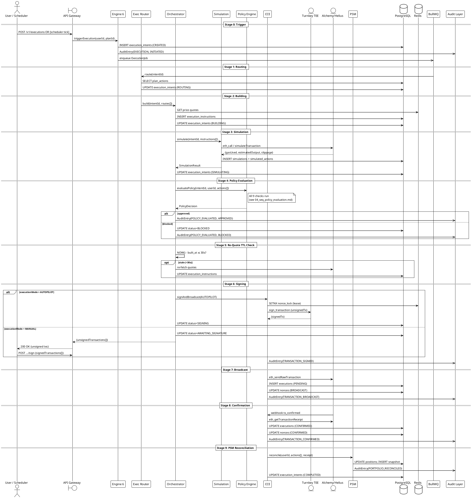

# 05 — Sequence Diagram: Transaction Execution (Full Pipeline)

**Pack:** CrestFlow UML & Architecture Documentation Pack  
**Version:** 1.0 | **Source docs:** `implementation_spec.md` v1.0 §6–§9, `orchestrator_planner.md` v2.0, `execution_router.md` v2.0, `protocol_layer.md` v2.0, `CANONICAL_DECISIONS.md` v1.2 (D1, D2, D7)  
**Primary deliverable:** Lucidchart-ready specification. PlantUML is supplementary only.

---

## 1. Purpose & Scope

Specifies the complete end-to-end transaction execution pipeline from trigger to on-chain confirmation. Covers:

- Trigger: Autopilot scheduler (AUTOPILOT) or manual user action (MANUAL)
- Full D7 pipeline: `Engine 6 → Execution Router → Orchestrator/Planner → Simulation → Policy Engine → CCE → PSM`
- Path A vs Path B branching at the CCE signing step
- Gas accounting per chain (EIP-1559 Ethereum, Base L2, Arbitrum L2, Solana)
- Saga state transitions alongside each pipeline stage
- 30-second re-quote TTL guard before signing
- Nonce management (CCE owns all nonce operations)
- Compensation trigger on `STEP_FAILED`
- BullMQ async job queuing for each stage
- Audit events at each lifecycle step

**Out of scope:** CCTP cross-chain bridge (see `06_seq_cctp_bridge.md`). Policy Engine detail (see `04_seq_policy_evaluation.md`).

---

## 2. Participants & Lifelines

| # | Participant | Type | Stereotype | Lucidchart Shape |
|---|---|---|---|---|
| 1 | User / Autopilot Scheduler | Actor | «actor» | Stick figure / Clock symbol |
| 2 | API Gateway | System | «boundary» | Rectangle (dashed) |
| 3 | Engine 6 — Execution Intelligence | System | «service» | Rounded rectangle |
| 4 | Execution Router (ER) | System | «service» | Rounded rectangle |
| 5 | Orchestrator/Planner (ORC) | System | «control» | Rounded rectangle |
| 6 | Simulation Engine | System | «service» | Rounded rectangle |
| 7 | Policy Engine (PE) | System | «service» | Rounded rectangle |
| 8 | CCE (Chain Command Executor) | System | «service» | Rounded rectangle |
| 9 | Turnkey TEE | External | «external TEE» | Rectangle (grey fill) |
| 10 | Alchemy / Helius RPC | External | «external» | Rectangle (grey fill) |
| 11 | Portfolio State Manager (PSM) | System | «service» | Rounded rectangle |
| 12 | PostgreSQL | System | «database» | Cylinder |
| 13 | Redis | System | «cache» | Cylinder (dashed) |
| 14 | BullMQ Worker | System | «async» | Rounded rectangle (dashed) |
| 15 | Audit Layer | System | «service» | Rounded rectangle |

**Lifeline ordering:** User/Scheduler → API GW → E6 → ER → ORC → Simulation → PE → CCE → Turnkey TEE → Alchemy/Helius → PSM → PostgreSQL → Redis → BullMQ → Audit Layer

---

## 3. Preconditions

- User has `kycStatus = APPROVED` and ≥ 1 active `address_scope`.
- For AUTOPILOT: delegation state is `ACTIVE`, `AutopilotConfig.enabled = true`.
- For MANUAL: user has authenticated and submitted explicit execution intent.
- `strategy_plans` row exists with status `APPROVED` (plan approved by user or auto-approved for autopilot).
- `goal_profiles` row exists and is active.
- Risk + yield snapshots are within freshness windows.

---

## 4. Main Flow — Step-by-Step

### Stage 0: Trigger & Intent Creation

```
Step 1:  [AUTOPILOT] BullMQ Scheduler → E6:          triggerDriftCheck(userId)
         [MANUAL]    User → API Gateway:               POST /v1/executions  { planId, executionMode: MANUAL }

Step 2:  E6 → PostgreSQL:                             SELECT current portfolio state, positions[], risk_snapshots
Step 3:  E6 → E6:                                     Compute drift score; determine DriftUrgency
                                                       NONE/LOW: skip; MEDIUM: queue; HIGH/EMERGENCY: immediate
Step 4:  E6 → PostgreSQL:                             INSERT INTO execution_intents
                                                         { userId, planId, executionMode, status: CREATED, createdAt }
Step 5:  E6 → Audit Layer:                            emit AuditEntry { category=EXECUTION, action=EXECUTION_INITIATED }
Step 6:  E6 → BullMQ Worker:                          enqueue ExecutionJob { executionIntentId }
         Saga state: CREATED
```

### Stage 1: Routing (Execution Router)

```
Step 7:  BullMQ Worker → ER:                          route(executionIntentId)
Step 8:  ER → PostgreSQL:                             SELECT execution_intents, plan_actions[] (from strategy_plans)
Step 9:  ER → ER:                                     Determine chain(s), venues, bridge requirements
                                                       Is bridge needed? → route via CCTP path (see 06_seq_cctp_bridge.md)
                                                       Venue selection: Uniswap V3 / Aerodrome / Jupiter / Raydium / Aave V3 / Moonwell / Kamino / MarginFi
Step 10: ER → PostgreSQL:                             UPDATE execution_intents SET status = ROUTING, router_output = { routes[] }
         Saga state: ROUTING
```

### Stage 2: Building (Orchestrator/Planner)

```
Step 11: ER → ORC:                                    build(executionIntentId, routes[])
Step 12: ORC → PostgreSQL:                            SELECT plan_actions (actionType, amountIn, chain, protocol)
Step 13: ORC → Redis:                                 GET price quote for each action (TTL 30s)
         [if cache miss]
Step 13b: ORC → Alchemy/Helius:                       fetch current price / pool data
           ORC → Redis:                               SET price cache (EX 30)
Step 14: ORC → ORC:                                   Build ExecutionInstructions[] per action:
                                                         amountIn: BaseUnits (integer string — NEVER decimal)
                                                         deadline: NOW() + 30s (re-quote TTL)
Step 15: ORC → PostgreSQL:                            INSERT INTO execution_instructions (action_id, instruction_payload, built_at)
Step 16: ORC → PostgreSQL:                            UPDATE execution_intents SET status = BUILDING
         Saga state: BUILDING
```

### Stage 3: Simulation

```
Step 17: ORC → Simulation:                            simulate(executionIntentId, instructions[])
Step 18: Simulation → Alchemy/Helius:                 eth_call / simulateTransaction (dry-run on current state)
Step 19: Alchemy/Helius → Simulation:                 { gasUsed, estimatedOutput, estimatedSlippage, success }
Step 20: Simulation → Simulation:                     Compute amountOut, slippage impact, gas cost per chain:
                                                         Ethereum: gasUsed × (baseFee + priorityFee) × 1.15 buffer
                                                         Base: gasUsed × (baseFee + priorityFee) + GasPriceOracle.getL1Fee(txBytes) + getOperatorFee(gasUsed)
                                                         Arbitrum: L2 gas + NodeInterface(0xc8).gasEstimateL1Component(to, false, data)
                                                         Solana: 5000 lamports/sig + computeUnitLimit × computeUnitPriceMicroLamports
Step 21: Simulation → PostgreSQL:                     INSERT INTO simulations { results, estimated_gas_usd, estimated_slippage }
Step 22: Simulation → PostgreSQL:                     INSERT INTO simulated_actions[] (per action)
Step 23: Simulation → ORC:                            SimulationResult { success, gasEstimates[], slippages[], amountsOut[] }
         [if simulation fails]
Step 23b: ORC → PostgreSQL:                           UPDATE execution_intents SET status = FAILED
           ORC → Audit Layer:                         emit AuditEntry { EXECUTION, SIMULATION_FAILED }
           [saga → FAILED — trigger compensation if needed]
Step 24: ORC → PostgreSQL:                            UPDATE execution_intents SET status = SIMULATING (complete)
         Saga state: SIMULATING
```

### Stage 4: Policy Evaluation

```
Step 25: ORC → PE:                                    evaluatePolicy(intentId, userId, simulatedActions[])
         [All 9 checks run — full detail in 04_seq_policy_evaluation.md]
Step 26: PE → ORC:                                    PolicyDecision { approved, blockedReasons[] }
         Saga state: POLICY_CHECK

         [alt BLOCKED]
Step 27b: ORC → PostgreSQL:                           UPDATE execution_intents SET status = BLOCKED
           ORC → Audit Layer:                         emit AuditEntry { EXECUTION, POLICY_EVALUATED, BLOCKED }
           [saga terminal: BLOCKED]

         [alt APPROVED — continue below]
Step 27: ORC → Audit Layer:                           emit AuditEntry { EXECUTION, POLICY_EVALUATED, APPROVED }
```

### Stage 5: Re-Quote TTL Check

```
Step 28: ORC → ORC:                                   Check: NOW() - instructions[].built_at ≤ 30s?
         [if stale — >30s elapsed]
Step 28b: ORC: re-execute Steps 13–16 (re-fetch quotes, rebuild instructions)
           ORC → Audit Layer: emit AuditEntry { EXECUTION, QUOTE_REFRESHED }
         [if fresh — continue]
```

### Stage 6a: CCE Signing — AUTOPILOT Path (Path A)

```
Step 29: ORC → CCE:                                   signAndBroadcast(intentId, instructions[], executionMode=AUTOPILOT)
Step 30: CCE → PostgreSQL:                            SELECT nonces WHERE chain = $chain AND address = $signerAddress
Step 31: CCE → Redis:                                 SETNX nonce_lock:{chain}:{address} = leaseId  EX 30  [lease nonce]
Step 32: CCE → CCE:                                   Allocate nonce: pendingNonce + 1 (EVM) or fetch recent blockhash (Solana)
Step 33: CCE → PostgreSQL:                            INSERT INTO nonces (chain, address, nonce, status=LEASED, leased_at)
Step 34: ORC → PostgreSQL:                            UPDATE execution_intents SET status = SIGNING
         Saga state: SIGNING (Autopilot)
Step 35: CCE → Turnkey TEE:                           POST /public/v1/submit/sign_transaction
              { organizationId: subOrgId, signWith: keyId, unsignedTransaction: hex }
Step 36: Turnkey TEE → CCE:                           { signedTransaction: hex }
Step 37: CCE → Audit Layer:                           emit AuditEntry { EXECUTION, TRANSACTION_SIGNED }
```

### Stage 6b: CCE Signing — MANUAL Path (Path B or Path A MANUAL mode)

```
Step 29b: ORC → PostgreSQL:                           UPDATE execution_intents SET status = AWAITING_SIGNATURE
           Saga state: AWAITING_SIGNATURE
Step 30b: ORC → API Gateway:                          return { unsignedTransactions[], intentId } to user
Step 31b: User → API Gateway:                         POST /v1/executions/:id/sign  { signedTransactions[] }
Step 32b: CCE → CCE:                                  Verify signatures are from ownerAddress (ecrecover / ed25519 verify)
Step 33b: CCE → Audit Layer:                          emit AuditEntry { EXECUTION, TRANSACTION_SIGNED }
           [continue at Stage 7 with signedTransactions[]]
```

### Stage 7: Broadcast

```
Step 38: CCE → Alchemy/Helius:                        eth_sendRawTransaction / sendTransaction (broadcast)
Step 39: CCE → PostgreSQL:                            UPDATE nonces SET status = BROADCAST, tx_hash = $hash
Step 40: CCE → PostgreSQL:                            INSERT INTO executions { tx_hash, status=PENDING, broadcasted_at }
Step 41: CCE → PostgreSQL:                            UPDATE execution_intents SET status = BROADCASTING
         Saga state: BROADCASTING
Step 42: CCE → Audit Layer:                           emit AuditEntry { EXECUTION, TRANSACTION_BROADCAST, txHash }
```

### Stage 8: Confirmation

```
Step 43: Alchemy/Helius → CCE:                        webhook: transaction_confirmed (Alchemy Notify / Helius webhook)
              Alchemy: X-Alchemy-Signature HMAC-SHA256 verified
              Helius: authHeader + secret URL verified
Step 44: CCE → Alchemy/Helius:                        eth_getTransactionReceipt (confirm finality)
Step 45: CCE → PostgreSQL:                            UPDATE executions SET status=CONFIRMED, confirmed_at, gas_used, block_number
Step 46: CCE → PostgreSQL:                            UPDATE nonces SET status=CONFIRMED
Step 47: CCE → PostgreSQL:                            UPDATE execution_intents SET status=CONFIRMING
         Saga state: CONFIRMING
Step 48: CCE → Audit Layer:                           emit AuditEntry { EXECUTION, TRANSACTION_CONFIRMED, txHash, gasUsed }
```

### Stage 9: PSM Reconciliation

```
Step 49: CCE → PSM:                                   reconcile(userId, executedActions[], txReceipt)
Step 50: PSM → PostgreSQL:                            UPDATE positions[] (new balances post-execution)
Step 51: PSM → PostgreSQL:                            INSERT INTO portfolio_snapshots (post-execution snapshot)
Step 52: PSM → Audit Layer:                           emit AuditEntry { EXECUTION, PORTFOLIO_RECONCILED }
Step 53: PSM → CCE:                                   reconciliation complete
Step 54: CCE → PostgreSQL:                            UPDATE execution_intents SET status = COMPLETED
         Saga state: COMPLETED (terminal)
```

---

## 5. Alternative Fragments

| Fragment ID | Type | Guard | Steps | Description |
|---|---|---|---|---|
| ALT-TRIGGER | alt | AUTOPILOT scheduler / MANUAL user | 1 | Trigger source |
| ALT-BRIDGE | opt | routes include cross-chain action | Step 9 branching | CCTP path — see `06_seq_cctp_bridge.md` |
| ALT-CACHE | alt | Redis cache hit on price quote | 13 vs 13b | Cache hit skips Alchemy/Helius call |
| ALT-SIM-FAIL | alt | simulation returns failure | 23b | Saga → FAILED |
| ALT-POLICY | alt | PolicyDecision.approved | 27 vs 27b | APPROVED continues; BLOCKED → terminal |
| ALT-REQUOTE | opt | NOW() - built_at > 30s | 28b | Re-quote stale instructions |
| ALT-SIGN-A | alt | executionMode = AUTOPILOT | 29–37 | Turnkey TEE signs |
| ALT-SIGN-B | alt | executionMode = MANUAL | 29b–33b | User signs externally |
| ALT-CONFIRM | alt | webhook vs polling | 43 | Webhook preferred; polling fallback |

---

## 6. Postconditions

- `execution_intents.status = COMPLETED`
- `executions` row: status=CONFIRMED, tx_hash, confirmed_at, gas_used
- `nonces` row: status=CONFIRMED
- `positions[]` updated with post-execution balances
- `portfolio_snapshots` new snapshot inserted
- Full audit trail: INITIATED → SIGNED → BROADCAST → CONFIRMED → RECONCILED

---

## 7. Exceptions & Recovery

| Exception | Trigger | Saga State | Recovery |
|---|---|---|---|
| Simulation failure | Dry-run reverts | `FAILED` | Manual retry after re-plan |
| Policy blocked | Any check fails | `BLOCKED` (terminal) | Re-evaluate conditions; create new plan |
| Broadcast failure | RPC error | `FAILED` | CCE retries with exponential backoff; nonce released |
| Tx dropped / stuck | Mempool expiry | `FAILED` | CCE detects via receipt timeout; re-broadcast with higher gas |
| Confirmation timeout | No webhook + no receipt | `FAILED` | CCE polling fallback; after N attempts → FAILED |
| STEP_FAILED during multi-step | One action in batch fails | `COMPENSATING` | CCE triggers compensation: attempt reversal of completed steps; → `COMPENSATED` or `MANUAL_RECOVERY` |
| Gas cap exceeded | Computed gas > user gas cap | `PAUSED` (queued) | Wait for lower gas conditions; re-attempt |

**Compensation path:**
```
STEP_FAILED → COMPENSATING → [all reversals complete] COMPENSATED
                            → [partial reversal only] PARTIAL_ROLLBACK  
                            → [reversal impossible]   MANUAL_RECOVERY
```

---

## 8. Audit Events

| Trigger | AuditCategory | AuditAction | Actor |
|---|---|---|---|
| Execution intent created | EXECUTION | EXECUTION_INITIATED | System/User |
| Simulation complete | EXECUTION | SIMULATION_COMPLETE | System |
| Simulation failed | EXECUTION | SIMULATION_FAILED | System |
| Policy approved | EXECUTION | POLICY_EVALUATED (APPROVED) | System |
| Policy blocked | EXECUTION | POLICY_EVALUATED (BLOCKED) | System |
| Quote refreshed (re-quote) | EXECUTION | QUOTE_REFRESHED | System |
| Transaction signed | EXECUTION | TRANSACTION_SIGNED | System/User |
| Transaction broadcast | EXECUTION | TRANSACTION_BROADCAST | System |
| Transaction confirmed | EXECUTION | TRANSACTION_CONFIRMED | System |
| Portfolio reconciled | EXECUTION | PORTFOLIO_RECONCILED | System |
| Compensation triggered | EXECUTION | COMPENSATION_TRIGGERED | System |

---

## 9. Connection Table

| # | From | To | Message / Label | Arrow Type | Notes |
|---|---|---|---|---|---|
| 1 | BullMQ / User | E6 / API GW | triggerDriftCheck / POST /v1/executions | Sync / Async | |
| 2 | E6 | PostgreSQL | SELECT positions, risk_snapshots | Sync | |
| 3 | E6 | BullMQ | enqueue ExecutionJob | Async | |
| 4 | ER | PostgreSQL | SELECT execution_intents, plan_actions | Sync | |
| 5 | ORC | Redis | GET price quote (TTL check) | Sync | |
| 6 | ORC | Alchemy/Helius | fetch price/pool data (cache miss) | Sync | HTTPS |
| 7 | ORC | PostgreSQL | INSERT execution_instructions | Sync | |
| 8 | Simulation | Alchemy/Helius | eth_call / simulateTransaction | Sync | HTTPS |
| 9 | ORC | PE | evaluatePolicy(intentId) | Sync | Blocking |
| 10 | CCE | Redis | SETNX nonce_lock (lease) | Sync | Atomic |
| 11 | CCE | Turnkey TEE | sign_transaction (AUTOPILOT) | Sync | HTTPS/TEE |
| 12 | CCE | Alchemy/Helius | eth_sendRawTransaction | Sync | HTTPS |
| 13 | Alchemy/Helius | CCE | webhook: tx_confirmed | Async | HMAC-verified |
| 14 | CCE | PSM | reconcile(userId, actions[], receipt) | Sync | |
| 15 | PSM | PostgreSQL | UPDATE positions, INSERT snapshot | Sync | |
| 16 | Audit Layer | PostgreSQL | INSERT audit_entries | Async | At each stage |

---

## 10. Layout Recommendations

**Horizontal axis (lifelines):**
User/Scheduler | API GW | E6 | ER | ORC | Simulation | PE | CCE | Turnkey TEE | Alchemy/Helius | PSM | PostgreSQL | Redis | BullMQ | Audit Layer

**Vertical bands (top to bottom, color-coded):**
- Band 0 (grey): Trigger & Intent (Steps 1–6)
- Band 1 (blue): Routing (Steps 7–10)
- Band 2 (cyan): Building (Steps 11–16)
- Band 3 (yellow): Simulation (Steps 17–24)
- Band 4 (orange): Policy Evaluation (Steps 25–27) — reference to File 04
- Band 5 (green): Re-Quote TTL (Step 28)
- Band 6a (green, solid): AUTOPILOT Signing (Steps 29–37)
- Band 6b (green, dashed): MANUAL Signing (Steps 29b–33b)
- Band 7 (purple): Broadcast (Steps 38–42)
- Band 8 (teal): Confirmation (Steps 43–48)
- Band 9 (dark green): PSM Reconciliation (Steps 49–54)

**Tips:**
- Use `alt` combined fragments for AUTOPILOT vs MANUAL at Stage 6.
- Policy Evaluation band can reference File 04 as a collapsed `ref` fragment to avoid duplication.
- Saga state annotations: add sticky notes at each stage transition labeling the saga state.
- Compensation path: add a separate `opt` block below Stage 7 for the STEP_FAILED compensation flow.

---

## 11. Supplementary PlantUML



---

## 12. Flags & Open Questions

| Flag ID | Type | Description | Impact |
|---|---|---|---|
| F-05-01 | **Confirmed** | `amountIn` must always be `BaseUnits` (integer string). Never decimal. This applies to all execution instructions. | Diagram label accuracy |
| F-05-02 | **Confirmed** | `LEND_SUPPLY` / `LEND_WITHDRAW` are correct action types. Never `LEND_DEPOSIT`. | Diagram label accuracy |
| F-05-03 | **D2** | GMX is read-only display only — no automated execution. `AWAITING_FULFILLMENT` saga state is reserved but unreachable in MVP. | Do not show GMX execution path |
| F-05-04 | **Assumption** | BullMQ is backed by Redis and queues each pipeline stage as a separate job. Inter-stage handoff is via queue, not direct function call. The diagram shows conceptual message passing; actual implementation uses BullMQ job IDs. | Minor architectural note |
| F-05-05 | **Unresolved** | `SPLIT_THRESHOLD` for split order routing is noted as per-chain but specific values not specified in docs. ER routing logic shows single-route for simplicity. | Minor |
| F-05-06 | **Phase 2** | Kafka event bus is a Phase 2 option if BullMQ/Redis volume requires it. Current diagram uses BullMQ only. | No impact on MVP diagram |
| F-05-07 | **Assumption** | "30s re-quote TTL" is the maximum age of built instructions before they must be refreshed prior to signing. This is based on price volatility considerations noted in orchestrator_planner.md. | Affects Stage 5 |
