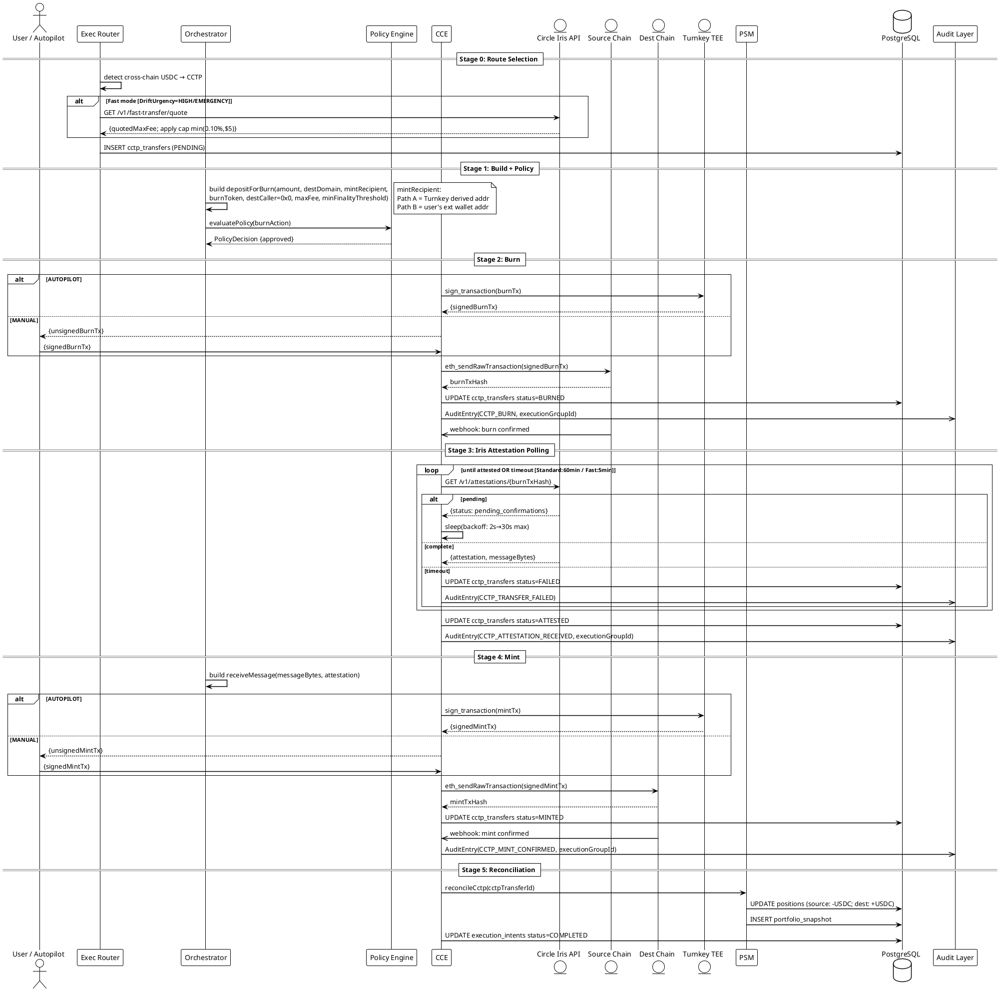

# 06 — Sequence Diagram: CCTP Cross-Chain Transfer

**Pack:** CrestFlow UML & Architecture Documentation Pack  
**Version:** 1.0 | **Source docs:** `cross_chain_ecosystem.md` v2.0, `protocol_layer.md` v2.0, `implementation_spec.md` v1.0 §8, `CANONICAL_DECISIONS.md` v1.2 (D3, D5)  
**Primary deliverable:** Lucidchart-ready specification. PlantUML is supplementary only.

---

## 1. Purpose & Scope

Specifies the complete CCTP V2 cross-chain USDC transfer sequence from route selection to on-chain mint and PSM reconciliation. Covers:

- Route selection: speed (Standard/Fast), source/destination domain, fee quotation
- Planner building `depositForBurn` with all 7 CCTP V2 parameters
- Policy Engine approval (all 9 checks)
- CCE broadcasting burn transaction on source chain
- Circle Iris API polling for attestation (exponential backoff 2s → 30s max)
- Attestation receipt and `receiveMessage` construction
- Mint transaction broadcast on destination chain
- PSM balance reconciliation
- Standard vs Fast mode branching
- Path A vs Path B signing branching
- `CctpTransfer` status transitions: `PENDING → BURNED → ATTESTED → MINTED`
- Timeout handling and manual recovery flag
- Shared `executionGroupId` across burn + mint audit entries

**Out of scope:** Non-CCTP bridge protocols (LI.FI/Socket — Phase 2 only). Non-USDC assets (CCTP is USDC-only per D3).

---

## 2. Participants & Lifelines

| # | Participant | Type | Stereotype | Lucidchart Shape |
|---|---|---|---|---|
| 1 | User / Autopilot | Actor | «actor» | Stick figure / Clock |
| 2 | Engine 6 (E6) | System | «service» | Rounded rectangle |
| 3 | Execution Router (ER) | System | «service» | Rounded rectangle |
| 4 | Orchestrator/Planner (ORC) | System | «control» | Rounded rectangle |
| 5 | Policy Engine (PE) | System | «service» | Rounded rectangle |
| 6 | CCE | System | «service» | Rounded rectangle |
| 7 | Circle Iris API | External | «external» | Rectangle (grey fill) |
| 8 | Source Chain (ETH / ARB / BASE) | External | «blockchain» | Rectangle (blue tint) |
| 9 | Destination Chain (BASE / SOL / ETH / ARB) | External | «blockchain» | Rectangle (blue tint) |
| 10 | Turnkey TEE | External | «external TEE» | Rectangle (grey fill, lock) |
| 11 | PSM | System | «service» | Rounded rectangle |
| 12 | PostgreSQL | System | «database» | Cylinder |
| 13 | Audit Layer | System | «service» | Rounded rectangle |

---

## 3. Preconditions

- `strategy_plans` includes a cross-chain action requiring USDC bridge.
- Source chain wallet has sufficient USDC balance.
- CCTP V2 TokenMinter contract is deployed on source chain (ETH/ARB/BASE).
- MessageTransmitter contract is deployed on destination chain.
- For Fast mode: source chain must support CCTP V2 Fast (ETH, ARB, BASE — all supported).
- `executionGroupId` (UUID) is generated before burn to link burn + mint audit entries.

---

## 4. Main Flow — Step-by-Step

### Stage 0: Route Selection (Execution Router)

```
Step 1:  E6 → ER:                              route(intentId) — includes cross-chain action
Step 2:  ER → ER:                              Detect cross-chain requirement:
                                                 source_chain ≠ destination_chain AND asset = USDC → CCTP
Step 3:  ER → ER:                              Determine speed mode:
                                                 DriftUrgency = HIGH or EMERGENCY → Fast eligible
                                                 Otherwise → Standard
Step 4:  [if Fast mode]
         ER → Circle Iris API:                 GET /v1/fast-transfer/quote
              { amount, sourceChain, destChain }
         → { quotedMaxFee, estimatedTime: 5min }
         Apply fee cap: min(0.10% × amount, $5.00)
Step 5:  ER → ER:                              Resolve destination domain:
                                                 ETH = 0, ARB = 3, SOL = 5, BASE = 6
Step 6:  ER → PostgreSQL:                      INSERT INTO cctp_transfers
              { executionGroupId, sourceChain, destChain, destDomain, amount, speed, status: PENDING, maxFee, minFinalityThreshold }
         CctpTransfer status: PENDING
Step 7:  ER → ORC:                             buildCctpTransfer(intentId, cctpTransferId, speed, domainParams)
```

### Stage 1: Build depositForBurn

```
Step 8:  ORC → ORC:                            Build depositForBurn call:
              depositForBurn(
                amount,                          // USDC in smallest units (integer BaseUnits)
                destinationDomain,               // ETH=0, ARB=3, SOL=5, BASE=6
                mintRecipient,                   // resolved below
                burnToken,                       // USDC token address on source chain
                destinationCaller = 0x0,         // permissionless — anyone can relay mint
                maxFee,                          // Standard: 0; Fast: quoted fee (capped)
                minFinalityThreshold             // Standard: 2000; Fast: 1000
              )

Step 9:  ORC → ORC:                            Resolve mintRecipient:
                                                 Path A (Turnkey wallet): mintRecipient = Turnkey-derived address on dest chain
                                                 Path B (external wallet): mintRecipient = user's external wallet address on dest chain

Step 10: ORC → PostgreSQL:                     UPDATE cctp_transfers SET mint_recipient = resolvedAddress, burn_params = { all 7 params }
Step 11: ORC → PE:                             evaluatePolicy(intentId, userId, [burnAction])
         [All 9 policy checks run — see 04_seq_policy_evaluation.md]
Step 12: PE → ORC:                             PolicyDecision { approved }
         [if BLOCKED → saga BLOCKED terminal — same as standard execution]
```

### Stage 2: CCE Burn Transaction (Source Chain)

```
Step 13: ORC → CCE:                            broadcastBurn(cctpTransferId, depositForBurnCalldata)
Step 14: CCE → CCE:                            Lease source-chain nonce

[alt AUTOPILOT — Path A]
Step 15a: CCE → Turnkey TEE:                   sign_transaction(burnTx, sourceChainOrgId)
          Turnkey TEE → CCE:                   { signedBurnTx }
[alt MANUAL — Path A/B]
Step 15b: CCE → User (via API GW):             return { unsignedBurnTx } for user to sign
          User → CCE:                          { signedBurnTx }
[end alt]

Step 16: CCE → Source Chain:                   eth_sendRawTransaction(signedBurnTx)
Step 17: Source Chain → CCE:                   txHash (burn transaction pending)
Step 18: CCE → PostgreSQL:                     UPDATE cctp_transfers SET status = BURNED, burn_tx_hash = txHash, burned_at = NOW()
         CctpTransfer status: BURNED
Step 19: CCE → Audit Layer:                    emit AuditEntry { category=EXECUTION, action=TRANSACTION_BROADCAST,
              subType=CCTP_BURN, executionGroupId, txHash, sourceChain }
Step 20: Source Chain → CCE:                   webhook/poll: burn tx confirmed
Step 21: CCE → PostgreSQL:                     UPDATE cctp_transfers SET burn_confirmed_at = NOW()
```

### Stage 3: Iris Attestation Polling

```
Step 22: CCE:                                  Start Iris polling loop (exponential backoff):
                                                 Initial delay: 2s
                                                 Backoff multiplier: 2×
                                                 Max delay: 30s
                                                 Timeout: Standard=3600s (60min), Fast=300s (5min)

Step 23: [loop until attestation received OR timeout]
         CCE → Circle Iris API:                GET /v1/attestations/{burnTxHash}
         [alt attestation not ready]
         Circle Iris API → CCE:               { status: "pending_confirmations" }
         CCE: sleep(backoffDelay); backoffDelay = min(backoffDelay×2, 30s)
         [alt attestation ready]
         Circle Iris API → CCE:               { status: "complete", attestation: hex, messageBytes: hex }
         [alt timeout exceeded]
         CCE: mark cctp_transfers status = FAILED; emit manual recovery alert
         [end loop]

Step 24: CCE → PostgreSQL:                     UPDATE cctp_transfers SET status = ATTESTED, attestation = hex, attested_at = NOW()
         CctpTransfer status: ATTESTED
Step 25: CCE → Audit Layer:                    emit AuditEntry { EXECUTION, CCTP_ATTESTATION_RECEIVED, executionGroupId }
```

### Stage 4: Build and Broadcast receiveMessage (Destination Chain)

```
Step 26: ORC → ORC:                            Build receiveMessage call:
              receiveMessage(
                message: messageBytes,         // from attestation response
                attestation: hex               // Circle attestation signature
              )
              [destinationCaller = 0x0 means any relayer can call, but CCE calls it directly]

[alt AUTOPILOT — Path A]
Step 27a: CCE → Turnkey TEE:                   sign_transaction(mintTx, destChainOrgId)
          Turnkey TEE → CCE:                   { signedMintTx }
[alt MANUAL — Path A/B]
Step 27b: CCE → User:                          return { unsignedMintTx } for second user signature
          User → CCE:                          { signedMintTx }
[end alt]

Step 28: CCE → Destination Chain:              eth_sendRawTransaction(signedMintTx)
Step 29: Destination Chain → CCE:              txHash (mint transaction pending)
Step 30: CCE → PostgreSQL:                     UPDATE cctp_transfers SET status = MINTED, mint_tx_hash = txHash, minted_at = NOW()
         CctpTransfer status: MINTED
Step 31: Destination Chain → CCE:              webhook/poll: mint tx confirmed
Step 32: CCE → Audit Layer:                    emit AuditEntry { category=EXECUTION, action=TRANSACTION_CONFIRMED,
              subType=CCTP_MINT, executionGroupId, txHash, destChain }
```

### Stage 5: PSM Reconciliation

```
Step 33: CCE → PSM:                            reconcileCctp(userId, cctpTransferId, mintTxReceipt)
Step 34: PSM → PostgreSQL:                     UPDATE positions:
                                                 source chain: USDC balance - amount - fee
                                                 dest chain:   USDC balance + amount
Step 35: PSM → PostgreSQL:                     INSERT INTO portfolio_snapshots (post-bridge state)
Step 36: PSM → Audit Layer:                    emit AuditEntry { EXECUTION, PORTFOLIO_RECONCILED, executionGroupId }
Step 37: CCE → PostgreSQL:                     UPDATE execution_intents SET status = COMPLETED
         Saga state: COMPLETED
```

---

## 5. Alternative Fragments

| Fragment ID | Type | Guard | Steps | Description |
|---|---|---|---|---|
| ALT-SPEED-FAST | opt | DriftUrgency = HIGH/EMERGENCY | Step 4 | Iris fee quotation for Fast mode |
| ALT-SPEED-STD | alt | DriftUrgency < HIGH | — | maxFee=0, minFinalityThreshold=2000 |
| ALT-SIGN-A | alt | executionMode = AUTOPILOT | 15a, 27a | Turnkey TEE signs both legs |
| ALT-SIGN-B | alt | executionMode = MANUAL | 15b, 27b | User signs burn + mint separately |
| LOOP-IRIS | loop | attestation status = pending | 23 | Exponential backoff polling |
| ALT-IRIS-TIMEOUT | alt | elapsed > timeout | End of loop | Manual recovery flag |

---

## 6. CctpTransfer Status Transitions

```
PENDING → BURNED (burn tx broadcast)
BURNED  → ATTESTED (Iris attestation received)
ATTESTED → MINTED (mint tx broadcast)
MINTED  → [confirmed + reconciled — no separate status beyond MINTED]
(any state) → FAILED (timeout, RPC error, policy block)
```

---

## 7. Speed Mode Parameters

| Parameter | Standard | Fast |
|---|---|---|
| `maxFee` | `0` | Quoted by Iris; cap = min(0.10% × amount, \$5.00) |
| `minFinalityThreshold` | `2000` | `1000` |
| Attestation timeout | 60 minutes | 5 minutes |
| Eligibility | Always | DriftUrgency = HIGH or EMERGENCY only |
| Feature flag | — | `CCTP_FAST_ENABLED` (may be `false` in production) |

---

## 8. CCTP Domain Map

| Chain | CCTP Domain ID |
|---|---|
| Ethereum | 0 |
| Arbitrum | 3 |
| Solana | 5 |
| Base | 6 |

---

## 9. Postconditions

- `cctp_transfers.status = MINTED`
- `positions[]`: USDC decreased on source chain, increased on destination chain
- `portfolio_snapshots`: new snapshot with post-bridge state
- Audit trail linked by `executionGroupId`: CCTP_BURN broadcast + CCTP_ATTESTATION_RECEIVED + CCTP_MINT confirmed

---

## 10. Exceptions & Recovery

| Exception | Trigger | Handling |
|---|---|---|
| Burn tx rejected | Source chain reverts (insufficient allowance, bad params) | `cctp_transfers.status = FAILED`; notify user; manual retry |
| Iris attestation timeout (Standard) | >60 min without attestation | `cctp_transfers.status = FAILED`; alert admin; mint can be retried if attestation arrives later |
| Iris attestation timeout (Fast) | >5 min without attestation | Same as Standard; Fast timeouts are more common |
| Mint tx rejected | Destination chain reverts | Attestation is still valid; retry `receiveMessage` with correct parameters |
| Fast fee cap exceeded | Iris quote > min(0.10%, \$5) | Downgrade to Standard mode; re-quote |
| `destinationCaller` mismatch | Non-zero destinationCaller set accidentally | Mint will revert unless called from exact caller address; CrestFlow always sets `0x0` |

---

## 11. Audit Events

| Trigger | AuditCategory | AuditAction | SubType | Actor |
|---|---|---|---|---|
| Burn tx broadcast | EXECUTION | TRANSACTION_BROADCAST | CCTP_BURN | System |
| Attestation received | EXECUTION | CCTP_ATTESTATION_RECEIVED | — | System |
| Mint tx confirmed | EXECUTION | TRANSACTION_CONFIRMED | CCTP_MINT | System |
| Portfolio reconciled | EXECUTION | PORTFOLIO_RECONCILED | — | System |
| Timeout / FAILED | EXECUTION | CCTP_TRANSFER_FAILED | — | System |

All entries share `executionGroupId` for cross-entry tracing.

---

## 12. Connection Table

| # | From | To | Message / Label | Arrow Type | Notes |
|---|---|---|---|---|---|
| 1 | ER | Circle Iris | GET /v1/fast-transfer/quote | Sync | Fast mode only |
| 2 | ORC | PE | evaluatePolicy(burnAction) | Sync | All 9 checks |
| 3 | CCE | Turnkey TEE | sign_transaction(burnTx) | Sync | AUTOPILOT only; HTTPS |
| 4 | CCE | Source Chain | eth_sendRawTransaction | Sync | HTTPS/JSON-RPC |
| 5 | Source Chain | CCE | tx_confirmed webhook | Async | HMAC-verified |
| 6 | CCE | Circle Iris | GET /v1/attestations/{hash} | Sync (loop) | Exponential backoff |
| 7 | Circle Iris | CCE | { attestation, messageBytes } | Return | |
| 8 | CCE | Turnkey TEE | sign_transaction(mintTx) | Sync | AUTOPILOT only |
| 9 | CCE | Destination Chain | eth_sendRawTransaction / sendTransaction | Sync | |
| 10 | Destination Chain | CCE | tx_confirmed webhook | Async | |
| 11 | CCE | PSM | reconcileCctp | Sync | |
| 12 | PSM | PostgreSQL | UPDATE positions, INSERT snapshot | Sync | |
| 13 | Audit Layer | PostgreSQL | INSERT audit_entries × multiple | Async | Shared executionGroupId |

---

## 13. Layout Recommendations

**Horizontal axis (lifelines):**
User/Autopilot | E6 | ER | ORC | PE | CCE | Circle Iris | Source Chain | Dest Chain | Turnkey TEE | PSM | PostgreSQL | Audit Layer

**Vertical bands:**
- Band 0 (grey): Route Selection (Steps 1–7)
- Band 1 (blue): Build depositForBurn + Policy Check (Steps 8–12)
- Band 2 (orange): Burn Transaction (Steps 13–21)
- Band 3 (yellow): Iris Polling Loop (Steps 22–25) — use `loop` combined fragment
- Band 4 (green): receiveMessage Build + Mint (Steps 26–32)
- Band 5 (teal): PSM Reconciliation (Steps 33–37)

**Tips:**
- Show Standard vs Fast as `alt` fragment at Steps 4–7.
- Show AUTOPILOT vs MANUAL as `alt` fragments at Steps 15 and 27 (two separate alt fragments).
- The Iris polling loop is the most important visual element — use a prominent `loop` combined fragment with the timeout condition clearly labeled.
- CctpTransfer status transitions can be shown as sticky note annotations at Steps 18, 24, 30.

---

## 14. Supplementary PlantUML



---

## 15. Flags & Open Questions

| Flag ID | Type | Description | Impact |
|---|---|---|---|
| F-06-01 | **Confirmed** | `destinationCaller = 0x0` always (permissionless mint). Anyone can relay, but CCE calls it directly. | Diagram must show `0x0` explicitly |
| F-06-02 | **Feature flag** | `CCTP_FAST_ENABLED` may be `false` in production. Fast mode is conditionally available. | Show as opt fragment or note |
| F-06-03 | **Confirmed** | CCTP V2 is USDC-only (D3). Non-USDC bridge (LI.FI/Socket) is Phase 2. | Do not show non-USDC asset path |
| F-06-04 | **Assumption** | For Solana destination: `receiveMessage` is called on the Solana CCTP MessageTransmitter program. The exact program call format differs from EVM but the logical flow is identical. | Minor note for Lucidchart label |
| F-06-05 | **Unresolved** | Exact retry strategy for a FAILED CCTP transfer (after timeout) is not specified in docs. Manual recovery is flagged but specific admin workflow is not documented. | Affects recovery diagram detail |
| F-06-06 | **Naming** | `minFinalityThreshold` (not `finalityThreshold` or `minFinality`). Use exact CCTP V2 parameter name. | Lucidchart label accuracy |
