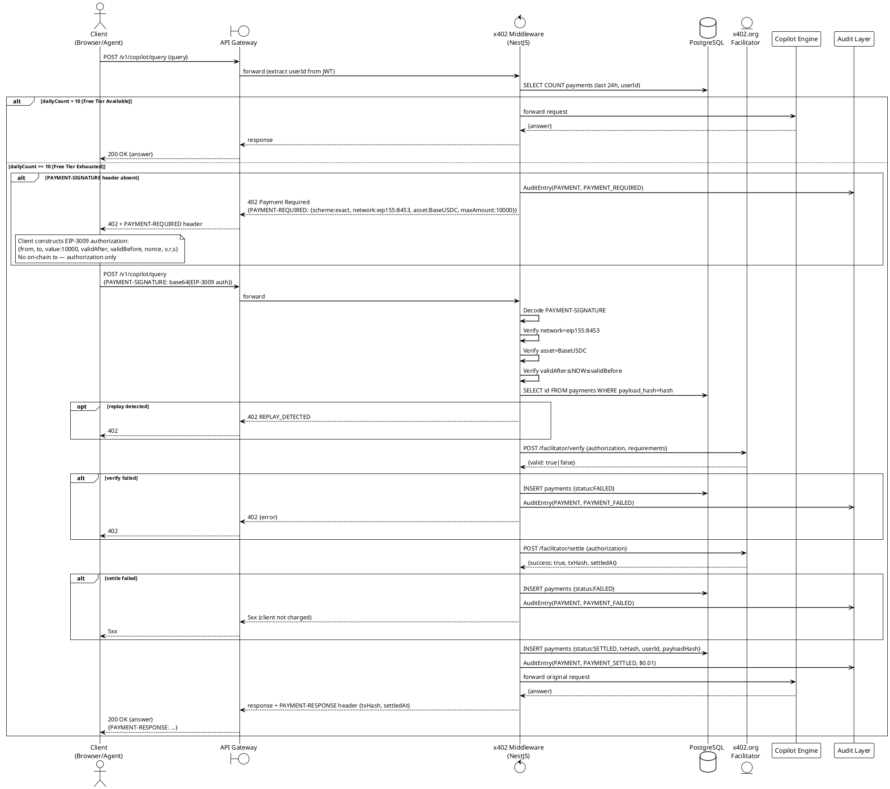

# 07 — Sequence Diagram: x402 Payment & Settlement

**Pack:** CrestFlow UML & Architecture Documentation Pack  
**Version:** 1.0 | **Source docs:** `audit_layer_x402.md` v2.0, `implementation_spec.md` v1.0 §11, `CANONICAL_DECISIONS.md` v1.2 (D4, T17)  
**Primary deliverable:** Lucidchart-ready specification. PlantUML is supplementary only.

---

## 1. Purpose & Scope

Specifies the x402 HTTP payment middleware flow for monetizing Copilot Engine queries. Covers:

- Initial request interception by x402 Middleware
- Free tier check (10 queries/day per user/agent)
- HTTP 402 response with `PAYMENT-REQUIRED` body when free tier exhausted
- Client construction of EIP-3009 authorization (no on-chain transaction — authorization only)
- Re-request with `PAYMENT-SIGNATURE` header
- Middleware verification: network, asset, timing window, nonce uniqueness
- POST /verify to x402.org/facilitator
- POST /settle to x402.org/facilitator
- `PaymentRecord` write to PostgreSQL
- `PAYMENT-RESPONSE` header return and request forwarding to Copilot Engine
- 5xx error path: PaymentRecord.status = FAILED, client not charged
- Replay protection: `paymentPayloadHash` uniqueness
- Anonymous agent path (`userId = null`)

**Protocol parameters (D4/T17):**
- Facilitator: `https://x402.org/facilitator`
- Network: `eip155:8453` (Base mainnet)
- Asset: Base USDC
- Payment scheme: `exact`
- Price: \$0.01 per query
- Free tier: 10 queries/day

---

## 2. Participants & Lifelines

| # | Participant | Type | Stereotype | Lucidchart Shape |
|---|---|---|---|---|
| 1 | Client (Browser / API Agent) | Actor | «actor» | Stick figure / Robot icon |
| 2 | API Gateway | System | «boundary» | Rectangle (dashed) |
| 3 | x402 Middleware (NestJS) | System | «control» | Rounded rectangle |
| 4 | PostgreSQL | System | «database» | Cylinder |
| 5 | x402.org Facilitator | External | «external» | Rectangle (grey fill) |
| 6 | Copilot Engine | System | «service» | Rounded rectangle |
| 7 | Audit Layer | System | «service» | Rounded rectangle |

**Lifeline ordering (left → right):**
Client | API Gateway | x402 Middleware | PostgreSQL | x402.org Facilitator | Copilot Engine | Audit Layer

---

## 3. Preconditions

- Client has a valid JWT access token (authenticated user) OR is an unauthenticated API agent.
- Target endpoint `/v1/copilot/query` is a paid endpoint protected by x402 Middleware.
- For authenticated users: `users.id` is available; free tier counter is per userId.
- For anonymous agents: `userId = null`; free tier counter is per IP or API key.
- x402.org facilitator is reachable at `https://x402.org/facilitator`.
- Base USDC EIP-3009 authorization requires client to have Base mainnet USDC.

---

## 4. Main Flow — Step-by-Step

### Stage 0: Initial Request Interception

```
Step 1:  Client → API Gateway:            POST /v1/copilot/query  { query: "...", ... }
              Headers: { Authorization: Bearer <accessToken> }
              [No PAYMENT-SIGNATURE header]

Step 2:  API Gateway → x402 Middleware:  forward request (JWT extracted: userId)

Step 3:  x402 Middleware → PostgreSQL:   SELECT COUNT(*) FROM payments
              WHERE user_id = $userId AND created_at > NOW() - INTERVAL '24 hours'
              AND status = 'SETTLED'
         → { dailyCount }
```

### Stage 1: Free Tier Check

```
Step 4:  x402 Middleware:                 Is dailyCount < 10?
         [alt FREE TIER AVAILABLE]
Step 5a: x402 Middleware → Copilot:      forward request (pass-through)
Step 6a: Copilot → x402 Middleware:      response { answer, ... }
Step 7a: x402 Middleware → API Gateway:  forward response
Step 8a: API Gateway → Client:           200 OK { answer }
         [alt FREE TIER EXHAUSTED — continue at Stage 2]
```

### Stage 2: Check for PAYMENT-SIGNATURE Header

```
Step 5b: x402 Middleware:                Check request headers for PAYMENT-SIGNATURE
         [alt PAYMENT-SIGNATURE absent — first attempt after exhaustion]

         Step 6b: x402 Middleware → Audit Layer: emit AuditEntry { PAYMENT, PAYMENT_REQUIRED, userId }
         Step 7b: x402 Middleware → API Gateway: 402 Payment Required
                      Headers: { PAYMENT-REQUIRED: <base64-encoded payment descriptor> }
                      Body: {
                        scheme: "exact",
                        network: "eip155:8453",
                        asset: { type: "ERC20", address: "<Base USDC contract>" },
                        maxAmountRequired: "10000",    // 0.01 USDC in 6-decimal units
                        payTo: "<CrestFlow payment address>",
                        description: "CrestFlow Copilot query",
                        facilitatorUrl: "https://x402.org/facilitator"
                      }
         Step 8b: API Gateway → Client: 402 Payment Required { PAYMENT-REQUIRED header + body }

         [Client constructs EIP-3009 authorization — see Stage 3]

         [alt PAYMENT-SIGNATURE present — client re-sends after constructing auth]
         [continue at Stage 4]
```

### Stage 3: Client Constructs EIP-3009 Authorization (Off-sequence — Client-side)

```
[Client-side only — no server participant]

Client:  Construct EIP-3009 authorization:
           {
             from: <client Base wallet address>,
             to: <CrestFlow payment address>,
             value: 10000,          // 0.01 USDC in 6-decimal units
             validAfter: NOW() - 60s,    // allow slight clock skew
             validBefore: NOW() + 300s,  // 5-minute validity window
             nonce: <random bytes32>,    // EIP-3009 nonce (not chain nonce)
             v, r, s: <EIP-712 signature>
           }
         IMPORTANT: This is an authorization, NOT a transaction. No on-chain tx hash is sent.

Client → API Gateway:  POST /v1/copilot/query  { query }
         Headers: {
           Authorization: Bearer <accessToken>,
           PAYMENT-SIGNATURE: <base64(EIP-3009 authorization)>
         }
```

### Stage 4: Middleware Verification

```
Step 9:  x402 Middleware:                Decode PAYMENT-SIGNATURE header → EIP-3009 authorization object

Step 10: x402 Middleware:                Verify network = "eip155:8453" [Base mainnet]
         [fail: return 402 with error "INVALID_NETWORK"]

Step 11: x402 Middleware:                Verify asset = Base USDC contract address
         [fail: return 402 with error "INVALID_ASSET"]

Step 12: x402 Middleware:                Verify timing window:
                                          validAfter ≤ NOW() AND NOW() ≤ validBefore
         [fail: return 402 with error "AUTHORIZATION_EXPIRED"]

Step 13: x402 Middleware:                Compute paymentPayloadHash = keccak256(authorization bytes)
Step 14: x402 Middleware → PostgreSQL:  SELECT id FROM payments WHERE payload_hash = $paymentPayloadHash
         [if exists: return 402 with error "REPLAY_DETECTED"]
         [if not exists: continue]
```

### Stage 5: Facilitator Verify

```
Step 15: x402 Middleware → x402.org:    POST https://x402.org/facilitator/verify
              Body: { authorization: <EIP-3009 object>, paymentRequirements: { network, asset, amount } }
Step 16: x402.org → x402 Middleware:   { valid: true|false, reason?: "..." }
         [if valid === false]
Step 17b: x402 Middleware → PostgreSQL: INSERT INTO payments { status: FAILED, reason, payload_hash, user_id, created_at }
          x402 Middleware → Audit Layer: emit AuditEntry { PAYMENT, PAYMENT_FAILED, userId, reason }
          x402 Middleware → API Gateway: 402 { error: reason }
          [end flow]
         [if valid === true: continue]
```

### Stage 6: Facilitator Settle

```
Step 17: x402 Middleware → x402.org:    POST https://x402.org/facilitator/settle
              Body: { authorization: <EIP-3009 object> }
Step 18: x402.org → x402 Middleware:   { success: true, txHash: "0x...", settledAt }
         [if success === false]
Step 19b: x402 Middleware → PostgreSQL: INSERT INTO payments { status: FAILED, payload_hash, user_id }
          x402 Middleware → Audit Layer: emit AuditEntry { PAYMENT, PAYMENT_FAILED }
          x402 Middleware → API Gateway: 5xx (payment settlement failed; client NOT charged)
          [end flow]
```

### Stage 7: PaymentRecord + Response

```
Step 19: x402 Middleware → PostgreSQL:  INSERT INTO payments {
              user_id,         // null for anonymous agent
              payload_hash: paymentPayloadHash,
              amount: "10000",
              asset: "Base USDC",
              network: "eip155:8453",
              status: SETTLED,
              tx_hash: facilitatorTxHash,
              settled_at: NOW(),
              created_at: NOW()
            }
Step 20: x402 Middleware → Audit Layer: emit AuditEntry { PAYMENT, PAYMENT_SETTLED, userId, amountUsd: 0.01 }

Step 21: x402 Middleware → Copilot:    forward original request
Step 22: Copilot → x402 Middleware:    response { answer, ... }
Step 23: x402 Middleware → API Gateway: response with PAYMENT-RESPONSE header:
              PAYMENT-RESPONSE: { txHash, settledAt, amountUsd: 0.01 }
Step 24: API Gateway → Client:         200 OK { answer }
              Headers: { PAYMENT-RESPONSE: ... }
```

---

## 5. Alternative Fragments

| Fragment ID | Type | Guard | Steps | Description |
|---|---|---|---|---|
| ALT-FREE | alt | dailyCount < 10 | 5a–8a | Free tier — pass through directly |
| ALT-NO-SIG | alt | PAYMENT-SIGNATURE header absent | 6b–8b | Return 402 with payment descriptor |
| ALT-HAS-SIG | alt | PAYMENT-SIGNATURE header present | 9–24 | Full payment verification flow |
| ALT-VERIFY-FAIL | alt | Facilitator verify returns false | 17b | Write FAILED record; return 402 |
| ALT-SETTLE-FAIL | alt | Facilitator settle fails | 19b | Write FAILED record; return 5xx (not charged) |
| ALT-REPLAY | alt | paymentPayloadHash exists in payments | 14 | Return 402 REPLAY_DETECTED |
| ALT-ANON | opt | userId = null (unauthenticated agent) | 3, 19 | Free tier per IP; userId null in PaymentRecord |

---

## 6. Postconditions

**Free tier path:**
- No `payments` record created.
- Copilot query answered.
- Free tier counter incremented (by counting SETTLED payments in rolling 24h window).

**Paid + settled path:**
- `payments` row: `status=SETTLED`, `payload_hash` stored (replay protection), `user_id`, `tx_hash`
- Audit event: `PAYMENT/PAYMENT_SETTLED`
- Copilot query answered.
- `PAYMENT-RESPONSE` header returned to client.

**Failed path (verify or settle fails):**
- `payments` row: `status=FAILED`
- Client NOT charged (settlement did not complete).
- Audit event: `PAYMENT/PAYMENT_FAILED`
- 402 or 5xx returned.

---

## 7. Exceptions & Recovery

| Exception | Trigger | Handling |
|---|---|---|
| x402.org facilitator unreachable | Network/DNS failure | 503 to client; PaymentRecord not written; query not forwarded; client may retry |
| EIP-3009 nonce reuse | Client accidentally reuses nonce bytes | Facilitator /verify returns invalid; REPLAY_DETECTED if hash matches existing payment |
| Timing window expired | Client took >5 min to submit signed auth | Step 12 fails: AUTHORIZATION_EXPIRED; client must construct new authorization |
| Copilot Engine error after payment settled | 5xx from Copilot after successful settle | PaymentRecord.status = SETTLED (payment is taken); Copilot error returned; consider partial refund (not in MVP) |
| Anonymous agent daily limit | userId=null, IP-based limit reached | Same 402 flow; `userId = null` in PAYMENT-REQUIRED body |

---

## 8. Audit Events

| Trigger | AuditCategory | AuditAction | Actor |
|---|---|---|---|
| Free tier exhausted; 402 issued | PAYMENT | PAYMENT_REQUIRED | System |
| Payment successfully settled | PAYMENT | PAYMENT_SETTLED | System |
| Payment verification failed | PAYMENT | PAYMENT_FAILED | System |
| Payment settlement failed | PAYMENT | PAYMENT_FAILED | System |
| Replay detected | PAYMENT | PAYMENT_REPLAY_DETECTED | System |

---

## 9. Connection Table

| # | From | To | Message / Label | Arrow Type | Notes |
|---|---|---|---|---|---|
| 1 | Client | API Gateway | POST /v1/copilot/query | Sync | HTTPS |
| 2 | x402 Middleware | PostgreSQL | SELECT COUNT payments (24h) | Sync | Free tier check |
| 3 | x402 Middleware | Copilot Engine | forward request (free tier) | Sync | Pass-through |
| 4 | x402 Middleware | API Gateway | 402 + PAYMENT-REQUIRED header | Return | On exhaustion |
| 5 | x402 Middleware | PostgreSQL | SELECT payments WHERE payload_hash | Sync | Replay protection |
| 6 | x402 Middleware | x402.org Facilitator | POST /facilitator/verify | Sync | HTTPS external |
| 7 | x402.org | x402 Middleware | { valid, reason? } | Return | |
| 8 | x402 Middleware | x402.org Facilitator | POST /facilitator/settle | Sync | HTTPS external |
| 9 | x402.org | x402 Middleware | { success, txHash, settledAt } | Return | |
| 10 | x402 Middleware | PostgreSQL | INSERT payments (SETTLED or FAILED) | Sync | |
| 11 | x402 Middleware | Audit Layer | emit AuditEntry | Async | |
| 12 | x402 Middleware | Copilot Engine | forward request (paid path) | Sync | After settlement |
| 13 | x402 Middleware | API Gateway | response + PAYMENT-RESPONSE header | Return | |

---

## 10. Layout Recommendations

**Horizontal axis (lifelines):**
Client | API Gateway | x402 Middleware | PostgreSQL | x402.org Facilitator | Copilot Engine | Audit Layer

**Vertical bands:**
- Band 0 (grey): Initial request + free tier check (Steps 1–4)
- Band 1 (green): Free tier pass-through (Steps 5a–8a) — `alt` branch
- Band 2 (orange): 402 response (Steps 5b–8b) — `alt` branch
- Band 3 (blue): Middleware verification (Steps 9–14)
- Band 4 (purple): Facilitator /verify (Steps 15–17)
- Band 5 (purple, darker): Facilitator /settle (Steps 17–18)
- Band 6 (teal): PaymentRecord + forwarding + response (Steps 19–24)

**Tips:**
- Use a single wide `alt` combined fragment for free-tier vs paid, with the free-tier branch very short.
- Nest the replay-detection check as an `opt` fragment inside the paid path.
- The Client lifeline is inactive during Stage 3 (client constructs EIP-3009 auth client-side) — add a note box over the Client lifeline labeled "Client constructs EIP-3009 authorization (off-sequence)".
- Use dashed activation bars on x402.org Facilitator to indicate external service latency.

---

## 11. Supplementary PlantUML



---

## 12. Flags & Open Questions

| Flag ID | Type | Description | Impact |
|---|---|---|---|
| F-07-01 | **Confirmed** | EIP-3009 is an authorization primitive, not a transaction. The client signs an off-chain authorization; the facilitator submits the actual on-chain transfer. No tx hash is sent in `PAYMENT-SIGNATURE`. | Critical distinction for diagram correctness |
| F-07-02 | **Confirmed** | Network must be `eip155:8453` (Base mainnet). Testnet (`eip155:84532`) is not acceptable for production. | Diagram label accuracy |
| F-07-03 | **Assumption** | Free tier counter is computed by COUNT of SETTLED payments in rolling 24h, not a separate counter column. This avoids counter drift. | Minor architectural assumption |
| F-07-04 | **Assumption** | Anonymous agent free tier limit is per-IP or per-API key (not per userId since userId=null). The exact grouping key for anonymous agents is not specified in planning docs. | Flag for implementation decision |
| F-07-05 | **Unresolved** | Copilot query failing after a successful settlement — refund mechanism is not documented. MVP likely has no automatic refund. | Out of scope for current diagram |
| F-07-06 | **Phase 2** | Pre-funded credit balances and agent credit ledger are Phase 2 features. Not shown in this diagram. | No impact on current flow |
| F-07-07 | **Confirmed** | `maxAmountRequired = 10000` = 0.01 USDC in 6-decimal representation (Base USDC uses 6 decimals). | Diagram must show 10000, not 0.01 |
