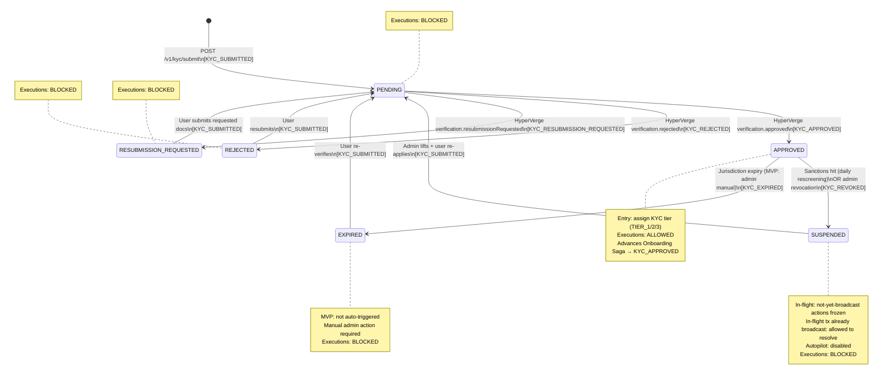

# 09 — State Machine: KYC Lifecycle

> **Diagram type:** UML State Machine (stateDiagram-v2)
> **Lucidchart template:** UML State Machine
> **Owner:** CrestFlow Compliance Engineering
> **Relates to:** `implementation_spec §7`, T10 audit mapping

---

## 1. Purpose & Scope

This specification defines the state machine for the **KYC (Know Your Customer) Lifecycle** — the compliance status assigned to each CrestFlow user and evaluated at Policy Check 1 of every execution saga.

**In scope:**
- All 6 `KycStatus` enum values and the initial pseudo-state
- Transitions triggered by HyperVerge vendor webhook events and CrestFlow system events
- Audit event mapping (T10)
- KYC tier assignment at approval
- Policy effect per state (execution allowed / blocked)
- In-flight suspension behavior
- KYC expiry behavior (MVP: manual only)
- Relationship to the Onboarding Saga

**Out of scope:**
- Execution Saga lifecycle (see File 08)
- Delegation / Autopilot lifecycle (see File 10)
- Internal HyperVerge document verification steps (vendor-internal)

**Primary entity:** `KycRecord` (table `kyc_records`)
**Status field:** `KycRecord.status` (enum `KycStatus`)
**Audit log:** `KycAuditEvent` (table `kyc_audit_events`, T10 schema)

---

## 2. States Inventory

| State | Type | Description | Entry Action | Exit Action |
|---|---|---|---|---|
| *(initial pseudo-state)* | initial | UML filled circle; user record created but no KYC submission yet | — | Create `KycRecord` row; link to `User.id` |
| `PENDING` | intermediate | KYC application submitted; under review by HyperVerge | Emit `KYC_SUBMITTED` audit event (T10); notify user "under review" | — |
| `APPROVED` | intermediate | Identity verified; user permitted to execute | Emit `KYC_APPROVED` audit event (T10); **assign KYC tier** (TIER_1/2/3); enable executions; update `User.kycTier`; advance Onboarding Saga to `KYC_APPROVED` | — |
| `REJECTED` | intermediate | Identity verification failed; user may not proceed | Emit `KYC_REJECTED` audit event (T10); block executions; notify user with rejection reason | — |
| `RESUBMISSION_REQUESTED` | intermediate | Vendor or compliance officer requests additional documents | Emit `KYC_RESUBMISSION_REQUESTED` audit event (T10); notify user with required document list; block executions | — |
| `SUSPENDED` | intermediate | Account administratively suspended post-approval (sanctions hit or manual revocation) | Emit `KYC_REVOKED` audit event (T10); **stop not-yet-broadcast in-flight actions**; disable autopilot; block executions; notify user and compliance team | — |
| `EXPIRED` | intermediate | Approval period lapsed (jurisdiction-specific; not auto-triggered in MVP) | Emit `KYC_EXPIRED` audit event (T10); block executions; notify user to re-verify | — |

> **Note on APPROVED:** `APPROVED` is listed as intermediate because a previously-approved user can transition to `SUSPENDED` or `EXPIRED`. It is not a terminal state.

> **Note on MVP expiry:** Approval records **do not auto-expire** in MVP. The `EXPIRED` state exists in the enum for future jurisdiction-specific configuration. Manual admin action is required to trigger expiry in MVP.

---

## 3. Transitions Table

| From State | To State | Trigger / Event | Guard Condition | Action | T10 Audit Event | Notes |
|---|---|---|---|---|---|---|
| *(initial)* | `PENDING` | User submits KYC application via `POST /v1/kyc/submit` | User authenticated; no existing active `KycRecord` | Create `KycRecord`; upload docs to HyperVerge | `KYC_SUBMITTED` | CrestFlow system event |
| `PENDING` | `APPROVED` | HyperVerge `verification.approved` webhook received | `webhook.applicantId` matches `KycRecord.vendorRef`; signature valid | Assign tier; enable executions; advance Onboarding Saga | `KYC_APPROVED` | HyperVerge vendor event |
| `PENDING` | `REJECTED` | HyperVerge `verification.rejected` webhook received | `webhook.applicantId` matches; signature valid | Record `rejection_reason` from vendor payload | `KYC_REJECTED` | HyperVerge vendor event |
| `PENDING` | `RESUBMISSION_REQUESTED` | HyperVerge `verification.resubmissionRequested` webhook received | `webhook.applicantId` matches; signature valid | Record required document types | `KYC_RESUBMISSION_REQUESTED` | HyperVerge vendor event |
| `REJECTED` | `PENDING` | User resubmits KYC application via `POST /v1/kyc/submit` | Previous `KycRecord` status=REJECTED; new submission provided | Create new `KycRecord` (or update existing); re-submit to HyperVerge | `KYC_SUBMITTED` | CrestFlow system event; previous rejection preserved in audit log |
| `RESUBMISSION_REQUESTED` | `PENDING` | User submits requested documents via `POST /v1/kyc/resubmit` | `KycRecord.status = RESUBMISSION_REQUESTED`; required docs attached | Update `KycRecord`; re-submit to HyperVerge; reset review timer | `KYC_SUBMITTED` | HyperVerge re-evaluation triggered |
| `APPROVED` | `SUSPENDED` | Daily rescreening sanctions hit | Sanctions list match found for user; rescreening job detects hit | Stop not-yet-broadcast actions; disable autopilot; block executions | `KYC_REVOKED` | CrestFlow system event (daily scheduler) |
| `APPROVED` | `SUSPENDED` | Admin manual revocation via `POST /v1/admin/kyc/:id/suspend` | Admin role; valid `KycRecord.id` | Record `suspension_reason`; same in-flight freeze behavior | `KYC_REVOKED` | CrestFlow system event (admin action) |
| `APPROVED` | `EXPIRED` | Jurisdiction expiry rule triggers (MVP: manual admin only) | `KycRecord.approvedAt + jurisdiction.expiryDays ≤ now` **OR** admin explicit expiry | Block executions; prompt re-verification | `KYC_EXPIRED` | CrestFlow system event; **not auto-triggered in MVP** |
| `SUSPENDED` | `PENDING` | Suspension lifted; user re-applies | Admin lifts suspension AND user re-submits; compliance approval required | Create new `KycRecord`; re-submit to HyperVerge | `KYC_SUBMITTED` | Requires admin unlock before user re-submit |
| `EXPIRED` | `PENDING` | User initiates re-verification | User submits new KYC application | Create new `KycRecord`; re-submit to HyperVerge | `KYC_SUBMITTED` | Old approval archived |

---

## 4. Special Paths

### 4.1 Approval and Tier Assignment
When transitioning to `APPROVED`:
1. CrestFlow evaluates the user's submitted tier preference and document quality.
2. Assigns `KycRecord.tier` from: `TIER_1` ($1k/day), `TIER_2` ($10k/day), `TIER_3` (unlimited).
3. Updates `User.kycTier` and `AddressScope.dailyLimit` accordingly.
4. Advances Onboarding Saga from `PENDING_KYC` → `KYC_APPROVED` (see §4.4).

| Tier | Daily Limit | Typical Use |
|---|---|---|
| `TIER_1` | $1,000 | Retail, basic ID only |
| `TIER_2` | $10,000 | Enhanced due diligence |
| `TIER_3` | Unlimited | Institutional / VIP |

### 4.2 In-Flight Suspension Behavior
When a user transitions from `APPROVED` → `SUSPENDED`:

- **Not-yet-broadcast actions:** Immediately frozen (`saga.status = PAUSED`).
- **In-flight (already broadcast) actions:** Allowed to resolve normally (cannot be recalled from mempool).
- **Autopilot:** Disabled for all affected wallets.
- **New executions:** Blocked at Policy Check 1 (`KYC_NOT_APPROVED`).

> **Lucidchart note:** Add a UML Note shape attached to the `SUSPENDED` state box with this behavior summary.

### 4.3 HyperVerge vs. CrestFlow Events
Transitions are triggered by two distinct event sources:

| Source | Events | Delivery | Verification |
|---|---|---|---|
| **HyperVerge** (vendor) | `verification.approved`, `verification.rejected`, `verification.resubmissionRequested` | Webhook `POST /webhooks/hyperverge` | HMAC-SHA256 signature + `applicantId` match |
| **CrestFlow** (system) | Daily sanctions rescreening hit, admin revocation, admin expiry, user resubmit | Internal scheduler / admin API | Role-based auth; internal event bus |

### 4.4 Onboarding Saga Relationship
The KYC Lifecycle is a dependency of the **Onboarding Saga**:

```
Onboarding Saga:
  PENDING_WALLET → WALLET_CREATED → PENDING_KYC → KYC_APPROVED
```

- `PENDING_KYC`: Onboarding Saga waits for `KycRecord.status = APPROVED`.
- `KYC_APPROVED` (Onboarding terminal): Triggered by the `APPROVED` entry action of the KYC state machine.
- The KYC state machine is **independent** after onboarding completes; subsequent SUSPENDED/EXPIRED transitions do not affect the Onboarding Saga (already terminal).

> **Lucidchart note:** Add a dashed reference arrow from the `APPROVED` state to an annotation box: *"Advances Onboarding Saga: PENDING_KYC → KYC_APPROVED"*.

### 4.5 MVP Expiry Caveat
`EXPIRED` state exists in the enum but is **not automatically triggered** in MVP. Auto-expiry requires per-jurisdiction configuration that is not yet implemented. Admin must manually invoke expiry via admin API. Diagram must include a note on the `APPROVED → EXPIRED` transition: *"MVP: manual admin action only; auto-expiry not configured"*.

---

## 5. Lucidchart Shape Guide

| Element | UML Shape | Lucidchart Shape Name | Style Notes |
|---|---|---|---|
| Initial pseudo-state | Filled circle | `UML Initial State` | Black fill, no border |
| `PENDING` state | Rounded rectangle | `UML State` | White fill, 1px border |
| `APPROVED` state | Rounded rectangle | `UML State` | Light green fill (#E6F4EA) |
| `REJECTED` state | Rounded rectangle | `UML State` | Light red fill (#FDECEA) |
| `RESUBMISSION_REQUESTED` state | Rounded rectangle | `UML State` | Light amber fill (#FFF8E1) |
| `SUSPENDED` state | Rounded rectangle | `UML State` | Orange fill (#FFF3CD), bold border |
| `EXPIRED` state | Rounded rectangle | `UML State` | Grey fill (#F5F5F5), dashed border |
| Transition (vendor event) | Arrow | `Connection` | Solid line; label in blue italic |
| Transition (system event) | Arrow | `Connection` | Solid line; label in black |
| T10 audit annotation | Note | `UML Note` | Attach to each transition; note T10 event name |
| In-flight suspension note | Note | `UML Note` | Attach to `SUSPENDED` state box |
| Onboarding Saga reference | Dashed arrow | `Connection` with dashed style | From `APPROVED` to annotation box |
| MVP caveat | Note | `UML Note` | Attach to `APPROVED → EXPIRED` transition |
| Policy effect | Note | `UML Note` | Attach inside each state box; "Executions: ALLOWED / BLOCKED" |

---

## 6. Layout Recommendations

- **Orientation:** Left-to-right (LR) for review flow; top-to-bottom for escalation paths.
- **Central flow:**
  `[*] → PENDING → APPROVED` as the primary horizontal spine.
- **Rejection/resubmission below PENDING:**
  `PENDING → REJECTED → PENDING` (loop back up)
  `PENDING → RESUBMISSION_REQUESTED → PENDING` (loop back up)
- **Post-approval branches to the right of APPROVED:**
  `APPROVED → SUSPENDED` (downward)
  `APPROVED → EXPIRED` (downward, dashed)
- **Re-entry paths:** `SUSPENDED → PENDING` and `EXPIRED → PENDING` as long arching arrows back to the left.
- **Onboarding Saga reference box:** Top-right corner; dashed border; linked to `APPROVED` with a dashed arrow.
- **Policy effect legend:** Bottom-left; small table showing APPROVED=allowed, all others=blocked.
- **Approximate canvas size:** 1600×1200px at 100% zoom.

---

## 7. Supplementary Mermaid



---

## 8. Flags & Open Questions

| # | Flag | Detail | Owner | Status |
|---|---|---|---|---|
| F1 | Auto-expiry configuration | Which jurisdictions require auto-expiry? What is the renewal window? | Legal/Compliance | Open |
| F2 | Tier upgrade path | Can a user upgrade from TIER_1 to TIER_2 without full re-KYC? | Product/Compliance | Open |
| F3 | Sanctions rescreening frequency | Daily confirmed; real-time feed planned for Phase 2? | Compliance | Open |
| F4 | Multiple KycRecord versions | Is the history model append-only (new record per submission) or single-row with status updates? | Engineering | Open |
| F5 | Suspension lift flow | Does admin lift require a new KYC submission, or can APPROVED be restored directly? | Compliance | Open |
| F6 | HyperVerge webhook retry | What is the deduplication strategy for duplicate vendor webhooks? | Engineering | Open |
| F7 | RESUBMISSION max attempts | Is there a limit on resubmission cycles before forcing REJECTED? | Product/Compliance | Open |
| F8 | Onboarding Saga error | If KYC is REJECTED during Onboarding, does Onboarding Saga enter a failure state or stay at PENDING_KYC? | Engineering | Open |
