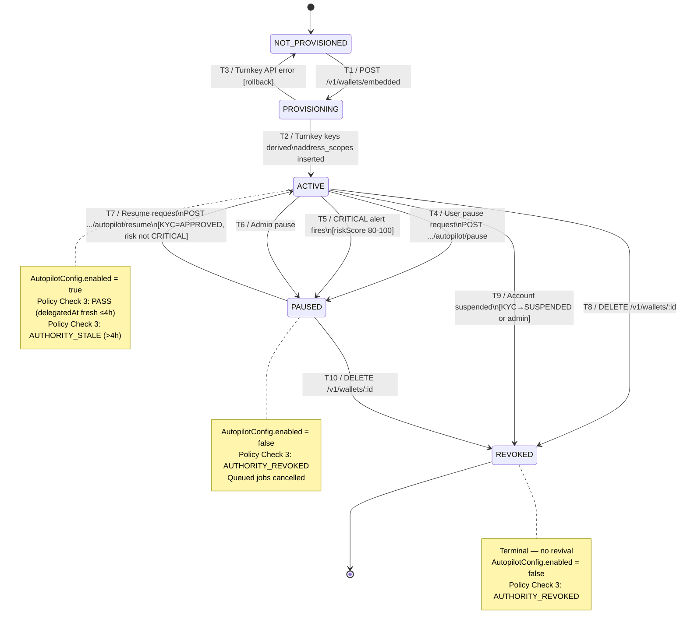

# 10 — State Machine Diagram: Delegation (Autopilot) Lifecycle

**Pack:** CrestFlow UML & Architecture Documentation Pack  
**Version:** 1.0 | **Source docs:** `identity_kyc.md` v2.0, `implementation_spec.md` v1.0 §4, `CANONICAL_DECISIONS.md` v1.2 (D1, D7)  
**Primary deliverable:** Lucidchart-ready specification. Mermaid is supplementary only.

---

## 1. Purpose & Scope

Specifies the state machine governing the **Autopilot delegation lifecycle** for Path A (embedded Turnkey wallet) users. Covers:

- All 5 delegation states and their transitions
- API endpoints and events that trigger transitions
- Policy Engine Check 3 outcome per state
- `AutopilotConfig.enabled` flag relationship to states
- Turnkey TEE delegation freshness window (4h)
- Path B non-applicability

**Scope limit:** This machine governs `address_scopes.execution_mode` and Turnkey delegation status only. KYC lifecycle is separate (`09_state_kyc_lifecycle.md`). Execution Saga lifecycle is separate (`08_state_saga_lifecycle.md`).

**Path B:** External wallet users have no delegation lifecycle. Their `address_scopes.execution_mode` is always `MANUAL` or `READ_ONLY`, and Policy Check 3 evaluates `ownership_verified_at` instead.

---

## 2. States Inventory

| State | Type | Description | AutopilotConfig.enabled | Policy Check 3 Outcome |
|---|---|---|---|---|
| `NOT_PROVISIONED` | Initial | User has no Turnkey sub-org or wallet. Path A provisioning has not yet been triggered. | `false` | N/A — no execution attempted |
| `PROVISIONING` | Transient | Turnkey sub-org creation and wallet key derivation in progress (async Turnkey API call). Short-lived. | `false` | `AUTHORITY_REVOKED` (provisioning incomplete) |
| `ACTIVE` | Normal operational | Turnkey sub-org exists, both keys derived (secp256k1 + Ed25519), `address_scopes.execution_mode = AUTOPILOT`. Delegation is live. | `true` | PASS if delegatedAt fresh (≤4h); `AUTHORITY_STALE` if >4h |
| `PAUSED` | Suspended | User or admin has paused autopilot. `address_scopes.execution_mode` remains `AUTOPILOT` but Turnkey delegation is suspended or CCE will not invoke it. No new autopilot plans are executed. | `false` | `AUTHORITY_REVOKED` |
| `REVOKED` | Terminal | User has removed the wallet or account has been suspended. Turnkey sub-org delegation is deactivated. No path back to ACTIVE. | `false` | `AUTHORITY_REVOKED` |

**Entry/Exit Actions:**

| State | Entry Action | Exit Action |
|---|---|---|
| `NOT_PROVISIONED` | (initial — no action) | — |
| `PROVISIONING` | Call Turnkey `create_sub_organization` + `create_wallet` (secp256k1) + `create_wallet` (Ed25519) | — |
| `ACTIVE` | Set `address_scopes.execution_mode = AUTOPILOT`; set `delegatedAt = NOW()`; emit `AUTOPILOT_ENABLED` audit event | — |
| `PAUSED` | Set `AutopilotConfig.enabled = false`; cancel queued-but-not-broadcast BullMQ jobs; emit `AUTOPILOT_DISABLED` audit event | — |
| `REVOKED` | Deactivate Turnkey delegation (API call); emit `AUTOPILOT_DISABLED` audit event | — (terminal) |

---

## 3. Transitions Table

| # | From State | To State | Trigger / Event | Guard Condition | Action | Notes |
|---|---|---|---|---|---|---|
| T1 | `NOT_PROVISIONED` | `PROVISIONING` | `POST /v1/wallets/embedded` (user initiates Path A onboarding) | User is authenticated (JWT valid); no existing Turnkey sub-org for userId | Begin async Turnkey sub-org creation | Triggers Flow B in `03_seq_onboarding_kyc.md` |
| T2 | `PROVISIONING` | `ACTIVE` | Turnkey TEE confirms `subOrganizationId` + both wallet addresses returned | Both keys derived (secp256k1 EVM + Ed25519 Solana); `address_scopes` INSERTs succeed | Set `execution_mode = AUTOPILOT`; set `delegatedAt`; emit audit `WALLET_PROVISIONED` + `AUTOPILOT_ENABLED` | Onboarding saga also advances `PENDING_WALLET → WALLET_CREATED` |
| T3 | `PROVISIONING` | `NOT_PROVISIONED` | Turnkey TEE API error (sub-org creation failed) | Turnkey returns error; no `subOrganizationId` assigned | Roll back any partial DB inserts; return 503 to user | Retry by re-calling `POST /v1/wallets/embedded` |
| T4 | `ACTIVE` | `PAUSED` | `POST /v1/wallets/:id/autopilot/pause` (user action) | User owns the wallet (JWT + address_scope ownership); current state = ACTIVE | Set `AutopilotConfig.enabled = false`; cancel queued jobs not yet broadcast; emit `AUTOPILOT_DISABLED` | User-initiated pause |
| T5 | `ACTIVE` | `PAUSED` | `CRITICAL` drift urgency alert fires (Engine 2) | `risk_snapshots.riskScore` in CRITICAL band (80–100); alert not yet acknowledged | Same as T4 actions | System-initiated pause; user notified via Copilot |
| T6 | `ACTIVE` | `PAUSED` | Admin `POST /v1/admin/users/:id/autopilot/pause` | Admin role JWT | Same as T4; admin action noted in audit | Admin-initiated pause |
| T7 | `PAUSED` | `ACTIVE` | `POST /v1/wallets/:id/autopilot/resume` (user action) | User owns wallet; KYC status = APPROVED; risk conditions no longer CRITICAL | Set `AutopilotConfig.enabled = true`; set `delegatedAt = NOW()` (freshness reset); emit `AUTOPILOT_ENABLED` | Cannot resume if KYC suspended |
| T8 | `ACTIVE` | `REVOKED` | `DELETE /v1/wallets/:id` (user removes wallet) | User owns wallet; no in-flight executions (or executions complete before revoke) | Deactivate Turnkey delegation; remove `address_scopes` row; emit `AUTOPILOT_DISABLED` | Terminal — no revival |
| T9 | `ACTIVE` | `REVOKED` | Account suspended (KYC → SUSPENDED or admin suspension) | `kyc_records.status` transitions to `SUSPENDED`; or admin suspension action | Deactivate delegation; in-flight actions halted (not-yet-broadcast); emit `AUTOPILOT_DISABLED` | Triggered by KYC lifecycle |
| T10 | `PAUSED` | `REVOKED` | `DELETE /v1/wallets/:id` (user removes wallet while paused) | User owns wallet | Same as T8 | Terminal |

---

## 4. Policy Engine Check 3 Outcomes by State

| Delegation State | Freshness | Policy Check 3 Result | Reason Code |
|---|---|---|---|
| `ACTIVE` | `NOW() - delegatedAt ≤ 14,400s` (4h) | **PASS** | — |
| `ACTIVE` | `NOW() - delegatedAt > 14,400s` (stale) | **FAIL** | `AUTHORITY_STALE` |
| `PROVISIONING` | — | **FAIL** | `AUTHORITY_REVOKED` |
| `PAUSED` | — | **FAIL** | `AUTHORITY_REVOKED` |
| `REVOKED` | — | **FAIL** | `AUTHORITY_REVOKED` |

**Re-fresh mechanism:** Calling `POST /v1/wallets/:id/autopilot/resume` resets `delegatedAt = NOW()`. Autopilot execution itself also updates `delegatedAt` on each successful signing call.

---

## 5. Lucidchart Shape Guide

| Element | UML Shape | Lucidchart Shape Name | Style Notes |
|---|---|---|---|
| Initial pseudo-state | Filled circle | "Start (UML)" or filled ellipse | Black fill, no label |
| State | Rounded rectangle | "State (UML)" | White fill; state name in bold; entry/exit actions in italic below separator line |
| Transition | Directed arrow | Connector with open arrowhead | Label: `event [guard] / action` |
| Terminal state | Circle with ring | "End (UML)" | Double-circle; used for `REVOKED` |
| Decision (guard) | Diamond | "Decision" | Only if explicit branching needed; prefer inline guard labels |
| Self-transition (freshness stale) | Curved arrow back to same state | Curved connector | Label "Policy Check 3: AUTHORITY_STALE [>4h stale]" |
| Path B note | Note shape | "Note (UML)" | Dashed border; text "Path B users: no delegation lifecycle" |

---

## 6. Layout Recommendations

**Suggested horizontal layout (left → right progression):**

```
[●] NOT_PROVISIONED → PROVISIONING → ACTIVE ⇆ PAUSED
                                       ↓             ↓
                                     REVOKED [◎]  REVOKED [◎]
```

**Practical Lucidchart layout:**
1. Place `NOT_PROVISIONED` at left with initial pseudo-state.
2. `PROVISIONING` immediately right; show T2 (success) going up/right to `ACTIVE`, T3 (failure) looping back to `NOT_PROVISIONED`.
3. `ACTIVE` in center — the main operational state. Show T4/T5/T6 going down to `PAUSED`.
4. `PAUSED` below `ACTIVE`. Show T7 going up back to `ACTIVE`.
5. `REVOKED` at bottom right — terminal. T8/T9 from `ACTIVE` and T10 from `PAUSED` point here.
6. Add Policy Check 3 outcome annotation boxes adjacent to each state using Lucidchart note shapes.
7. Add a separate note box in the lower-left corner for Path B non-applicability.

**Color coding:**
- `NOT_PROVISIONED`: grey fill
- `PROVISIONING`: yellow fill (transient)
- `ACTIVE`: green fill
- `PAUSED`: orange fill
- `REVOKED`: red fill with double border (terminal)

---

## 7. Supplementary Mermaid



---

## 8. Flags & Open Questions

| Flag ID | Type | Description | Impact |
|---|---|---|---|
| F-10-01 | **Path B** | Path B (external wallet) users have no delegation lifecycle. Their `execution_mode` is always `MANUAL` or `READ_ONLY`. Policy Check 3 for Path B evaluates `ownership_verified_at`, not Turnkey delegation. | Diagram must include explicit Path B note |
| F-10-02 | **Assumption** | The exact API endpoint for admin pause is assumed as `/v1/admin/users/:id/autopilot/pause`. Not specified in planning docs but consistent with NestJS REST conventions. | Minor |
| F-10-03 | **Unresolved** | "In-flight actions halted (not-yet-broadcast)" behavior during REVOKED transition — whether to wait for in-flight to complete or cancel them is not fully specified. Assumed: cancel queued, let in-flight complete. | May affect CCE behavior |
| F-10-04 | **Assumption** | `delegatedAt` reset on successful CCE signing call. This keeps the delegation fresh without user action during active autopilot usage. Not explicitly stated in docs. | Affects freshness window semantics |
| F-10-05 | **Naming** | `AutopilotConfig` is a logical config object; the actual DB column may be `address_scopes.execution_mode` + a separate config flag. Exact schema is `address_scopes.execution_mode` per implementation_spec §3.1. | Use schema-accurate names in ER diagram |
| F-10-06 | **Phase 2** | Key export (self-custody exit path from Turnkey) is a post-MVP feature. No REVOKED → export transition exists in MVP. | No impact on current diagram |
