# CrestFlow — UML File 11: Deployment Diagram Specification

> **Document type:** Lucidchart-ready UML Deployment Diagram specification  
> **Standard:** UML 2.5 Deployment Diagram notation  
> **Status:** Draft — Testnet / Pre-Mainnet  
> **Companion files:** 01_component_diagram.md, 12_BE_system_architecture.md

---

## 1. Purpose & Scope

This specification defines the **Deployment Diagram** for the CrestFlow platform. It enumerates every infrastructure node, the communication links between them, trust boundaries, environment-specific configurations, and the deployment artifacts that run on each node.

**In scope:**
- All runtime execution environments (NestJS API, BullMQ Worker Pool)
- All managed data stores (PostgreSQL 16, Redis)
- API Gateway / Load Balancer
- KMS / Secrets Manager
- All external cloud-hosted third-party providers
- All blockchain networks (EVM + Solana, mainnet + testnet)
- Communication protocols and ports

**Out of scope:**
- CI/CD pipeline infrastructure
- Developer workstations / local environments (addressed in §5 Environment Mapping)
- Internal Kubernetes pod topology (abstracted to node level)

---

## 2. Node Inventory

> **Column definitions:**  
> - **Node Type:** UML 2.5 category — `«device»`, `«execution environment»`, or `«artifact»`  
> - **Stereotype:** UML stereotype label displayed on the shape  
> - **Hosted On:** Parent node or cloud provider  
> - **Technology:** Runtime or platform technology

| Node Name | Node Type | Stereotype | Hosted On | Technology |
|---|---|---|---|---|
| **API Gateway / Load Balancer** | `«device»` | `«loadBalancer»` | Cloud VPC | HTTPS termination, rate limiting, TLS 1.3 |
| **NestJS API Server** | `«execution environment»` | `«applicationServer»` | Cloud VPC (horizontally scalable) | Node.js 20 LTS, NestJS, TypeScript |
| **BullMQ Worker Pool** | `«execution environment»` | `«workerPool»` | Cloud VPC (horizontally scalable) | Node.js 20 LTS, NestJS worker, BullMQ consumer |
| **PostgreSQL 16 Primary** | `«device»` | `«database»` | Cloud VPC — managed DB cluster | PostgreSQL 16, TypeORM |
| **PostgreSQL 16 Read Replica** | `«device»` | `«database»` | Cloud VPC — managed DB cluster | PostgreSQL 16 streaming replication |
| **Redis Cluster** | `«device»` | `«cache»` | Cloud VPC — managed Redis | Redis 7.x, cluster mode |
| **KMS / Secrets Manager** | `«device»` | `«secureStore»` | Cloud VPC — managed service | Cloud KMS + Secrets Manager |
| **Turnkey TEE** | `«device»` | `«tee»` | Turnkey cloud (external) | Trusted Execution Environment, secp256k1 + Ed25519 |
| **Alchemy Node** | `«device»` | `«rpcProvider»` | Alchemy cloud (external) | EVM RPC, Notify webhooks, HTTPS/WS |
| **Helius Node** | `«device»` | `«rpcProvider»` | Helius cloud (external) | Solana RPC, webhooks, HTTPS |
| **Circle Iris API** | `«device»` | `«externalApi»` | Circle cloud (external) | CCTP attestation, HTTPS |
| **x402.org Facilitator** | `«device»` | `«externalApi»` | x402 cloud (external) | Payment verify/settle, HTTPS |
| **HyperVerge KYC** | `«device»` | `«externalApi»` | HyperVerge cloud (external) | KYC session + webhooks, HTTPS [conditional D9] |
| **Google OAuth Server** | `«device»` | `«identityProvider»` | Google cloud (external) | OAuth 2.0 / OIDC, HTTPS |
| **Gemini LLM API** | `«device»` | `«aiService»` | Google cloud (external) | `gemini-3.8-flash` primary, `gemini-flash-lite-latest` fallback, HTTPS |
| **CoinGecko API** | `«device»` | `«dataFeed»` | CoinGecko cloud (external) | Price feeds, HTTPS; free tier 100 req/min |
| **DeFiLlama API** | `«device»` | `«dataFeed»` | DeFiLlama cloud (external) | Protocol TVL/safety, HTTPS; free tier no SLA |
| **Ethereum Mainnet** | `«device»` | `«blockchain»` | Public network | EVM, EIP-1559, Chainlink oracle |
| **Ethereum Sepolia** | `«device»` | `«blockchain»` | Public testnet | EVM, EIP-1559 |
| **Base Mainnet** | `«device»` | `«blockchain»` | Public L2 network | EVM L2, GasPriceOracle, Aerodrome, Moonwell |
| **Base Sepolia** | `«device»` | `«blockchain»` | Public L2 testnet | EVM L2 |
| **Arbitrum Mainnet** | `«device»` | `«blockchain»` | Public L2 network | EVM L2, NodeInterface, Aave V3 |
| **Arbitrum Sepolia** | `«device»` | `«blockchain»` | Public L2 testnet | EVM L2 |
| **Solana Mainnet** | `«device»` | `«blockchain»` | Public network | Solana runtime, Pyth oracle, Jupiter, Raydium, Kamino, MarginFi |
| **Solana Devnet** | `«device»` | `«blockchain»` | Public testnet | Solana runtime |
| **Chainlink Oracle** | `«artifact»` | `«onChainContract»` | Ethereum / Base / Arbitrum | On-chain price feed contracts |
| **Pyth Oracle** | `«artifact»` | `«onChainContract»` | Solana Mainnet | On-chain price feed program |
| **CCTP V2 Contracts** | `«artifact»` | `«onChainContract»` | ETH + BASE + ARB + SOL | TokenMinter + MessageTransmitter per chain/domain |
| **DEX / Lending Contracts** | `«artifact»` | `«onChainContract»` | Per chain | Uniswap V3, Aerodrome, Jupiter, Raydium, Aave V3, Moonwell, Kamino, MarginFi |
| **Client Browser / dApp** | `«device»` | `«client»` | User device | HTTPS consumer of CrestFlow REST API |

---

## 3. Communication Links Table

| From Node | To Node | Protocol | Port / Endpoint | Direction | Notes |
|---|---|---|---|---|---|
| Client Browser / dApp | API Gateway / Load Balancer | HTTPS TLS 1.3 | 443 | → | All client traffic enters here |
| API Gateway / Load Balancer | NestJS API Server | HTTP (internal) | 3000 (configurable) | → | TLS terminated at gateway; internal plain HTTP acceptable within VPC |
| NestJS API Server | PostgreSQL 16 Primary | TCP / PostgreSQL wire | 5432 | ↔ | Reads + writes; TypeORM connection pool |
| NestJS API Server | PostgreSQL 16 Read Replica | TCP / PostgreSQL wire | 5432 | → | Read-only queries for portfolio state, audit log |
| NestJS API Server | Redis Cluster | TCP / Redis | 6379 | ↔ | Cache reads/writes + BullMQ job enqueue |
| BullMQ Worker Pool | Redis Cluster | TCP / Redis | 6379 | ↔ | Job dequeue + result write-back |
| BullMQ Worker Pool | PostgreSQL 16 Primary | TCP / PostgreSQL wire | 5432 | ↔ | Saga state persistence, audit writes |
| NestJS API Server | KMS / Secrets Manager | HTTPS | 443 | → | Retrieve DB credentials, JWT signing keys, API keys at startup |
| BullMQ Worker Pool | KMS / Secrets Manager | HTTPS | 443 | → | Retrieve signing keys for worker jobs |
| NestJS API Server | Turnkey TEE | HTTPS | 443 | ↔ | Sub-org creation, key derivation, delegated signing (AUTOPILOT) |
| BullMQ Worker Pool | Turnkey TEE | HTTPS | 443 | → | Delegated transaction signing during execution jobs |
| NestJS API Server | Alchemy Node | HTTPS / WebSocket | 443 / WSS | ↔ | EVM RPC calls + optional streaming event subscription |
| Alchemy Node | NestJS API Server | HTTPS | 443 (webhook callback) | → | Notify webhook for on-chain event delivery |
| NestJS API Server | Helius Node | HTTPS | 443 | ↔ | Solana RPC calls |
| Helius Node | NestJS API Server | HTTPS | 443 (webhook callback) | → | Solana event webhooks |
| NestJS API Server | Circle Iris API | HTTPS | 443 | ↔ | CCTP attestation polling (PENDING → ATTESTED) |
| NestJS API Server | x402.org Facilitator | HTTPS | 443 (`/verify`, `/settle`) | ↔ | x402 payment verification + settlement |
| NestJS API Server | HyperVerge KYC | HTTPS | 443 | → | KYC session creation [conditional D9] |
| HyperVerge KYC | NestJS API Server | HTTPS | 443 (webhook callback) | → | KYC status webhook delivery |
| NestJS API Server | Google OAuth Server | HTTPS / OIDC | 443 | ↔ | Authorization code exchange, token validation |
| NestJS API Server | Gemini LLM API | HTTPS | 443 | → | Copilot query inference (`gemini-3.8-flash` / fallback) |
| NestJS API Server | CoinGecko API | HTTPS | 443 | → | Price feed polling |
| NestJS API Server | DeFiLlama API | HTTPS | 443 | → | Protocol TVL/safety data |
| NestJS API Server | Ethereum Mainnet | HTTPS (via Alchemy) | 443 | ↔ | EVM contract reads + tx broadcast |
| NestJS API Server | Base Mainnet | HTTPS (via Alchemy) | 443 | ↔ | EVM L2 contract reads + tx broadcast |
| NestJS API Server | Arbitrum Mainnet | HTTPS (via Alchemy) | 443 | ↔ | EVM L2 contract reads + tx broadcast |
| NestJS API Server | Solana Mainnet | HTTPS (via Helius) | 443 | ↔ | Solana program reads + tx broadcast |
| NestJS API Server | Ethereum Sepolia | HTTPS (via Alchemy) | 443 | ↔ | Testnet — same path as mainnet, different RPC URL |
| NestJS API Server | Base Sepolia | HTTPS (via Alchemy) | 443 | ↔ | Testnet |
| NestJS API Server | Arbitrum Sepolia | HTTPS (via Alchemy) | 443 | ↔ | Testnet |
| NestJS API Server | Solana Devnet | HTTPS (via Helius) | 443 | ↔ | Testnet |
| NestJS API Server | BullMQ Worker Pool | BullMQ / Redis | 6379 (via Redis) | → | Job enqueue for async execution tasks |

---

## 4. Trust Boundaries

| Boundary Name | Nodes Included | Trust Level | Notes |
|---|---|---|---|
| **Internal Infrastructure Boundary** | NestJS API Server, BullMQ Worker Pool, PostgreSQL 16 Primary, PostgreSQL 16 Read Replica, Redis Cluster, KMS / Secrets Manager | Fully trusted | All within private VPC; mTLS or VPC security groups restrict access; no public internet exposure |
| **External Provider Boundary** | Turnkey TEE, Alchemy, Helius, Circle Iris API, x402.org Facilitator, HyperVerge, Google OAuth, Gemini LLM API, CoinGecko, DeFiLlama | Contractual trust | HTTPS + API key authentication; treated as untrusted transport — all responses validated before use |
| **TEE Boundary** | Turnkey TEE | Cryptographic isolation | Private keys never leave TEE; CrestFlow holds delegated signing permissions only; cryptographically attested |
| **Blockchain Network Boundary** | Ethereum Mainnet/Sepolia, Base Mainnet/Sepolia, Arbitrum Mainnet/Sepolia, Solana Mainnet/Devnet, Chainlink, Pyth, CCTP V2 Contracts, DEX/Lending Contracts | Trustless / permissionless | Public networks; all data verified on-chain; no privileged access |
| **Client Boundary** | Client Browser / dApp | Untrusted | All inputs validated server-side; JWT required for authenticated endpoints; x402 payment verified server-side |

---

## 5. Environment Mapping

| Environment | Blockchain Nodes | External Config Differences |
|---|---|---|
| **Local Dev** | Anvil (EVM fork of Sepolia/Base Sepolia/Arbitrum Sepolia) + Solana test validator | Alchemy / Helius replaced by local fork RPC; Turnkey: test sub-org; Google OAuth: localhost redirect URI; x402: mock facilitator; KMS: local env file |
| **Testnet** | Ethereum Sepolia, Base Sepolia, Arbitrum Sepolia, Solana Devnet | Alchemy testnet API keys; Helius devnet endpoint; Turnkey: testnet sub-orgs; Circle Iris: testnet attestation; real Google OAuth; real HyperVerge sandbox; x402: testnet facilitator; CoinGecko / DeFiLlama: same endpoints (may use test tokens with no real price) |
| **Mainnet (staged — not yet triggered)** | Ethereum Mainnet, Base Mainnet, Arbitrum Mainnet, Solana Mainnet | Alchemy mainnet API keys (paid plan); Helius mainnet (paid plan); Turnkey: production sub-orgs; Circle Iris: production; CoinGecko: paid plan (rate limit upgrade); DeFiLlama: paid plan (SLA); x402: production facilitator; KMS: production KMS key rings |

---

## 6. Deployment Artifacts

| Artifact Name | Type | Deployed On |
|---|---|---|
| `crestflow-api` NestJS bundle | Node.js application archive | NestJS API Server |
| `crestflow-worker` NestJS bundle | Node.js application archive | BullMQ Worker Pool |
| `@crestflow/pool-type` NPM package | Shared NPM package (TypeScript) | NestJS API Server, BullMQ Worker Pool |
| PostgreSQL schema migrations (TypeORM) | SQL migration scripts | PostgreSQL 16 Primary (applied at deploy time) |
| Redis configuration | Config artifact | Redis Cluster |
| OpenAPI 3.1 spec (`openapi.json`) | API specification artifact | API Gateway / Load Balancer (optionally served) |
| Environment variable bundle | Secrets artifact | NestJS API Server, BullMQ Worker Pool (injected via KMS / Secrets Manager) |
| CCTP V2 contract ABIs | JSON ABI artifacts | Bundled within `crestflow-api` / `crestflow-worker` |
| DEX / Lending contract ABIs | JSON ABI artifacts | Bundled within `crestflow-api` / `crestflow-worker` |

---

## 7. Lucidchart Shape Guide

| Element Type | UML Shape | Lucidchart Shape Name | Grouping |
|---|---|---|---|
| Execution environment (NestJS, Worker) | Rounded rectangle with `«execution environment»` label | UML 2.5 → Node (Execution Environment) | Internal Infrastructure boundary box |
| Device node (DB, Redis, KMS, Gateway) | 3D box / cube with `«device»` label | UML 2.5 → Node (Device) | Internal Infrastructure boundary box |
| External device node (Alchemy, Helius, etc.) | 3D box with `«device»` + `«externalApi»` / `«rpcProvider»` label | UML 2.5 → Node (Device) | External Provider boundary box |
| Blockchain node | 3D box with `«blockchain»` label | UML 2.5 → Node (Device) | Blockchain Network boundary box |
| On-chain artifact (contracts) | Dog-eared rectangle with `«artifact»` label | UML 2.5 → Artifact | Nested inside blockchain node |
| Deployment artifact (app bundles) | Dog-eared rectangle with `«artifact»` label | UML 2.5 → Artifact | Nested inside execution environment |
| Communication link (synchronous) | Solid line with arrowhead | Connector → Line | Annotated with protocol + port |
| Communication link (async / queue) | Dashed line with arrowhead | Connector → Dashed Line | Labeled "BullMQ / Redis" |
| Trust boundary | Rounded dashed border with label | Group / Container (dashed style) | Colour-coded by trust level |
| TEE boundary | Rounded dashed border, distinct colour | Group / Container (dashed, distinct fill) | Turnkey TEE only |

**Recommended colour scheme:**
- Internal infrastructure boundary: light blue background
- External provider boundary: light orange background
- TEE boundary: light purple background
- Blockchain boundary: light green background
- Client boundary: light grey background

---

## 8. Layout Recommendations

### Suggested Layer Arrangement (top → bottom)

```
┌─────────────────────────────────────────────────────────────┐
│  CLIENT BOUNDARY                                            │
│  [ Client Browser / dApp ]                                 │
└─────────────────────┬───────────────────────────────────────┘
                      │ HTTPS 443
┌─────────────────────▼───────────────────────────────────────┐
│  INTERNAL INFRASTRUCTURE BOUNDARY                           │
│  [ API Gateway / Load Balancer ]                            │
│          │ HTTP 3000                                        │
│  [ NestJS API Server(s) ] ──BullMQ/Redis──→ [ BullMQ Workers ]│
│          │                        │                         │
│  [ PostgreSQL 16 Primary ]  [ Redis Cluster ]               │
│  [ PostgreSQL 16 Replica ]  [ KMS / Secrets Manager ]       │
└──────┬──────────────────────────┬──────────────────────────┘
       │ HTTPS 443                │ HTTPS 443
┌──────▼──────────┐  ┌────────────▼─────────────────────────┐
│  TEE BOUNDARY   │  │  EXTERNAL PROVIDER BOUNDARY           │
│  [ Turnkey TEE ]│  │  Alchemy, Helius, Circle, x402,       │
└─────────────────┘  │  HyperVerge, Google OAuth,            │
                     │  Gemini LLM, CoinGecko, DeFiLlama    │
                     └───────────────┬──────────────────────┘
                                     │ RPC / HTTPS
                     ┌───────────────▼──────────────────────┐
                     │  BLOCKCHAIN NETWORK BOUNDARY          │
                     │  ETH / BASE / ARB / SOL               │
                     │  (Mainnet + Testnet)                  │
                     │  Chainlink, Pyth, CCTP V2, DEX/Lending│
                     └──────────────────────────────────────┘
```

### Grouping Rules
1. **Internal Infrastructure**: place in a single bordered region, centre-left of canvas
2. **TEE Boundary**: small isolated box, right of internal infra, connected by HTTPS link
3. **External Providers**: wide horizontal band below TEE; group by function (identity, AI, data, bridge/payment)
4. **Blockchain Networks**: bottom band; EVM chains left, Solana right; testnet variants shown as sub-nodes or annotated
5. **Client**: top of canvas, single node connected to gateway
6. **Communication links**: use orthogonal routing; label each link with protocol + port; use dashed lines for async (BullMQ, webhooks)

---

## 9. Supplementary PlantUML

```plantuml
@startuml CrestFlow_Deployment_Diagram
!theme plain

skinparam node {
  BackgroundColor LightBlue
  BorderColor DarkBlue
}
skinparam rectangle {
  BackgroundColor LightYellow
}

' =========================================================
' CLIENT BOUNDARY
' =========================================================
node "Client Browser / dApp" <<client>> as CLIENT

' =========================================================
' INTERNAL INFRASTRUCTURE BOUNDARY
' =========================================================
rectangle "Internal Infrastructure Boundary" <<boundary>> #E8F4FD {

  node "API Gateway / Load Balancer" <<loadBalancer>> as GW

  node "NestJS API Server" <<applicationServer>> as API {
    artifact "crestflow-api bundle" as API_ARTIFACT
    artifact "@crestflow/pool-type" as POOL_PKG_API
  }

  node "BullMQ Worker Pool" <<workerPool>> as WORKER {
    artifact "crestflow-worker bundle" as WORKER_ARTIFACT
    artifact "@crestflow/pool-type" as POOL_PKG_WORKER
  }

  node "PostgreSQL 16 Primary" <<database>> as PG_PRIMARY
  node "PostgreSQL 16 Read Replica" <<database>> as PG_REPLICA
  node "Redis Cluster" <<cache>> as REDIS
  node "KMS / Secrets Manager" <<secureStore>> as KMS
}

' =========================================================
' TEE BOUNDARY
' =========================================================
rectangle "TEE Boundary" <<boundary>> #F3E8FF {
  node "Turnkey TEE" <<tee>> as TURNKEY
}

' =========================================================
' EXTERNAL PROVIDER BOUNDARY
' =========================================================
rectangle "External Provider Boundary" <<boundary>> #FFF3E8 {
  node "Alchemy Node" <<rpcProvider>> as ALCHEMY
  node "Helius Node" <<rpcProvider>> as HELIUS
  node "Circle Iris API" <<externalApi>> as CIRCLE
  node "x402.org Facilitator" <<externalApi>> as X402
  node "HyperVerge KYC" <<externalApi>> as HYPERVERGE
  node "Google OAuth Server" <<identityProvider>> as GOOGLE_OAUTH
  node "Gemini LLM API" <<aiService>> as GEMINI_LLM
  node "CoinGecko API" <<dataFeed>> as COINGECKO
  node "DeFiLlama API" <<dataFeed>> as DEFILLAMA
}

' =========================================================
' BLOCKCHAIN BOUNDARY
' =========================================================
rectangle "Blockchain Network Boundary" <<boundary>> #E8FFE8 {
  node "Ethereum Mainnet" <<blockchain>> as ETH_MAIN {
    artifact "Chainlink Oracle" as CHAINLINK
    artifact "CCTP V2 (ETH, Domain 0)" as CCTP_ETH
    artifact "Uniswap V3 / Aave V3" as DEX_ETH
  }
  node "Base Mainnet" <<blockchain>> as BASE_MAIN {
    artifact "CCTP V2 (BASE, Domain 6)" as CCTP_BASE
    artifact "Uniswap V3 / Aerodrome / Moonwell" as DEX_BASE
  }
  node "Arbitrum Mainnet" <<blockchain>> as ARB_MAIN {
    artifact "CCTP V2 (ARB, Domain 3)" as CCTP_ARB
    artifact "Uniswap V3 / Aave V3" as DEX_ARB
  }
  node "Solana Mainnet" <<blockchain>> as SOL_MAIN {
    artifact "Pyth Oracle" as PYTH
    artifact "CCTP V2 (SOL, Domain 5)" as CCTP_SOL
    artifact "Jupiter / Raydium / Kamino / MarginFi" as DEX_SOL
  }
  node "Testnet Nodes" <<blockchain>> as TESTNETS {
    artifact "Sepolia / Base Sepolia / Arbitrum Sepolia / Solana Devnet" as TN_ARTIFACTS
  }
}

' =========================================================
' COMMUNICATION LINKS
' =========================================================
CLIENT --> GW : "HTTPS :443"
GW --> API : "HTTP :3000"

API --> PG_PRIMARY : "TCP/PostgreSQL :5432"
API --> PG_REPLICA : "TCP/PostgreSQL :5432 (read)"
API --> REDIS : "TCP/Redis :6379"
API --> KMS : "HTTPS :443"
API --> TURNKEY : "HTTPS :443"
API --> ALCHEMY : "HTTPS/WS :443"
API --> HELIUS : "HTTPS :443"
API --> CIRCLE : "HTTPS :443"
API --> X402 : "HTTPS :443"
API --> HYPERVERGE : "HTTPS :443"
API --> GOOGLE_OAUTH : "HTTPS/OIDC :443"
API --> GEMINI_LLM : "HTTPS :443"
API --> COINGECKO : "HTTPS :443"
API --> DEFILLAMA : "HTTPS :443"
API ..> REDIS : "BullMQ enqueue"
REDIS ..> WORKER : "BullMQ dequeue"
WORKER --> PG_PRIMARY : "TCP/PostgreSQL :5432"
WORKER --> REDIS : "TCP/Redis :6379"
WORKER --> TURNKEY : "HTTPS :443"
WORKER --> KMS : "HTTPS :443"
ALCHEMY --> API : "Webhook HTTPS :443"
HELIUS --> API : "Webhook HTTPS :443"
HYPERVERGE --> API : "Webhook HTTPS :443"
ALCHEMY --> ETH_MAIN : "RPC"
ALCHEMY --> BASE_MAIN : "RPC"
ALCHEMY --> ARB_MAIN : "RPC"
HELIUS --> SOL_MAIN : "RPC"
ALCHEMY --> TESTNETS : "RPC (testnet)"
HELIUS --> TESTNETS : "RPC (devnet)"

@enduml
```



---

## 10. Flags & Open Questions

| ID | Flag / Question | Owner | Status |
|---|---|---|---|
| F11-01 | Kubernetes pod autoscaling policy for NestJS API Servers not yet defined — HPA thresholds TBD | Infra | Open |
| F11-02 | Redis cluster mode vs. Redis Sentinel — decision needed for managed cloud provider | Infra | Open |
| F11-03 | PostgreSQL replica lag monitoring strategy not specified — read replica failover behaviour TBD | Infra | Open |
| F11-04 | WebSocket connection (Alchemy streaming) — decision on whether to use polling or persistent WS in production | BE | Open |
| F11-05 | CoinGecko and DeFiLlama free tier rate limits (100 req/min; no SLA) — upgrade trigger criteria for paid plan not yet defined | Product | Open |
| F11-06 | HyperVerge conditional (D9) — webhook delivery endpoint must be publicly reachable; VPC ingress rules need review | Infra / BE | Open |
| F11-07 | Mainnet release gate not yet triggered — deployment diagram reflects testnet-active topology | Product | Open |
| F11-08 | Anvil (local) fork chain ID mapping — ensure local dev does not accidentally broadcast to testnet | BE | Open |
| F11-09 | CCTP V2 Fast mode (minFinalityThreshold=1000) latency SLA vs. Alchemy webhook reliability — confirm timeout handling | BE | Open |
| F11-10 | Outbound webhook callback URL for Alchemy / Helius / HyperVerge — must be stable; consider dedicated ingress or webhook relay service | Infra | Open |
