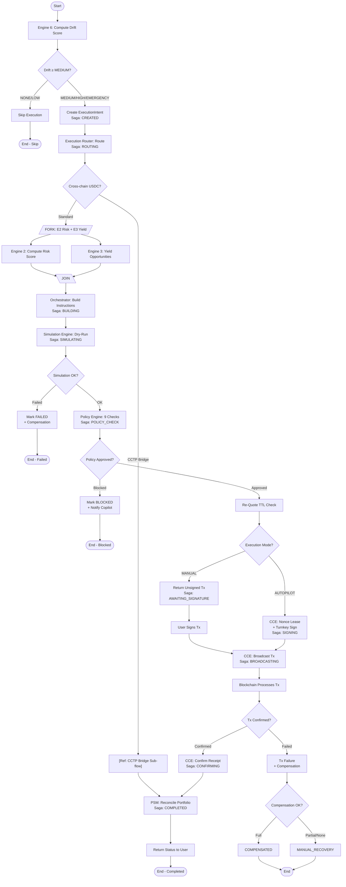

# 16 — BE Report: Activity Diagram (Transaction Execution)

**Pack:** CrestFlow UML & Architecture Documentation Pack  
**Version:** 1.0 | **Source docs:** `implementation_spec.md` v1.0 §6–§9, `orchestrator_planner.md` v2.0, `execution_router.md` v2.0  
**Primary deliverable:** Lucidchart-ready specification. Mermaid flowchart is supplementary only.

---

## 1. Purpose & Scope

Specifies the **Activity Diagram** for the complete CrestFlow transaction execution workflow. Uses swimlanes to show responsibilities across actors and system components.

**Scope:** Full execution lifecycle from trigger to portfolio reconciliation. Includes:
- Path A (AUTOPILOT) vs Path B/Manual (MANUAL) branching
- Parallel execution of Engine 2 (Risk) and Engine 3 (Yield) for plan input
- CCTP bridge detection and sub-flow reference
- Policy evaluation gate
- Compensation flow on failure
- Saga state alignment

---

## 2. Swimlane Inventory

| # | Swimlane Name | Actors / Components | Lucidchart Color |
|---|---|---|---|
| SL-1 | User | Path A/B User (human interaction points only) | Light blue |
| SL-2 | API Layer | API Gateway, x402 Middleware, NestJS controllers | Light grey |
| SL-3 | Intelligence Layer | Engine 1–6, Financial Knowledge Layer | Light green |
| SL-4 | Execution Pipeline | Execution Router, Orchestrator, Simulation, Policy Engine, CCE | Light orange |
| SL-5 | Blockchain | Alchemy/Helius RPC, Blockchain Networks | Light purple |

---

## 3. Activity Node Inventory

| Activity ID | Swimlane | Activity Name | Type | Description |
|---|---|---|---|---|
| A-00 | SL-3 | **Autopilot Scheduler Tick / User Request** | Initial (filled circle) | AUTOPILOT: BullMQ cron; MANUAL: user POST /v1/executions |
| A-01 | SL-3 | **Engine 6: Compute Drift Score** | Action | E6 reads positions, risk_snapshots; computes DriftUrgency |
| D-01 | SL-3 | **Drift Urgency Threshold?** | Decision | Is DriftUrgency ≥ MEDIUM? |
| A-02 | SL-3 | **Skip Execution (No Action)** | Action | NONE/LOW urgency; cycle ends |
| A-END-SKIP | SL-3 | **End (Skip)** | Activity Final | |
| A-03 | SL-4 | **Create ExecutionIntent (CREATED)** | Action | INSERT execution_intents; saga state = CREATED |
| A-04 | SL-4 | **Execution Router: Route Actions** | Action | Determine chain, venue, bridge requirement; saga = ROUTING |
| D-02 | SL-4 | **Cross-chain transfer required?** | Decision | Any action spans chains AND asset = USDC? |
| A-05-CCTP | SL-4 | **[Ref: CCTP Bridge Sub-flow]** | Action (ref) | Delegate to `06_seq_cctp_bridge.md`; merge after MINTED |
| A-05 | SL-3 | **[Fork: Parallel Engine Runs]** | Fork (thick bar) | Fork point: E2 and E3 start in parallel |
| A-06 | SL-3 | **Engine 2: Compute Risk Score** | Action | Risk Intelligence; produces riskScore, risk_alerts |
| A-07 | SL-3 | **Engine 3: Discover Yield Opportunities** | Action | Yield Opportunity; TOPSIS ranking; produces yield_opportunities |
| A-08 | SL-3 | **[Join: E2 + E3 Complete]** | Join (thick bar) | Wait for both engines to complete |
| A-09 | SL-4 | **Orchestrator: Build Instructions** | Action | Fetch price quotes (Redis or RPC); build ExecutionInstructions[]; amountIn in BaseUnits; saga = BUILDING |
| A-10 | SL-4 | **Simulation Engine: Dry-Run** | Action | eth_call / simulateTransaction; compute gas, slippage, amountOut; saga = SIMULATING |
| D-03 | SL-4 | **Simulation successful?** | Decision | Did simulated tx succeed without revert? |
| A-11b | SL-4 | **Mark FAILED + Trigger Compensation** | Action | UPDATE execution_intents status=FAILED; begin compensation if prior steps had side effects |
| A-END-FAIL | SL-4 | **End (Failed)** | Activity Final | |
| A-11 | SL-4 | **Policy Engine: Evaluate 9 Checks** | Action | All 9 checks run; produces PolicyDecision; saga = POLICY_CHECK |
| D-04 | SL-4 | **Policy approved?** | Decision | PolicyDecision.approved === true? |
| A-12b | SL-4 | **Mark BLOCKED + Notify Copilot** | Action | UPDATE status=BLOCKED (terminal); notify Copilot Engine with blockedReasons[] |
| A-END-BLOCKED | SL-4 | **End (Blocked)** | Activity Final | |
| A-12 | SL-4 | **Re-Quote TTL Check** | Action | NOW() - instructions.built_at ≤ 30s? If stale, re-fetch quotes + rebuild instructions |
| D-05 | SL-4 | **Execution Mode?** | Decision | AUTOPILOT or MANUAL? |
| A-13-AUTO | SL-4 | **CCE: Lease Nonce + Sign via Turnkey TEE** | Action | SETNX nonce_lock; Turnkey sign_transaction; saga = SIGNING |
| A-13-MANUAL | SL-1 | **Return Unsigned Tx to User** | Action | UPDATE status=AWAITING_SIGNATURE; return unsigned tx to user |
| A-14-MANUAL | SL-1 | **User Signs Transaction** | Action | User signs with external wallet; posts signedTransactions[] |
| A-15 | SL-4 | **CCE: Broadcast Signed Tx** | Action | eth_sendRawTransaction / sendTransaction; UPDATE nonces BROADCAST; saga = BROADCASTING |
| A-16 | SL-5 | **Blockchain Processes Transaction** | Action | Mempool → Block inclusion → Finality |
| D-06 | SL-5 | **Transaction confirmed?** | Decision | On-chain success (receipt status=1) or failure? |
| A-17b | SL-4 | **Handle Tx Failure + Compensation** | Action | UPDATE executions FAILED; compensation: attempt reversal of completed steps |
| D-06b | SL-4 | **Compensation successful?** | Decision | All prior steps reversed? |
| A-17c | SL-4 | **Mark COMPENSATED** | Action | Saga = COMPENSATED (terminal) |
| A-17d | SL-4 | **Mark MANUAL_RECOVERY** | Action | Saga = MANUAL_RECOVERY; alert admin |
| A-END-COMP | SL-4 | **End (Compensated / Recovery)** | Activity Final | |
| A-17 | SL-4 | **CCE: Confirm Receipt + Update Records** | Action | eth_getTransactionReceipt; UPDATE executions CONFIRMED, nonces CONFIRMED; saga = CONFIRMING |
| A-18 | SL-4 | **PSM: Reconcile Portfolio** | Action | UPDATE positions; INSERT portfolio_snapshot; saga = COMPLETED |
| A-19 | SL-2 | **Return Status to User** | Action | API returns execution status, tx hash, gas cost |
| A-END | SL-1 | **End** | Activity Final | Saga state = COMPLETED |

---

## 4. Transition Table

| From | To | Guard / Condition | Notes |
|---|---|---|---|
| A-00 (Initial) | A-01 | — | Always starts with drift check |
| A-01 | D-01 | — | |
| D-01 | A-02 | DriftUrgency = NONE or LOW | Skip |
| A-02 | A-END-SKIP | — | |
| D-01 | A-03 | DriftUrgency ≥ MEDIUM | Proceed |
| A-03 | A-04 | — | |
| A-04 | D-02 | — | |
| D-02 | A-05-CCTP | cross-chain USDC action detected | CCTP sub-flow; merges back at A-18 |
| D-02 | A-05 | no cross-chain action | Fork for E2 + E3 |
| A-05 | A-06, A-07 | — | Fork — both branches start simultaneously |
| A-06 → A-08; A-07 → A-08 | — | Join — wait for both | |
| A-08 | A-09 | — | |
| A-09 | A-10 | — | |
| A-10 | D-03 | — | |
| D-03 | A-11b | simulation failed | |
| A-11b | A-END-FAIL | — | |
| D-03 | A-11 | simulation succeeded | |
| A-11 | D-04 | — | |
| D-04 | A-12b | approved === false | Blocked |
| A-12b | A-END-BLOCKED | — | |
| D-04 | A-12 | approved === true | |
| A-12 | D-05 | — | |
| D-05 | A-13-AUTO | AUTOPILOT | |
| D-05 | A-13-MANUAL | MANUAL | |
| A-13-AUTO | A-15 | — | |
| A-13-MANUAL | A-14-MANUAL | — | |
| A-14-MANUAL | A-15 | — | User submits signed tx |
| A-15 | A-16 | — | |
| A-16 | D-06 | — | |
| D-06 | A-17b | tx failed / reverted | |
| A-17b | D-06b | — | Compensation check |
| D-06b | A-17c | compensation complete | COMPENSATED |
| D-06b | A-17d | compensation incomplete | MANUAL_RECOVERY |
| A-17c → A-END-COMP; A-17d → A-END-COMP | — | |
| D-06 | A-17 | tx confirmed | |
| A-17 | A-18 | — | |
| A-18 | A-19 | — | |
| A-19 | A-END | — | |

---

## 5. Decision Nodes

| Decision ID | Question | Outcomes | Branch Labels |
|---|---|---|---|
| D-01 | Is DriftUrgency ≥ MEDIUM? | Yes → proceed; No → skip | "MEDIUM/HIGH/EMERGENCY" / "NONE/LOW" |
| D-02 | Is cross-chain USDC bridge required? | Yes → CCTP; No → standard | "CCTP Bridge" / "Standard Execution" |
| D-03 | Did simulation succeed? | Yes → continue; No → failed | "Simulation OK" / "Simulation Failed" |
| D-04 | Is PolicyDecision.approved === true? | Yes → continue; No → blocked | "Approved" / "Blocked" |
| D-05 | What is ExecutionMode? | AUTOPILOT → CCE+Turnkey; MANUAL → user sign | "AUTOPILOT" / "MANUAL" |
| D-06 | Was on-chain transaction confirmed? | Yes → confirmed; No → failed | "Confirmed" / "Tx Failed / Reverted" |
| D-06b | Was compensation successful? | Full → COMPENSATED; Partial/None → MANUAL_RECOVERY | "Full Reversal" / "Partial / No Reversal" |

---

## 6. Fork/Join Nodes

| Fork/Join ID | Type | Swimlane | Branches | Description |
|---|---|---|---|---|
| F-01 (A-05) | Fork | SL-3 | Branch 1: A-06 (Engine 2 Risk); Branch 2: A-07 (Engine 3 Yield) | Both engines run concurrently using BullMQ parallel jobs |
| J-01 (A-08) | Join | SL-3 | Merge of A-06 output + A-07 output | Orchestrator waits for both engine outputs before building instructions |

**Lucidchart representation:** Use a thick horizontal bar (filled rectangle) for both fork and join nodes, spanning the swimlane width. Label: "FORK: E2 Risk + E3 Yield" and "JOIN: Risk + Yield Complete".

---

## 7. Exception Flows

| Exception | Trigger Point | Recovery Path |
|---|---|---|
| Simulation failure | D-03 → "Simulation Failed" | A-11b: FAILED; no compensation needed (no on-chain side effects yet) |
| Policy blocked | D-04 → "Blocked" | A-12b: BLOCKED (terminal); Copilot notified; user must change conditions |
| Tx rejected/reverted | D-06 → "Tx Failed" | A-17b: attempt reversal of any completed multi-step actions; → COMPENSATED or MANUAL_RECOVERY |
| Gas cap exceeded | Before A-15 (broadcast) | Saga → PAUSED (queued); retried when gas conditions improve |
| Re-quote timeout | A-12 (re-quote TTL) | Re-fetch quotes; if fails → abort execution |

---

## 8. Saga State Alignment

| Activity | Saga State | Table Column Value |
|---|---|---|
| A-03 (ExecutionIntent created) | `CREATED` | `execution_intents.status = CREATED` |
| A-04 (Routing) | `ROUTING` | `= ROUTING` |
| A-09 (Building) | `BUILDING` | `= BUILDING` |
| A-10 (Simulation) | `SIMULATING` | `= SIMULATING` |
| A-11 (Policy check) | `POLICY_CHECK` | `= POLICY_CHECK` |
| A-12b (Policy blocked) | `BLOCKED` | `= BLOCKED` (terminal) |
| A-13-MANUAL path | `AWAITING_SIGNATURE` | `= AWAITING_SIGNATURE` |
| A-13-AUTO path | `SIGNING` | `= SIGNING` |
| A-15 (Broadcast) | `BROADCASTING` | `= BROADCASTING` |
| A-16 (On-chain) | `AWAITING_CONFIRMATION` | `= AWAITING_CONFIRMATION` |
| A-17 (Receipt) | `CONFIRMING` | `= CONFIRMING` |
| A-18 (PSM) | `COMPLETED` | `= COMPLETED` (terminal) |
| A-11b / A-17b | `FAILED` | `= FAILED` |
| A-17b (compensation) | `COMPENSATING` | `= COMPENSATING` |
| A-17c (done) | `COMPENSATED` | `= COMPENSATED` (terminal) |

**CCTP-only states** (when D-02 → CCTP branch):
- After burn broadcast: `AWAITING_ATTESTATION`
- After attestation: `MINTING`
- After mint confirmed: continue to `CONFIRMING`

---

## 9. Lucidchart Shape Guide

| Element | UML Shape | Lucidchart Shape | Style |
|---|---|---|---|
| Initial node | Filled circle | "Start (UML)" | Black fill |
| Activity (action) | Rounded rectangle | "Activity (UML)" | White fill, rounded corners |
| Decision node | Diamond | "Decision (UML)" | White fill; label question inside |
| Fork / Join | Thick horizontal bar | "Fork/Join (UML)" | Black fill, thin rectangle spanning swimlane |
| Activity Final | Circle with filled inner circle | "End (UML)" | Use for each terminal path |
| Flow Final | Circle with ✕ | "Flow Final (UML)" | Use for skip/abort paths |
| Swimlane | Vertical partition | "Swim Lane (UML)" | Label at top of lane |
| Reference activity | Rectangle with «ref» | "Rectangle" with text "ref: ..." | Used for CCTP sub-flow reference |
| Object flow | Dashed arrow with label | "Dashed Arrow" connector | For data objects passed between activities |
| Transition | Solid arrow | "Arrow" connector | 1.5px; guard label on arrow |
| Exception path | Solid arrow with zig-zag notation | "Arrow" connector | Label the exception condition |

---

## 10. Layout Recommendations

**Orientation:** Horizontal swimlanes (top to bottom: SL-1 through SL-5). Activities flow top to bottom within each lane; cross-lane arrows show handoffs.

**Key layout decisions:**
- Place Fork (A-05) and Join (A-08) spanning SL-3 horizontally to show true parallelism.
- Branch the CCTP reference (D-02 → A-05-CCTP) as a wide box spanning SL-4 and SL-5, with a note "See 06_seq_cctp_bridge.md".
- Decision D-05 (AUTOPILOT vs MANUAL) should visually branch into two lanes — AUTOPILOT stays in SL-4, MANUAL crosses into SL-1.
- Compensation sub-flow (A-17b → D-06b → A-17c / A-17d) can be placed to the right of the main flow to avoid visual clutter.
- Use numbered activity IDs (A-01, A-02...) as small badges on each activity shape for cross-reference with this spec.

**Height per swimlane (approximate):** SL-1: 15%, SL-2: 10%, SL-3: 25%, SL-4: 35%, SL-5: 15%.

---

## 11. Supplementary Mermaid

---

## 12. Flags & Open Questions

| Flag ID | Type | Description |
|---|---|---|
| F-16-01 | **Confirmed** | E2 (Risk Intelligence) and E3 (Yield Opportunity) run in parallel. This is explicitly designed for latency reduction. The join waits for both before building instructions. |
| F-16-02 | **Assumption** | "Re-Quote TTL Check" (A-12) is shown as an activity, not a decision. If quotes are fresh (≤30s), it's a no-op. If stale, it re-fetches. The 30s TTL is from price volatility considerations in orchestrator_planner.md. |
| F-16-03 | **D2** | GMX execution does not appear in this diagram. GMX positions are view-only. |
| F-16-04 | **Phase 2** | Kafka as an event bus would change the communication mechanism between swimlanes but would not alter the logical activity flow. |
| F-16-05 | **CCTP states** | When the CCTP branch is taken (D-02), saga states `AWAITING_ATTESTATION` and `MINTING` occur within the CCTP sub-flow (between A-05-CCTP and A-18). These are not shown in the main diagram to avoid complexity — they are fully specified in `06_seq_cctp_bridge.md`. |
