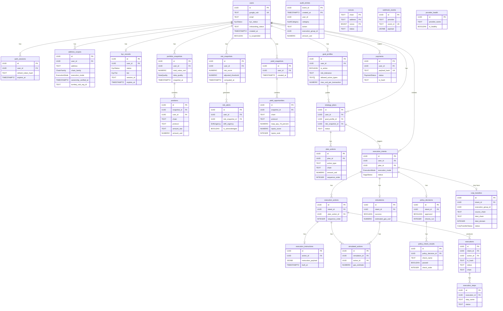

# 17 — BE Report: Entity-Relationship Diagram

**Pack:** CrestFlow UML & Architecture Documentation Pack  
**Version:** 1.0 | **Source docs:** `implementation_spec.md` v1.0 §3.1, `canonical_schemas.md` v2.0  
**Primary deliverable:** Lucidchart-ready ER Diagram specification. Mermaid erDiagram is supplementary.

---

## 1. Purpose & Scope

Specifies the **Entity-Relationship Diagram** for the CrestFlow PostgreSQL 16 database. Covers all 29 tables documented in `implementation_spec.md` §3.1 with:

- Table names, column names, data types
- Primary keys (PK), foreign keys (FK), unique constraints (UQ), composite keys
- Cardinalities and relationship descriptions
- Enumerated types

**Partitioning note:** `audit_entries` is partitioned by `created_at` (time-based partitioning). Composite PK: `(event_id, created_at)`.

---

## 2. Enumerated Types

| Enum Name | Values |
|---|---|
| `KycStatus` | PENDING, APPROVED, REJECTED, RESUBMISSION_REQUESTED, SUSPENDED, EXPIRED |
| `KycTier` | TIER_1, TIER_2, TIER_3 |
| `ExecutionMode` | AUTOPILOT, MANUAL, READ_ONLY |
| `AuditCategory` | AUTH, KYC, EXECUTION, PREFERENCE, PAYMENT, SYSTEM |
| `CctpTransferStatus` | PENDING, BURNED, ATTESTED, MINTED, FAILED |
| `DriftUrgency` | NONE, LOW, MEDIUM, HIGH, EMERGENCY |
| `DataQuality` | COMPLETE, PARTIAL, STALE |
| `SagaStatus` | CREATED, ROUTING, BUILDING, SIMULATING, POLICY_CHECK, BLOCKED, AWAITING_SIGNATURE, SIGNING, BROADCASTING, AWAITING_CONFIRMATION, AWAITING_ATTESTATION, MINTING, CONFIRMING, COMPLETED, FAILED, COMPENSATING, COMPENSATED, PAUSED |
| `PaymentStatus` | PENDING, SETTLED, FAILED |
| `ChainFamily` | EVM, SOLANA |

---

## 3. Entity (Table) Inventory

### Group A: Identity & Authentication

**`users`**
| Column | Type | Constraint | Description |
|---|---|---|---|
| `id` | UUID | PK, NOT NULL | User identifier |
| `google_sub` | TEXT | UQ, NOT NULL | Google OAuth subject identifier |
| `email` | TEXT | NOT NULL | User email |
| `display_name` | TEXT | | Display name from Google |
| `kyc_status` | KycStatus | NOT NULL, DEFAULT PENDING | Denormalized KYC status for fast reads |
| `onboarding_status` | TEXT | NOT NULL | PENDING_WALLET, WALLET_CREATED, PENDING_KYC, KYC_APPROVED |
| `created_at` | TIMESTAMPTZ | NOT NULL, DEFAULT NOW() | |
| `last_login_at` | TIMESTAMPTZ | | |
| `is_suspended` | BOOLEAN | NOT NULL, DEFAULT false | Admin suspension flag |

**`auth_sessions`**
| Column | Type | Constraint | Description |
|---|---|---|---|
| `id` | UUID | PK | Session identifier |
| `user_id` | UUID | FK → users.id, NOT NULL | |
| `refresh_token_hash` | TEXT | NOT NULL | bcrypt hash of refresh token |
| `created_at` | TIMESTAMPTZ | NOT NULL | |
| `expires_at` | TIMESTAMPTZ | NOT NULL | 7-day TTL |
| `revoked_at` | TIMESTAMPTZ | | NULL if active |

**`address_scopes`**
| Column | Type | Constraint | Description |
|---|---|---|---|
| `id` | UUID | PK | |
| `user_id` | UUID | FK → users.id, NOT NULL | |
| `address` | TEXT | NOT NULL | Wallet address (EVM hex or Solana base58) |
| `chain_family` | ChainFamily | NOT NULL | EVM or SOLANA |
| `execution_mode` | ExecutionMode | NOT NULL | AUTOPILOT, MANUAL, or READ_ONLY |
| `ownership_verified_at` | TIMESTAMPTZ | | NULL until verified (Path B) |
| `created_at` | TIMESTAMPTZ | NOT NULL | |
| `is_active` | BOOLEAN | NOT NULL, DEFAULT true | |
| `turnkey_sub_org_id` | TEXT | | Path A only; NULL for Path B |

**Unique constraint:** `(user_id, address)` — one scope per user+address.

---

### Group B: KYC

**`kyc_records`**
| Column | Type | Constraint | Description |
|---|---|---|---|
| `id` | UUID | PK | |
| `user_id` | UUID | FK → users.id, NOT NULL | |
| `status` | KycStatus | NOT NULL, DEFAULT PENDING | |
| `tier` | KycTier | | NULL until APPROVED; then TIER_1 default |
| `session_id` | TEXT | | HyperVerge session ID |
| `vendor_result` | JSONB | | Raw vendor response |
| `created_at` | TIMESTAMPTZ | NOT NULL | |
| `updated_at` | TIMESTAMPTZ | NOT NULL | |
| `approved_at` | TIMESTAMPTZ | | |
| `expires_at` | TIMESTAMPTZ | | NULL (MVP: no auto-expiry) |

---

### Group C: Goal Profile

**`goal_profiles`**
| Column | Type | Constraint | Description |
|---|---|---|---|
| `id` | UUID | PK | |
| `user_id` | UUID | FK → users.id, NOT NULL | |
| `is_active` | BOOLEAN | NOT NULL, DEFAULT true | Only one active per user |
| `risk_tolerance` | TEXT | NOT NULL | CAPITAL_PRESERVATION, CONSERVATIVE, MODERATE, AGGRESSIVE, YIELD_SEEKER |
| `investment_horizon` | TEXT | | SHORT, MEDIUM, LONG |
| `allowed_action_types` | TEXT[] | NOT NULL | e.g., ['SWAP','LEND_SUPPLY','LEND_WITHDRAW','BRIDGE'] |
| `max_usd_per_transaction` | NUMERIC | NOT NULL | Per-tx USD limit |
| `max_slippage_percent` | NUMERIC | NOT NULL | Maximum slippage tolerance |
| `allowed_chains` | TEXT[] | NOT NULL | e.g., ['ETH','BASE','ARB','SOL'] |
| `allowed_protocols` | JSONB | | Per-chain protocol allowlist |
| `created_at` | TIMESTAMPTZ | NOT NULL | |
| `updated_at` | TIMESTAMPTZ | NOT NULL | |

---

### Group D: Portfolio State

**`portfolio_snapshots`**
| Column | Type | Constraint | Description |
|---|---|---|---|
| `id` | UUID | PK | |
| `user_id` | UUID | FK → users.id, NOT NULL | |
| `total_value_usd` | NUMERIC | NOT NULL | Total portfolio USD value |
| `data_quality` | DataQuality | NOT NULL | COMPLETE, PARTIAL, STALE |
| `snapshot_at` | TIMESTAMPTZ | NOT NULL | When snapshot was taken |
| `created_at` | TIMESTAMPTZ | NOT NULL | |

**`positions`**
| Column | Type | Constraint | Description |
|---|---|---|---|
| `id` | UUID | PK | |
| `snapshot_id` | UUID | FK → portfolio_snapshots.id, NOT NULL | |
| `user_id` | UUID | FK → users.id, NOT NULL | Denormalized for query performance |
| `chain` | TEXT | NOT NULL | ETH, BASE, ARB, SOL |
| `protocol` | TEXT | NOT NULL | e.g., 'uniswap_v3', 'aave_v3' |
| `asset_symbol` | TEXT | NOT NULL | |
| `amount_raw` | TEXT | NOT NULL | BaseUnits (integer string) |
| `amount_usd` | NUMERIC | NOT NULL | |
| `position_type` | TEXT | NOT NULL | SPOT, LP, LEND, BORROW |
| `pool_type` | TEXT | | stable, correlated, constant_product |
| `apy_percent` | NUMERIC | | |
| `created_at` | TIMESTAMPTZ | NOT NULL | |

---

### Group E: Risk Intelligence

**`risk_snapshots`**
| Column | Type | Constraint | Description |
|---|---|---|---|
| `id` | UUID | PK | |
| `user_id` | UUID | FK → users.id, NOT NULL | |
| `risk_score` | NUMERIC | NOT NULL | 0–100 (use `riskScore` NEVER `compositeRiskScore`) |
| `adjusted_threshold` | NUMERIC | NOT NULL | base × persona_multiplier |
| `hhi_score` | NUMERIC | | Herfindahl-Hirschman Index |
| `hhi_band` | TEXT | | LOW/MODERATE/HIGH/CRITICAL |
| `computed_at` | TIMESTAMPTZ | NOT NULL | |
| `is_stale` | BOOLEAN | NOT NULL, DEFAULT false | True if >14,400s old |

**`risk_alerts`**
| Column | Type | Constraint | Description |
|---|---|---|---|
| `id` | UUID | PK | |
| `user_id` | UUID | FK → users.id, NOT NULL | |
| `risk_snapshot_id` | UUID | FK → risk_snapshots.id | |
| `alert_type` | TEXT | NOT NULL | e.g., HIGH_CONCENTRATION, LOW_PROTOCOL_SAFETY |
| `drift_urgency` | DriftUrgency | NOT NULL | NONE–EMERGENCY |
| `message` | TEXT | NOT NULL | Human-readable description |
| `is_acknowledged` | BOOLEAN | NOT NULL, DEFAULT false | |
| `created_at` | TIMESTAMPTZ | NOT NULL | |

---

### Group F: Yield Intelligence

**`yield_snapshots`**
| Column | Type | Constraint | Description |
|---|---|---|---|
| `id` | UUID | PK | |
| `user_id` | UUID | FK → users.id, NOT NULL | |
| `created_at` | TIMESTAMPTZ | NOT NULL | |

**`yield_opportunities`**
| Column | Type | Constraint | Description |
|---|---|---|---|
| `id` | UUID | PK | |
| `snapshot_id` | UUID | FK → yield_snapshots.id, NOT NULL | |
| `chain` | TEXT | NOT NULL | |
| `protocol` | TEXT | NOT NULL | |
| `asset_symbol` | TEXT | NOT NULL | |
| `action_type` | TEXT | NOT NULL | LEND_SUPPLY, SWAP, etc. |
| `twap_apy_7d_percent` | NUMERIC | NOT NULL | Use `twapApy7dPercent` NOT `twapApy30dPercent` |
| `protocol_safety_score` | NUMERIC | | |
| `topsis_score` | NUMERIC | | Composite ranking score |
| `topsis_rank` | INTEGER | | Rank within snapshot |
| `pool_type` | TEXT | | |
| `created_at` | TIMESTAMPTZ | NOT NULL | |

---

### Group G: Strategy

**`strategy_plans`**
| Column | Type | Constraint | Description |
|---|---|---|---|
| `id` | UUID | PK | |
| `user_id` | UUID | FK → users.id, NOT NULL | |
| `goal_profile_id` | UUID | FK → goal_profiles.id, NOT NULL | |
| `risk_snapshot_id` | UUID | FK → risk_snapshots.id | |
| `status` | TEXT | NOT NULL | DRAFT, PENDING_APPROVAL, APPROVED, REJECTED, EXECUTING, COMPLETED |
| `llm_model` | TEXT | | Model used for plan generation |
| `rationale` | TEXT | | LLM-generated explanation |
| `created_at` | TIMESTAMPTZ | NOT NULL | |
| `approved_at` | TIMESTAMPTZ | | |

**`plan_actions`**
| Column | Type | Constraint | Description |
|---|---|---|---|
| `id` | UUID | PK | |
| `plan_id` | UUID | FK → strategy_plans.id, NOT NULL | |
| `action_type` | TEXT | NOT NULL | SWAP, LEND_SUPPLY, LEND_WITHDRAW, BRIDGE |
| `chain` | TEXT | NOT NULL | |
| `protocol` | TEXT | NOT NULL | |
| `asset_in` | TEXT | NOT NULL | Symbol |
| `asset_out` | TEXT | | |
| `amount_usd` | NUMERIC | NOT NULL | |
| `sequence_order` | INTEGER | NOT NULL | Ordering within plan |
| `created_at` | TIMESTAMPTZ | NOT NULL | |

---

### Group H: Execution

**`execution_intents`**
| Column | Type | Constraint | Description |
|---|---|---|---|
| `id` | UUID | PK | |
| `user_id` | UUID | FK → users.id, NOT NULL | |
| `plan_id` | UUID | FK → strategy_plans.id | |
| `execution_mode` | ExecutionMode | NOT NULL | |
| `status` | SagaStatus | NOT NULL, DEFAULT CREATED | |
| `router_output` | JSONB | | Route decisions |
| `created_at` | TIMESTAMPTZ | NOT NULL | |
| `updated_at` | TIMESTAMPTZ | NOT NULL | |

**`execution_actions`**
| Column | Type | Constraint | Description |
|---|---|---|---|
| `id` | UUID | PK | |
| `intent_id` | UUID | FK → execution_intents.id, NOT NULL | |
| `plan_action_id` | UUID | FK → plan_actions.id | |
| `status` | TEXT | NOT NULL | |
| `sequence_order` | INTEGER | NOT NULL | |
| `created_at` | TIMESTAMPTZ | NOT NULL | |

**`execution_instructions`**
| Column | Type | Constraint | Description |
|---|---|---|---|
| `id` | UUID | PK | |
| `action_id` | UUID | FK → execution_actions.id, NOT NULL | |
| `instruction_payload` | JSONB | NOT NULL | Encoded calldata, amountIn (BaseUnits), deadline |
| `built_at` | TIMESTAMPTZ | NOT NULL | Used for 30s re-quote TTL |

**`simulations`**
| Column | Type | Constraint | Description |
|---|---|---|---|
| `id` | UUID | PK | |
| `intent_id` | UUID | FK → execution_intents.id, NOT NULL | |
| `success` | BOOLEAN | NOT NULL | |
| `estimated_gas_usd` | NUMERIC | | |
| `estimated_slippage` | NUMERIC | | |
| `simulated_at` | TIMESTAMPTZ | NOT NULL | |

**`simulated_actions`**
| Column | Type | Constraint | Description |
|---|---|---|---|
| `id` | UUID | PK | |
| `simulation_id` | UUID | FK → simulations.id, NOT NULL | |
| `action_id` | UUID | FK → execution_actions.id | |
| `gas_estimate` | NUMERIC | | Per-chain gas |
| `amount_out_estimate` | TEXT | | BaseUnits |
| `slippage_estimate` | NUMERIC | | |

**`policy_decisions`**
| Column | Type | Constraint | Description |
|---|---|---|---|
| `id` | UUID | PK | |
| `intent_id` | UUID | FK → execution_intents.id, NOT NULL | |
| `approved` | BOOLEAN | NOT NULL | |
| `blocked_reasons` | JSONB | | Array of blocked reason objects |
| `checks_run` | INTEGER | NOT NULL | Always 9 |
| `evaluated_at` | TIMESTAMPTZ | NOT NULL | |

**`policy_check_results`**
| Column | Type | Constraint | Description |
|---|---|---|---|
| `id` | UUID | PK | |
| `policy_decision_id` | UUID | FK → policy_decisions.id, NOT NULL | |
| `check_name` | TEXT | NOT NULL | e.g., 'KYC_GATE', 'RISK_GATE' |
| `passed` | BOOLEAN | NOT NULL | |
| `reason` | TEXT | | Failure reason if not passed |
| `check_order` | INTEGER | NOT NULL | 1–9 |

**`executions`**
| Column | Type | Constraint | Description |
|---|---|---|---|
| `id` | UUID | PK | |
| `intent_id` | UUID | FK → execution_intents.id, NOT NULL | |
| `action_id` | UUID | FK → execution_actions.id | |
| `tx_hash` | TEXT | | On-chain transaction hash |
| `status` | TEXT | NOT NULL | PENDING, CONFIRMED, FAILED |
| `chain` | TEXT | NOT NULL | |
| `gas_used` | NUMERIC | | |
| `block_number` | BIGINT | | |
| `broadcasted_at` | TIMESTAMPTZ | | |
| `confirmed_at` | TIMESTAMPTZ | | |

**`execution_steps`**
| Column | Type | Constraint | Description |
|---|---|---|---|
| `id` | UUID | PK | |
| `execution_id` | UUID | FK → executions.id, NOT NULL | |
| `step_name` | TEXT | NOT NULL | SIGN, BROADCAST, CONFIRM |
| `status` | TEXT | NOT NULL | |
| `occurred_at` | TIMESTAMPTZ | NOT NULL | |

---

### Group I: CCTP

**`cctp_transfers`**
| Column | Type | Constraint | Description |
|---|---|---|---|
| `id` | UUID | PK | |
| `intent_id` | UUID | FK → execution_intents.id, NOT NULL | |
| `execution_group_id` | UUID | NOT NULL | Links burn + mint audit entries |
| `source_chain` | TEXT | NOT NULL | ETH, ARB, BASE |
| `dest_chain` | TEXT | NOT NULL | BASE, ETH, ARB, SOL |
| `dest_domain` | INTEGER | NOT NULL | 0=ETH, 3=ARB, 5=SOL, 6=BASE |
| `amount` | TEXT | NOT NULL | BaseUnits (integer string) |
| `max_fee` | TEXT | NOT NULL | "0" for Standard; quoted for Fast |
| `min_finality_threshold` | INTEGER | NOT NULL | 2000 Standard; 1000 Fast |
| `mint_recipient` | TEXT | NOT NULL | Destination wallet address |
| `burn_token` | TEXT | NOT NULL | USDC token address on source chain |
| `status` | CctpTransferStatus | NOT NULL, DEFAULT PENDING | |
| `burn_tx_hash` | TEXT | | |
| `burn_confirmed_at` | TIMESTAMPTZ | | |
| `attestation` | TEXT | | Iris attestation hex |
| `message_bytes` | TEXT | | CCTP message bytes |
| `attested_at` | TIMESTAMPTZ | | |
| `mint_tx_hash` | TEXT | | |
| `minted_at` | TIMESTAMPTZ | | |
| `created_at` | TIMESTAMPTZ | NOT NULL | |

---

### Group J: Audit

**`audit_entries`** *(partitioned by created_at)*
| Column | Type | Constraint | Description |
|---|---|---|---|
| `event_id` | UUID | PK (composite with created_at) | |
| `created_at` | TIMESTAMPTZ | PK (composite with event_id) | Partition key |
| `user_id` | UUID | | NULL for system events |
| `category` | AuditCategory | NOT NULL | AUTH, KYC, EXECUTION, PREFERENCE, PAYMENT, SYSTEM |
| `action` | TEXT | NOT NULL | e.g., LOGIN, KYC_APPROVED, TRANSACTION_CONFIRMED |
| `outcome` | TEXT | | APPROVED, BLOCKED, FAILED, etc. |
| `metadata` | JSONB | | Additional event-specific data |
| `execution_group_id` | UUID | | For CCTP cross-entry tracing |
| `amount_usd` | NUMERIC | | For EXECUTION events (daily limit queries) |

**`audit_event_dedupe`**
| Column | Type | Constraint | Description |
|---|---|---|---|
| `dedup_key` | TEXT | PK | Hash of (category, action, metadata key fields) |
| `event_id` | UUID | NOT NULL | References audit_entries |
| `created_at` | TIMESTAMPTZ | NOT NULL | |

---

### Group K: Payments

**`payments`**
| Column | Type | Constraint | Description |
|---|---|---|---|
| `id` | UUID | PK | |
| `user_id` | UUID | FK → users.id | NULL for anonymous agents |
| `payload_hash` | TEXT | UQ, NOT NULL | keccak256 of EIP-3009 authorization (replay protection) |
| `amount` | TEXT | NOT NULL | "10000" = 0.01 USDC in 6-decimal |
| `asset` | TEXT | NOT NULL | "Base USDC" |
| `network` | TEXT | NOT NULL | "eip155:8453" |
| `status` | PaymentStatus | NOT NULL | PENDING, SETTLED, FAILED |
| `tx_hash` | TEXT | | Facilitator settlement tx hash |
| `settled_at` | TIMESTAMPTZ | | |
| `created_at` | TIMESTAMPTZ | NOT NULL | |

---

### Group L: Nonces & Webhooks

**`nonces`**
| Column | Type | Constraint | Description |
|---|---|---|---|
| `chain` | TEXT | PK (composite) | ETH, BASE, ARB, SOL |
| `address` | TEXT | PK (composite) | Signer wallet address |
| `nonce` | BIGINT | PK (composite) | Transaction nonce value |
| `status` | TEXT | NOT NULL | LEASED, BROADCAST, CONFIRMED |
| `leased_at` | TIMESTAMPTZ | NOT NULL | |
| `tx_hash` | TEXT | | Set on BROADCAST |

**Composite PK:** `(chain, address, nonce)`

**`webhook_events`**
| Column | Type | Constraint | Description |
|---|---|---|---|
| `id` | UUID | PK | |
| `provider` | TEXT | NOT NULL | ALCHEMY, HELIUS, HYPERVERGE |
| `event_id` | TEXT | NOT NULL | Provider-assigned event ID |
| `payload` | JSONB | NOT NULL | Raw webhook body |
| `processed_at` | TIMESTAMPTZ | | NULL if pending |
| `created_at` | TIMESTAMPTZ | NOT NULL | |

**Unique constraint:** `(provider, event_id)` — idempotent webhook processing.

**`provider_health`**
| Column | Type | Constraint | Description |
|---|---|---|---|
| `id` | UUID | PK | |
| `provider_name` | TEXT | NOT NULL | ALCHEMY, HELIUS, COINGECKO, etc. |
| `is_healthy` | BOOLEAN | NOT NULL | |
| `last_check_at` | TIMESTAMPTZ | NOT NULL | |
| `error_message` | TEXT | | NULL if healthy |

---

## 4. Relationship Table

| Relationship # | Table A | Cardinality | Table B | FK Column(s) | Description |
|---|---|---|---|---|---|
| R-01 | users | 1 | auth_sessions | N | users.id → auth_sessions.user_id |
| R-02 | users | 1 | address_scopes | N | users.id → address_scopes.user_id |
| R-03 | users | 1 | kyc_records | 1 | users.id → kyc_records.user_id (one active record) |
| R-04 | users | 1 | goal_profiles | N | users.id → goal_profiles.user_id (one active) |
| R-05 | users | 1 | portfolio_snapshots | N | users.id → portfolio_snapshots.user_id |
| R-06 | users | 1 | risk_snapshots | N | users.id → risk_snapshots.user_id |
| R-07 | users | 1 | yield_snapshots | N | users.id → yield_snapshots.user_id |
| R-08 | users | 1 | strategy_plans | N | users.id → strategy_plans.user_id |
| R-09 | users | 1 | execution_intents | N | users.id → execution_intents.user_id |
| R-10 | users | 1 | payments | N | users.id → payments.user_id (nullable) |
| R-11 | users | 1 | audit_entries | N | users.id → audit_entries.user_id (nullable) |
| R-12 | portfolio_snapshots | 1 | positions | N | portfolio_snapshots.id → positions.snapshot_id |
| R-13 | risk_snapshots | 1 | risk_alerts | N | risk_snapshots.id → risk_alerts.risk_snapshot_id |
| R-14 | yield_snapshots | 1 | yield_opportunities | N | yield_snapshots.id → yield_opportunities.snapshot_id |
| R-15 | strategy_plans | 1 | plan_actions | N | strategy_plans.id → plan_actions.plan_id |
| R-16 | strategy_plans | 1 | execution_intents | N | strategy_plans.id → execution_intents.plan_id |
| R-17 | goal_profiles | 1 | strategy_plans | N | goal_profiles.id → strategy_plans.goal_profile_id |
| R-18 | risk_snapshots | 1 | strategy_plans | N | risk_snapshots.id → strategy_plans.risk_snapshot_id |
| R-19 | execution_intents | 1 | execution_actions | N | execution_intents.id → execution_actions.intent_id |
| R-20 | execution_actions | 1 | execution_instructions | 1 | execution_actions.id → execution_instructions.action_id |
| R-21 | execution_intents | 1 | simulations | 1 | execution_intents.id → simulations.intent_id |
| R-22 | simulations | 1 | simulated_actions | N | simulations.id → simulated_actions.simulation_id |
| R-23 | execution_actions | 1 | simulated_actions | 1 | execution_actions.id → simulated_actions.action_id |
| R-24 | execution_intents | 1 | policy_decisions | 1 | execution_intents.id → policy_decisions.intent_id |
| R-25 | policy_decisions | 1 | policy_check_results | 9 | policy_decisions.id → policy_check_results.policy_decision_id |
| R-26 | execution_actions | 1 | executions | N | execution_actions.id → executions.action_id |
| R-27 | execution_intents | 1 | executions | N | execution_intents.id → executions.intent_id |
| R-28 | executions | 1 | execution_steps | N | executions.id → execution_steps.execution_id |
| R-29 | execution_intents | 1 | cctp_transfers | 1 | execution_intents.id → cctp_transfers.intent_id |
| R-30 | plan_actions | 1 | execution_actions | N | plan_actions.id → execution_actions.plan_action_id |

---

## 5. Lucidchart Shape Guide

| Element | Lucidchart Shape | Style |
|---|---|---|
| Entity (table) | Rectangle | Header row: table name in bold, different background color |
| Attribute row | Table row inside entity rectangle | Column name + type + constraint indicators (PK🔑, FK🔗, UQ, NN) |
| PK attribute | Bold text with key icon 🔑 | Underlined or gold highlight |
| FK attribute | Italic text with link icon 🔗 | |
| Relationship line (1:N) | Crow's foot notation | "One" side: single bar; "Many" side: crow's foot |
| Relationship line (1:1) | Single bar both ends | |
| Weak entity (partitioned) | Double-border rectangle | `audit_entries` |
| Composite PK note | Note shape | For `nonces` and `audit_entries` |

---

## 6. Layout Recommendations

**Group by domain (use Lucidchart groups / colored containers):**

```
[Identity & Auth Group]       users, auth_sessions, address_scopes
[KYC Group]                   kyc_records
[Goal Group]                  goal_profiles
[Portfolio Group]             portfolio_snapshots, positions
[Risk Group]                  risk_snapshots, risk_alerts
[Yield Group]                 yield_snapshots, yield_opportunities
[Strategy Group]              strategy_plans, plan_actions
[Execution Group]             execution_intents, execution_actions, execution_instructions,
                              simulations, simulated_actions, policy_decisions,
                              policy_check_results, executions, execution_steps
[CCTP Group]                  cctp_transfers
[Audit Group]                 audit_entries, audit_event_dedupe
[Payment Group]               payments
[Infrastructure Group]        nonces, webhook_events, provider_health
```

**Central anchor:** `users` table in the center. All FK relationships radiate outward from `users`.
**Execution chain:** Show linearly: `execution_intents → execution_actions → execution_instructions → simulations → policy_decisions → executions → execution_steps`.

---

## 7. Supplementary Mermaid



---

## 8. Flags & Open Questions

| Flag ID | Type | Description |
|---|---|---|
| F-17-01 | **Naming critical** | `risk_score` NOT `compositeRiskScore`. Use exact column name. |
| F-17-02 | **Naming critical** | `twap_apy_7d_percent` NOT `twap_apy_30d_percent`. Use exact column name. |
| F-17-03 | **Naming critical** | Action types: `LEND_SUPPLY` / `LEND_WITHDRAW` NOT `LEND_DEPOSIT`. |
| F-17-04 | **Partitioning** | `audit_entries` is time-partitioned. Its PK is composite `(event_id, created_at)`. Draw with double-border in Lucidchart. |
| F-17-05 | **Composite PK** | `nonces` has composite PK `(chain, address, nonce)`. Draw with all three underlined. |
| F-17-06 | **Unique constraint** | `webhook_events (provider, event_id)` — composite unique; not PK. Show as UQ constraint. |
| F-17-07 | **Nullable FK** | `payments.user_id` is nullable (anonymous agents). `audit_entries.user_id` is nullable (system events). |
| F-17-08 | **Phase 2** | Kafka event tables, credit ledger tables, and ERC-4337 session key tables are Phase 2 — not shown. |
