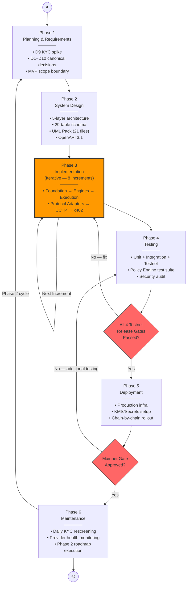

# 19 — Project Planning: SDLC Model

**Pack:** CrestFlow UML & Architecture Documentation Pack  
**Version:** 1.0 | **Source docs:** `CANONICAL_DECISIONS.md` v1.2, `implementation_spec.md` v1.0, all v2.0 planning documents  
**Primary deliverable:** Lucidchart-ready SDLC specification. Mermaid flowchart is supplementary.

---

## 1. Purpose & Scope

Specifies the **Software Development Life Cycle (SDLC) model** adopted for the CrestFlow project, with CrestFlow-specific activities for each phase. Suitable for the BE project report Chapter 2 (Methodology).

---

## 2. Recommended SDLC Model: Iterative Incremental

**Rationale:** The CrestFlow architecture strongly suggests an **Iterative Incremental** model, specifically an **Agile Scrum-inspired** approach, based on these documented characteristics:

| Evidence from Planning Docs | SDLC Implication |
|---|---|
| 6 intelligence engines with well-defined interfaces — buildable independently | Incremental delivery of modules |
| Explicit testnet-before-mainnet release gates | Iterative validation before production |
| Phase 2 backlog clearly documented (Black-Litterman, GMX, ERC-4337, etc.) | Incremental scope expansion |
| HyperVerge conditional (D9) — vendor spike required before integration commitment | Risk-driven iterative decisions |
| `CANONICAL_DECISIONS.md` maintained as a live document (v1.2) | Iterative decision-making |
| BullMQ → Kafka Phase 2 upgrade path | Architecture evolution over iterations |
| 5-layer architecture with clear separation of concerns | Parallel development across teams/iterations |

**Alternative models considered:**

| Model | Verdict | Reason |
|---|---|---|
| Waterfall | Not recommended | Architecture too complex; KYC vendor (D9) and mainnet gate are dynamic decision points incompatible with purely sequential phases |
| Pure Agile Scrum | Recommended with modifications | Full Scrum with 2-week sprints; modified with explicit testnet/mainnet gates as release milestones |
| Spiral | Partially applicable | Risk-driven iterations align (D9 spike), but overhead too high for academic project |
| Prototype | Not recommended | Well-specified canonical decisions make prototyping unnecessary at MVP level |

---

## 3. CrestFlow SDLC Phases

### Phase 1: Planning & Requirements
**Goal:** Understand and document the problem domain, stakeholder needs, and technical constraints.

**CrestFlow-Specific Activities:**
- Stakeholder interviews: investment goals, risk tolerance, DeFi familiarity
- DeFi domain research: CCTP V2, x402 protocol, Turnkey TEE capabilities
- KYC vendor evaluation (D9 spike: HyperVerge vs Persona vs Sumsub)
- Technology stack selection → D10: TypeScript/NestJS/PostgreSQL/Redis
- Canonical decision capture → `CANONICAL_DECISIONS.md` D1–D10, T1–T17
- MVP scope boundary → Phase 2 backlog established
- Risk register: mainnet security, TEE availability, regulatory compliance

**Key Outputs:**
- `CANONICAL_DECISIONS.md` v1.0
- Functional requirements (40 use cases)
- Risk register
- Project plan / Gantt (see `18_project_gantt.md`)

---

### Phase 2: System Design
**Goal:** Translate requirements into architectural and detailed design artifacts.

**CrestFlow-Specific Activities:**
- 5-layer architecture design (Interface → Intelligence → Execution → Protocol → Data)
- 29-table PostgreSQL 16 schema design (partitioned audit_entries, composite PKs)
- Engine interface contracts: canonical_schemas.md (§1–§17)
- Policy Engine design: 9 checks in documented order, no short-circuit
- CCTP V2 integration design: `depositForBurn` 7-parameter signature (D5)
- x402 middleware design: EIP-3009 flow, replay protection via `paymentPayloadHash`
- Execution Saga design: 18 states + compensation paths
- Shared library design: `@crestflow/pool-type` (T11)
- UML & Architecture Documentation Pack production (this document set)

**Key Outputs:**
- All v2.0 planning documents (20 files)
- UML pack (21 specification files)
- OpenAPI 3.1 specification
- Database migration scripts

---

### Phase 3: Implementation (Iterative)
**Goal:** Build the system in increments aligned with the layer dependency order.

**Increment Structure:**
```
Increment 1: Foundation (Identity, Auth, DB, Redis, Shared Library)
Increment 2: Portfolio & Risk Intelligence (Engines 1–2)
Increment 3: Yield & Strategy Intelligence (Engines 3–4)
Increment 4: Execution Pipeline (ER, Orchestrator, Simulation, Policy Engine)
Increment 5: Protocol Adapters (EVM DEX, EVM Lending, Solana)
Increment 6: CCE, Signing, Broadcast, PSM Reconciliation
Increment 7: CCTP Bridge (Increment 5 must complete first)
Increment 8: x402 Payments, Copilot (Engine 5), User Intelligence
```

**CrestFlow-Specific Activities (per increment):**
- TDD: unit tests written alongside each module
- BullMQ job queues configured per engine
- Turnkey TEE integration testing on testnet keys
- Protocol adapter testing against forked Anvil / Solana test validator
- Gas estimation validation per chain (EIP-1559, Base L2, Arbitrum L2, Solana compute units)
- Canonical naming enforcement (`riskScore`, `twapApy7dPercent`, `LEND_SUPPLY`, etc.)

**Key Outputs:**
- Working NestJS modules per increment
- Test suite expanding each increment
- Local testnet deployment (Anvil + Solana test validator)

---

### Phase 4: Testing
**Goal:** Validate correctness, security, and performance against requirements and testnet release gates.

**CrestFlow-Specific Activities:**

| Test Type | Focus | Tools |
|---|---|---|
| Unit Tests | Each service, engine, adapter in isolation | Jest |
| Integration Tests | NestJS ↔ PostgreSQL ↔ Redis ↔ BullMQ | Jest + testcontainers |
| Policy Engine Tests | All 9 checks × pass/fail combinations | Jest; 18+ test cases |
| Testnet Deployment | Full system on Sepolia/Base Sepolia/Devnet | Manual + scripted |
| Testnet Gate: Swap | ≥1 successful swap (Uniswap V3 on Sepolia) | Manual verification |
| Testnet Gate: Aave V3 | ≥1 successful lend + withdraw | Manual verification |
| Testnet Gate: CCTP | ≥1 CCTP USDC transfer (Sepolia → Base Sepolia) | Manual verification |
| Testnet Gate: x402 | ≥1 paid Copilot query on Base Sepolia | Manual verification |
| Security Audit | Turnkey key handling, auth flows, x402 replay | External security review |
| Performance Testing | Engine pipeline latency, BullMQ throughput | k6 / Artillery |
| Regression Testing | Full test suite on each increment | CI/CD (GitHub Actions) |

**Key Outputs:**
- Test reports
- Testnet release gate sign-off
- Security audit report

---

### Phase 5: Deployment
**Goal:** Deploy the system to production with appropriate controls.

**CrestFlow-Specific Activities:**
- Production infrastructure: NestJS cluster (horizontally scalable), PostgreSQL primary + read replica, Redis cluster
- KMS / Secrets Manager setup (all Turnkey, HyperVerge, Alchemy, Helius, Gemini API keys)
- API Gateway + Load Balancer configuration
- Mainnet release gate decision (separate approval; triggered after all testnet gates pass + security audit)
- Chain-by-chain mainnet rollout: ETH/BASE/ARB first, Solana next
- Monitoring: provider health checks, audit log alerting, BullMQ queue depth alerts

**Key Outputs:**
- Production deployment
- Operations runbook
- Monitoring dashboards

---

### Phase 6: Maintenance
**Goal:** Operate, monitor, and evolve the system.

**CrestFlow-Specific Activities:**
- Daily sanctions rescreening (KYC APPROVED → SUSPENDED path)
- Provider health monitoring: Alchemy, Helius, Circle Iris, x402.org, Gemini LLM
- CoinGecko/DeFiLlama API quota monitoring (free tier limits)
- Audit log partitioning maintenance (pruning old partitions)
- Phase 2 backlog execution: Black-Litterman optimizer, GMX automation, ERC-4337 delegation, Kafka, fiat on-ramp
- Canonical decision document updates as new decisions are made

---

## 4. SDLC Diagram Specification (Lucidchart)

### Element Inventory

| Element ID | Element Type | Label | Shape | Color |
|---|---|---|---|---|
| SD-00 | Initial node | Start | Filled circle | Black |
| SD-01 | Phase | Planning & Requirements | Rounded rectangle | Blue |
| SD-02 | Phase | System Design | Rounded rectangle | Green |
| SD-03 | Phase | Implementation (Iterative) | Rounded rectangle (thick border) | Orange |
| SD-04 | Phase | Testing | Rounded rectangle | Red |
| SD-05 | Decision | All testnet gates passed? | Diamond | Orange |
| SD-06 | Phase | Deployment | Rounded rectangle | Teal |
| SD-07 | Decision | Mainnet gate approved? | Diamond | Red |
| SD-08 | Phase | Maintenance | Rounded rectangle | Purple |
| SD-09 | Iteration loop | Increment feedback | Curved arrow back to SD-03 | Orange dashed |
| SD-10 | Iteration loop | Phase feedback | Curved arrow back to SD-01 or SD-02 | Blue dashed |
| SD-END | Activity Final | End | Double circle | Black |

### Connection Table

| From | To | Label | Arrow Type |
|---|---|---|---|
| SD-00 | SD-01 | — | Solid arrow |
| SD-01 | SD-02 | Requirements approved | Solid arrow |
| SD-02 | SD-03 | Design complete | Solid arrow |
| SD-03 | SD-03 | Next increment (loop) | Dashed curved arrow (self-loop or back-arc) |
| SD-03 | SD-04 | Increment complete | Solid arrow |
| SD-04 | SD-05 | Tests complete | Solid arrow |
| SD-05 | SD-03 | Testnet gates fail — fix and re-test | Dashed arrow (feedback loop) |
| SD-05 | SD-06 | All testnet gates passed | Solid arrow |
| SD-06 | SD-07 | Production infra ready | Solid arrow |
| SD-07 | SD-04 | Gate not approved — additional audit/testing | Dashed arrow |
| SD-07 | SD-08 | Mainnet launch approved | Solid arrow |
| SD-08 | SD-01 | Phase 2 requirements cycle | Dashed arrow (Phase 2 feedback) |
| SD-08 | SD-END | Product end-of-life | Solid arrow (optional) |

---

## 5. Lucidchart Shape Guide

| Element | Lucidchart Shape | Style |
|---|---|---|
| Phase box | Rounded Rectangle | 200×80px; bold label; colored fill |
| Decision | Diamond | 100×100px; question label; white fill |
| Initial node | "Start (UML)" filled circle | Black |
| Final node | "End (UML)" | Double circle |
| Feedback loop | Curved Arrow connector | Dashed; label on arc |
| Increment annotation | Note shape | "8 Increments; each ~1–2 weeks" |
| Release gate annotation | Note shape (red border) | List testnet gates |
| Phase 2 annotation | Note shape (purple border) | "Phase 2 backlog: Black-Litterman, GMX, ERC-4337, etc." |

---

## 6. Layout Recommendations

**Primary direction:** Top → Bottom (vertical flow).

```
[●] Start
    ↓
[Planning & Requirements] ←←←←←←←←←←←←←←←←←←←←←←←←←←←←←←
    ↓                                                          ↑ Phase 2 cycle
[System Design]                                                |
    ↓                                                          |
[Implementation — Iterative] ⟲ (8 increments loop)           |
    ↓                                                          |
[Testing]                                                      |
    ↓                                                          |
◇ All testnet gates passed?                                   |
    ↓ Yes          ↓ No → back to Implementation              |
[Deployment]                                                   |
    ↓                                                          |
◇ Mainnet gate approved?                                      |
    ↓ Yes          ↓ No → back to Testing                     |
[Maintenance] ————————————————————————————————————————————————
    ↓
[◎] End (or Phase 2 begin)
```

**Key visual emphasis:**
- The Implementation phase box should be visually larger and use a thicker border to signal its iterative nature.
- The increment loop arrow should be a prominent curved arc on the left side of the Implementation box.
- Both release gate diamonds should use a red/orange fill with bold labels: "Testnet Gates (4 criteria)" and "Mainnet Gate (separate approval)".
- Add small annotation boxes adjacent to each gate listing the specific criteria.

---

## 7. Supplementary Mermaid



---

## 8. Flags & Open Questions

| Flag ID | Type | Description |
|---|---|---|
| F-19-01 | **Recommended** | Iterative Incremental (Agile-inspired) is recommended based on documented architecture characteristics. Confirm with project supervisor if a different model is required by the academic program. |
| F-19-02 | **D9 impact** | HyperVerge KYC spike (Phase 1) is a critical planning dependency. If KYC vendor changes, Increment 1 (Identity) may require rework, extending Phase 3. |
| F-19-03 | **Release gates** | The 4 testnet release gate criteria are explicitly documented in CANONICAL_DECISIONS.md. They form the formal exit criteria for the Testing phase. |
| F-19-04 | **Mainnet gate** | The mainnet release gate is a separate decision (not yet triggered in the planning documents). It requires all testnet gates + security audit as prerequisites. |
| F-19-05 | **Phase 2 scope** | The maintenance phase loops back to Planning for Phase 2 features: Black-Litterman optimizer (requires 90+ snapshots), GMX automation, ERC-4337/EIP-7702 delegation, fiat on-ramp, Travel Rule (Phase 3), Kafka, non-USDC bridge. |
