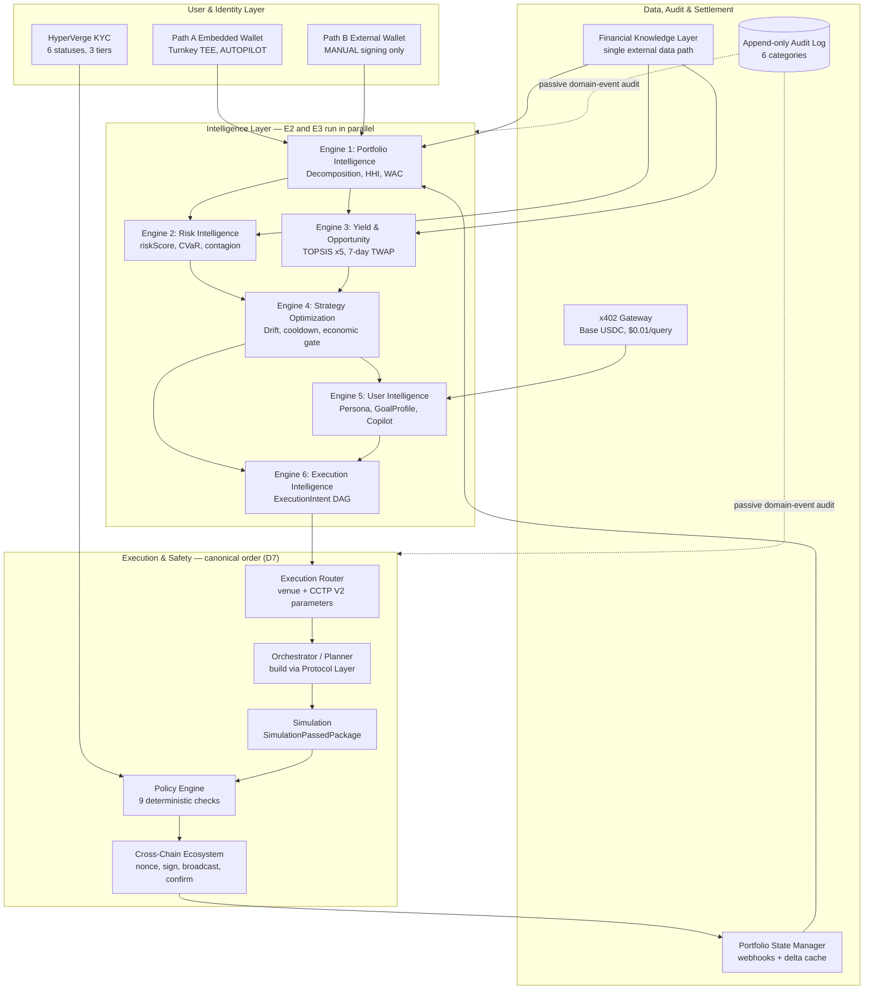

# Cross-Chain Decentralized Financial Intelligence, Portfolio Optimization, and Policy-Constrained Autonomous Execution: A Comprehensive Literature Survey and Architectural Foundation

**Project:** CrestFlow Intelligence Platform  
**Target Chain Scope (MVP):** Ethereum · Solana · Base · Arbitrum  
**Document Type:** Before-Project Literature Survey & Systematic State-of-the-Art Review  
**Audience:** Academic Committee, Project Mentors, and Quantitative Systems Reviewers  
**Status:** Derived literature review  
**Version:** 2.0  
**Last reviewed:** 18 November 2026  
**Companion index:** `core_documents/CrestFlow Literature Survey Papers List.csv`  
**Canonical references:** `CANONICAL_DECISIONS.md`, `docs/canonical_schemas.md`

---

## Executive Abstract

Decentralized Finance (DeFi) has evolved from isolated automated market makers into a hyper-fragmented multi-chain ecosystem characterized by heterogeneous virtual machines (EVM and SVM), asynchronous cross-chain communication, complex token-incentive structures, and asymmetric tail risk. Despite managing tens of billions in total value locked (TVL), existing user interfaces and automation tools rely on naive single-metric heuristics (e.g., raw spot APY sorting or unconstrained mean-variance optimization) and execute unverified transactions across trust-compromised bridging infrastructure.

This survey provides a comprehensive review of the state-of-the-art literature underpinning **CrestFlow**—an event-driven, domain-separated intelligence platform combining six specialized computation engines with a fail-closed policy guardrail and saga-compensating execution pipeline. We systematically review and categorize **54 unique academic and empirical publications** from the CrestFlow literature survey (alongside 3 supplementary foundational references for algorithmic completeness) across ten core domains. The v1.x list contained 54 URL-bearing rows but only 53 unique titles; v2.0 removes the duplicate Kroo et al. record and splits the conflated Barber & Odean citation into two verified papers, yielding 54 unique core references. Citation status is recorded in §15.3.
1. Intelligent Financial Decision Support Systems in Web3
2. Cross-Chain Interoperability, Virtual Machine Abstraction, and Solver Markets
3. On-Chain Portfolio Accounting, LP Decomposition, and Performance Attribution
4. Quantitative Risk Modeling in Fat-Tailed and Illiquid Regimes
5. Robust Portfolio Optimization, Hierarchical Risk Parity, and Drift Rebalancing
6. Multi-Criteria Yield Discovery and Impermanent Loss Dynamics
7. Behavioral Finance, Regulated Profiling, and Financial Large Language Models
8. Autonomous Execution, Runtime Policy Governance, and Distributed Saga Compensation
9. Decentralized Identity, Pragmatic Compliance, and Tamper-Resistant Audit Logging
10. High-Fidelity Financial Data Infrastructure, Oracle Manipulation Resistance, and Numerical Precision

Finally, this survey synthesizes the critical gaps in prevailing academic and commercial systems and establishes the rigorous theoretical foundation for the CrestFlow architecture.

---

## Table of Contents

1. [Introduction and Architectural Motivation](#1-introduction-and-architectural-motivation)
2. [Survey Methodology, 8-Point Evaluation Framework, and Domain Taxonomy](#2-survey-methodology-and-systematic-evaluation-framework)
3. [Base Literature: Intelligent Decision Support Systems in DeFi](#3-base-literature-intelligent-decision-support-systems-in-defi)
4. [Cross-Chain Interoperability, Heterogeneous VMs, and Intent Execution](#4-cross-chain-interoperability-heterogeneous-vms-and-intent-execution)
5. [Portfolio Intelligence: Position Decomposition and Performance Attribution](#5-portfolio-intelligence-position-decomposition-and-performance-attribution)
6. [Quantitative Risk Intelligence in Non-Gaussian Crypto Regimes](#6-quantitative-risk-intelligence-in-non-gaussian-crypto-regimes)
7. [Strategy Optimization: Hierarchical Risk Parity, Mean-CVaR, and Rebalancing](#7-strategy-optimization-hierarchical-risk-parity-mean-cvar-and-rebalancing)
8. [Yield Opportunity Ranking, Impermanent Loss, and Multi-Criteria Decision Analysis](#8-yield-opportunity-ranking-impermanent-loss-and-multi-criteria-decision-analysis)
9. [User Intelligence, Behavioral Finance, and Domain-Specific AI Copilots](#9-user-intelligence-behavioral-finance-and-domain-specific-ai-copilots)
10. [Autonomous Execution, Policy Guardrails, and Distributed Sagas](#10-autonomous-execution-policy-guardrails-and-distributed-sagas)
11. [Identity, Compliance, Fiat On-Ramps, and Immutable Audit Logging](#11-identity-compliance-fiat-on-ramps-and-immutable-audit-logging)
12. [Financial Data Infrastructure, Oracles, and Numerical Correctness](#12-financial-data-infrastructure-oracles-and-numerical-correctness)
13. [Comparative Matrix and Identified Research Gaps](#13-comparative-matrix-and-identified-research-gaps)
14. [Conclusion and Project Roadmap](#14-conclusion-and-project-roadmap)
15. [Comprehensive Reference Bibliography](#15-comprehensive-reference-bibliography)

---

## 1. Introduction and Architectural Motivation

The transition of Web3 financial infrastructure from single-chain experiments to a multi-chain, multi-layer paradigm has introduced severe systemic challenges for capital allocators:

1. **Information Asymmetry and Metric Distortions:** Public interfaces routinely display annualized percentage yields (APY) derived from transient token emissions or unadjusted spot volume. They mask the severe drag of impermanent loss (IL), dynamic borrowing borrow-rate spikes, and protocol counterparty risk.
2. **Execution and Bridge Vulnerabilities:** Moving capital across chains historically relies on external validator lock-and-mint bridges, which have accounted for over $2.8 billion in exploit losses. Furthermore, asynchronous cross-chain execution exposes users to execution desynchronization, slippage exploitation, and sandwich attacks.
3. **Behavioral Pitfalls and Lack of Personalization:** Retail and semi-institutional participants repeatedly suffer from classic behavioral biases (e.g., disposition effect, panic selling during liquidation cascades) exacerbated by static, questionnaire-based risk scoring that fails to track portfolio drift.
4. **Unconstrained Autonomous Agents:** Emerging agentic systems attempting automated DeFi management operate without deterministic runtime policy guardrails, risking liquidation or exploit drain during extreme volatility.

### The CrestFlow Architecture

To address these compounding failure modes, CrestFlow defines a **domain-event-driven microservices architecture** operating across four MVP chains: **Ethereum, Solana, Base, and Arbitrum**. The computation pipeline separates intelligence from execution across six sequentially chained engines, gated by an independent Policy Engine and governed by an immutable audit trail:



This survey examines the literature that provides the quantitative, algorithmic, and architectural foundation for every component in this system.

---

## 2. Taxonomy of the Literature Survey

The literature surveyed is structured according to the functional layers of the CrestFlow system:

## 2. Survey Methodology and Systematic Evaluation Framework

A literature survey was conducted to examine existing research relevant to the CrestFlow project. The selected papers were analysed using a consistent evaluation framework to enable objective comparison, identify research gaps, and assess their applicability to the proposed system. This review provides the foundation for the design and development of the ‘CrestFlow’ Project.

### 2.1 The 8-Point Structured Evaluation Framework

Each of the **54 unique surveyed papers** is evaluated and distilled into an individual **1-page structured analytical profile** using the following standardized 8-point structure:

1. **Problem & Research Gap:** Identifies the specific decentralized finance, mathematical, or architectural problem investigated, establishing what limitations existed in prior state-of-the-art literature.
2. **Core Contribution:** Summarizes the novel conceptual framework, algorithmic innovation, or empirical discovery introduced.
3. **Methodology:** Formulates the mathematical modeling, econometric methods, machine learning architectures, or formal verification procedures employed.
4. **Tech Stack & Data:** Details the empirical data sources, on-chain transaction traces, protocol versions, simulated environments, or expert panels used.
5. **Results:** Synthesizes key numerical findings, ranking outcomes, performance benchmarks, and empirical validations.
6. **Strengths & Limitations:** Provides an objective critique evaluating the analytical rigor and advantages against scalability constraints, computational overhead, or restrictive assumptions.
7. **Project Relevance (CrestFlow):** Establishes the direct architectural mapping to CrestFlow’s 6 Intelligence Engines, Policy Engine, Orchestrator, Protocol Layer, or Cross-Chain Infrastructure.
8. **Key Takeaway:** Crystallizes the core actionable insight adopted by the CrestFlow system.

### 2.2 Analysis Flow

The analytical progression for every paper follows an unbroken pipeline:

$$\text{Problem \& Research Gap} \longrightarrow \text{Core Contribution} \longrightarrow \text{Methodology} \longrightarrow \text{Tech Stack \& Data} \longrightarrow \text{Results} \longrightarrow \text{Strengths \& Limitations} \longrightarrow \text{Project Relevance (CrestFlow)} \longrightarrow \text{Key Takeaway}$$

This framework ensures a systematic and comparable evaluation of research contributions across different domains relevant to ‘CrestFlow’.

```
┌────────────────────────────────────────────────────────────────────────────────────────────────────────┐
│                                       CRESTFLOW 1-PAGER ANALYSIS FLOW                                  │
│                                                                                                        │
│  [1. Problem & Gap] ──► [2. Contribution] ──► [3. Methodology] ──► [4. Tech Stack & Data]             │
│                                                                               │                        │
│  [8. Key Takeaway]  ◄── [7. CrestFlow Fit] ◄── [6. Strengths/Limits] ◄────── [5. Empirical Results]   │
└────────────────────────────────────────────────────────────────────────────────────────────────────────┘
```

### 2.3 Domain Taxonomy of the Surveyed Literature

The 54 unique core papers are organized across ten distinct functional domains:

```
├── 1. Base Literature (Foundational DeFi & Decision Systems - 6 papers)
├── 2. Cross-Chain Interoperability & Heterogeneous VM Execution (6 papers)
├── 3. On-Chain Portfolio Accounting & Position Normalization (5 papers)
├── 4. Quantitative Risk Intelligence & Cascading Contagion (6 papers)
├── 5. Robust Portfolio Optimization & Rebalancing Dynamics (7 papers)
├── 6. Multi-Criteria Yield Discovery & APY Normalization (4 papers)
├── 7. User Intelligence, Behavioral Finance & Financial LLMs (7 papers)
├── 8. Autonomous Execution, Runtime Policy & Distributed Sagas (5 papers)
├── 9. Identity, Compliance, Fiat Integration & Audit Logging (5 papers)
└── 10. Financial Data Infrastructure, Oracles & Numerical Systems (3 papers)
```
*(Total unique core survey papers: 6 + 6 + 5 + 6 + 7 + 4 + 7 + 5 + 5 + 3 = **54 papers**)*

---

## 3. Base Literature: Intelligent Decision Support Systems in DeFi

Modern decision support in decentralized finance requires unifying multi-criteria risk assessments with automated portfolio optimization. 

### 3.1 Foundations of Integrated Risk Decision Support
**Kirişci (2025)**, in *Neural Computing and Applications*, provides a structured risk-evaluation framework for DeFi. Recognizing that blockchain risks cannot be summarized by a single scalar volatility metric, Kirişci integrates Multi-Criteria Decision-Making (MCDM) methods—specifically Interval-Valued Fermatean Fuzzy DEMATEL (IVFF-DEMATEL), the Analytic Hierarchy Process (AHP), TOPSIS, and IVFF-ARAS. This approach captures subjective expert uncertainty, maps systemic interdependencies among smart-contract vulnerabilities, and ranks risk factors across financial layers. It provides support for CrestFlow’s multi-layered risk and yield scoring rather than a direct mathematical proof of it.

### 3.2 Artificial Intelligence in Decentralized Finance
**El-dosuky (2024)** proposes a unified AI-DeFi architectural framework that synthesizes automated market makers (AMMs), lending protocols, and algorithmic portfolio allocation into an intelligent operational pipeline. El-dosuky emphasizes that decentralization without algorithmic intelligence leads to severe capital misallocation, high latency in reacting to oracle delays, and excessive gas consumption.

### 3.3 Systematic Ecosystem Reviews
The macroeconomic structure and cross-protocol composability of DeFi are rigorously synthesized by **Jiang et al. (2023)** and **Xu & Feng (2022)**. 
- **Jiang et al. (2023)** construct a layered taxonomy spanning settlement, asset, protocol, application, and aggregation layers, documenting vulnerabilities including sandwiching, governance extractable value, and flash-loan exploits.
- **Xu & Feng (2022)** conduct a systematic survey of yield-farming protocols (e.g., Yearn, Beefy, Badger DAO), categorizing yield generation mechanics, liquidation risks, and simulation models.
- **Weingärtner et al. (2023)** introduce a multi-dimensional "risk wheel" evaluating DeFi risks against traditional finance (TradFi) benchmarks across 200+ protocols, illustrating that operational, legal, and systemic contagion risks require visual, interpretable telemetry for allocators.
- **Kroo et al. (2024)** formulate mean-variance optimization specifically for liquidity positions within constant-product AMMs hedged via token shorts, demonstrating that liquidity provision must be treated as a composite portfolio rather than isolated token holding.

---

## 4. Cross-Chain Interoperability, Heterogeneous VMs, and Intent Execution

A core engineering challenge in CrestFlow is orchestrating capital across disparate execution environments—specifically three EVM networks (**Ethereum, Base, Arbitrum**) and one high-throughput SVM network (**Solana**).

### 4.1 Zero-Knowledge Light Clients and Trust-Minimized Bridges
Traditional multi-signature and validator-collusion bridges represent the single largest attack vector in Web3. 
- **Xie et al. (2022)** introduce **zkBridge**, employing 2-hop recursive zk-SNARKs to compress light-client block header verification. By generating a succinct proof of consensus validity on the source chain (e.g., Cosmos/Tendermint or Ethereum PoS) and verifying it in a smart contract on the target chain, zkBridge achieves trust minimization without requiring trusted third parties.
- **Belchior et al. (2023)** present **Harmonia (DendrETH)**, demonstrating zero-knowledge state relaying across EVM and non-EVM systems. Their empirical results prove that while ZK light clients eliminate validator collusion risk, verification gas costs on Layer 1 Ethereum remain non-trivial, motivating off-chain attestation and specialized Layer 2 relaying.

### 4.2 Cross-Chain Relayer Bottlenecks and Performance
**Chervinski et al. (2023)** perform an empirical measurement study of the Inter-Blockchain Communication (IBC) protocol. They reveal that cross-chain transaction latency is overwhelmingly dominated by relayer scheduling, RPC node concurrency limits, and state finality delays rather than on-chain execution. This empirical reality informs CrestFlow's decoupling of the execution pipeline: Solana transactions report `confirmed` for user feedback while the Audit Layer asynchronously polls until `finalized` block status is reached.

### 4.3 Heterogeneous Virtual Machine Execution (EVM vs. SVM)
- **Nekriach et al. (2025)** present **HEMVM**, addressing cross-VM execution between EVM and MoveVM. They formalize the state divergence, gas accounting disparities, and memory models of heterogeneous VMs.
- In CrestFlow, the dichotomy between **EVM (stack-based, sequential transaction execution per block, global mempool, EIP-1559 base fee)** and **SVM (Solana Sealevel, parallel transaction execution via explicit account read/write locking, no global mempool, local fee markets)** requires distinct transaction lifecycles. On Solana, transactions touching disjoint accounts run concurrently; hence, network congestion on a hot NFT mint does not inflate gas for CrestFlow's Kamino/MarginFi lending operations. However, blockhash expiration requires rapid retry mechanisms rather than EVM-style gas-bumping.

### 4.4 Intent-Based Execution Markets and Solver Networks
**Chitra et al. (2024)** provide the foundational game-theoretic model of intent-based execution markets (e.g., ERC-7683). Rather than submitting raw transaction paths, users broadcast declarative execution constraints ("swapping asset $A$ on Chain 1 for at least $x$ amount of asset $B$ on Chain 2"). Solvers compete in Dutch auctions or convex optimization games to fulfill these orders using private inventory. Chitra et al. demonstrate that while intent systems reduce user-facing slippage, solver concentration introduces censorship risks and oligopolistic pricing. CrestFlow keeps MVP execution deterministic: Jupiter `/order` + `/build` on Solana and allowlisted EVM venues, with no solver network for cross-chain value transfer. Cross-chain movement is CCTP-only, and intent/solver routing is a Phase 2 study rather than an MVP dependency.

### 4.5 Account Abstraction and Hardware TEE Isolation
- **Wang & Chen (2023)** analyze **ERC-4337 (Account Abstraction)**, detailing the decoupling of authorization from execution through `UserOperations`, alternative mempools, and Bundler/Paymaster contracts. CrestFlow does **not** rely on ERC-4337 session keys: Path B external wallets are `MANUAL`, and the user signs every transaction. EIP-7702-style delegation is a Phase 2 evaluation item, not an MVP execution path.
- **Austgen et al. (2024)** introduce **Liquefaction**, exploring Trusted Execution Environment (TEE) encumbrance of private keys. They demonstrate that by executing key generation and signing inside hardware-isolated enclaves (e.g., AWS Nitro Enclaves / Turnkey infrastructure), systems can guarantee that raw cryptographic seed material never enters application memory, eliminating server-side key compromise risks. CrestFlow uses Turnkey TEE for Path A only; Path B keys never leave the user's wallet.

### 4.6 Native Burn-and-Mint Bridging vs. Liquidity Pools (Circle CCTP V2)
A critical architectural pivot in CrestFlow is the adoption of **Circle CCTP V2 (Cross-Chain Transfer Protocol)** over liquidity-pool bridges (e.g., Stargate, Hop):
- Liquidity pool bridges suffer from inventory imbalance, high dynamic fees during one-way capital flight, and slippage.
- CCTP executes a 3-stage **burn $\rightarrow$ attestation $\rightarrow$ mint** lifecycle. Capital is burned natively on the source domain (Ethereum/Base/Arbitrum/Solana) and minted 1:1 on the destination domain following Circle attestation verification. This guarantees zero slippage and removes pool honeypot risk.
- CrestFlow uses the V2 burn interface with `destinationCaller`, `maxFee`, and `minFinalityThreshold`: Standard (`maxFee = 0`, threshold `2000`) is the default; Fast (threshold `1000`, quoted fee capped at 0.10% or $5) is opt-in only for HIGH-urgency plans. Non-USDC cross-chain transfers fail closed with `UNSUPPORTED_BRIDGE`.

---

## 5. Portfolio Intelligence: Position Decomposition and Performance Attribution

Accurately tracking multi-chain Web3 portfolios requires resolving complex token derivatives, liquidity pool shares, and multi-venue basis trades into unified accounting metrics.

### 5.1 Constant Function Market Maker (CFMM) Payoff Dynamics
- **Bergault et al. (2022)** formulate a Markowitz-style mean-variance analysis of liquidity provider (LP) payoffs in constant function market makers. They prove that an LP position is mathematically equivalent to a short position in a portfolio variance swap combined with continuous rebalancing, establishing the efficient frontier for AMM capital provision.
- **Dewey & Newbold (2023)** develop a derivative-pricing and hedging framework for CFMMs under realistic market microstructure assumptions, deriving the exact conditions under which fee accrual compensates for adverse selection and impermanent loss.
- **Bichuch & Feinstein (2024)** extend this to a Black-Scholes risk-neutral derivative perspective on constant product market maker (CPMM) LP tokens. They demonstrate that LP shares must be modeled as non-linear derivative instruments whose true delta and gamma change continuously with underlying pool spot movements.

### 5.2 Concentrated Liquidity Positions (Uniswap V3)
While classic AMM literature addresses unbounded Constant Product pools ($xy=k$), modern DEX liquidity on Ethereum, Base, and Arbitrum is concentrated within discrete price intervals $[p_a, p_b]$.
- **Heimbach, Schertenleib, & Wattenhofer (2022)** provide an empirical study of Uniswap V3 LP positions and show that returns are highly range-dependent. Their analysis is more nuanced than the frequently cited "around 50% of LPs lose money" finding, which belongs to Loesch et al. and is cited by Heimbach: with appropriate range selection and active management, concentrated LP can be profitable, while passive or out-of-range positions can underperform holding after impermanent loss and gas costs. Concentrated liquidity amplifies both fee generation and impermanent loss by a leverage multiplier:
  $$\text{Multiplier} = \frac{1}{1 - \sqrt{p_a / p_b}}$$
- CrestFlow incorporates this range-dependence into **Engine 1** and **Engine 3**, using exact tick-space liquidity equations rather than simplified v2 approximations and treating out-of-range positions as a yield-quality penalty rather than an automatic loss.

### 5.3 On-Chain Cost Basis: Weighted Average Cost (WAC) vs. Lot Tracking
In traditional finance, tax lot identification relies on First-In-First-Out (FIFO) or Specific Identification. On public blockchains, multi-hop routing, token wrapping/unwrapping, and automated yield harvesting create fragmented transaction graphs where precise lot matching is computationally intractable and vulnerable to cherry-picking. CrestFlow implements **Weighted Average Cost (WAC)**:
$$\text{WAC}_{\text{new}} = \frac{Q_{\text{prev}} \cdot \text{WAC}_{\text{prev}} + Q_{\text{new}} \cdot P_{\text{purchase}}}{Q_{\text{prev}} + Q_{\text{new}}}$$
This formulation ensures stability, auditable non-discretionary accounting, and direct mathematical consistency across all EVM and SVM transaction logs.

### 5.4 Performance Attribution and Basis Trade Risk
**Pindza (2026)** models centralized-decentralized exchange (CEX-DEX) funding rate arbitrage and basis trades, introducing **Brinson-Hood-Beebower (BHB) performance attribution** to crypto portfolios. By decomposing total returns into asset allocation, protocol selection, and interaction effects, Pindza provides the formal basis for CrestFlow's position decomposition across lending yields, LP trading fees, and market drift.

### 5.5 Multi-Dimensional Concentration Scoring (HHI) and Systemic Risk
- **DOJ/FTC Herfindahl-Hirschman Index (HHI):** CrestFlow adapts the antitrust HHI metric across three orthogonal dimensions: asset concentration, protocol concentration, and chain concentration:
  $$\text{HHI} = \sum_{i=1}^{N} (w_i \times 100)^2, \quad w_i = \frac{\text{USD Value}_i}{\text{Total Portfolio USD}}$$
  Thresholds follow T1: $\text{HHI} < 1500$ low/unconcentrated; $1500 \le \text{HHI} \le 2500$ moderate; $2500 < \text{HHI} \le 5000$ high; $\text{HHI} > 5000$ critical. Engine 4 blocks any new placement that would push an axis above 2,500; high HHI alone does not force an unwind.
- **Farzulla & Maksakov (2026)** propose the **Aggregated Systemic Risk Index (ASRI)**, a multi-dimensional risk monitoring framework that aggregates stablecoin de-peg risk, liquidity pool depth, protocol contagion, and regulatory opacity. CrestFlow integrates ASRI principles into Engine 1's portfolio health score. **Citation status:** metadata could not be independently verified as of 18 November 2026 (see §15.3); treat as a design reference, not a confirmed publication.

---

## 6. Quantitative Risk Intelligence in Non-Gaussian Crypto Regimes

DeFi return distributions exhibit extreme negative skewness, excess kurtosis, and structural regime switches. Applying Gaussian risk assumptions in Web3 leads to catastrophic underestimation of insolvency risk.

### 6.1 Coherent Risk Measures: Conditional Value at Risk (CVaR)
Classical Value at Risk (VaR) fails the mathematical axioms of a coherent risk measure because it violates subadditivity: the VaR of a diversified portfolio can exceed the sum of individual asset VaRs.
- **Rockafellar & Uryasev (2000)** introduce the definitive mathematical formulation of **Conditional Value at Risk (CVaR)**, also known as Expected Shortfall (ES). CVaR measures the expected loss in the worst $(1 - \alpha)\%$ of cases:
  $$\text{CVaR}_\alpha(X) = \frac{1}{1-\alpha} \int_{0}^{1-\alpha} \text{VaR}_u(X) \, du$$
- Rockafellar & Uryasev prove that CVaR is convex and can be optimized efficiently via linear programming without requiring matrix inversion. CrestFlow calculates **Historical Simulation CVaR at 95% confidence** across rolling 30-day snapshot windows, avoiding false distributional assumptions.

### 6.2 Fat Tails, Dynamic Correlation, and Contagion Crises
- **Santiago, Charifzadeh, & Herberger (2024)** investigate the collapse of Terra-Luna using Dynamic Conditional Correlation GARCH (DCC-GARCH) modeling. Their empirical findings show that during systemic stress, correlations between seemingly uncorrelated crypto assets converge toward 1.0, while volatility spreads instantaneously across bridge rails.
- **Liu, Makarov, & Schoar (2023)** analyze the on-chain micro-mechanics of the Terra-Luna run, showing that large-holder capital withdrawals triggered cascading automated liquidations across Anchor Protocol and Curve 3pool.

### 6.3 Lending Network Cascades and Health Factor Dynamics
- **Tovanich et al. (2023)** reconstruct Compound lending pool balance sheets to simulate financial network contagion. They demonstrate that cascading liquidations are exacerbated by oracle update latency and DEX secondary market slippage, causing bad debt accumulation.
- In CrestFlow, **Engine 2** continuously evaluates lending health on Aave V3, Kamino, and MarginFi using dynamic Health Factor (HF) mechanics:
  $$\text{HF} = \frac{\sum (\text{Collateral Value}_i \times \text{Liquidation Threshold}_i)}{\sum \text{Borrow Value}_j}$$
- Furthermore, because Ethereum, Base, and Arbitrum share the same derived secp256k1 EVM address, Engine 2 implements **cross-chain correlated liquidation detection**: posting ETH as collateral across both Aave-Ethereum and Aave-Arbitrum creates systemic multi-chain liquidation fragility during market crashes, which is tracked as a unified risk exposure.

### 6.4 DeFi Infrastructure Risk Scoring
- **Arora et al. (2026)** introduce an auditable vulnerability scoring framework for DeFi critical infrastructure, combining Failure Mode and Effects Analysis (FMEA), an Adversarial Feasibility Score, and an empirical dataset of 558 DeFi exploits (2021–2025). They establish that smart contract audit quality, admin multisig timelock parameters, and TVL volatility are the strongest predictors of exploit severity.
- **Melnikov et al. (2025)** apply supervised machine learning to MakerDAO wallet activity to construct predictive credit scoring and protocol-level VaR estimation. CrestFlow incorporates these metrics into Engine 2 Analyser 4 (Protocol Safety Scoring).

---

## 7. Strategy Optimization: Hierarchical Risk Parity, Mean-CVaR, and Rebalancing

Standard Markowitz Mean-Variance Optimization (MVO) fails catastrophically in cryptocurrency portfolios. Because MVO requires inverting the sample covariance matrix ($\Sigma^{-1}$), small estimation errors in crypto asset correlations are amplified by orders of magnitude—a phenomenon known as Michaud’s "error-maximization critique."

### 7.1 Hierarchical Risk Parity (HRP)
To circumvent the instability of matrix inversion, CrestFlow adopts **Hierarchical Risk Parity (HRP)**, introduced by **López de Prado (2016)**. HRP synthesizes graph theory, machine learning clustering, and recursive capital allocation:

1. **Tree Clustering:** Construct a correlation-based distance metric:
   $$d_{i,j} = \sqrt{\frac{1}{2} (1 - \rho_{i,j})}$$
   Compute the distance matrix and apply Ward’s hierarchical linkage to generate a hierarchical tree (dendrogram).
2. **Quasi-Diagonalization:** Reorder the rows and columns of the covariance matrix such that highly correlated assets are placed adjacent to one another along the diagonal.
3. **Recursive Bisection:** Partition the assets top-down into sub-clusters. Allocate capital between sub-clusters inversely proportional to their aggregated cluster variance:
   $$w_1 = \alpha \cdot w, \quad w_2 = (1 - \alpha) \cdot w, \quad \alpha = 1 - \frac{V_1}{V_1 + V_2}$$

HRP never inverts the covariance matrix; it is numerically stable, resilient to collinearity, and consistently outperforms Markowitz out-of-sample in volatile crypto regimes.

### 7.2 Mean-CVaR Optimization and Factor Constraints
- **Tomić (2020)** evaluates six crypto portfolio optimization objectives, confirming that Mean-CVaR significantly outperforms Max-Sharpe and Min-Variance during market drawdowns while explicitly controlling for Bitcoin’s systematic factor dominance.
- **Giudici, Pagnottoni, & Polinesi (2020)** demonstrate that filtering crypto covariance matrices using Random Matrix Theory (RMT) and network centrality metrics removes idiosyncratic noise and enhances out-of-sample risk-adjusted returns.
- **Zolfani et al. (2022)** apply an asymmetric PROMETHEE II outranking method to crypto assets, combining return forecasts from LSTM/ARIMA pipelines with VaR/CVaR downside penalties.

### 7.3 CrestFlow's Tiered Ensemble Optimization Architecture
Recognizing that model complexity must scale with available sample history, CrestFlow's **Engine 4** implements a tiered selection model:

```
Available Snapshots (N)         Selected Optimization Model
─────────────────────────────────────────────────────────────────────────────
N < 14 snapshots        ───►    Equal Weight (1/N) with Persona Bound Tilting
14 ≤ N < 30 snapshots   ───►    Inverse Volatility Allocation
30 ≤ N < 90 snapshots   ───►    50/50 Ensemble: HRP + Mean-CVaR
N ≥ 90 snapshots        ───►    Black-Litterman Bayesian Updating (Phase 2)
```

The 50/50 Ensemble (`finalWeight = 0.5 * w_HRP + 0.5 * w_MeanCVaR`) mitigates structural model risk: HRP prevents covariance inversion collapse, while Mean-CVaR directly shapes the tail-loss distribution.

### 7.4 Transaction-Cost-Aware Threshold Rebalancing
Frequent rebalancing on public blockchains erodes returns through L1 gas fees, L2 calldata costs, DEX slippage, and bridge fees.
- **Mitchell & Braun (2011)** formulate portfolio rebalancing under convex transaction and market impact costs, proving that optimal rebalancing takes the form of a no-trade bandwidth (inaction region).
- **Kashyap (2024)** introduces a "cascading waterfall" threshold rebalancing mechanism for cryptocurrencies. Rebalancing is triggered only when asset drift crosses urgency boundaries, explicitly factoring in gas amortisation.
- **Trimborn, Li, & Härdle (2019)** formulate the Liquidity Bounded Risk-return Optimization (LIBRO) model, capping position sizes by on-chain liquidity market depth.
- **Sun et al. (2020)** utilize Deep Reinforcement Learning (DDPG) with a custom reward function for goal-based investment allocation, showing that dynamic goal-based thresholds preserve capital better than static calendar rebalancing.
- In CrestFlow, a **7-day rebalance cooldown** is strictly enforced for LOW and MEDIUM urgency plans, while HIGH urgency (liquidation threat or defensive override) bypasses the cooldown.

---

## 8. Yield Opportunity Ranking, Impermanent Loss, and Multi-Criteria Decision Analysis

Ranking yield opportunities across decentralized protocols requires looking beyond misleading spot APY figures to derive **true risk-adjusted, net-of-friction yields**.

### 8.1 Systematic Yield Taxonomy and APY Normalization
**Cousaert, Xu, & Matsui (2021)** present the definitive Systematization of Knowledge (SoK) for DeFi yield aggregators. They categorize yield sources into:
1. Base trading fees (organic volume)
2. Interest rate payments (borrow demand)
3. Governance token incentive emissions (inflationary dilution)

They demonstrate that yield aggregators (Yearn, Harvest, Beefy) generate yield primarily through continuous auto-compounding, but that net returns are heavily dictated by harvest transaction costs. CrestFlow implements 7-day Time-Weighted Average Price (TWAP) APY normalization:
$$\text{APY}_{\text{normalised}} = \left(1 + \frac{\text{APR}_{7\text{d-TWAP}}}{365}\right)^{365} - 1$$

### 8.2 PoolType-Aware Impermanent Loss Modeling
CrestFlow classifies all LP opportunities via a canonical shared tag: `poolType`:

1. **`constant_product` (Uniswap V3, Raydium):** Standard divergent impermanent loss applies:
   $$\text{IL}(k) = \frac{2\sqrt{k}}{1 + k} - 1, \quad k = \frac{P_t}{P_0}$$
   Annualized IL is deducted from fee APY to compute true net yield.
2. **`stable_swap` (Aerodrome Stable Pools, Curve invariant):** Assumes price ratios remain pegged near 1.0. CrestFlow applies a piece-wise flat IL curve with sharp downside penalties only upon peg deviation exceeding 1.5%.
3. **`gmx_gm_pool` (GMX v2 on Arbitrum):** Not an AMM. GM pool liquidity providers act as the counterparty to leveraged traders. LPs absorb net trader PnL, earn borrowing fees, and receive a share of trading volume. Applying standard IL formulas produces erroneous results. CrestFlow bypasses AMM math entirely, querying the on-chain **GMX Reader contract** directly for real-time net APR.

### 8.3 Yield Sustainability, TVL Signals, and Carry Trade Viability
- **Chaudhry (2025)** investigates yield dynamics in Liquid Restaking Tokens (LRTs) on Pendle, identifying an inverse cross-sectional relationship between TVL depth and yield premiums: lower TVL pools offer unsustainable incentive yields to compensate for liquidity risk.
- **Saengchote (2021)** analyzes on-chain stablecoin velocity, showing that high-yield pools frequently reflect recursive circular composability (yield chasing) rather than organic economic activity.
- **Ginavar, Liu, & Pele (2026)** simulate stablecoin carry trade sustainability on Aave V3 using Cox-Ingersoll-Ross (CIR) interest rate models with Poisson-Exponential jump diffusions across 10,000 Monte Carlo paths. They establish that rate divergence spikes can invert net yields within hours, validating CrestFlow's continuous monitoring of net switching benefits.

### 8.4 Multi-Criteria Ranking via TOPSIS
To rank opportunities across heterogeneous dimensions, **Engine 3** implements **TOPSIS (Technique for Order Preference by Similarity to Ideal Solution)** across exactly five criteria (T2):
1. Net APY (Maximise)
2. Protocol Safety Score (Maximise)
3. Yield Consistency, measured as $1/\mathrm{CV}$ (Maximise)
4. Liquidity (Maximise)
5. IL Risk (Minimise)

Gas, bridge cost, payback, and net switching benefit are **not** TOPSIS criteria. They are applied after ranking as **Engine 4 economic gates**:
$$\text{Payback Days} = \frac{\text{Gas Cost} + \text{Bridge Fee}}{\text{Daily Net Switching Benefit}} < 90 \quad \text{and} \quad \text{Net Switching Benefit} \ge \$25/\text{year}$$
Engine 3 emits a switching **signal**; Engine 4 decides whether a `StrategyPlan` is justified. This prevents a ranking model from bypassing the economic gate and keeps the five-criterion ranking reproducible across implementations.

---

## 9. User Intelligence, Behavioral Finance, and Domain-Specific AI Copilots

Financial robo-advisors in Web3 must bridge conversational natural language interfaces with formal, deterministic financial telemetry while mitigating destructive retail behavioral biases.

### 9.1 Financial Large Language Models and Grounded QA
- **Wu et al. (2023)** introduce **BloombergGPT**, a 50-billion parameter language model trained on financial domain corpora. They demonstrate that general-purpose LLMs consistently hallucinate financial terminology, misinterpret accounting metrics, and fail numerical reasoning without explicit financial pretraining or structured in-context grounding.
- **Li et al. (2025)** evaluate **Long-Context Prompting vs. Retrieval-Augmented Generation (RAG)**. They find that for complex analytical queries requiring synthesis over tabular data, injecting the full, structured state directly into a large context window substantially outperforms vector chunk retrieval in eliminating hallucinations.
- In CrestFlow, **Engine 5’s AI Copilot** utilizes **full in-context state injection**: every user query is injected with typed JSON packages (`PortfolioSnapshot`, `RiskSnapshot`, `StrategyPlan`, `YieldOpportunitySnapshot`). The LLM never computes financial metrics inline; it narrates and explains pre-computed engine outputs.

### 9.2 Regulated Intent Classification and Query Routing
**Jenset & McGillivray (2019)** benchmark domain-specific supervised intent classification in regulated financial guidance environments. They show that multi-class top-down ensemble classifiers prevent dangerous query routing failures. CrestFlow implements a 15-class intent taxonomy categorizing queries into:
- `INFORMATIONAL` (Free tier, general Web3 concepts)
- `ANALYTICAL` (Paid via x402 gateway, deep portfolio diagnosis)
- `EXECUTION` (Paid via x402, triggers Engine 6 DAG construction)
- `GOAL_CHANGE` (Free tier, prompts questionnaire refresh)

### 9.3 Behavioral Biases: Disposition Effect and Overtrading
- **Barber & Odean (2000)** establish that individual retail investors severely erode their returns through overconfidence and hyper-frequent trading. Furthermore, investors suffer from the **disposition effect**—the tendency to sell winning positions prematurely to lock in gains while holding losing positions indefinitely to avoid realizing losses.
- CrestFlow’s Copilot specifically counters these biases by issuing proactive push alerts when behavioral drift occurs (e.g., dismissing rebalance recommendations after market drawdowns) and enforcing transaction cooldowns.

### 9.4 Investor Profiling: Stated vs. Revealed Preferences
**Klement (2016)** reviews investor risk profiling, showing that static onboarding questionnaires only measure "stated" risk tolerance, which routinely diverges from "revealed" risk tolerance during live market crashes. CrestFlow implements a **Two-Dimensional Persona Architecture**:
1. **Aggression Score (0–100):** Derived from risk tolerance, drawdown horizon, and market experience.
2. **Yield Tilt Score (0–100):** Measures preference for cash-flow yield vs. capital appreciation.

A user with high yield tilt ($\ge 70$) is classified as `YIELD_SEEKER`, overriding default aggression buckets to calibrate yield-specific TOPSIS weights and protocol risk thresholds. Behavioral drift is tracked dynamically ($\pm 20$ points); crossing a boundary triggers a prompt to refresh the questionnaire rather than silently reclassifying the user.

### 9.5 Regulatory Explainability (XAI) and MiFID II Compliance
**Vilone, Sovrano, & Lognoul (2024)** analyze the explainability requirements for automated robo-advice under European financial regulations (MiFID II and the EU AI Act). They conclude that algorithmic recommendations must provide non-black-box explanations of *why* an asset allocation was chosen and *what* trade-offs were incurred. CrestFlow adheres to this standard by returning all Policy Engine check evaluations and TOPSIS distance scores alongside every execution proposal.

---

## 10. Autonomous Execution, Policy Guardrails, and Distributed Sagas

Moving from static portfolio recommendations to autonomous on-chain execution introduces severe safety, atomicity, and routing challenges.

### 10.1 Plan-Execute-Verify Agentic Architectures
**Molinari & Ciravegna (2025)** present **RP-ReAct (Reason-Plan-ReAct)**, a multi-agent architecture that separates high-level planning and reasoning from the ReAct tool executor. On complex enterprise benchmarks, RP-ReAct significantly outperforms single-loop agent systems by supervising execution steps and verifying preconditions prior to dispatch. CrestFlow mirrors this paradigm: **Engine 6** constructs the execution plan as an acyclic dependency graph (DAG), but has zero authority to sign or broadcast transactions.

### 10.2 Runtime Policy Governance and Fail-Closed Gates
**Qin et al. (2026)** formulate an externalized runtime governance layer for autonomous embodied agents. Their framework enforces formal safety constraints, capability admissions, and human-in-the-loop gates at runtime, successfully intercepting over 95% of unauthorized or out-of-distribution agent actions in simulation trials. 

CrestFlow's **Policy Engine** operates as an externalized zero-trust gate, executing **9 deterministic, fail-closed checks** on simulated transaction packages. All nine run; there is no short-circuit:
1. KYC Status Verification
2. Tiered Rolling 24-Hour Spend Limit
3. Wallet Authority and Execution Mode
4. Risk Threshold and Snapshot Freshness (TTL $\le 4$ hours)
5. Chain Allowlist
6. Protocol Allowlist
7. Per-Transaction Value Cap
8. Slippage Cap
9. Allowed Action Types

Cooldown and gas/bridge payback are **Engine 4 economic gates**, not policy checks. The Qin et al. (2026) citation is marked unverified in §15.3; its reported interception rate is cited as motivation, not as a CrestFlow benchmark.

### 10.3 Optimal Routing Across Constant Function Market Makers
**Diamandis et al. (2023)** formulate trade routing across a network of CFMMs as a convex optimization problem. They show that optimal execution across fragmented liquidity pools requires split-order routing to minimize price impact and slippage. CrestFlow's **Execution Router** applies this only across its allowlisted MVP venues: Uniswap V3, Aerodrome, Raydium, and Jupiter (`/order` + `/build`). 1inch, UniswapX, Curve, and Camelot are Phase 2 (T12); no aggregator route is introduced after Policy, because the Router resolves venues **before** the Planner builds and Policy validates the resulting package.

### 10.4 Pre-Broadcast Simulation as a Security Layer
**Abdelaziz & Ali (2026)** introduce **TxLens**, evaluating real-time machine-learning detection of malicious transactions via state-dependent mempool simulation. In CrestFlow, the Orchestrator enforces a mandatory pre-flight simulation step:
- EVM: `eth_call` simulates execution against current block state.
- Solana: `simulateTransaction` validates account locks and program execution.
- The FKL re-quotes at build time; a quote older than 30 seconds fails closed, as does any simulated revert, unexpected slippage exceedance, or balance/allowance mismatch. Simulation produces `SimulationPassedPackage`, which is the only input the Policy Engine accepts.

### 10.5 Distributed Saga Compensation in Blockchain Systems
A fundamental axiom of decentralized systems is that **Two-Phase Commit (2PC) is impossible across independent blockchains**: there is no universal lock coordinator, and on-chain transactions cannot be paused mid-flight.
- **Garcia-Molina & Salem (1987)** establish the **Saga Pattern** for long-lived distributed transactions. Rather than maintaining distributed ACID locks, a Saga consists of a sequence of local transactions $T_1, T_2, \dots, T_n$ paired with corresponding compensating transactions $C_1, C_2, \dots, C_{n-1}$. If step $T_k$ fails, the coordinator executes $C_{k-1}, \dots, C_1$ in reverse order to logically unwind state changes.
- CrestFlow’s Orchestrator implements a Saga state machine for multi-step cross-chain DAGs. If a CCTP mint fails on Arbitrum after withdrawing from Base, the Orchestrator initiates compensating deposits to restore the user's initial state, escalating to manual review if compensation simulation fails.

---

## 11. Identity, Compliance, Fiat On-Ramps, and Immutable Audit Logging

Operating an institutional-grade intelligence platform requires reconciling decentralized protocols with global regulatory compliance and anti-money laundering (AML) mandates.

### 11.1 Decentralized Identity (DID) vs. Pragmatic Hybrid KYC
- **Irwanto et al. (2023)** design a blockchain-based Decentralized Identity (DID) system for banking KYC, demonstrating that W3C verifiable credentials can preserve customer privacy while verifying compliance predicates.
- **Pauwels (2021)** formalizes **zkKYC**, utilizing zero-knowledge proofs to verify age, residency, and accreditation status without disclosing underlying PII on-chain.
- **The Pragmatic Pivot in CrestFlow:** While DID and zkKYC represent an active area of research, retail consumer adoption of DID identity wallets remains negligible. To balance compliance with real-world usability, CrestFlow adopts **HyperVerge AI-powered KYC** (document verification, facial liveness, sanctions screening) combined with deterministic on-chain daily volume limits:
  - **Tier 1:** $1,000 / day
  - **Tier 2:** $10,000 / day
  - **Tier 3:** Unlimited / Enhanced Due Diligence
- Compliance is enforced at the Policy Engine by querying rolling 24-hour execution totals recorded in the Audit Layer.

### 11.2 On-Chain AML and FATF Travel Rule
**Lee et al. (2022)** present **CODE**, a decentralized system enabling Virtual Asset Service Providers (VASPs) to exchange originator and beneficiary metadata under the Financial Action Task Force (FATF) Travel Rule. In CrestFlow, MVP counterparty risk is managed at **allowlist curation time**: only audited, compliant protocols and pools are admitted to the execution manifest. Live per-transaction counterparty screening and Travel Rule message exchange are **Phase 2/3** (T8), not MVP claims.

### 11.3 Fiat-to-Crypto Rails: The UPI Convergence Model
**Shreya, Joshi, & Kamath (2025)** propose an architectural model integrating fast fiat payment rails (Unified Payments Interface - UPI) with decentralized smart contracts. They detail the mechanics of escrow accounts, stablecoin conversion ramps, and regulatory reporting for retail users. CrestFlow cites this work as context for a **post-MVP** fiat on-ramp; fiat on-ramp is explicitly out of MVP scope (T16), and MVP funding is wallet deposits plus CCTP USDC transfers.

### 11.4 Immutable Event Sourcing and Audit Trails
**Ahmad et al. (2018)** evaluate tamper-resistant, blockchain-anchored audit logs (**BlockAudit**), demonstrating that append-only log structures provide undeniable non-repudiation for financial audits. 

CrestFlow’s **Audit Layer** implements these principles within an enterprise database architecture:
- Table permissions are restricted to **`INSERT`-only** at the PostgreSQL database role level (`UPDATE` and `DELETE` grants are revoked).
- Audit entries use six canonical **categories** — `AUTH`, `KYC`, `EXECUTION`, `PREFERENCE`, `PAYMENT`, `SYSTEM` — each with a category-scoped **action** (T10). Execution lifecycle events such as simulation, signing, broadcast, confirmation, and compensation are actions under `EXECUTION`, not separate categories.
- PII and wallet addresses are encrypted using field-level **AES-256-GCM**.
- Timestamps are generated by the database server clock (`NOW()`), preventing client-side timestamp manipulation.
- Monthly range partitioning ensures high query performance over millions of immutable historical audit records; retention is seven years.

---

## 12. Financial Data Infrastructure, Oracles, and Numerical Correctness

The integrity of quantitative financial engines depends fundamentally on the freshness of market telemetry, resistance to oracle manipulation, and exact numerical precision.

### 12.1 Decentralized Indexing vs. Dedicated Knowledge Caching
**Babu et al. (2021)** document **The Graph**, analyzing decentralized indexing networks with GraphQL query interfaces. While subgraphs provide standardized indexing, query latencies (often 1–5 seconds) are inadequate for high-frequency execution routing. CrestFlow's **Financial Knowledge Layer (FKL)** implements a port/adapter architecture backed by in-memory **Redis caching** with the canonical T6 TTLs:
- Token Prices: 30 seconds
- Wallet Holdings and Open Positions: 30 seconds
- Protocol Pool Reserves and APY: 300 seconds
- Protocol Safety Scores: 24 hours
- Historical OHLCV Data: 24 hours
- Protocol and Token Metadata: 7 days

Stale-while-revalidate is used; execution pricing never reads the cache and is re-quoted at build time. This prevents redundant RPC node load and ensures all six engines evaluate identical, normalized state snapshots during execution planning.

### 12.2 Oracle Vulnerabilities and Manipulation Resistance
Decentralized lending and liquidation mechanisms are notoriously vulnerable to flash-loan price oracle manipulation.
- **Bai et al. (2024)** propose **Ormer**, a gas-efficient, manipulation-resistant blockchain oracle. They prove that while Time-Weighted Average Price (TWAP) oracles resist instantaneous flash-loan spikes, they exhibit structural lag during genuine volatility breaks. Ormer’s piecewise-parabolic median-estimation fuses multi-window observations to minimize both latency and manipulation vulnerability.
- CrestFlow integrates multi-source price aggregation with a fixed role separation (T4): Chainlink is primary and Pyth is fallback on EVM; Pyth is primary on Solana. A 60-second staleness threshold blocks signing, and a 1.5% cross-check between the two on-chain sources blocks signing. CoinGecko is display-only; a 5% divergence raises a warning but never gates signing.

### 12.3 Decimal Precision and IEEE-754 Arithmetic Failures
**Aswal, Perumal, & Prasanna (2012)** demonstrate that standard binary floating-point arithmetic (IEEE 754 standard, used by default in JavaScript/Python `float` types) accumulates significant truncation and rounding errors during compound financial calculations:
```
// Standard IEEE-754 failure example
0.1 + 0.2 = 0.30000000000000004
```
In decentralized finance, where tokens have varying native decimals (e.g., USDC has 6 decimals, DAI has 18 decimals, WBTC has 8 decimals), floating-point errors result in catastrophic transaction reverts or dust exploitation. CrestFlow strictly enforces **fixed-point and arbitrary-precision integer arithmetic** (via `ethers.BigNumber` and arbitrary-precision decimal libraries) across all data pipelines.

### 12.4 Machine-to-Machine Agent Monetization: The x402 Protocol
CrestFlow introduces the **x402 Micropayment Gateway**, implementing the **HTTP 402 Payment Required** standard for AI Copilot queries:
- The first **10 queries per user per day** are free; each subsequent query costs **$0.01** (T17). There is no per-intent price schedule and no subscription tier.
- Settlement uses the official facilitator (`https://x402.org/facilitator`), Base mainnet USDC, CAIP-2 `eip155:8453`, and the `exact` scheme with EIP-3009 `transferWithAuthorization`.
- Protocol V2 headers `PAYMENT-REQUIRED`, `PAYMENT-SIGNATURE`, and `PAYMENT-RESPONSE` are used; there is no `X-Payment` header and no transaction-hash verification.
- This creates an autonomous, economically self-sustaining agent framework where intelligence computation is funded directly through on-chain payment channels.

---

## 13. Comparative Matrix and Identified Research Gaps

### 13.1 Systematic Comparison Matrix

The following matrix compares CrestFlow against existing literature benchmarks and commercial Web3 platforms:

| Architectural Dimension | Existing DeFi Aggregators (Yearn, 1inch, Beefy) | Commercial Portfolio Trackers (DeBank, Zapper) | Academic Agent Frameworks | **CrestFlow Intelligence Platform** |
|---|---|---|---|---|
| **Multi-Chain Scope** | Single-chain or pool-bridged | Multi-chain view (read-only) | Typically simulated / single EVM | **4 Chains: EVM (ETH, Base, ARB) + SVM (Solana)** |
| **Virtual Machine Handling** | Homogeneous (EVM only) | Display only (no cross-VM execution) | EVM only | **Heterogeneous EVM + SVM native derivation & routing** |
| **Portfolio Valuation** | Raw nominal LP token price | Decomposed token balances | Standalone token pricing | **`poolType`-aware (Uniswap v3, StableSwap, GMX Reader)** |
| **Accounting Standard** | None (current balance only) | Heuristic lot tracking | None | **Weighted Average Cost (WAC) + DOJ/FTC HHI Scoring** |
| **Risk Metrics** | Raw historical drawdowns | None | Gaussian VaR | **Historical Simulation CVaR (95%) + Aave Multi-Chain HF** |
| **Portfolio Optimization** | None (manual vault select) | None | Unconstrained Markowitz MVO | **Tiered Model: 50/50 HRP + Mean-CVaR Ensemble** |
| **Rebalancing Logic** | Continuous vault harvest | None | Periodic (calendar-based) | **Cost-aware threshold drift + 7-day cooldown gate** |
| **Yield Selection** | Highest nominal spot APY | Display nominal APY | Highest projected return | **Five-criterion TOPSIS on 7-day TWAP APY (IL-adjusted true net yield)** |
| **Bridge Mechanism** | Liquidity pools (Stargate, Hop) | None | Unspecified / Third-party | **Circle CCTP V2 native burn-and-mint (USDC only)** |
| **Key Custody & Signing** | External wallet prompts | Read-only | Local private keys in server memory | **Turnkey TEE for Path A; manual user signing for Path B** |
| **Safety & Governance** | Protocol-level timelocks only | None | Unconstrained tool execution | **Policy Engine: 9 fail-closed deterministic checks** |
| **Transaction Reliability** | Atomic bundle or revert | None | Single-attempt broadcast | **Pre-broadcast simulation + Saga reverse compensation** |
| **User Personalization** | None (one-size-fits-all) | None | Generic prompt persona | **2D Persona Matrix (Aggression × Yield) + Behavioral Drift** |
| **Regulatory Compliance** | Non-compliant / permissionless | Non-compliant | Ignored | **HyperVerge AI KYC (Tier 1/2/3) with rolling 24h limits** |
| **Auditability** | Public block explorer | None | Ephemeral debug logs | **Postgres `INSERT`-only immutable audit trail (6 categories)** |

### 13.2 Critical Research Gaps Addressed by CrestFlow

Through this literature survey, four primary research gaps were identified in current Web3 financial systems:

1. **The "Spot APY Illusion" and Impermanent Loss Gap:** Existing yield aggregators prioritize nominal spot APY, disregarding incentive token inflation, dynamic borrow cost fluctuations, and pool-specific impermanent loss. CrestFlow bridges this gap through `poolType`-dispatched true yield calculation and 7-day TWAP normalization.
2. **The Covariance Inversion Breakdown in Crypto Asset Allocation:** Classical financial engineering literature relies on Markowitz mean-variance optimization, which breaks down in cryptocurrency portfolios due to fat-tailed return distributions and singular covariance matrices. CrestFlow solves this by implementing López de Prado’s Hierarchical Risk Parity (HRP) combined with Rockafellar & Uryasev’s convex Mean-CVaR formulation.
3. **The Cross-Chain Execution Fragility and 2PC Fallacy:** Existing agentic DeFi prototypes assume atomic transaction guarantees across heterogeneous blockchains. Because Two-Phase Commit is impossible across decentralized ledgers, failure midway through an execution chain strands user assets. CrestFlow addresses this by introducing a distributed Saga orchestration state machine with reverse compensating transactions.
4. **The Unbounded Agent Safety Dilemma:** Current autonomous LLM agent literature relies on prompt-based instructions or soft guardrails to constrain agent tool use. In financial environments, prompt engineering is vulnerable to jailbreaking, drift, and hallucinated transaction parameters. CrestFlow resolves this by establishing an external, zero-trust, deterministic Policy Engine enforcing fail-closed compliance, slippage, and risk limits prior to transaction signing.

---

## 14. Conclusion and Project Roadmap

This literature survey validates that the proposed CrestFlow platform is firmly grounded in rigorous financial economics, quantitative risk methodology, and cutting-edge distributed systems research. By unifying:
- **Foundational Portfolio Theory:** (López de Prado HRP, Rockafellar & Uryasev CVaR, Bergault AMM payoff analysis)
- **State-of-the-Art Blockchain Infrastructure:** (Circle CCTP V2, Turnkey Hardware TEEs, Solana Sealevel SVM, EIP-3009 x402 settlement)
- **Modern AI & Agentic Governance:** (RP-ReAct planning, in-context state grounding, runtime safety guardrails)
- **Robust Financial Architecture:** (Fail-closed policy gating, Saga compensation, and immutable event sourcing)

CrestFlow provides a comprehensive, mathematically rigorous solution to the compounding challenges of multi-chain decentralized finance. The specifications outlined in this review serve as the formal foundation for the engineering phase, technical verification, and empirical benchmarking of the CrestFlow platform.

---

## 15. Comprehensive Reference Bibliography

### 15.1 Core Literature Survey Catalogue (54 Unique Papers)

1. **M. Kirişci (2025).** *An integrated decision-making process for risk analysis of decentralized finance.* Neural Computing and Applications (Springer). [DOI 10.1007/s00521-024-10839-2](https://doi.org/10.1007/s00521-024-10839-2) · [PDF](https://link.springer.com/content/pdf/10.1007/s00521-024-10839-2.pdf)
2. **M. El-dosuky (2024).** *Artificial Intelligence-driven Decentralized Finance.* International Journal of Computer Applications. [DOI 10.5120/ijca2024923993](https://doi.org/10.5120/ijca2024923993)
3. **Dmitry Kroo, V. Gorgadze, George Ovchinnikov, Artem Barger (2024).** *Optimal Portfolios Of Liquidity Positions.* [Semantic Scholar record](https://www.semanticscholar.org/paper/edb92d93de551f00ca24ce2f266aa4898f75bbf7) — DOI not located.
4. **Jiahua Xu, Yebo Feng (2022).** *Reap the Harvest on Blockchain: A Survey of Yield Farming Protocols.* IEEE Transactions on Network and Service Management. [Open-access PDF](https://discovery.ucl.ac.uk/10161659/1/Reap_the_Harvest_on_Blockchain_A_Survey_of_Yield_Farming_Protocols.pdf)
5. **Tim Weingärtner, Fabian Fasser, Pedro Reis Sá da Costa, Walter Farkas (2023).** *Deciphering DeFi: A Comprehensive Analysis and Visualization of Risks in Decentralized Finance.* Journal of Risk and Financial Management, 16(10), 454. [DOI 10.3390/jrfm16100454](https://doi.org/10.3390/jrfm16100454)
6. **E. Jiang, Bo Qin, Qin Wang, Zhipeng Wang, Qianhong Wu, Jian Weng, Xinyu Li, Chenyang Wang, Yuhang Ding, Yanran Zhang (2023).** *Decentralized Finance (DeFi): A Survey.* arXiv:2308.05282. [arXiv](https://arxiv.org/pdf/2308.05282)
7. **Tiancheng Xie, Jiaheng Zhang, Zerui Cheng, Fan Zhang, Yupeng Zhang, Yongzheng Jia, D. Boneh, D. Song (2022).** *zkBridge: Trustless Cross-chain Bridges Made Practical.* CCS '22, 303–317. [DOI 10.1145/3548606.3560652](https://doi.org/10.1145/3548606.3560652)
8. **Rafael Belchior, Dimo Dimov, Zahary Karadjov, Jonas Pfannschmidt, André Vasconcelos, Miguel Correia (2023).** *Harmonia: Securing Cross-Chain Applications Using Zero-Knowledge Proofs.* [Semantic Scholar record](https://www.semanticscholar.org/paper/208935db8553d83e1d8b70e7b939b0e6cbf7e036) — DOI not located.
9. **João Otávio Massari Chervinski, D. Kreutz, Xiwei Xu, Jiangshan Yu (2023).** *Analyzing the Performance of the Inter-Blockchain Communication Protocol.* arXiv:2303.10844. [arXiv](http://arxiv.org/pdf/2303.10844)
10. **Vladyslav Nekriach, Sidi Mohamed Beillahi, Chenxing Li, Peilun Li, Ming Wu, A. Veneris, Fan Long (2025).** *HEMVM: A Heterogeneous Blockchain Framework for Interoperable Virtual Machines.* ACM Transactions on Software Engineering and Methodology. [DOI 10.1145/3763076](https://doi.org/10.1145/3763076)
11. **Tarun Chitra, Kshitij Kulkarni, Mallesh Pai, Theo Diamandis (2024).** *An Analysis of Intent-Based Markets.* arXiv:2403.02525. [arXiv](https://arxiv.org/pdf/2403.02525)
12. **Qin Wang, Shiping Chen (2023).** *Account Abstraction, Analysed.* arXiv:2309.00448. [arXiv](https://arxiv.org/pdf/2309.00448)
13. **Philippe Bergault, Louis Bertucci, David Bouba, Olivier Guéant (2022).** *Automated market makers: mean-variance analysis of LPs payoffs and design of pricing functions.* arXiv:2212.00336. [arXiv](http://arxiv.org/pdf/2212.00336)
14. **Richard Dewey, C. Newbold (2023).** *The Pricing And Hedging Of Constant Function Market Makers.* SSRN Electronic Journal. [DOI 10.2139/ssrn.4455835](https://doi.org/10.2139/ssrn.4455835)
15. **Maxim Bichuch, Zachary Feinstein (2024).** *A Derivative Pricing Perspective on Liquidity Tokens in Constant Product Market Makers.* [Semantic Scholar record](https://www.semanticscholar.org/paper/d14c5182d0ad1ab51076ecdcec2049cd2aeb4653) — DOI not located.
16. **E. Pindza (2026).** *Centralized–decentralized exchange funding rate arbitrage as a basis trade: risk decomposition, stress testing, and portfolio construction under venue uncertainty.* Financial Innovation (Springer). [DOI 10.1007/s42521-026-00213-3](https://doi.org/10.1007/s42521-026-00213-3)
17. **Murad Farzulla, Andrew Maksakov (2026).** *ASRI: An Aggregated Systemic Risk Index for Cryptocurrency Markets.* **[UNVERIFIED — see §15.3]** [Semantic Scholar record](https://www.semanticscholar.org/paper/4860b2c5117b46ecba5377a41a852ca3b14ba55b)
18. **R. Tyrrell Rockafellar, Stanislav Uryasev (2000).** *Optimization of conditional value-at-risk.* Journal of Risk, 2, 21–42. [DOI 10.21314/jor.2000.038](https://doi.org/10.21314/jor.2000.038)
19. **Viktor Santiago, Michel Charifzadeh, T. Herberger (2024).** *Risks of decentralized finance and their potential negative effects on capital markets: the Terra-Luna case.* Studies in Economics and Finance, 42(3), 427–450. [DOI 10.1108/SEF-02-2024-0075](https://doi.org/10.1108/SEF-02-2024-0075)
20. **Natkamon Tovanich, Myriam Kassoul, Simon Weidenholzer, Julien Prat (2023).** *Contagion in Decentralized Lending Protocols: A Case Study of Compound.* HAL Open Science. [HAL](https://hal.science/hal-04221228/document)
21. **Jiageng Liu, I. Makarov, A. Schoar (2023).** *Anatomy of a Run: The Terra Luna Crash.* SSRN Electronic Journal. [DOI 10.2139/ssrn.4416677](https://doi.org/10.2139/ssrn.4416677)
22. **Sanidhay Arora, Yingjiu Li, Yebo Feng, Jiahua Xu (2026).** *A Risk Scoring Framework for Critical Infrastructure of Decentralized Finance (DeFi).* Blockchain: Research and Applications. [DOI 10.1016/j.bcra.2026.100496](https://doi.org/10.1016/j.bcra.2026.100496)
23. **Ignat A. Melnikov, Irina Lebedeva, Denis Bogutsky, Yury Yanovich (2025).** *Smarter Risks for Smart Contracts: Machine Learning Approach to Credit Scoring and Risk Assessment in DeFi.* [Semantic Scholar record](https://www.semanticscholar.org/paper/9299c5b5cfc9d24bc58cb97c1432e9df7cd37214) — DOI not located.
24. **Paolo Giudici, Paolo Pagnottoni, Gloria Polinesi (2020).** *Network Models to Enhance Automated Cryptocurrency Portfolio Management.* Frontiers in Artificial Intelligence, 3, 22. [DOI 10.3389/frai.2020.00022](https://doi.org/10.3389/frai.2020.00022)
25. **Bojan Tomić (2020).** *Bitcoin: Systematic Force of Cryptocurrency Portfolio.* [Semantic Scholar record](https://www.semanticscholar.org/paper/8840034ded3cb0ecedfdc20bea926c49e2338cf3) — DOI not located.
26. **S. Zolfani, H. Taheri, Mahmoud Gharehgozlou, Alireza M. Farahani (2022).** *An asymmetric PROMETHEE II for cryptocurrency portfolio allocation based on return prediction.* [Semantic Scholar record](https://www.semanticscholar.org/paper/b5526db832cdbfeb74385941b844d5cdc430e524) — DOI not located.
27. **R. Kashyap (2024).** *To Trade Or Not To Trade: Cascading Waterfall Round Robin Rebalancing Mechanism for Cryptocurrencies.* arXiv:2407.12150. [arXiv](https://arxiv.org/pdf/2407.12150)
28. **J. Mitchell, Stephen Braun (2011).** *Rebalancing an Investment Portfolio in the Presence of Convex Transaction Costs and Market Impact Costs.* [Semantic Scholar record](https://www.semanticscholar.org/paper/4de635bc672dc39420311c046097d20b7226b4e3) — DOI not located.
29. **Simon Trimborn, Mingyang Li, W. Härdle (2019).** *Investing with Cryptocurrencies—a Liquidity Constrained Investment Approach.* SSRN Electronic Journal. [DOI 10.2139/ssrn.2999782](https://doi.org/10.2139/ssrn.2999782)
30. **Eric Sun, Ning Cai, Ziming Mao, Dr. Cristian Homescu (2020).** *Combining (Deep) Reinforcement Learning with Goal-Based Investment.* [Semantic Scholar record](https://www.semanticscholar.org/paper/2c934f44c13491cfd36c00d30afac589144ffbc9) — DOI not located.
31. **Simon Cousaert, Jiahua Xu, T. Matsui (2021).** *SoK: Yield Aggregators in DeFi.* arXiv:2105.13891. [arXiv](https://arxiv.org/pdf/2105.13891)
32. **Faris Chaudhry (2025).** *Influence of Total Value Locked on the Yield Dynamics of Liquid Restaking Tokens.* [Semantic Scholar record](https://www.semanticscholar.org/paper/f1ff2f8250dc298088c455709b22f922667f14ec) — DOI not located.
33. **A. Ginavar, Francis Liu, D. Pele (2026).** *Sustainability of DeFi Carry Trading Using Stablecoins.* Proceedings of the International Conference on Business Excellence. [DOI 10.2478/picbe-2026-0017](https://doi.org/10.2478/picbe-2026-0017)
34. **Kanis Saengchote (2021).** *Where do DeFi stablecoins go? A closer look at what DeFi composability really means.* [Semantic Scholar record](https://www.semanticscholar.org/paper/1008b5b73bd12b4609fb3dc14d7f85127e141983) — DOI not located.
35. **Shijie Wu, Ozan Irsoy, Steven Lu, Vadim Dabravolski, Mark Dredze, Sebastian Gehrmann, P. Kambadur, David Stuart Rosenberg, Gideon Mann (2023).** *BloombergGPT: A Large Language Model for Finance.* arXiv:2303.17564. [arXiv](https://arxiv.org/abs/2303.17564)
36. **Xinze Li, Yixin Cao, Yubo Ma, Aixin Sun (2025).** *Long Context vs. RAG for LLMs: An Evaluation and Revisits.* arXiv:2501.01880. [arXiv](https://arxiv.org/pdf/2501.01880)
37. **Gard B. Jenset, Barbara McGillivray (2019).** *Enhancing Domain-Specific Supervised Natural Language Intent Classification with a Top-Down Selective Ensemble Model.* Multimodal Technologies and Interaction, 3(2), 37. [DOI 10.3390/mti3020037](https://doi.org/10.3390/mti3020037)
38. **Klement Joachim (2016).** *Investor Risk Profiling: An Overview.* Research Foundation Briefs, CFA Institute. [DOI 10.2470/rfbr.v1.n1.1](https://doi.org/10.2470/rfbr.v1.n1.1)
39. **B. Barber, T. Odean (2000).** *Trading Is Hazardous to Your Wealth: The Common Stock Investment Performance of Individual Investors.* The Journal of Finance, 55(2), 773–806. [DOI 10.1112/0022-1082.00226](https://doi.org/10.1112/0022-1082.00226)
40. **B. Barber, T. Odean (1999).** *The Courage of Misguided Convictions: The Trading Behavior of Individual Investors.* Financial Analysts Journal, 55(6), 41–55. [DOI 10.2469/faj.v55.n6.2313](https://doi.org/10.2469/faj.v55.n6.2313)
41. **Giulia Vilone, Francesco Sovrano, Michaël Lognoul (2024).** *On the Explainability of Financial Robo-Advice Systems.* Proceedings of the 2024 International Conference on Artificial Intelligence and Law. [Open-access PDF](https://pure.unamur.be/ws/files/101215815/9068.pdf)
42. **Gianni Molinari, Fabio Ciravegna (2025).** *Reason-Plan-ReAct: A Reasoner-Planner Supervising a ReAct Executor for Complex Enterprise Tasks.* arXiv:2512.03560. [arXiv](https://arxiv.org/pdf/2512.03560)
43. **Xue Qin, Simin Luan, John See, Cong Yang, Zhijun Li (2026).** *Harnessing Embodied Agents: Runtime Governance for Policy-Constrained Execution.* **[UNVERIFIED — see §15.3]** [Semantic Scholar record](https://www.semanticscholar.org/paper/62f63a9bf77ec44f3be481578baaee20a7e175d3)
44. **Theo Diamandis, Max Resnick, Tarun Chitra, Guillermo Angeris (2023).** *An Efficient Algorithm for Optimal Routing Through Constant Function Market Makers.* [Semantic Scholar record](https://www.semanticscholar.org/paper/9ae82df1248e400a84a833187efccca2081d1069) — DOI not located.
45. **James Austgen, Andrés Fábrega, Mahimna Kelkar, Dani Vilardell, Sarah Allen, Kushal Babel, Jay Yu, Ari Juels (2024).** *Liquefaction: Privately Liquefying Blockchain Assets.* [Semantic Scholar record](https://www.semanticscholar.org/paper/c8070f38715aa60eea176f672ea229e93a67fddc) — DOI not located.
46. **T. Abdelaziz, K. Ali (2026).** *TxLens: Scalable Real-Time Detection of Malicious Ethereum Transactions.* IEEE ICBC 2026. [DOI 10.1109/icbc67748.2026.11575464](https://doi.org/10.1109/icbc67748.2026.11575464)
47. **Felix Irwanto, Jessica Jodis, Emily Indrakusuma, Anderes Gui, Richard (2023).** *Decentralized Identity (DID) for Know Your Customer (KYC) Process in the Banking Industry.* [Semantic Scholar record](https://www.semanticscholar.org/paper/fe4fa80ed4d9875c3cda981b707af8a75afb503c) — DOI not located.
48. **P. Pauwels (2021).** *zkKYC: A Solution Concept for KYC without Knowing Your Customer, Leveraging Self-Sovereign Identity and Zero-Knowledge Proofs.* [Semantic Scholar record](https://www.semanticscholar.org/paper/17ec143917b5d5dcafc7ad52a646f10e9f271369) — DOI not located.
49. **Chaehyeon Lee, Changhoon Kang, Won-Seok Choi, Myunghun Cha, Jongsoo Woo, J. W. Hong (2022).** *CODE: Blockchain-based Travel Rule Compliance System.* [Semantic Scholar record](https://www.semanticscholar.org/paper/94861d428fcbd6c324829f9a44b372e30ce55897) — DOI not located.
50. **Ashar Ahmad, Muhammad Saad, M. Bassiouni, Aziz Mohaisen (2018).** *Towards Blockchain-Driven, Secure and Transparent Audit Logs.* arXiv:1811.09944. [arXiv](https://arxiv.org/pdf/1811.09944)
51. **K. Shreya, Ankitha Anand Joshi, Deepika Kamath (2025).** *Cryptocurrency and UPI Convergence: A Next-Gen Digital Payment System.* [Semantic Scholar record](https://www.semanticscholar.org/paper/b5d4dd37a56a0e7b4aab4184f9183667a499d916) — DOI not located.
52. **B. Babu, Poojitha Tatineni, L. I, C. Prasad, Hema Chindu, Bala Bhaskara Rao Emani (2021).** *The Graph - A Decentralized Query Protocol for Blockchain Technology.* [Semantic Scholar record](https://www.semanticscholar.org/paper/71b3d2897e00ceeb2a3838f6cea5ad772952e73f) — DOI not located.
53. **Dongbin Bai, Jiannong Cao, Yinfeng Cao, Long Wen (2024).** *Ormer: A Manipulation-resistant and Gas-efficient Blockchain Pricing Oracle for DeFi.* arXiv:2410.07893. [arXiv](https://arxiv.org/pdf/2410.07893)
54. **A. Aswal, G. Perumal, G. N. S. Prasanna (2012).** *On Basic Financial Decimal Operations on Binary Machines.* [Semantic Scholar record](https://www.semanticscholar.org/paper/b89c63e85c1873b4607b9f3f9a69d7b7ab9ffa3d) — DOI not located.

---

### 15.2 Supplementary Algorithmic & System Foundations

55. **Marcos López de Prado (2016).** *Building Diversified Portfolios that Outperform Out of Sample.* The Journal of Portfolio Management, 42(4), 59–69. [DOI 10.3905/jpm.2016.42.4.059](https://doi.org/10.3905/jpm.2016.42.4.059) *(Hierarchical Risk Parity foundation for Engine 4)*
56. **Lucian Heimbach, Eric Schertenleib, & Roger Wattenhofer (2022).** *Risks and Returns of Uniswap V3 Liquidity Providers.* In Proceedings of the 2022 ACM CCS Workshop on Decentralized Finance and Security (DeFi '22). [arXiv:2205.08904](https://arxiv.org/abs/2205.08904) *(Concentrated-liquidity and range-dependent impermanent-loss foundation for Engines 1, 3, and the Protocol Layer)*
57. **Hector Garcia-Molina & Kenneth Salem (1987).** *Sagas.* ACM SIGMOD Record, 16(3), 249–259. [DOI 10.1145/38713.38742](https://doi.org/10.1145/38713.38742) *(Distributed transaction compensation foundation for Orchestrator & Planner)*

---

### 15.3 Citation Verification Method and Status

**Verification date:** 18 November 2026.

**Method:** DOI resolution via Crossref/publisher pages; arXiv identifiers for preprints; Semantic Scholar records where no DOI was located; publisher PDFs for open-access venue verification. The CSV companion (`core_documents/CrestFlow Literature Survey Papers List.csv`) carries `DOI / Identifier` and `Verification Status` columns.

**Corrections applied in v2.0:**

1. **Duplicate removed.** The v1.x list contained 54 URL-bearing rows but 53 unique titles. Kroo et al., *Optimal Portfolios Of Liquidity Positions*, appeared twice with a variant subtitle and the same Semantic Scholar URL. The duplicate was removed; only one entry remains.
2. **Barber & Odean split.** The v1.x entry conflated *Trading Is Hazardous to Your Wealth* (Journal of Finance 55(2), 773–806, 2000) with *The Courage of Misguided Convictions* (Financial Analysts Journal 55(6), 41–55, 1999). Both are now separate, correctly attributed references.
3. **Kirişci journal corrected.** DOI `10.1007/s00521-024-10839-2` resolves to *Neural Computing and Applications*, not *Complex & Intelligent Systems*.
4. **Heimbach attribution corrected.** The often-cited "around 50% of LPs lose money" result belongs to Loesch et al. and is cited by Heimbach; Heimbach et al. themselves report a more nuanced, range-dependent result. The narrative no longer presents the cited finding as the paper's own proof.
5. **Dead links replaced.** Arora et al. now uses DOI `10.1016/j.bcra.2026.100496`; TxLens now uses DOI `10.1109/icbc67748.2026.11575464`.
6. **Unverified citations flagged.** ASRI (Farzulla & Maksakov, 2026) and Qin et al. (2026) returned 429/404 during verification. They are marked `[UNVERIFIED]` and must be rechecked before submission; they should not be cited in the BE report as confirmed publications until then.
7. **Count reconciled.** After removing the duplicate and splitting the conflated citation, the core catalogue contains **54 unique papers**, plus 3 supplementary foundations.

**Residual status:** entries marked "Semantic Scholar record — DOI not located" have a stable record but no publisher DOI/venue metadata confirmed. They are acceptable for a literature survey but should be rechecked before the final bibliography is frozen.
